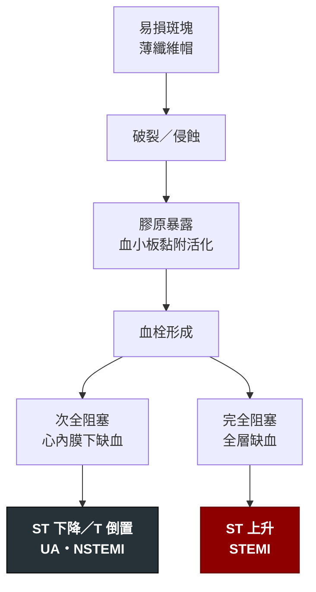
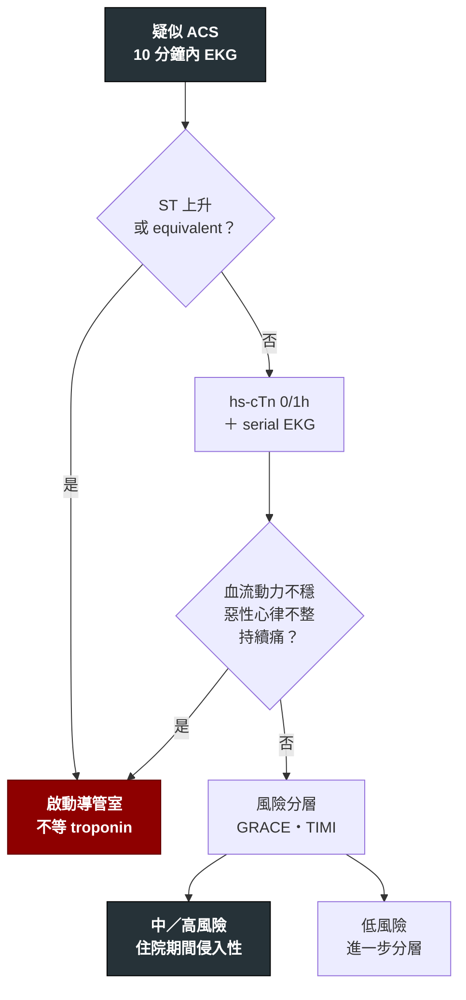

---
tags:
  - Med/Disease/Cardio
  - syndrome
  - 禁忌
aliases:
  - ACS
  - 急性冠心症
  - Acute Coronary Syndrome
  - STEMI
  - NSTEMI
  - NSTE-ACS
  - UA
  - Unstable angina
  - 不穩定心絞痛
  - MI
  - AMI
  - 心肌梗塞
  - 急性心肌梗塞
  - Myocardial Infarction
created: 2026-07-26
updated: 2026-07-26
status: 可用
source: 2025 ACC/AHA/ACEP/NAEMSP/SCAI ACS Guideline (Circulation 2025)；2018 Fourth Universal Definition of MI；2023 ESC ACS Guideline
cssclass: clinical-note
presents_as:
  - "[[Chest pain]]"
  - "[[Dyspnea]]"
  - "[[Shock]]"
diagnosed_by:
  - "[[EKG ischemia]]"
  - "[[Troponin]]"
  - "[[Coronary angiography]]"
treated_by:
  - "[[PCI]]"
  - "[[Antiplatelet]]"
  - "[[Fibrinolytics]]"
  - "[[Statin]]"
differential:
  - "[[Aortic dissection]]"
  - "[[Pulmonary embolism]]"
  - "[[Pericarditis]]"
  - "[[Takotsubo]]"
complication:
  - "[[Shock]]"
  - "[[Heart failure]]"
  - "[[Ventricular tachycardia]]"
  - "[[Cardiac tamponade]]"
---

# ACS ｜ 急性冠心症 · Acute Coronary Syndrome

> [!abstract] 一句話總覽
> 冠狀動脈斑塊**破裂或侵蝕**加上血栓形成的急性事件，是 [[CAD]] 的急性分支。整套處置只圍繞一個問題：**冠狀動脈現在是不是完全塞住？** 是（STEMI 或 STEMI equivalent）→ 立刻通血管，時間就是心肌；不是（NSTE-ACS）→ 抗栓穩住，再依風險決定導管時機。

> [!tip] 30 秒行動卡
> **診斷關鍵**：到院／接觸病人 **10 分鐘內完成 12-lead EKG**。看到 ST 上升或任一 [[EKG ischemia|STEMI equivalent]] → **不等 troponin，直接啟動導管室**。無 ST 上升 → hs-cTn 0/1h ＋ 風險分層（見下方決策樹）。
> **治療骨架**：aspirin 咀嚼 ＋ P2Y12 抑制劑 ＋ 抗凝 ＋ 高強度 [[Statin]] → **STEMI**：primary PCI，first-medical-contact-to-device **≤90 min**；無法達成 → 溶栓 door-to-needle ≤30 min → **NSTE-ACS**：中／高風險住院期間安排侵入性評估
> **絕對不可**：未排除主動脈剝離就給抗栓；下壁／右心室梗塞給硝酸鹽；心因性休克給靜脈 beta blocker；ACS 期間用 NSAID（除 aspirin）

---

## 定義與定位

*這個病是什麼？在分類樹的哪個位置？跟隔壁的病靠什麼分開？*

| 項目 | 重點 |
|---|---|
| 本質 | 斑塊破裂／侵蝕 ＋ 血小板血栓 → **休息時也缺血**（與 CCS 的關鍵分野） |
| 分類位置 | [[CAD]] 的急性分支；旁邊是慢性分支 CCS |
| 內部三分 | UA ／ NSTEMI ／ STEMI——**完整名詞地圖在 [[CAD]]**，不在這裡重抄 |
| 這篇的職責 | **分流與處置**：誰要立刻進導管室、誰可以等、藥怎麼給、之後盯什麼 |

> [!important] 為什麼 UA 與 NSTEMI 合成一篇處理
> 兩者只差 troponin，而 **troponin 不改變初始處置**——抗栓一樣、風險分層工具一樣、導管時機的判斷邏輯一樣。2025 ACC/AHA 也把 STEMI 與 NSTE-ACS 合併成單一份指引。
> 分開背反而會讓你以為要用兩套處置。

## 病因與機制

*為什麼會發生？病生理鏈條長什麼樣？*

> [!info] 「心內膜下 vs 全層」決定了 ST 段方向
> 冠脈血流由外往內灌注，**心內膜是最遠端**——所以次全阻塞先傷心內膜下，心電圖表現為 ST **下降**；完全阻塞造成全層缺血，表現為 ST **上升**。這條機制是 [[EKG ischemia]] 整篇的基礎。

![[assets/subendocardial-ischemia-st-vector.jpg|560]]
*下半圖示心內膜下缺血：缺血侷限內層時，injury vector 的體表投影常表現為 ST depression；圖中把心肌橫切面、細胞外電位、體表投影與 12 導程波形連在一起。Source: [Okada et al., *Cardiovasc Eng Technol* 2020, Figure 2](https://pmc.ncbi.nlm.nih.gov/articles/PMC10717899/)（CC BY 4.0）。*

![[assets/ecg-st-elevation-reciprocal.jpg|760]]
*全層 injury 的方向朝向覆蓋病灶的導程時出現 ST elevation；本例 V1–V4／I／aVL 抬高，III／aVF 出現 reciprocal depression。這是「完全阻塞 → 全層缺血 → ST 上升」的典型對照，但真實臨床仍有 OMI 不達 STEMI 閾值。Source: [Wikimedia Commons — 12 Lead EKG ST Elevation tracing color coded](https://commons.wikimedia.org/wiki/File:12_Lead_EKG_ST_Elevation_tracing_color_coded.jpg)（public domain）。*

## 臨床表現

*典型病人長什麼樣？哪些症狀是幾乎一定有、哪些是提示性的？*

- **典型**：休息時或輕微活動即發生的胸骨後壓迫感，持續 >20 分鐘不緩解，伴冒冷汗、噁心、瀕死感
- **提示性（anginal equivalent）**：新發生的呼吸困難、上腹痛、下巴／頸／肩／背／手臂痛、極度疲倦、單純冒冷汗、突發暈厥
- **少見但重要**：**完全無痛的沉默梗塞**——DM、老年人、女性、CKD、術後、失智者；表現可能只有意識改變、低血壓、心衰或血糖失控

> [!danger] 症狀型態不能用來排除 ACS
> 「痛只有一下」「壓下去會痛」「吃胃藥有效」「硝酸鹽有效」——這些都**不能**排除 ACS。
> 唯一能推翻的是：serial EKG ＋ serial hs-cTn ＋ 臨床風險分數，三者一起。

→ 相關主訴流程：[[Chest pain]]、[[Dyspnea]]（Workup）

## 診斷

*診斷標準是什麼？要開哪些檢查？哪個是 gold standard？*

### 分流決策樹

### 診斷條件

| 診斷條件 | 內容 |
|---|---|
| **心肌梗塞** | troponin **上升／下降**（超過 99th percentile）**＋** 至少一項缺血證據：症狀、新的缺血性 EKG 變化、新 Q 波、影像顯示新的節段運動異常、導管見血栓 |
| **STEMI** | 新出現的 J 點 ST 上升，**≥2 個相鄰導程**：一般導程 ≥1 mm；V2–V3 例外（男 ≥40 歲 ≥2 mm、男 <40 歲 ≥2.5 mm、女性任何年齡 ≥1.5 mm）。閾值細節與 equivalent 清單見 [[EKG ischemia]] |
| **NSTE-ACS** | 符合缺血但無持續 ST 上升。troponin ＋ → NSTEMI；troponin − → UA |

**要開的檢查**：[[EKG ischemia]]（serial，症狀持續時每 15–30 分鐘重做）、[[Troponin]]（0/1h）、[[Echocardiography]]（看 EF、節段運動、併發症、排除 mimics）、[[Coronary angiography]]

> [!warning] 初始 EKG 正常不能排除 ACS
> 左迴旋支與後壁是心電圖的「沉默區」。持續症狀就必須 **serial EKG**，並考慮加做 **V7–V9**（後壁）與 **V4R**（右心室）。

## 鑑別診斷

*要跟誰分清楚？靠什麼分？*

| 要排除的 | 支持它的線索 | 怎麼排除 |
|---|---|---|
| [[Aortic dissection]] | 撕裂痛瞬間到最痛、延伸到背、兩側血壓／脈搏差、新舒張期雜音、縱膈變寬 | CTA。**先排除再抗栓**——最高優先 |
| [[Pulmonary embolism]] | 呼吸困難與低血氧為主、單側下肢腫、右心負荷、S1Q3T3 | CTA；troponin 也可升高 |
| [[Pericarditis]]／心肌炎 | 姿勢與呼吸相關的尖銳痛、摩擦音、廣泛凹型 ST 上升＋PR 段下降、**無對應性 ST 下降** | 見 [[EKG ischemia]] mimics 表；心肌炎 troponin 明顯升高但冠脈通暢 |
| [[Takotsubo]] | 情緒／生理壓力事件後、前壁 ST 上升＋深廣 T 倒置、心尖球狀化、冠脈通暢 | 導管＋超音波；常無法在術前區分 |
| MINOCA | 導管顯示無明顯阻塞（<50%）但確實是 MI | 機制可能是斑塊侵蝕、痙攣、SCAD、栓塞、微血管；需進一步影像 |
| 食道破裂／食道痙攣、氣胸、膽道疾病 | 相應病史與影像 | 見 [[Chest pain]] |

## 治療

*第一線是什麼？什麼情況升級？*

### ① 所有 ACS 的共同基底

| 藥物 | 要點 |
|---|---|
| **Aspirin** | 立刻**咀嚼**負荷劑量（一般 162–325 mg），之後低劑量長期 |
| **P2Y12 抑制劑** | 要做 PCI 者，**ticagrelor 或 prasugrel 優先於 clopidogrel**。若 NSTE-ACS 預計導管 >24 小時後才做，可考慮上游先給 clopidogrel 或 ticagrelor |
| **抗凝** | UFH／enoxaparin／bivalirudin，依再灌流策略選。**fondaparinux 不可用來支持 PCI**（導管內血栓風險，2025 指引列為 Class 3: Harm）——若病人已在用 fondaparinux 而要做 PCI，術中必須追加 UFH |
| **高強度 [[Statin]]** | 所有 ACS，可同時起始 ezetimibe。已用到最大耐受劑量而 LDL-C ≥70 mg/dL → 加非 statin 藥物 |
| **[[Beta blocker]]** | 口服，**無禁忌**時早期起始（見禁忌表） |
| **氧氣** | **只在 SpO₂ <90%** 時給。常規給氧無益甚至有害 |
| **止痛／硝酸鹽** | 硝酸鹽緩解症狀（不改善預後）；嗎啡保留給硝酸鹽無效者，且會延遲 P2Y12 吸收 |

### ② STEMI：再灌流的時間窗

| 情境 | 目標 |
|---|---|
| 院前已辨識 STEMI | 優先直送可做 PCI 的醫院，**first medical contact → device ≤90 分鐘** |
| 已在可做 PCI 的醫院 | **door-to-device（door-to-balloon）≤90 分鐘** |
| 在不可做 PCI 的醫院，預估 FMC→device **≤120 分鐘**，或有溶栓禁忌 | **轉送**做 primary PCI |
| 症狀 <12 小時，但預估 PCI 延遲 **>120 分鐘** | **給溶栓**（無禁忌時），**door-to-needle ≤30 分鐘**，給完立即轉送可做 PCI 的中心 |

> [!info] 每延遲 30 分鐘，一年死亡率的相對風險上升約 7.5%
> 這是為什麼「先驗血、先照 X 光、先等主治醫師回電」都不能成為延遲啟動導管室的理由。aspirin 立刻嚼、導管室平行啟動。

### ③ NSTE-ACS：導管時機由風險決定

| 風險層級 | 判準 | 策略 |
|---|---|---|
| **極高風險** | 血流動力不穩／心因性休克、藥物無法緩解的持續胸痛、致命性心律不整、急性心衰、機械性併發症、反覆動態 ST 變化 | **立即侵入性**（等同 STEMI 處理） |
| **中／高風險** | troponin ＋、動態 ST-T 變化、GRACE 分數偏高、EF 下降、糖尿病、CKD、近期 PCI／CABG 病史 | **住院期間**安排侵入性評估並意圖血管重建（Class 1）；**高風險者於 24 小時內**進行是合理的（Class 2a） |
| **低風險** | 上述皆無 | 常規侵入性或選擇性侵入性（先進一步分層） |

> [!note] 「住院期間」與「24 小時內」是兩件事，不要混
> **Class 1 的「住院期間」回答的是「要不要做」**——中／高風險就該做侵入性評估，而不是先保守觀察。
> **Class 2a 的「24 小時內」回答的是「多快做」**——只針對高風險，而且是「合理」等級，不是強制。
> 2023 ESC 也把高風險的 <24 小時從 Class I **降級為 IIa**，兩份指引在這一點上目前是一致的。真正必須「立刻」的只有上表的極高風險那一列。

### ④ 手術與再灌流的操作要點

| 項目 | 建議 |
|---|---|
| 入路 | **橈動脈優於股動脈**（減少出血、血管併發症與死亡率） |
| 血管內影像 | 複雜病變的 PCI 建議用 IVUS／OCT 導引 |
| 完全血管重建 | STEMI 與 NSTE-ACS **都建議**完全血管重建。STEMI 的非犯罪病變可單次或分階段處理，**傾向單次處理** |
| **心因性休克** | 犯罪血管緊急血管重建；**不建議**同時常規處理非犯罪血管 |
| 機械循環支持 | 選擇性的 AMI 合併心因性休克可考慮微軸流幫浦；出血、肢體缺血、腎衰竭併發症較高 |
| 輸血 | ACS 合併貧血且未活動性出血者，維持 Hb 約 10 g/dL 可能合理 |

### ⑤ 出院後

- **DAPT 預設至少 12 個月**（無高出血風險者）
- 減少出血風險的策略：有腸胃道出血風險 → 加 PPI；已耐受 ticagrelor 的 DAPT → PCI 後 **≥1 個月**可轉為 ticagrelor 單藥；需長期抗凝者 → PCI 後 **1–4 週停 aspirin**，保留 P2Y12（優先 clopidogrel）
- 血脂：起始或調整劑量後 **4–8 週**追空腹血脂
- **心臟復健轉介**（無法或不願到院者可用居家式方案）
- 其他：ACEI／ARB（尤其 EF 下降、DM、高血壓）、EF ≤40% 者評估 MRA 與 [[ICD]]

## 併發症與預後

*住院時要盯什麼？出院後會怎麼樣？*

| 時間 | 併發症 | 線索 |
|---|---|---|
| **最初數小時** | VT／VF、心室早期收縮、心搏過緩與 AV block（**下壁梗塞**常見）、心因性 [[Shock]]、急性心衰／肺水腫 | 持續心律監測；下壁梗塞看有無 AV block |
| **2–7 天**（再灌流時代已少見但致命） | **游離壁破裂** → 心包填塞、電機械分離；**心室中膈破裂** → 新的粗糙全收縮期雜音＋急性右心衰；**乳頭肌斷裂** → 急性重度 MR、突發肺水腫、雜音可能很輕（**後內側乳頭肌**只有單一血流供應，最常斷，多伴下壁梗塞） | 突然的低血壓／新雜音／肺水腫 → **立刻心臟超音波** |
| **數天–數週** | 心室內附壁血栓（大前壁梗塞、EF 低）→ 栓塞；左心室膨大（aneurysm）→ 持續 ST 上升、心衰、心律不整 | 超音波；考慮抗凝 |
| **1–8 週** | **Dressler syndrome**（梗塞後自體免疫性心包炎）：發燒、心包摩擦音、心包積液、發炎指標升高 | 與早期梗塞後心包炎（<1 週、局部）區分 |

- **預後因子**：總缺血時間、梗塞範圍與 EF、Killip 分級（I 無心衰 → IV 心因性休克）、GRACE 分數、年齡、腎功能、是否完成完全血管重建、出院後藥物順從度與 LDL-C 是否達標

> [!danger] 突然變壞的三個機械性併發症要立刻想到
> 梗塞後 2–7 天病人突然低血壓、肺水腫或新雜音 → **游離壁破裂／心室中膈破裂／乳頭肌斷裂**。這三個靠聽診分不開，靠**床邊超音波**，處置是**外科**。

## 禁忌與陷阱

> [!danger] 絕對不可
> | 情境 | 絕對不可 | 為什麼 | 該做什麼 |
> |---|---|---|---|
> | 尚未排除主動脈剝離（不對稱脈搏／血壓、撕裂痛延伸到背、縱膈變寬） | 給抗血小板／抗凝／溶栓 | 剝離擴大、破裂、心包填塞致死 | 先 CTA。剝離波及右冠口會造成下壁 ST 上升，長得就像 STEMI |
> | **下壁梗塞合併右心室梗塞**（V1 或 V4R ST 上升、低血壓＋頸靜脈脹＋肺野乾淨） | 硝酸鹽、大劑量嗎啡、利尿劑 | 右心室依賴前負荷，降前負荷 → 循環崩潰 | **快速輸液**＋必要時 inotrope；避免任何降前負荷的藥 |
> | 24 小時內用過 sildenafil 或 vardenafil／48 小時內用過 tadalafil | 給硝酸鹽 | 協同血管擴張 → 難以矯正的低血壓 | 其他止痛與抗缺血手段，等時間過 |
> | 心因性休克、急性心衰、心搏過緩或高度 AV block | 早期**靜脈** beta blocker | 進一步壓抑心輸出 → 休克惡化 | 穩定後再口服低劑量起始 |
> | 溶栓絕對禁忌（見下方註） | 給 [[Fibrinolytics]] | 顱內出血 | 轉送可做 PCI 的中心，即使超過 120 分鐘 |
> | ACS 急性期與後續 | 使用 NSAID（aspirin 除外）與 COX-2 抑制劑 | 增加死亡、再梗塞、心衰與心肌破裂風險 | 停用；改用 acetaminophen 等替代 |
> | Wellens pattern 或高風險 NSTE-ACS | 安排運動壓力測試 | 可能誘發完全阻塞 | 直接安排侵入性冠脈評估 |
> | 疑似 STEMI | 為了等抽血結果、X 光或會診而延遲啟動導管室 | 每 30 分鐘延遲，一年死亡相對風險 ↑約 7.5% | aspirin 立刻嚼服，導管室**平行**啟動 |
>
> **爭議標記**：古柯鹼相關胸痛「不可用 beta blocker」（理論上未拮抗的 α 使冠脈收縮）在近年文獻已被質疑，但仍是廣泛採用的保守做法。優先給 benzodiazepine ＋ 硝酸鹽 ＋ CCB。

> [!danger] 註：溶栓的**絕對**禁忌
> | 類別 | 項目 |
> |---|---|
> | 顱內 | **任何時間點的顱內出血史**；已知腦血管結構異常（動靜脈畸形）；已知惡性顱內腫瘤（原發或轉移）；**2 個月內的顱內或脊椎手術**；3 個月內明顯的閉合性頭部或臉部外傷 |
> | 中風 | **3 個月內的缺血性中風** |
> | 血管 | **疑似主動脈剝離** |
> | 出血 | 活動性出血或出血體質（不含月經）；3 個月內的顯著出血事件 |
> | 血壓 | **對緊急降壓治療無反應的嚴重高血壓** |
>
> **兩個容易記錯的細節**：
> ① 「3 個月內缺血性中風」的例外是**中風本身發作在 4.5 小時內**——那是把溶栓當成中風的治療，不是 STEMI 的例外通行證。臨床上遇到同時中風與 STEMI，處置遠比背禁忌複雜，直接找神經內科與心臟科。
> ② 「就診時血壓高（SBP >180 或 DBP >110）」屬於**相對**禁忌；升格為絕對禁忌的是**降不下來**那種。
> 相對禁忌（慢性重度高血壓病史、外傷性或長時間 CPR、3 週內大手術、2 週內無法壓迫止血的穿刺、懷孕、活動性消化性潰瘍、正在使用口服抗凝劑）不是不能給，是要權衡——**但只要有絕對禁忌，就是轉送做 PCI，不論延遲多久**。

> [!warning] 常見錯誤
> - 用單一次 troponin 或單一張 EKG 排除 ACS
> - 有 ST 上升卻先等 troponin 結果——**STEMI 不需要 troponin 才能診斷**
> - 忘了加做 V7–V9（後壁）與 V4R（右心室）
> - 沒有調舊 EKG 對照，無法判斷 LBBB／Q 波／ST 上升是不是「新的」
> - 把 aVR ST 上升＋廣泛 ST 下降當成 STEMI 去溶栓（它是高風險，但**不是** STEMI equivalent；見 [[EKG ischemia]]）
> - troponin 升高就給雙抗，沒有先問「這是 Type 1 還是 Type 2」（見 [[CAD]]）
> - 上腹痛的病人直接當胃病開 PPI，沒做 EKG

## 相關連結

- [[CAD]] — 名詞地圖（CCS／UA／NSTEMI／STEMI）、MI 五個 Type、慢性期處置
- [[EKG ischemia]] — ST 上升閾值、梗塞定位、**STEMI equivalent 與 mimics 完整清單**
- [[Troponin]] — 0/1h algorithm、心肌損傷 vs 心肌梗塞、非 ACS 升高原因
- [[Chest pain]] — 主訴層的 can't-miss 與到床邊的前 5 分鐘
- [[PCI]]、[[Fibrinolytics]]、[[Antiplatelet]]、[[Shock]]、[[ICD]]
