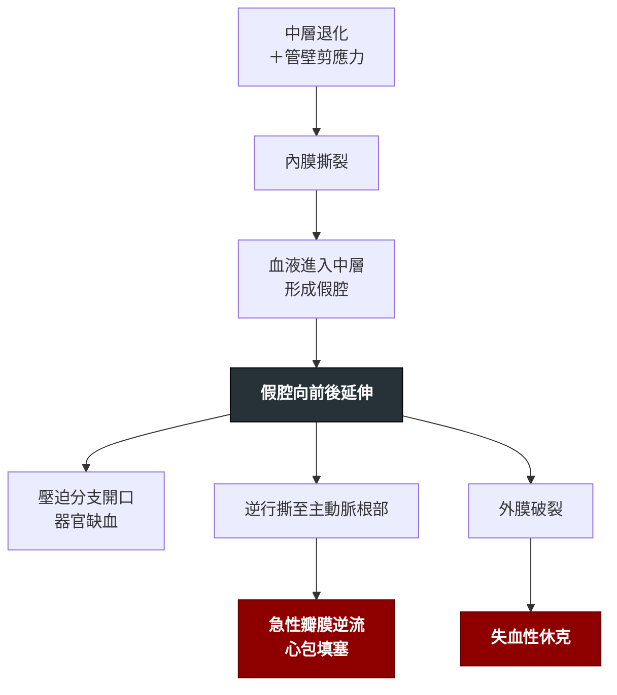

---
tags:
  - Med/Disease/Cardio
  - aortopathy
  - emergency
  - 禁忌
aliases:
  - AD
  - AAD
  - 主動脈剝離
  - 急性主動脈剝離
  - Acute aortic dissection
  - Aortic Dissection
  - Stanford A
  - Stanford B
  - DeBakey
created: 2026-07-27
updated: 2026-07-27
status: 可用
source: 114-1 醫學(三) 5、114-2 醫學(三) 74 延伸；2022 ACC/AHA 主動脈疾病指引；Harrison's
cssclass: clinical-note
presents_as:
  - "[[Chest pain]]"
  - "[[Shock]]"
diagnosed_by:
  - "[[Chest CT]]"
  - "[[Echocardiography]]"
treated_by:
  - "[[Beta blocker]]"
differential:
  - "[[ACS]]"
  - "[[Pulmonary embolism]]"
  - "[[Cardiac tamponade]]"
complication:
  - "[[Cardiac tamponade]]"
  - "[[Shock]]"
  - "[[ACS]]"
---

# Aortic dissection ｜ 主動脈剝離 · Aortic Dissection

> [!abstract] 一句話總覽
> 主動脈內膜撕裂後，血液衝進中層形成**假腔**並沿血管縱向延伸——所有臨床表現都只是「**假腔壓迫或撕斷了哪一條分支**」。分型只問一件事：**有沒有侵犯升主動脈？** 有（Stanford A）→ 緊急外科；沒有（Stanford B）→ 先把心率與血壓壓下來。

> [!tip] 30 秒行動卡
> **診斷關鍵**：突發、**發作瞬間就衝到最痛**的胸／背撕裂痛 ＋ 兩臂收縮壓差 ＞20 mmHg 或新出現的舒張期雜音 → **胸主動脈一律做 CTA**；血行動力不穩、不能離開急診 → 床邊 **TEE**
> **治療骨架**：止痛 → **先靜脈 β-blocker 把心率壓到 60 bpm 附近，再加血管擴張劑把收縮壓降到 <120 mmHg（順序不可顛倒）** → Stanford A **一律緊急外科**；Stanford B 無併發症先藥物、有併發症才介入（TEVAR）
> **絕對不可**：先給純血管擴張劑（反射性心搏過速會加速撕裂）；未排除剝離就抗凝／溶栓；A 型合併填塞時做大量心包穿刺

---

## 定義與定位

*這個病是什麼？在分類樹的哪個位置？跟隔壁的病靠什麼分開？*

內膜撕裂後，血液進入主動脈**中層**，真腔與假腔並存並沿血管**縱向延伸**。高峰 60–70 歲、男性居多；**40 歲以下發病要往遺傳性主動脈病變想**。它是「急性主動脈症候群」三兄弟之一——**典型剝離**、**壁內血腫（IMH, intramural hematoma）**、**穿透性主動脈潰瘍（PAU, penetrating atherosclerotic ulcer）**；三者的分型原則與急性處置骨架相同。**時間軸**：超急性 ＜24 小時｜急性 1–14 天｜亞急性 15–90 天｜慢性 ＞90 天。

## 分型

*分型直接決定「開不開刀」，所以要先分型再談別的。*

| 項目 | **Stanford A** | **Stanford B** |
|---|---|---|
| 定義 | **侵犯升主動脈**（不論撕裂起點在哪） | 只侵犯左鎖骨下動脈開口**以遠**，升主動脈未受累 |
| 對應 DeBakey | **I**：起於升主動脈、延伸過弓部到降主動脈以下；**II**：**侷限在升主動脈** | **III**：起於左鎖骨下動脈以遠；**IIIa** 止於橫膈以上、**IIIb** 延伸到橫膈以下 |
| 比例 | 約 **2/3** | 約 **1/3** |
| 疼痛位置傾向 | 較常在**前胸** | 較常在**背部／肩胛間** |
| 招牌併發症 | 心包填塞、急性主動脈瓣逆流（AR, aortic regurgitation）、冠脈受累、中風 | 腸缺血、腎缺血、下肢缺血、截癱 |
| 處置 | **緊急外科手術** | 無併發症先藥物；有併發症才介入 |

> [!important] 分型只問「有沒有侵犯升主動脈」
> **不是問撕裂起點在哪。** 起點在降主動脈、但逆行撕到升主動脈 → 仍然是 **Stanford A**，仍然要開刀。
> 這一句可以解掉所有分型題，也解釋了為什麼 DeBakey I 與 II 都歸在 Stanford A。

![[assets/aortic-dissection-classification.jpg|760]]
*Stanford 看「升主動脈有沒有受累」；DeBakey 則同時考慮起點與延伸範圍。圖中 I、II 都屬 Stanford A，IIIa／IIIb 都屬 Stanford B；B 型的近端界線在左鎖骨下動脈開口遠端。Source: [Chung et al., *Eur Heart J Cardiovasc Imaging* 2024, Figure 1](https://pmc.ncbi.nlm.nih.gov/articles/PMC11442778/)（CC BY 4.0）。*

## 病因與機制

> [!tip] 一句話推出全部處置
> **撕裂會不會繼續延伸，取決於左心室射血打在內膜上的剪應力（dP/dt），不是單純的血壓數字。**
> 所以：心率↓、收縮力↓、血壓↓ 三者都是好事；任何讓心跳變快的動作都是壞事。這句話直接推出「為什麼要先給 β-blocker」。

![[assets/aortic-dissection-branch-malperfusion.jpg|760]]
*分支灌流不良的兩種機制：static obstruction 是剝離延伸進分支、即使壓力改變仍狹窄；dynamic obstruction 是假腔壓力把 intimal flap 推向分支開口而間歇阻塞。臨床上同一機制可發生在冠脈、頭臂、肋間、腸繫膜、腎與髂動脈。Source: [Zhang et al., *Insights Imaging* 2025, Figure 12](https://pmc.ncbi.nlm.nih.gov/articles/PMC12570746/)（CC BY-NC-ND 4.0）。*

## 危險因子

| 類別 | 具體項目 | 備註 |
|---|---|---|
| **血流動力** | **高血壓**（最重要，IRAD／International Registry of Acute Aortic Dissection 中約 **7 成**病人有）；**古柯鹼**、安非他命等擬交感神經藥 | 古柯鹼是年輕病人一定要問的一條病史 |
| **主動脈結構異常** | **雙葉主動脈瓣**（見 [[Bicuspid aortic valve]]）、既有胸主動脈瘤、主動脈狹窄（coarctation）、Turner syndrome | 雙葉瓣的主動脈病變**獨立於瓣膜狹窄的嚴重度**，瓣膜不狹窄也會有 |
| **遺傳性結締組織病** | **Marfan syndrome**（FBN1）、**血管型 Ehlers–Danlos**（COL3A1）、Loeys–Dietz syndrome、家族性胸主動脈瘤／剝離 | 見 [[Marfan syndrome]] |
| **發炎性主動脈炎** | Takayasu 動脈炎、巨細胞動脈炎、梅毒性主動脈炎 | |
| **醫源性／外傷** | 心導管與主動脈內器械操作、主動脈內氣球幫浦、心臟手術、高速減速傷 | |
| **生理狀態** | **懷孕**：多集中在**第三孕期、生產過程與產後數週至 3 個月內** | 血量、心輸出與荷爾蒙對管壁的作用同時上升 |

> [!note] 年輕病人的紅旗
> **40 歲以下的剝離，要主動想 Marfan syndrome 與其他遺傳性結締組織疾病**——找體徵、問家族史。年輕族群中遺傳性主動脈病變的佔比在不同世代與族裔差異不小，記方向比記數字安全。

## 臨床表現

*典型病人長什麼樣？哪些症狀是幾乎一定有、哪些是提示性的？*

- **典型**：**突發、發作瞬間即達到最痛**的胸痛或背痛，性質為撕裂樣、刀割樣。「痛在幾秒內衝到頂點」比「痛的性質」更有鑑別力
- **提示性**：疼痛**會遷移**（代表撕裂正在延伸）、就診時嚴重高血壓、冒冷汗、強烈瀕死感
- **少見但重要**：**完全不痛**（約 **5%**），改以暈厥、中風、突發下肢無力、腹痛或休克表現——這一群最容易被延誤

> [!important] 疼痛位置只是「傾向」，不是規則
> 前胸痛較常對應升主動脈（A 型）、肩胛間背痛較常對應降主動脈（B 型）；但兩者可以並存，也會隨撕裂延伸而遷移。**決定嚴重度的是解剖分型與有沒有併發症，不是痛在前面還是後面**——不要把「背痛比前胸痛更危險」記進去，**A 型（較常前胸痛）才是死亡率最高、必須立刻開刀的一群。**

→ 相關主訴流程：[[Chest pain]]（Workup）

## 撕到哪裡，就出現哪個併發症

*剝離的每一個併發症都只是「假腔壓迫或撕斷了某一條分支」——把分支列一遍，表現就推得出來，不必背。*

| 受累的分支／結構 | 臨床表現 | 床邊怎麼抓 |
|---|---|---|
| **冠狀動脈開口**（**右冠最常見**） | **急性心肌梗塞，以下壁居多** | 心電圖下壁 ST 上升——**與單純 STEMI 無法區分**（見 [[EKG ischemia]]） |
| **主動脈瓣環** | 急性主動脈瓣逆流 → 急性肺水腫、心因性休克 | **新出現的舒張期漸弱雜音**（IRAD：A 型約 **44%**） |
| **心包腔**（逆行破入） | 心包積血 → **心包填塞** | 頸靜脈怒張＋低血壓＋心音遙遠（Beck 三徵）；見 [[Cardiac tamponade]] |
| **無名動脈／左總頸動脈** | **中風**、意識改變 | 突發局部神經學缺損＋胸背痛 |
| **無名動脈／左鎖骨下動脈** | **單側上肢脈搏減弱或消失** | **兩臂收縮壓差 ＞20 mmHg** |
| **脊髓動脈**（肋間動脈、Adamkiewicz） | 脊髓缺血 → **下肢癱瘓**、感覺平面 | 突發截癱＋背痛（很容易被當成脊椎問題） |
| **腸繫膜動脈** | **腸缺血** | 腹痛程度遠大於理學檢查發現、乳酸上升 |
| **腎動脈** | **急性腎損傷**、腎梗塞、頑固性高血壓 | 少尿、Cr 上升、腰痛、血尿（會像腎絞痛） |
| **髂／股動脈** | 下肢缺血 | 下肢脈搏消失、蒼白冰冷 |
| **喉返神經／交感神經鏈**（局部壓迫） | 聲音沙啞、Horner syndrome | 少見但很有指向性 |
| **外膜破裂** | 破入心包／左胸腔／縱膈 → 失血性休克 | 突然的低血壓；見 [[Shock]] |

> [!danger] 這張表最致命的一格
> **剝離撕到右冠開口 → 下壁 ST 上升，心電圖長得跟 STEMI 一模一樣。**
> 此時若當成單純 [[ACS]] 給溶栓或雙抗，會造成致命出血。**溶栓的絕對禁忌之一就是「疑似主動脈剝離」。**

## 理學檢查

| 項目 | 意義 | 一定要知道的但書 |
|---|---|---|
| **四肢血壓（至少兩側上肢一起量）＋脈搏對稱性** | 兩臂收縮壓差 **＞20 mmHg** 或脈搏短絀（pulse deficit）提示分支受累 | **出現率低**（IRAD 整體約 **15%**）；**沒有壓差完全不能排除剝離** |
| **新出現的舒張期漸弱雜音**（AR） | 撕到瓣環，提示 **A 型** | 急性 AR 的雜音**又短又輕**，很容易漏聽；也常沒有慢性 AR 的寬脈壓，見 [[Cardiac auscultation]] |
| 頸靜脈怒張 ＋ 低血壓 ＋ 心音遙遠 | **心包填塞** | 剝離情境下看到頸靜脈怒張，**先想填塞**，不是上腔靜脈症候群 |
| 神經學檢查 | 中風、截癱、Horner syndrome、聲音沙啞 | 別把突發截癱只當脊椎問題 |
| 血壓 | 多數為高血壓 | **低血壓要立刻想到填塞、破裂或重度 AR**；也要排除**假性低血壓**——量到的那隻手正好是被撕到的分支 |

## 診斷

### 影像選擇

| 工具 | 最擅長 | 盲點／限制 | 什麼時候用 |
|---|---|---|---|
| **CTA**（computed tomography angiography） | 全段主動脈；看得到內膜瓣、真假腔、壁內血腫、分支受累與破裂徵象；**測直徑最準**、快速可及 | 輻射、顯影劑腎損傷；病人必須能離開急診 | **穩定病人一律首選**（見 [[Chest CT]]） |
| **TEE**（transesophageal echocardiography） | 升主動脈近端、胸降主動脈、心包積液、AR 嚴重度；**床邊就能做** | **主動脈弓遠端有氣管遮擋的死角**；看不到腹主動脈；需鎮靜 | **血行動力不穩、不能搬離急診或開刀房**的病人 |
| **MRA**（magnetic resonance angiography） | 影像品質最佳、**無輻射** | 慢、可及性差、掃描中難以監測與急救 | **穩定病人的長期追蹤**；年輕人與需反覆追蹤者 |

> [!warning] 「超音波看不到主動脈」是錯的——錯在種類與部位
> 體表（經胸／經腹）超音波被肺內空氣與胸骨、肋骨擋住，**看不好主動脈弓與胸降主動脈**；它真正擅長的是**腹主動脈**（腹主動脈瘤篩檢的首選就是腹部超音波）。要在床邊看胸段，就把探頭放進食道——這就是 **TEE**。同一句敘述換一個工具或換一個部位，對錯就會翻面。**TTE**（transthoracic echocardiography）在剝離情境的角色是床邊第一時間找**心包填塞與 AR**，**不能用來排除剝離**（見 [[Echocardiography]]）。

### 胸部 X 光可能看到什麼

| 徵象 | 內容 |
|---|---|
| **縱膈腔變寬** | 最常被提到的一項；但敏感度不足以拿來排除 |
| **calcium sign（鈣化分離徵）** | 內膜的鈣化被假腔往內推，與主動脈外緣明顯分開。**特異但不常見** |
| 其他提示性徵象 | 主動脈輪廓異常、aortic knob 模糊、氣管或鼻胃管走向向右偏移；**左側胸腔積液**（血液滲漏到左側胸腔） |

> [!warning] X 光是「確認不了，也排除不了」的工具
> **胸部 X 光正常完全不能排除主動脈剝離。** 同理，「輕微的主動脈擴張常可由一般胸部或腹部 X 光發現」是把靈敏度講得太樂觀——要到明顯擴張才看得出縱膈變寬或輪廓異常。

### D-dimer 的角色

> [!note] 只能用來「往下拿掉」，不能用來確診
> - 假腔內大量血栓形成，D-dimer 常明顯升高；對急性主動脈症候群**敏感度高、但特異度很差**——肺栓塞、感染、術後、癌症、懷孕都會升高。切點的單位（FEU vs DDU）各實驗室不同，看報告時要確認
> - **ADD-RS（Aortic Dissection Detection Risk Score）三個面向各給 1 分，總分 0–3**：① **高危病史**（Marfan／結締組織病、家族主動脈疾病史、已知主動脈瓣疾病或胸主動脈瘤、近期主動脈操作）② **高危疼痛特徵**（突發、劇烈、撕裂／刀割樣，胸、背或腹痛皆算）③ **高危理學發現**（脈搏差或兩側血壓差、局部神經學缺損、新出現的 AR 雜音、低血壓或休克）。**2–3 分直接送影像；1 分若找不到其他解釋就儘快送影像**
> - 唯一被前瞻驗證的排除規則：**ADD-RS ≤1 且 D-dimer ＜500 ng/mL（FEU）可以安全排除**；但**臨床高度懷疑時，D-dimer 陰性不可用來取消 CTA**——壁內血腫、短節段或已血栓化的剝離都可能不升高

![[assets/aortic-dissection-true-false-lumen.jpg|760]]
*CTA 軸切的多種真假腔外觀：線狀 intimal flap 將管腔分成 T（true lumen）與 F（false lumen）。真腔常較小、較早顯影；假腔常較大、顯影較慢，但不能只靠大小判斷，仍要沿序列追蹤分支連續性與入口。Source: [Zhang et al., *Insights Imaging* 2025, Figure 10](https://pmc.ncbi.nlm.nih.gov/articles/PMC12570746/)（CC BY-NC-ND 4.0）。*

## 鑑別診斷

| 要排除的 | 支持它的線索 | 怎麼排除 |
|---|---|---|
| [[ACS]] | 疼痛**逐漸**加重而非瞬間到頂、有典型冠心症危險因子、troponin 呈動態上升 | **兩者可以並存**——A 型撕到冠脈開口本身就是 MI。只要有撕裂痛、兩臂血壓差、新雜音或縱膈變寬，**先 CTA 再抗栓** |
| [[Pulmonary embolism]] | 呼吸困難與低血氧為主、單側下肢腫、右心負荷徵象 | 兩者 D-dimer 都會升高；**CTA 一次可以分開** |
| [[Cardiac tamponade]]（非剝離原因） | 病史不同；處置完全不同 | 超音波看到心包積液後，**一定要再找有沒有內膜瓣與升主動脈擴大** |
| 食道破裂（Boerhaave） | 劇烈嘔吐後、皮下氣腫、縱膈氣腫 | 胸部 CT／食道攝影 |
| 急性心包炎、氣胸、腸繫膜缺血、腎絞痛 | 各自的線索 | 見 [[Chest pain]] |

## 治療

### 藥物：順序本身就是治療

| 步驟             | 藥物                                                                                             | 目標                             | 為什麼                                 |
| -------------- | ---------------------------------------------------------------------------------------------- | ------------------------------ | ----------------------------------- |
| **① 止痛**       | 靜脈嗎啡                                                                                           | 讓病人不痛、不躁動                      | 痛與焦慮 → 交感興奮 → 心率血壓上升。止痛本身就是在降 dP/dt |
| **② 先降心率**     | 靜脈 **[[Beta blocker]]**：**esmolol**（超短效，可隨時停掉，最適合待手術者）、**labetalol**（兼具 α 阻斷，降壓也有效）、metoprolol | **心率壓到 60 bpm 附近**             | 真正把主動脈撕開的是左心室射血的**剪應力 dP/dt**       |
| **③ 再降血壓**     | 血管擴張劑：**nicardipine**、**nitroprusside**、clevidipine                                            | **收縮壓 ＜120 mmHg**，或維持器官灌流的最低血壓 | β-blocker 已經上了，此時擴張血管才不會反射性心搏過速     |
| β-blocker 有禁忌時 | 靜脈CCB：**verapamil、diltiazem**                                                                  | 同上                             | 例如嚴重氣喘。**不是跳過降心率這一步**               |

> [!note] 要記的是順序，不是數字
> 2022 ACC/AHA 寫「心率 60–80 bpm、收縮壓 ＜120 mmHg（或維持末梢灌流的最低血壓）」，許多教科書與臨床習慣寫「心率 ＜60」——兩者要求的是同一件事：**先把 dP/dt 壓下來**。實務上壓到 60 附近即可，**真正不可動搖的是順序。**

### 手術與介入

| 分型 | 處置 |
|---|---|
| **Stanford A** | **一律緊急外科手術**：升主動脈置換 ± 主動脈瓣或根部處理 ± 弓部重建。**藥物只是送進開刀房前的橋接，不是治療** |
| **Stanford B（無併發症）** | **藥物治療為主**：控制心率與血壓、止痛、密切影像追蹤 |
| **Stanford B（有併發症）** | **介入，以 TEVAR（thoracic endovascular aortic repair）優先**。併發症指：破裂、分支阻塞造成器官或肢體缺血（malperfusion）、剝離持續延伸、主動脈進行性擴大、**頑固疼痛**、**藥物無法控制的高血壓** |
| **長期** | 終生嚴格血壓控制（**長期口服 β-blocker**）、戒菸、定期影像追蹤（CTA 或 MRA）、遺傳性主動脈病變者做**家族篩檢** |

> [!info] 2022 指引對「無併發症 B 型」的新意
> 對**解剖條件合適**的無併發症急性 B 型剝離，2022 ACC/AHA 認為 TEVAR **可能有益**，著眼於降低後續主動脈重塑不良與晚期事件。但**無併發症 B 型的初始處置仍然是藥物治療**——TEVAR 在這一群是可考慮的加值選擇，不是第一線。

## 併發症與預後

| 時間 | 要盯什麼 |
|---|---|
| **最初數小時（最危險）** | 心包填塞、外膜破裂、急性重度 AR 與肺水腫、冠脈受累造成的 MI、中風、器官與肢體缺血 |
| **住院期間** | 頑固疼痛或血壓失控（＝撕裂還在進展）、急性腎損傷、脊髓缺血（尤其胸主動脈手術或 TEVAR 後）、術後出血與感染 |
| **長期** | 假腔持續灌流 → **主動脈進行性擴大與晚期破裂**、吻合處或殘餘剝離處新生動脈瘤、需再次手術 |

- **死亡率的方向**：未治療的 A 型在最初 **24–48 小時每小時死亡約 1–2%**，不開刀的 30 天死亡率極高；手術能大幅降低死亡率，但術後仍有相當死亡率——**A 型不開刀就是等死**。藥物治療的 B 型住院／30 天死亡率約 **10%**，真正「無併發症」的次族群更低
- **預後因子**：分型與是否及時手術、有無填塞／休克／器官缺血、年齡、腎功能、假腔是否持續灌流

## 禁忌與陷阱

> [!danger] 絕對不可
> | 情境 | 絕對不可 | 為什麼 | 該做什麼 |
> |---|---|---|---|
> | 疑似或確診急性主動脈剝離 | **先給純血管擴張劑**（nitroprusside、hydralazine、單獨的硝酸鹽）而尚未上 β-blocker | 後負荷驟降 → **反射性心搏過速** → dP/dt 上升 → **撕裂加速延伸** | **順序固定：先 β-blocker 把心率壓下來，再加血管擴張劑** |
> | 胸痛尚未排除剝離（撕裂痛、兩臂血壓差、新舒張期雜音、縱膈變寬） | 給溶栓劑、抗凝、雙抗 | 剝離擴大、破裂、心包積血，直接致死 | **先做 CTA。**「疑似主動脈剝離」是溶栓的**絕對**禁忌 |
> | A 型撕到右冠開口、心電圖呈**下壁 ST 上升** | 當成單純 STEMI 立刻溶栓或給雙抗 | 同上，而且這是臨床上最容易發生的致命誤判 | 先問撕裂痛、兩臂血壓、新雜音、縱膈——任一項可疑就先影像 |
> | A 型剝離合併**心包填塞** | 為了「先把血壓拉起來」而做**大量**心包穿刺引流 | 心包壓力被抽掉 → 血壓回升 → **撕裂與再出血加速** → 電機械分離 | **直送開刀房。** 真的撐不到手術（PEA 或頑固低血壓）才做**受控引流**：只抽到剛好恢復灌流就停 |
> | 剝離病人合併重度 AR 或低血壓 | 放**主動脈內氣球幫浦（IABP）** | 導引鋼絲與氣球可能進入假腔、擴大撕裂；同時會加重主動脈瓣逆流 | 直接送外科；升壓靠藥物橋接 |
> | β-blocker 有禁忌（如嚴重氣喘） | 因此**跳過降心率**、直接給血管擴張劑 | 反射性心搏過速，等於做了最不該做的事 | 改用靜脈 **verapamil／diltiazem** 降心率，再降血壓 |
> | 血行動力不穩、無法搬離急診的疑似剝離 | 硬推去做 MRA，或勉強長距離搬運 | 途中失去監測與急救能力 | 床邊 **TEE** |
> | 已知或高度疑似剝離 | 讓病人下床、用力解便、憋氣、劇烈搬動 | 血壓與 dP/dt 瞬間飆高 | 絕對臥床、確實止痛與鎮靜、避免 Valsalva |

> [!warning] 常見錯誤
> - 用「兩臂血壓沒有差、脈搏對稱」排除剝離；或只量一隻手的血壓——量到的那隻手可能正好是被撕到的分支，造成**假性低血壓**
> - 用單獨的 D-dimer 陰性、或胸部 X 光正常就放心——兩者都**不能排除**剝離
> - 剝離病人出現頸靜脈怒張，想成上腔靜脈症候群——**先想心包填塞**
> - 分型時去記「撕裂起點在哪」（**只問有沒有侵犯升主動脈**）；以為體表超音波可以評估主動脈弓與胸降主動脈（那是 **TEE** 的守備範圍）
> - 忘了問古柯鹼、安非他命與懷孕，也忘了在年輕病人身上找 Marfan 的體徵
> - 把「無併發症的 B 型」直接送去做 TEVAR——第一線仍然是藥物

## 相關連結

- [[ACS]] — 最危險的雙向誤判：剝離撕到右冠會長得像下壁 STEMI，而未排除剝離就抗栓會致命
- [[Chest pain]] — 主訴層的 can't-miss 清單與到床邊的前 5 分鐘
- [[Cardiac tamponade]]、[[Shock]] — A 型最常見的致死機轉；剝離造成的填塞處置與其他填塞完全不同，而破裂、填塞、重度 AR 三條路最後都走到休克
- [[Chest CT]]、[[Echocardiography]] — CTA 的技術條件（ECG-gating）與判讀重點；TEE 與 TTE 各自的守備範圍與死角
- [[Beta blocker]] — esmolol／labetalol 的選擇、劑量與禁忌
- [[Marfan syndrome]]、[[Bicuspid aortic valve]] — 兩個最常考的結構性危險因子
