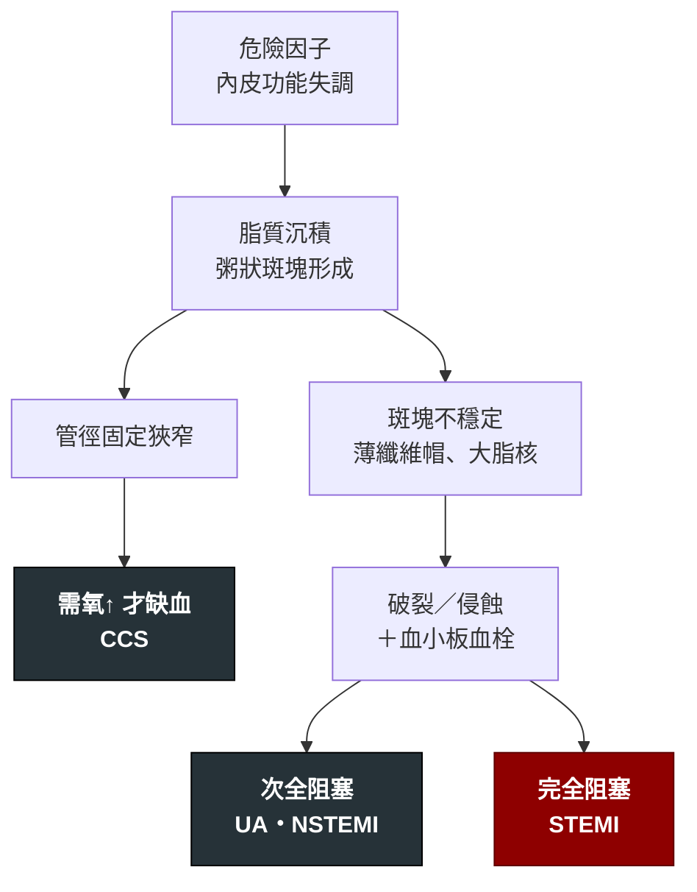

---
tags:
  - Med/Disease/Cardio
  - atherosclerosis
  - 禁忌
aliases:
  - CAD
  - CHD
  - IHD
  - 冠狀動脈疾病
  - 缺血性心臟病
  - Coronary Artery Disease
  - Ischemic Heart Disease
  - CCS
  - Chronic Coronary Syndrome
  - Stable angina
  - 穩定型心絞痛
  - 心絞痛
created: 2026-07-26
updated: 2026-07-26
status: 可用
source: 2025 ACC/AHA/ACEP/NAEMSP/SCAI ACS Guideline；2018 Fourth Universal Definition of MI；2023 AHA/ACC Chronic Coronary Disease Guideline；Harrison's
cssclass: clinical-note
presents_as:
  - "[[Chest pain]]"
  - "[[Dyspnea]]"
diagnosed_by:
  - "[[EKG ischemia]]"
  - "[[Troponin]]"
  - "[[Stress test]]"
  - "[[Coronary angiography]]"
treated_by:
  - "[[Antiplatelet]]"
  - "[[Statin]]"
  - "[[Beta blocker]]"
  - "[[Nitrates]]"
  - "[[PCI]]"
differential:
  - "[[Aortic dissection]]"
  - "[[Pulmonary embolism]]"
  - "[[Pericarditis]]"
  - "[[HCM]]"
  - "[[Aortic stenosis]]"
complication:
  - "[[ACS]]"
  - "[[Heart failure]]"
  - "[[Sudden cardiac death]]"
---

# CAD ｜ 冠狀動脈疾病 · Coronary Artery Disease

> [!abstract] 一句話總覽
> 冠狀動脈粥狀硬化造成**心肌氧氣供需失衡**。CAD 是**解剖／病理**名詞，本身不是一個臨床事件——它會分岔成兩條完全不同的臨床路線：**斑塊穩定、狹窄固定 → 慢性冠心症（CCS）**；**斑塊破裂／侵蝕加上血栓 → 急性冠心症（[[ACS]]）**。這兩條路的處置急迫性差了一個數量級。

> [!tip] 30 秒行動卡
> **診斷關鍵**：先回答「**這是急性事件嗎**」，不是「他有沒有 CAD」。有胸痛 → 10 分鐘內 [[EKG ischemia|12-lead EKG]] ＋ [[Troponin|hs-cTn]]。有急性事件 → 走 [[ACS]]；沒有 → 才談 pretest probability 與壓力測試。
> **治療骨架**（CCS）：抗血小板（aspirin）＋ 高強度 [[Statin]] ＋ 控制危險因子 → 抗心肌缺血藥（[[Beta blocker]]／CCB／[[Nitrates]]）→ 藥物無法控制症狀或高風險解剖 → [[PCI]]／CABG
> **絕對不可**：懷疑急性事件（不穩定症狀、動態 EKG 變化、troponin 上升）時安排**運動壓力測試**；血管痙攣性心絞痛單獨用 beta blocker

---

## 定義與定位

*這個病是什麼？在分類樹的哪個位置？跟隔壁的病靠什麼分開？*

| 項目 | 重點 |
|---|---|
| 本質 | 冠狀動脈內膜**粥狀硬化斑塊** → 管徑狹窄或急性血栓阻塞 → 心肌缺血 |
| 好發族群 | 年齡、男性、抽菸、DM、高血壓、高血脂、早發 CAD 家族史、CKD、慢性發炎疾病 |
| 分類位置 | 缺血性心臟病的主幹；旁邊還有**非粥狀硬化**的缺血原因（血管痙攣、SCAD、栓塞、微血管病變） |
| 分岔判準 | **斑塊有沒有破裂**——沒破 → CCS（勞動時才缺血）；破了 → [[ACS]]（休息也缺血） |

### 名詞地圖：這一節就是為了解決混亂

> [!important] 三分法不是嚴重度分級，是由兩條**獨立軸**決定的
> **軸一：心肌有沒有壞死** → 看 [[Troponin]]
> **軸二：冠狀動脈是不是急性完全阻塞** → 看 [[EKG ischemia|EKG 有無持續 ST 上升]]

| | 機制 | Troponin | 持續 ST 上升 | 決策後果 |
|---|---|---|---|---|
| **CCS**（stable angina） | 固定狹窄，**需氧↑** 才缺血 | − | − | 門診：藥物＋危險因子；擇期評估 |
| **UA**（不穩定心絞痛） | 斑塊破裂＋**次全**阻塞，休息也缺血 | **−** | − | 住院抗栓、風險分層後導管 |
| **NSTEMI** | 同 UA，但**已有壞死** | **＋** | − | 與 UA 相同（合稱 NSTE-ACS） |
| **STEMI** | 斑塊破裂＋**完全**阻塞 → 全層缺血 | ＋ | **＋** | **立刻再灌流**（見 [[ACS]]） |

> [!warning] 三個要改掉的直覺
> **① UA 與 NSTEMI 只差 troponin，初始處置完全一樣。** 用了高敏感度 troponin 之後，UA 已經萎縮成很小的類別——過去驗不出來的多數現在就是 NSTEMI。
> **② NSTEMI vs STEMI 不是「小心梗 vs 大心梗」**，是「**現在要不要立刻通血管**」的分流標籤。有些 NSTEMI 的心肌損失比小面積 STEMI 大。
> **③ EKG 的 ST 上升只是「有沒有急性完全阻塞」的代理指標**，會漏也會假陽性。這就是 **STEMI equivalent** 與 **STEMI mimics** 存在的理由，也是 OMI／NOMI（occlusion MI）這個新框架的出發點——完整清單在 [[EKG ischemia]]。

### 心肌梗塞的五個 Type：機制分類，不是嚴重度

| Type | 機制 | 處置方向 |
|---|---|---|
| **1** | 粥狀硬化斑塊破裂／侵蝕 ＋ 血栓 | 抗栓 ＋ 再灌流（＝一般說的「心肌梗塞」） |
| **2** | **供需失衡**，無急性斑塊事件：快速心律不整、嚴重貧血、休克／低血壓、敗血症、高血壓危症、血管痙攣 | **治病因**，不是 DAPT ＋ 導管 |
| 3 | 疑似缺血症狀／心電圖變化後猝死，來不及驗生化 | — |
| 4a／4b／4c | [[PCI]] 相關／支架血栓／支架再狹窄 | 依情境 |
| 5 | CABG 相關 | 依情境 |

> [!danger] Type 2 是最常被誤處理的一格
> 敗血症或心房顫動快心律的病人 troponin ＋，若直接當 Type 1 給雙抗＋抗凝，出血風險上升而根本病因沒解決。
> 判準：**有沒有急性血栓性阻塞的證據**（症狀型態、動態 EKG、導管所見），而不是「troponin 有沒有高」。

> [!note] Troponin 升高 ≠ 心肌梗塞
> **心肌損傷（myocardial injury）**＝troponin 超過 99th percentile。
> **心肌梗塞（MI）**＝心肌損傷 ＋ **缺血的臨床證據**（症狀／新的缺血性 EKG 變化／新 Q 波／影像顯示新的節段運動異常／導管見血栓）。
> 完整的非 ACS 升高原因表在 [[Troponin]]。

## 病因與機制

*為什麼會發生？病生理鏈條長什麼樣？*

> [!info] 「狹窄程度」與「會不會梗塞」關聯沒你想的強
> **斑塊的組成（脂核大小、纖維帽厚薄、發炎程度）比管徑百分比更能預測破裂**。這解釋兩件臨床現象：**壓力測試正常不代表不會心梗**；**支架處理狹窄能改善症狀，但對預防未來梗塞的效果遠不如 statin ＋ 抗血小板**。
>
> **爭議標記**：教科書常說的「多數心梗來自狹窄 <50% 的斑塊」出自 1980–90 年代的序列血管攝影研究，近年被質疑——那些研究的基準攝影與事件之間隔太久（輕度病灶在期間會長大），較新的系列發現多數犯罪病灶在事件前已 ≥50%。
> 站得住腳的說法是**族群層次**的：輕度斑塊的**數量遠多於**重度狹窄，所以絕對數上貢獻不少事件；但**單一輕度病灶**的破裂風險其實低於重度病灶。引用時要分清楚是在講哪一個層次。

![[assets/stable-vulnerable-plaque.jpg|760]]
*由左至右：正常血管、穩定斑塊（厚纖維帽、小脂質核心）、易損斑塊（薄帽、大脂質壞死核心、巨噬細胞／泡沫細胞、新生血管與斑塊內出血）。Source: [Bezerra et al., *J Cardiovasc Dev Dis* 2025, Figure 1](https://pmc.ncbi.nlm.nih.gov/articles/PMC11856627/)（CC BY 4.0）。*

![[assets/plaque-rupture-thrombus.png|820]]
*左圖補上事件端：纖維帽破裂後，thrombogenic lipid core 暴露，迅速形成富紅血球血栓；血栓量決定次全或完全阻塞。右圖是 plaque erosion 對照，常形成較偏 platelet-rich 的白色血栓。Source: [Wikimedia Commons — Pathological features of plaque rupture and plaque erosion](https://commons.wikimedia.org/wiki/File:Pathological_features_of_plaque_rupture_and_plaque_erosion.png)（CC BY 4.0）。*

## 臨床表現

*典型病人長什麼樣？哪些症狀是幾乎一定有、哪些是提示性的？*

**典型心絞痛（typical angina）三要素**——三個都符合叫典型，兩個叫非典型，零到一個叫非心絞痛：

1. 胸骨後**壓迫／緊縮／悶重**感（不是尖銳刺痛，通常說不出精確一點）
2. **勞動或情緒壓力**誘發
3. **休息或硝酸鹽數分鐘內緩解**

| 分類 | 表現 |
|---|---|
| **典型（CCS）** | 上述三要素，症狀在數週至數月內**穩定可預測**（同樣的運動量誘發同樣程度） |
| **不穩定（→ [[ACS]]）** | 新發生、**休息時發作**、頻率／強度／持續時間**惡化**、比以前更輕的活動就誘發 |
| **提示性（anginal equivalent）** | 呼吸困難、冒冷汗、噁心嘔吐、極度疲倦、**上腹痛**、下巴／牙／頸／肩／背／手臂痛 |
| **少見但重要** | **沉默缺血**——DM（自主神經病變）、老年人、女性、CKD、術後、失智者可以完全不痛 |

> [!danger] 兩個最常漏掉的門
> **上腹痛**必須做 EKG 排除下壁 MI；**新發生的活動性呼吸困難**在有危險因子的人身上要當 anginal equivalent 處理。

→ 相關主訴流程：[[Chest pain]]、[[Dyspnea]]（Workup）

## 診斷

*診斷標準是什麼？要開哪些檢查？哪個是 gold standard？*

> [!important] 診斷 CAD 的第一步是**排除急性事件**，不是量狹窄
> 順序不能顛倒。急性事件的分流與時間窗寫在 [[ACS]]；ST 段判讀寫在 [[EKG ischemia]]；troponin 判讀寫在 [[Troponin]]。這裡只寫**慢性路線**。

| 步驟 | 內容 |
|---|---|
| ① 排除急性 | 12-lead EKG ＋ hs-cTn。有動態變化或不穩定症狀 → 走 [[ACS]]，**不要送去壓力測試** |
| ② 估 pretest probability | 年齡、性別、症狀典型度、危險因子。**極低機率不需要檢查**（假陽性反而害人）；極高機率可直接考慮侵入性 |
| ③ 中等機率 → 非侵入性檢查 | **解剖性**：CCTA（可看斑塊負荷，年輕／中低機率者佳）。**功能性**：運動心電圖、負荷心臟超音波、心肌灌流掃描、負荷 MRI（可定位缺血範圍） |
| ④ 侵入性 | **冠狀動脈導管攝影**是解剖 gold standard；中度狹窄用 **FFR／iFR** 判斷有無生理意義 |

**要開的檢查**：[[EKG ischemia]]、[[Troponin]]、[[Stress test]]、[[Coronary angiography]]（Test）

> [!warning] 運動心電圖的兩個限制
> **判讀不了**：基礎 LBBB、心室節律起搏、明顯 LVH、預先激發（WPW）、digoxin 使用者——ST 段本來就變形。改用影像式負荷檢查。
> **做不了**：走不動的人（骨科／神經／周邊動脈疾病）→ 改用藥物性負荷（dobutamine／regadenoson／dipyridamole）。

## 鑑別診斷

*要跟誰分清楚？靠什麼分？*

| 要排除的 | 支持它的線索 | 怎麼排除 |
|---|---|---|
| [[Aortic dissection]] | 撕裂樣痛、瞬間到最痛、延伸到背、兩側血壓／脈搏不對稱、新的舒張期雜音 | CTA。**這是抗栓治療的絕對禁忌情境** |
| [[Pulmonary embolism]] | 呼吸困難為主、低血氧、單側下肢腫、心搏過速、右心負荷 | D-dimer／CTA |
| [[Pericarditis]] | 尖銳痛、**姿勢與呼吸相關**（躺下加劇、前傾緩解）、摩擦音、廣泛凹型 ST 上升＋PR 段下降 | 見 [[EKG ischemia]] 的 mimics 表 |
| 血管痙攣性心絞痛（Prinzmetal） | **休息時、清晨**發作，痛時可見暫時性 ST 上升，冠脈通暢；抽菸相關 | 痛時 EKG；CCB 反應好。**禁忌：單獨用 beta blocker** |
| SCAD（自發性冠脈剝離） | 年輕女性、產後、纖維肌肉發育不良、無傳統危險因子 | 導管；**多數不放支架，保守治療** |
| [[HCM]]／[[Aortic stenosis]] | 收縮期雜音、暈厥、勞動性症狀但冠脈可能正常 | 心臟超音波 |
| 胃食道逆流／食道痙攣 | 進食相關、平躺加劇、灼熱感 | **不能用「制酸劑有效」排除 ACS** |
| 肌肉骨骼／肋間神經 | 可**觸痛重現**、與呼吸／動作相關 | 病史與 PE，但仍不可據此跳過 EKG |

## 治療

*第一線是什麼？什麼情況升級？*

> [!note] 這一節只寫 CCS（慢性）
> 急性期的抗栓、再灌流、時間窗寫在 [[ACS]]，不在這裡重抄。

| 情境 | 處置 |
|---|---|
| **改善預後**（每個人都要） | 高強度 [[Statin]]（目標 LDL-C 依風險，通常 <70 mg/dL，極高風險 <55）、低劑量 aspirin、戒菸、血壓控制、DM 病人優先選有心血管益處的藥（SGLT2i／GLP-1 RA）、運動、心臟復健 |
| **緩解症狀第一線** | [[Beta blocker]]（降心率＝降需氧）或非 DHP-CCB；短效硝酸鹽備用（[[Nitrates]]） |
| **症狀未控制** | 加第二種抗心肌缺血藥（長效硝酸鹽、DHP-CCB、ranolazine、ivabradine、trimetazidine） |
| **升級到血管重建** | 最佳藥物治療後仍有影響生活的症狀；或高風險解剖（左主幹重度狹窄、三條血管病變合併左心功能下降、大範圍缺血）→ [[PCI]] 或 CABG |
| **選 CABG 而非 PCI 的傾向** | 左主幹、複雜三條血管（SYNTAX 分數高）、糖尿病合併多條血管病變、左心功能明顯下降 |

> [!info] 支架不會延長穩定型病人的壽命
> CCS 的血管重建主要買到的是**症狀改善**，死亡率／心梗率的益處有限（ISCHEMIA 試驗）。真正改變預後的是 statin、抗血小板、戒菸、血壓與血糖控制。
> 這也是為什麼「先給到最佳藥物治療」在 CCS 是正確順序——但在 [[ACS]] 完全不適用。

## 併發症與預後

*住院時要盯什麼？出院後會怎麼樣？*

- **要盯的併發症**：[[ACS]]（斑塊破裂事件）、缺血性 [[Heart failure]]（缺血性心肌症）、心律不整與 [[Sudden cardiac death]]、缺血性二尖瓣逆流
- **預後因子**：左心室 EF、缺血心肌的範圍、病變血管數與位置（左主幹最差）、DM、CKD、是否持續抽菸、LDL-C 是否達標、有無心臟復健

## 禁忌與陷阱

> [!danger] 絕對不可
> | 情境 | 絕對不可 | 為什麼 | 該做什麼 |
> |---|---|---|---|
> | 不穩定症狀／動態 EKG 變化／troponin 上升 | 安排運動壓力測試 | 增加需氧可能誘發完全阻塞與致命心律不整 | 直接走 [[ACS]] 路線，安排侵入性評估 |
> | 血管痙攣性心絞痛（Prinzmetal） | **單獨**使用 beta blocker | 未被拮抗的 α 作用使冠脈收縮惡化 | CCB ＋ 硝酸鹽；戒菸 |
> | 24 小時內用過 sildenafil／48 小時內用過 tadalafil | 給任何硝酸鹽 | 協同血管擴張 → 難以矯正的低血壓 | 改用其他抗心肌缺血藥，等時間過 |
> | 胸痛尚未排除主動脈剝離（不對稱脈搏／血壓、撕裂痛延伸到背、縱膈變寬） | 給抗血小板／抗凝／溶栓 | 剝離擴大、破裂、心包填塞 | 先 CTA。剝離波及右冠口可造成下壁 ST 上升，看起來就是 STEMI |
> | 嚴重主動脈狹窄或 [[HCM]] 的勞動性胸痛 | 當成 CAD 直接給硝酸鹽降前負荷 | 前負荷依賴 → 心輸出驟降、暈厥 | 先做心臟超音波確認機制 |

> [!warning] 常見錯誤
> - 用「硝酸鹽有效」或「制酸劑有效」來**排除**心臟原因——兩者都沒有診斷價值
> - 用一次正常 EKG 或一次陰性 troponin 排除 ACS（需要 serial；見 [[EKG ischemia]]、[[Troponin]]）
> - 把 troponin 升高一律當 Type 1 MI 給雙抗（見上方 Type 2）
> - 把「有 CAD」與「現在正在缺血」混為一談——導管報告上的狹窄不會告訴你今天的胸痛是不是它造成的
> - 只用狹窄百分比預測梗塞風險，忽略斑塊組成與整體風險因子
> - 女性、DM、老人的非典型表現被歸類為「焦慮」或「胃病」

## 相關連結

- [[ACS]] — 急性路線：分流、再灌流時間窗、併發症時序
- [[EKG ischemia]] — ST 段判讀閾值、梗塞定位、STEMI equivalent／mimics
- [[Troponin]] — 0/1h algorithm、心肌損傷 vs 心肌梗塞、非 ACS 升高原因
- [[Chest pain]] — 主訴層的 can't-miss 與第一批 order
- [[PCI]]、[[Stress test]]、[[Statin]]、[[Antiplatelet]]、[[Nitrates]]、[[Beta blocker]]
