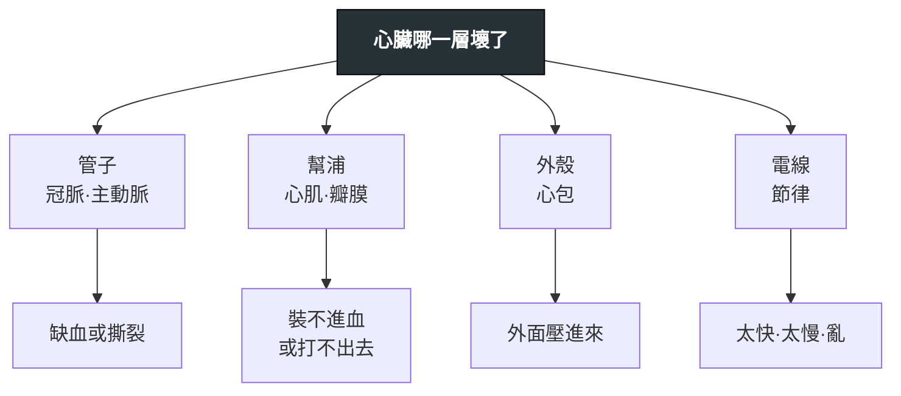

---
tags:
  - Med/MOC/Cardio
  - cardiology
aliases:
  - Cardio Category
  - 心臟內科分類
  - 心臟內科索引
  - Cardiology MOC
created: 2026-07-27
updated: 2026-10-14
status: 可用
cssclass: clinical-note
---

# 🫀 心臟內科分類 · Cardiology

> [!abstract] 這份筆記怎麼讀
> 心臟的病幾乎都可以問一句話定位：**「哪一層壞了？」**——管子（冠脈、主動脈）、肌肉（心肌、瓣膜）、外殼（心包）、電線（節律）、還是外來的（感染）。
> 先看 [[#1 一眼骨架｜依「哪一層壞了」分]] 抓位置，再用 [[#3 高產出對照表]] 補容易互換的細節，最後從 [[#2 專篇索引]] 點進各篇。
> **五個角度分散在五個資料夾**：心內科疾病主要在 `Disease/Cardio/`；先天性心臟病集中於 `Disease/Pediatrics/Pediatric heart disease/`。檢查在 `Test/`、藥在 `Drug/`、處置在 `Intervention/`、主訴流程在 `Workup/`。本檔把它們串回同一張圖。

---

## 資料夾地圖 Folder Map

```text
Disease/Cardio/     ← 心內科疾病專篇（你在這裡）
Disease/Pediatrics/Pediatric heart disease/
                    TOF · TGA · Pulmonary atresia
Test/               Cardiac auscultation · Echocardiography · EKG ischemia
                    · Myocardial perfusion imaging · Troponin
Drug/               Antiplatelet · Statin · DOAC
Intervention/       ICD · TOF correction · TGA correction · Pulmonary atresia intervention
Workup/             Chest pain · Dyspnea · Edema
```

---

## 1. 一眼骨架｜依「哪一層壞了」分

```text
心臟
├─ 管子 Plumbing
│  ├─ 冠狀動脈：CAD（慢性）→ ACS（急性）
│  └─ 大血管：Aortic dissection
├─ 幫浦 Pump
│  ├─ 收縮／填充的最終共同結局：Heart failure
│  └─ 心肌本身：HCM（太厚）· Restrictive cardiomyopathy（太硬）
├─ 外殼 Pericardium
│  ├─ 急性壓迫：Cardiac tamponade
│  └─ 慢性收縮：Constrictive pericarditis
├─ 電線 Electrical
│  ├─ 心房：Atrial fibrillation
│  ├─ 心室：Ventricular tachycardia →（裝置）ICD
│  ├─ 基質天生就壞：Inherited arrhythmia syndromes
│  └─（藥）Antiarrhythmics ← 四類藥各擋一個動作電位相
├─ 外來的 Infection／Valve
│  └─ Infective endocarditis（＋瓣膜病：待補）
└─ 先天結構 Congenital
   └─ TOF／d-TGA／pulmonary atresia → 兒科心臟疾病索引
```



> [!tip] 三個「裝不進血」長得很像，靠外殼與心肌分開
> [[Cardiac tamponade]]（外殼急性壓）· [[Constrictive pericarditis]]（外殼慢性硬）· [[Restrictive cardiomyopathy]]（心肌本身硬）。
> **完整三者對照表在 [[Constrictive pericarditis]]**，其餘兩篇只放精簡摘要並連過去。

---

## 2. 專篇索引

### Disease 疾病

| 分層 | 專篇 | 一句話定位 |
|---|---|---|
| 管子 · 冠脈 | [[CAD]] | 慢性穩定的需氧／供氧失衡 |
| 管子 · 冠脈 | [[ACS]] | 斑塊破裂造成的急性事件 |
| 管子 · 大血管 | [[Aortic dissection]] | 撕到哪裡就出現哪個併發症 |
| 幫浦 · 共同結局 | [[Heart failure]] | HFrEF 四本柱 vs HFpEF 只有一類藥 |
| 幫浦 · 心肌 | [[HCM]] | 動態阻塞——讓心室變飽還是變空 |
| 幫浦 · 心肌 | [[Restrictive cardiomyopathy]] | 心肌太硬，裝不進血 |
| 外殼 | [[Cardiac tamponade]] | 急症；積液速度比積液量重要 |
| 外殼 | [[Constrictive pericarditis]] | 慢性；三者鑑別的完整對照表在這篇 |
| 電線 · 心房 | [[Atrial fibrillation]] | 節律／心率一條線，抗凝另一條線 |
| 電線 · 心室 | [[Ventricular tachycardia]] | 先排除缺血與電解質，再談藥與裝置 |
| 電線 · 遺傳 | [[Inherited arrhythmia syndromes]] | 基因 ↔ 電流 ↔ **誘發情境**的三方反查 |
| 感染 · 瓣膜 | [[Infective endocarditis]] | 菌種 ↔ 情境 ↔ 抽血培養的三方反查 |
| 先天結構 | [[TOF]] | 四項異常、RVOT 阻塞與右向左分流；含解剖對照圖 |
| 先天結構 | [[TGA]] | d-TGA 平行循環與混合；疾病專篇位於兒科 |
| 先天結構 | [[Pulmonary atresia]] | 區分 PA/IVS、PA/VSD；詳見 [[Pediatric heart disease]] |

### Test 檢查

| 專篇 | 什麼時候想到它 |
|---|---|
| [[Cardiac auscultation]] | 雜音隨動作變化的完整規則 |
| [[Echocardiography]] | 結構與血行動力的第一線；本 vault 被指最多次的檢查 |
| [[EKG ischemia]] | 缺血的心電圖表現與 STEMI-equivalent |
| [[Myocardial perfusion imaging]] | 功能性缺血；可逆 vs 固定缺損 |
| [[Troponin]] | 心肌損傷的定量；MI 五型的診斷門檻 |

### Drug 藥物

| 專篇 | 核心 |
|---|---|
| [[Antiarrhythmics]] | Vaughan Williams ＝ 動作電位分類；含 amiodarone 專節 |
| [[Antiplatelet]] | 抗血小板／抗凝／溶栓三層不能混用 |
| [[Statin]] | 走不走 CYP3A4 決定交互作用 |
| [[DOAC]] | 四藥差異與反轉劑 |

### Intervention 處置

| 專篇 | 核心 |
|---|---|
| [[ICD]] | 猝死的一級與二級預防；降低的是什麼死亡 |
| [[TOF correction]] | Complete repair、術前支持、tet spell 急救與 shunt／stent 橋接 |
| [[TGA correction]] | BAS、arterial switch 與術後冠脈／大血管追蹤 |
| [[Pulmonary atresia intervention]] | 肺血流橋接、冠脈限制與分型手術策略 |

### Workup 主訴流程

[[Chest pain]] · [[Dyspnea]] · [[Edema]]

---

## 3. 高產出對照表

### 3.1 三種「裝不進血」的快速指認

| | [[Cardiac tamponade]] | [[Constrictive pericarditis]] | [[Restrictive cardiomyopathy]] |
|---|---|---|---|
| 病灶 | 心包**腔內**液體 | 心包**本身**變硬 | **心肌**變硬 |
| JVP y descent | **消失／變鈍** | **陡峭**（W 形） | 陡峭 |
| 奇脈 | **典型有** | 少見 | 少見 |
| Kussmaul sign | **無** | **有** | 可有 |
| 急不急 | **急症** | 慢性 | 慢性 |

**完整血行動力學與影像對照表在 [[Constrictive pericarditis]]。**

### 3.2 心臟影像工具怎麼挑

| 想回答的問題 | 選哪個 |
|---|---|
| 結構、瓣膜、心包積液、填充壓 | [[Echocardiography]]（第一線） |
| 有沒有功能性缺血、缺血範圍多大 | [[Myocardial perfusion imaging]] |
| 心肌組織性質（纖維化、浸潤、發炎） | 心臟磁振造影（待補） |
| 大血管解剖（剝離、動脈瘤） | 電腦斷層血管攝影（待補）；不穩定者用經食道超音波 |
| 心肌有沒有壞死 | [[Troponin]] ＋ [[EKG ischemia]] |

### 3.3 抗栓的三層，不可混講

| 層 | 擋什麼 | 代表 |
|---|---|---|
| 抗血小板 | 血小板聚集（動脈、高剪應力） | [[Antiplatelet]] |
| 抗凝 | 凝血瀑布（心房、靜脈、低流速） | [[DOAC]]、heparin |
| 溶栓 | 已形成的血栓 | fibrinolytics |

---

## 4. 還沒寫的（依優先序）

> [!todo] 下一批候選
> **瓣膜**：Aortic stenosis（含 Bicuspid aortic valve）· Mitral valve prolapse — 三年三題，紅連結多
> **高血壓**：Hypertension · Blood pressure measurement — 114-2 單場四題，115 沒考，回鍋機率高
> **Beta blocker** — 現在最大的紅連結（被 8 篇引用），跨心律不整／心衰竭／冠心症／高血壓
> **影像**：Cardiac MRI · Coronary CTA · Cardiac catheterization
> **其他**：Sudden cardiac death · PCI · CPR/ACLS · Bradyarrhythmia（房室傳導阻斷）· Adult congenital heart disease · Atrial myxoma · Cyanosis

---

## 相關連結

- [[Chest pain]] — 心臟科最重要的入口主訴，致命鑑別全在那篇
- [[Shock]] — 心因性休克與阻塞性休克的分流
- [[禁忌選項]] — 各篇「絕對不可」區塊的彙整
