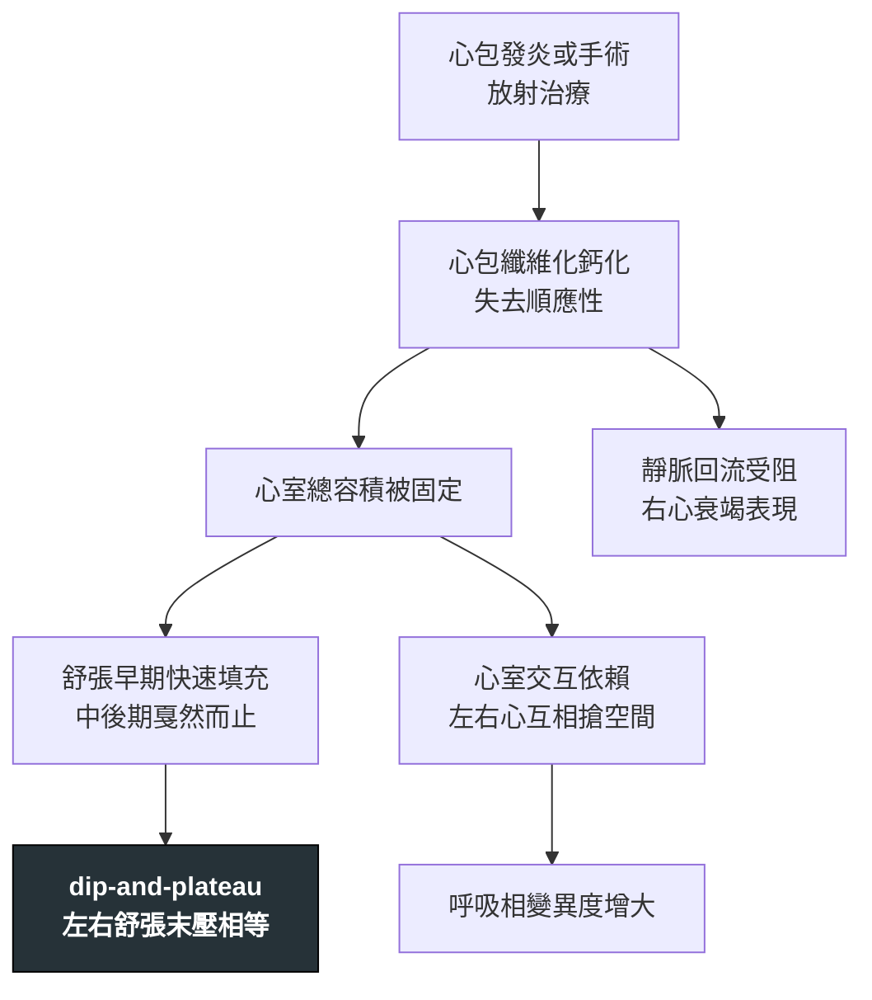

---
tags:
  - Med/Disease/Cardio
  - pericardium
  - 禁忌
aliases:
  - CP
  - 束縮性心包膜炎
  - 縮窄性心包炎
  - Constrictive Pericarditis
created: 2026-07-26
updated: 2026-07-26
status: 可用
source: 113-1 醫學(三) 6、113-2 醫學(三) 12 延伸；ASE 2013 Multimodality Imaging of Pericardial Disease；Harrison's
cssclass: clinical-note
presents_as:
  - "[[Edema]]"
  - "[[Dyspnea]]"
diagnosed_by:
  - "[[Cardiac catheterization]]"
  - "[[Echocardiography]]"
treated_by:
  - "[[Pericardiectomy]]"
differential:
  - "[[Restrictive cardiomyopathy]]"
  - "[[Cardiac tamponade]]"
complication:
  - "[[Cirrhosis]]"
---

# Constrictive pericarditis ｜ 束縮性心包膜炎 · Constrictive Pericarditis

> [!abstract] 一句話總覽
> 心包膜纖維化增厚變成一個**硬殼**，把心臟包死：舒張早期血還衝得進來，中後期就被硬殼擋住。**心肌本身是好的**——這句話是它跟 [[Restrictive cardiomyopathy]] 所有差異的源頭，也是唯一能根治的理由（切掉心包就好）。

> [!tip] 30 秒行動卡
> **診斷關鍵**：右心衰竭表現（頸靜脈怒張、腹水、水腫）但**肺部乾淨**＋ **Kussmaul sign** ＋ 心包叩擊音 → 影像看心包增厚／鈣化，心導管看 **square root sign** 與左右心室舒張末壓幾乎相等
> **治療骨架**：**心包切除術**是根治方法；利尿劑只是等手術前的橋接
> **絕對不可**：把它當「難治型心衰竭」一路加利尿劑而不轉外科

---

## 定義與定位

| 項目 | 重點 |
|---|---|
| 本質 | 心包纖維化／鈣化 → **舒張期填充受限**，收縮功能正常 |
| 常見病因 | 病毒性或特發性心包炎後、**心臟手術後**、**縱膈放射治療後**、**結核**（開發中國家最主要）、尿毒症、結締組織疾病 |
| 分類位置 | 「舒張填充障礙」家族：[[Cardiac tamponade]]、本篇、[[Restrictive cardiomyopathy]] |
| 病灶在哪 | **心包**（對照：RCM 在心肌、tamponade 在心包腔的液體） |

## 病因與機制

> [!tip] 兩個機制推出全部徵象
> **① 總容積被固定** → 舒張末壓左右相等、square root sign。
> **② 心室交互依賴**（左右心共用一個硬殼裡的固定空間）→ 吸氣時右心多進一點，中膈就把左心擠小 → **呼吸相變異度變大**、Kussmaul sign。

![[assets/constrictive-square-root-sign.jpg|660]]
*B 圖是同步 LV／RV 壓力：舒張早期快速下降後立即上升並進入 plateau，形成 dip-and-plateau／square-root sign；兩條曲線的舒張壓約落在 20–30 mmHg 且接近重疊。A 顯示厚重鈣化心包，C 為切除標本。Source: [Van den Eynde et al., *Clin Case Rep* 2020, Figure 1](https://pmc.ncbi.nlm.nih.gov/articles/PMC7669375/)（CC BY 4.0）。*

## 臨床表現

- **典型**：**體循環鬱血遠重於肺鬱血**——頸靜脈怒張、肝腫大、腹水、下肢水腫，但躺平不太喘
- **提示性**：**Kussmaul sign**（吸氣時 JVP 不降反升）、**心包叩擊音**（pericardial knock，舒張早期的高頻聲）
- **少見但重要**：長期被誤診為肝硬化（「心因性肝硬化」）而一路做腹水引流

→ 相關主訴流程：[[Edema]]、[[Dyspnea]]

> [!warning] 腹水大於水腫時要想到它
> 「腹水明顯但下肢水腫相對輕」在肝病之外，束縮性心包炎是必須排除的心因性原因。

## 診斷

| 診斷條件 | 內容 |
|---|---|
| 影像 | CT／MRI 看**心包增厚（＞4 mm）或鈣化**（註：約 20% 心包厚度正常，不能靠它排除） |
| 超音波 | 中膈彈跳（septal bounce）、下腔靜脈擴張、**二尖瓣 E 波呼吸相變異 ≥25%**（三尖瓣 ≥40%） |
| 組織都卜勒 | **e′ ≥8 cm/s**——心肌是好的所以不慢，甚至隨填充壓升高而更快（**annulus paradoxus**） |
| 心導管 | **square root sign**；RVEDP ＞ 1/3 RVSP；**LVEDP − RVEDP ≤5 mmHg**；RV 收縮壓 **＜50 mmHg** |

**要開的檢查**：[[Echocardiography]] → [[Cardiac catheterization]]（鑑別診斷不清時的仲裁）

## 鑑別診斷

*這一節是本篇的核心價值——三個病共用「裝不進血」，靠下表分開。*

|                     | [[Cardiac tamponade]] | **本篇 CP**           | [[Restrictive cardiomyopathy]] |
| ------------------- | --------------------- | ------------------- | ------------------------------ |
| 病灶                  | 心包腔積液                 | **心包硬殼**            | **心肌本身**                       |
| y descent           | **變鈍／消失**             | **極明顯**（Friedreich） | 明顯                             |
| 奇脈 pulsus paradoxus | **有**                 | 少見                  | 少見                             |
| **Kussmaul sign**   | **無**                 | **有**               | 可有可無                           |
| RV 收縮壓              | —                     | **＜50 mmHg**        | 常 **＞50 mmHg**                 |
| LVEDP − RVEDP       | 幾乎相等                  | **≤5 mmHg**         | **＞5 mmHg**                    |
| 二尖瓣 E 波呼吸變異         | 大                     | **≥25%**            | **＜10%**                       |
| 組織都卜勒 e′            | —                     | **≥8 cm/s**         | **＜8 cm/s**                    |
| 肝靜脈血流逆流             | —                     | **吐氣時**             | **吸氣時**                        |
| 心肌壁厚度               | 正常                    | 正常（心包增厚）            | 正常或增厚                          |
| 心雜音／額外音             | 無                     | **心包叩擊音**           | 可有 MR、TR                       |
| 治療                  | **心包穿刺引流**            | **心包切除術**           | 治療基礎病，多需心臟移植                   |

> [!tip] 兩條線索就能分開三個病
> **① Kussmaul sign 有無** → 有＝CP，無＝tamponade。
> **② e′ 快不快** → 快（≥8）＝病在心包（CP），慢（＜8）＝病在心肌（RCM）。

> [!danger] 三者中只有心包填塞是急症
> **Beck's triad ＝ 低血壓 ＋ 頸靜脈怒張 ＋ 心音遙遠（distant heart sound）**。
> 注意**心包摩擦音不是 Beck's triad 的成員**——它是心包炎的徵象（填塞病人也可能有，但不算三徵之一）。
>
> | | 內容 |
> |---|---|
> | 首選檢查 | **心臟超音波**（不是胸部 X 光）——看積液 ＋ **右心房／右心室舒張期被壓扁** |
> | 不可以做 | 利尿劑、血管擴張劑——降前負荷會讓心輸出量直接崩掉 |
> | 撐住的手段 | **快速輸液**維持前負荷；必要時升壓劑 |
> | 唯一的解 | **心包穿刺引流**；外傷性、化膿性或反覆積液者考慮外科開窗 |
>
> **一旦有症狀＋超音波證據就立即穿刺，不必等其他檢查。**

> [!warning] CP 與 RCM 不是「常常合併」
> 它們是**機轉完全不同**的兩個病，只是終點相同（舒張填充受限）。唯一會**同時**造成兩者的病因是**縱膈放射治療**——所以放療病史不能拿來區分它們，反而要兩個都想。

> [!warning] Kussmaul sign ≠ Kussmaul breathing
> **sign**：吸氣時 JVP 不降反升（CP、右心衰竭、限制性生理）。
> **breathing**：深而快的呼吸（代謝性酸中毒，如 DKA）。兩者常被拿來互當陷阱。

## 治療

| 情境 | 處置 |
|---|---|
| 根治 | **[[Pericardiectomy]] 心包切除術**——唯一能解決問題的方法，早做預後較好 |
| 術前橋接 | 利尿劑減輕鬱血；但過度利尿會讓心輸出量掉下來 |
| 亞急性／發炎期 | 少數由發炎主導的個案（transient constriction）可先試 **2–3 個月抗發炎治療**（NSAID、colchicine ± 類固醇），部分可自行緩解 |
| 結核性 | **抗結核治療**同時進行，不能只切心包 |

## 併發症與預後

- **要盯的併發症**：心因性肝硬化與惡病質（拖久了即使手術也難逆轉）、術後低心輸出症候群
- **預後因子**：**病程長短**是最重要的——愈晚手術、心肌與肝臟受損愈不可逆。放射線引起者手術死亡率最高、預後最差

## 禁忌與陷阱

> [!danger] 絕對不可
> | 情境 | 絕對不可 | 為什麼 | 該做什麼 |
> |---|---|---|---|
> | 診斷 CP 後 | 只給利尿劑長期「內科治療」 | 硬殼不會消失，拖延只讓心肌與肝臟不可逆受損 | 及早轉心臟外科評估心包切除 |
> | 心包厚度正常 | 因此排除 CP | 約 20% 的 CP 心包厚度正常 | 靠血行動力學（心導管、都卜勒）判定，不靠厚度 |
> | 疑似結核性 CP | 只做心包切除不給抗結核藥 | 感染未控制會復發並惡化 | 同步抗結核治療 |

> [!warning] 常見錯誤
> - 把 **y descent 明顯** 記到 tamponade 頭上——**tamponade 是變鈍**，CP 才明顯。
> - 把 **奇脈** 當成 CP 的特徵——奇脈是 **tamponade**。
> - 把 **LVEDP − RVEDP ≤5 mmHg** 記成 RCM 的標準——那是 **CP**；RCM 是 **＞5 mmHg**。
> - 只用心包厚度下結論。

## 相關連結

- [[Restrictive cardiomyopathy]] — 最難分開的對手；差別在病灶是心肌還是心包
- [[Cardiac tamponade]] — 同一家族的急性版
- [[Cardiac catheterization]] — 仲裁工具與壓力曲線判讀
- [[Edema]] — 由主訴進入這個診斷的路徑
