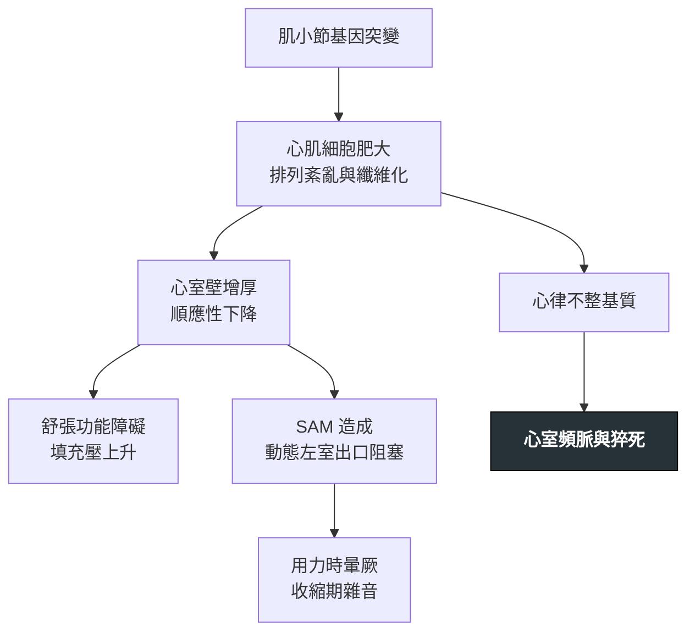

---
tags:
  - Med/Disease/Cardio
  - cardiomyopathy
  - 禁忌
aliases:
  - HCM
  - HOCM
  - 肥厚型心肌症
  - Hypertrophic Cardiomyopathy
  - 肥厚性阻塞型心肌症
created: 2026-07-26
updated: 2026-07-26
status: 可用
source: 113-1 醫學(三) 6、12 延伸；2020／2024 AHA-ACC HCM Guideline；Harrison's
cssclass: clinical-note
presents_as:
  - "[[Chest pain]]"
  - "[[Dyspnea]]"
diagnosed_by:
  - "[[Echocardiography]]"
treated_by:
  - "[[Beta blocker]]"
  - "[[ICD]]"
differential:
  - "[[Aortic stenosis]]"
  - "[[Restrictive cardiomyopathy]]"
complication:
  - "[[Sudden cardiac death]]"
  - "[[Atrial fibrillation]]"
---

# HCM ｜ 肥厚型心肌症 · Hypertrophic Cardiomyopathy

> [!abstract] 一句話總覽
> 肌小節蛋白基因突變（體染色體顯性）造成的**左心室肥厚**，兩個致命後果：**動態左心室出口阻塞（LVOTO）** 與 **心律不整性猝死**。所有處置的方向都是「**讓心室維持飽滿**」——縮小心室的任何動作都會讓阻塞惡化。

> [!tip] 30 秒行動卡
> **診斷關鍵**：不明原因的左心室壁增厚（**≥15 mm**；有家族史者 ≥13 mm）且無其他足以解釋的原因 → 心臟超音波看 **SAM** 與 LVOT 壓差
> **治療骨架**：負性肌力藥（β-blocker → verapamil → disopyramide）→ 心肌肌凝蛋白抑制劑（mavacamten／aficamten）→ 藥物無效且有症狀的阻塞型：中膈減積（酒精消融或手術）
> **絕對不可**：血管擴張劑（DHP-CCB、硝酸鹽）、過度利尿、正性肌力藥

---

## 定義與定位

*這個病是什麼？在分類樹的哪個位置？跟隔壁的病靠什麼分開？*

| 項目 | 重點 |
|---|---|
| 本質 | **肌小節（sarcomere）蛋白基因突變**，體染色體顯性遺傳、外顯率不完全 |
| 好發族群 | 任何年齡；肥厚**不是出生就有**，典型在青春期至成年逐漸長出來 |
| 分類位置 | 心肌症的「肥厚型」，與擴張型、限制型（見 [[Restrictive cardiomyopathy]]）並列 |
| 關鍵分型 | **阻塞型（HOCM，約 2/3）** vs 非阻塞型——差別在有無 LVOT 壓差（休息或誘發後 ≥30 mmHg） |

> [!note] 出生就有明顯 LVH 要往別處想
> Pompe disease、母親糖尿病造成的新生兒心肌肥厚、Noonan syndrome。HCM 的肥厚是「長出來」的。

## 病因與機制

*為什麼會發生？病生理鏈條長什麼樣？*

> [!tip] 一條線推出全部處置
> **心室愈空 → 出口愈窄 → 阻塞愈嚴重。**
> 所以：前負荷↓、後負荷↓、收縮力↑ 三者都是壞事；反過來都是好事。用藥的對錯不必背，用這句推。

![[assets/hcm-sam-lvoto.jpg|600]]
*收縮期連續影格：流出血流從僧帽瓣心室面推動前葉朝肥厚中膈移動，先接近、接觸，再造成動態 LVOT obstruction。現代解釋以 flow drag／pushing force 為主，單用 Venturi「吸過去」並不完整；SAM 同時讓瓣葉對合失常，常產生後向 MR jet。Source: [Sherrid et al., *J Am Heart Assoc* 2020, Figure 1](https://pmc.ncbi.nlm.nih.gov/articles/PMC7033877/)（CC BY-NC-ND 4.0）。*

## 臨床表現

*典型病人長什麼樣？哪些症狀是幾乎一定有、哪些是提示性的？*

- **典型**：許多人終生無症狀；有症狀者以**用力時呼吸困難**最常見
- **提示性**：**用力當下**的暈厥或前暈厥（與血管迷走性暈厥的關鍵區別）、胸痛（冠脈正常也會痛，因為心肌需氧量高＋微血管病變）、心悸
- **少見但重要**：**猝死為首發表現**，尤其在年輕運動員；心房顫動（心房因填充壓高而擴大）會突然讓症狀惡化

→ 相關主訴流程：[[Chest pain]]、[[Dyspnea]]

## 診斷

| 診斷條件 | 內容 |
|---|---|
| 影像門檻 | 左心室壁厚 **≥15 mm**（第一代親屬有 HCM 者 **≥13 mm**） |
| 必要條件 | **找不到其他足以造成此肥厚的原因**（高血壓、主動脈瓣狹窄、運動員心臟、浸潤性疾病） |
| 阻塞判定 | LVOT 壓差 **≥30 mmHg**（休息或 Valsalva／運動誘發）＝阻塞型 |
| 遺傳 | 基因檢測用於確診與**家族篩檢**，不是診斷必需 |

**要開的檢查**：[[Echocardiography]]（首選；看壁厚、SAM、壓差）、[[ECG]]（幾乎都異常，常見左心室高電壓與深而窄的 Q 波）、心臟 MRI（測最大壁厚與 LGE）

> [!note] 心臟 MRI 的角色在變重
> **廣泛 LGE（≥15% LV mass）** 已納入 2020／2024 指引的猝死風險評估。超音波量不準的心尖肥厚型，MRI 也看得比較清楚。

![[assets/hcm-echo-sam.jpg|720]]
*上排左：parasternal long-axis 可見肥厚中膈與收縮期前葉貼近中膈；上排中：M-mode 箭頭標出 SAM；右：典型晚峰、dagger-shaped LVOT Doppler。下排則示範可誘發的 SAM／LVOTO。Source: [Frederich et al., *Internist* 2024, Figure 2](https://pmc.ncbi.nlm.nih.gov/articles/PMC11445290/)（CC BY 4.0）。*

## 鑑別診斷

*要跟誰分清楚？靠什麼分？*

| 要排除的 | 支持它的線索 | 怎麼排除 |
|---|---|---|
| [[Aortic stenosis]] | 雜音在胸骨**右**緣並傳向頸部；**蹲下時雜音變大**；脈搏 parvus et tardus | [[Cardiac auscultation]] 的 maneuver 反應＋超音波看瓣膜 |
| 高血壓性心臟病 | 長期高血壓病史；肥厚多為**對稱性**且較輕（通常 ＜15 mm） | 病史＋肥厚型態 |
| 運動員心臟 | 高強度耐力訓練；壁厚多 ＜13 mm、心室腔**擴大**、去訓練後會退 | 停止訓練後追蹤 |
| 心臟類澱粉沉積症 | 壁厚但 **ECG 電壓反而低**（HCM 是高電壓）；顆粒閃爍狀心肌 | 這是關鍵反差——見 [[Restrictive cardiomyopathy]] |
| Fabry disease | 男性、肢端疼痛、蛋白尿、角膜渦狀混濁 | α-galactosidase A 活性 |

> [!tip] 一個反差記住兩個病
> **壁厚 + ECG 高電壓 → HCM；壁厚 + ECG 低電壓 → 類澱粉沉積。**

## 治療

| 情境 | 處置 |
|---|---|
| 無症狀 | 不需藥物；做猝死風險評估與家族篩檢 |
| 有症狀（阻塞型）第一線 | **非血管擴張型 β-blocker**；不耐受者換 **verapamil** |
| 第二線 | 加 **disopyramide**（強力負性肌力）；或 **心肌肌凝蛋白抑制劑** mavacamten／aficamten（需追蹤 EF） |
| 藥物無效＋壓差 ≥50 mmHg | **中膈減積**：手術中膈切除術，或酒精中膈消融 |
| 併發心房顫動 | 積極恢復竇性節律；**只要有 Afib 就抗凝**（見 [[DOAC]]），不必先算 CHA₂DS₂-VASc |
| 猝死高風險 | 植入 [[ICD]] |
| 支持性 | 避免競技型運動（現行指引已放寬為個別化共同決策）；容量狀態維持充足 |

> [!warning] 利尿劑不是絕對禁忌，但要非常小心
> 明顯肺鬱血時仍可小心給低劑量；問題出在**過度**利尿讓心室變空、阻塞惡化。「絕對不可」的是把它當常規降壓／消腫用。

## 併發症與預後

- **要盯的併發症**：[[Sudden cardiac death]]、[[Atrial fibrillation]]（易栓塞）、進展性心衰竭、感染性心內膜炎（阻塞型）
- **預後因子**：約 **5%** 會走向「burnt-out」的擴張型心肌症（收縮力下降、心室擴大）
- 多數病人壽命接近常人；風險集中在少數高危族群，所以**風險分層比治療本身更重要**

> [!info] 猝死危險因子（決定要不要放 ICD）
> - 猝死家族史
> - 無法解釋的暈厥
> - 最大室壁厚 **≥30 mm**
> - 左心室**心尖動脈瘤**
> - **LVEF ＜50%**
> - 非持續性心室頻脈（NSVT）
> - 心臟 MRI **廣泛 LGE（≥15% LV mass）**
>
> **版本註記**：舊版（2011）曾列「**運動時血壓異常反應**（未上升，或自峰值下降 ≥20 mmHg）」，2020／2024 指引已移除，改納入 LGE。舊版項目在考試中仍會出現。

## 禁忌與陷阱

> [!danger] 絕對不可
> | 情境 | 絕對不可 | 為什麼 | 該做什麼 |
> |---|---|---|---|
> | 阻塞型 HCM 有症狀 | 給**血管擴張劑**（DHP-CCB、硝酸鹽、ACEI／ARB 為降壓用） | 後負荷↓ → 心室變空 → LVOTO 惡化，可致休克 | 給負性肌力藥（β-blocker、verapamil、disopyramide） |
> | 阻塞型 HCM 低血壓 | 給**正性肌力藥**（dobutamine、digoxin） | 收縮力↑ → 阻塞更嚴重 | 給**輸液**擴容 ＋ 純 α 升壓劑（phenylephrine） |
> | 任何 HCM | 大量利尿使容積不足 | 前負荷↓ → LVOTO 惡化 | 維持容量充足；必要時只給最低有效劑量 |
> | HCM 合併 Afib | 因 CHA₂DS₂-VASc 分數低就不抗凝 | HCM 的 Afib 栓塞風險本身就高，不適用一般評分 | **只要有 Afib 就抗凝** |

> [!warning] 常見錯誤
> - 把 **Brockenbrough–Braunwald sign**（早搏後壓差↑但主動脈脈搏壓↓）記成主動脈瓣狹窄——它是 **HOCM 的招牌**；AS 早搏後脈搏壓是**上升**的。
> - 以為肥厚出生就有——是逐漸長出來的。
> - 把「運動時血壓上升」當危險因子——危險的是**上不去或掉下來**。
> - 只看休息時壓差就判定為非阻塞型——**要做 Valsalva 或運動誘發**。

## 相關連結

- [[Aortic stenosis]] — 最常互當錯誤選項的鄰居；靠 maneuver 反應分開
- [[Cardiac auscultation]] — 雜音隨動作變化的完整規則
- [[ICD]] — 猝死一級預防的裝置
- [[DOAC]] — 合併 Afib 時的抗凝
- [[Restrictive cardiomyopathy]] — 另一種「裝不進血」的心肌症
