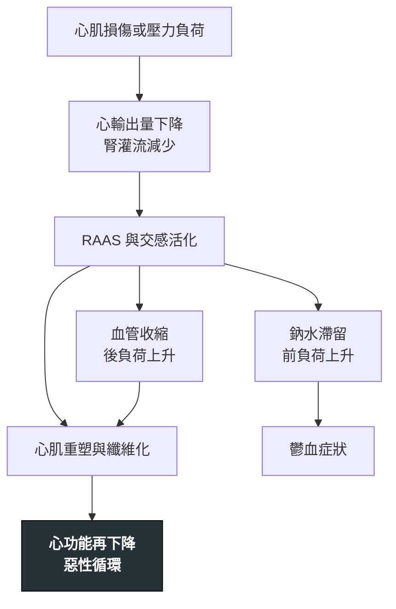

---
tags:
  - Med/Disease/Cardio
  - syndrome
  - 禁忌
aliases:
  - HF
  - CHF
  - 心衰竭
  - 心臟衰竭
  - Heart Failure
  - Congestive Heart Failure
  - HFrEF
  - HFpEF
  - High-output heart failure
  - 高輸出量心衰竭
created: 2026-07-27
updated: 2026-07-27
status: 可用
source: 113-2 醫學(三) 13、114-1 醫學(三) 12、14、114-2 醫學(三) 9、115-2 醫學(三) 10 延伸；2022 AHA/ACC/HFSA HF Guideline；2021 ESC HF Guideline ＋ 2023 Focused Update；Harrison's
cssclass: clinical-note
presents_as:
  - "[[Dyspnea]]"
  - "[[Edema]]"
diagnosed_by:
  - "[[Echocardiography]]"
  - "[[BNP]]"
treated_by:
  - "[[Beta blocker]]"
  - "[[ICD]]"
differential:
  - "[[Constrictive pericarditis]]"
  - "[[Restrictive cardiomyopathy]]"
complication:
  - "[[Atrial fibrillation]]"
  - "[[Sudden cardiac death]]"
---

# Heart failure ｜ 心臟衰竭

> [!abstract] 一句話總覽
> 心臟結構或功能異常，使心輸出量不足、或必須靠**升高填充壓**才能維持輸出。它是**症候群不是單一疾病**，診斷永遠要兩件事：症狀徵象 ＋ 客觀的心因性證據。分型用 **left ventricular ejection fraction (LVEF)**，但 LVEF **不是嚴重度，是選藥的分類器**。

> [!tip] 30 秒行動卡
> **診斷關鍵**：症狀徵象 → **natriuretic peptide**（排除用，不是確診）→ **echocardiography** 量 LVEF（決定性）
> **治療骨架**：**HFrEF** 四本柱盡快上齊；**HFpEF** 只有 **SGLT2 inhibitor** 站得住腳，其餘是利尿劑控症狀 ＋ 治共病
> **絕對不可**：急性失代償且低灌流時新開或加量 **beta-blocker**；由 **ACEI** 換 **ARNI** 未間隔 36 小時

---

## 定義與定位

臨床上要有**症狀或徵象**，同時要有**客觀的心因性證據**（natriuretic peptide 升高，或影像顯示鬱血）。少了後面這一層，喘與水腫可以來自肺、腎、肝或甲狀腺。

### 依 LVEF 分型 — 決定用哪套藥

| 分型 | LVEF | 一句話 | 典型病因 |
|---|---|---|---|
| **HFrEF**（reduced） | **≤40%** | 打不出去 | 心肌梗塞、dilated cardiomyopathy、心肌炎、長期心搏過速 |
| **HFmrEF**（mildly reduced） | **41–49%** | 中間地帶；治療靠向 HFrEF | 多由 HFrEF 改善或 HFpEF 惡化而來 |
| **HFpEF**（preserved） | **≥50%** | 裝不進血 | 長期高血壓的老年人、肥胖／糖尿病、[[HCM]]、[[Restrictive cardiomyopathy]]、[[Aortic stenosis]] |
| **HFimpEF**（improved） | 基線 ≤40% 回升至 ＞40% | 改善不等於治癒 | **藥要繼續吃**，停藥會復發 |

> [!warning] HFpEF 不等於「EF 正常的喘」
> 三件事要同時成立：**EF ≥50%** ＋ 心衰竭症狀徵象 ＋ **客觀證據**（natriuretic peptide 升高，或超音波顯示舒張功能異常／充填壓上升）。輔助評分有 **H₂FPEF** 與 **HFA-PEFF**，組成不外乎肥胖、高血壓、心房顫動、肺高壓、高齡、充填壓高。

> [!note] Stage 與 NYHA 回答的是不同問題
> **Stage A–D**：疾病走到哪裡，**只能前進不能後退**——曾有症狀者即使症狀完全消失仍是 Stage C。它決定「該不該開始治療」。**Stage B（pre-HF）最容易漏**：有結構異常或生物標記升高、但從未有症狀，就該治療了。
> **NYHA I–IV**：此刻的功能狀態，**可以來回**。它決定「現在藥要調到多重」。

## 病因與機制

> [!tip] 這條線直接推出四本柱
> **短期救命的代償（縮血管、留鈉水、催交感），長期就是毒素。** 所以有效的藥全是**阻斷神經荷爾蒙**的：**ARNI** 打 **renin-angiotensin-aldosterone system (RAAS)** 並保留 natriuretic peptide、**beta-blocker** 打交感、**MRA** 打 aldosterone 與纖維化、**SGLT2 inhibitor** 打代謝與容積。
> 反過來說：**只讓病人「感覺好」的藥（利尿劑、digoxin）不改善存活**——症狀改善與存活改善是兩件事，這條線把四本柱與其他藥切開。

### 病因分類

| 類別 | 代表 |
|---|---|
| 缺血性 | **coronary artery disease 約佔 2/3**（見 [[CAD]]），已開發國家第一病因 |
| 高血壓性 | 長期後負荷↑ → 向心性肥厚 → 舒張功能障礙 → **HFpEF** |
| 浸潤性 | amyloidosis、sarcoidosis、hemochromatosis |
| 毒物／藥物 | 酒精、doxorubicin（劑量累積性）、trastuzumab、免疫檢查點抑制劑 |
| 感染／免疫 | 病毒性心肌炎、巨細胞心肌炎、Chagas disease |
| 心律相關 | 長期心搏過速性心肌病、[[Atrial fibrillation]] 心室率未控制 |
| **高輸出型** | 甲狀腺毒症、嚴重[[Anemia]]、動靜脈廔管（含[[Dialysis]]用）、thiamine 缺乏、肝硬化、懷孕 |

心衰竭**有家族聚集性**——親代有心衰竭病史者，後代的左心室質量與內徑增加、收縮功能異常的機率較高。

### 危險因子

| 方向 | 內容 |
|---|---|
| **增加** | 年齡、高血壓、糖尿病、肥胖、吸菸、心肌梗塞病史、**left bundle branch block (LBBB)**、**無症狀左心室收縮功能障礙**、**貧血**、慢性腎病、睡眠呼吸中止 |
| **降低** | **身體活動量高** |

> [!info] 兩個容易被翻面的字
> 束支阻斷是**左**不是右——LBBB ＝ 心室收縮不同步 → 重塑 → 心衰竭，也因此**只有 LBBB 是 cardiac resynchronization therapy (CRT) 的核心適應症**；RBBB 沒有這一層意義。
> 血紅素是**低**不是高——貧血既是危險因子，也是預後不良指標。

### HFpEF 的危險標記 — 兩類就夠推

| 讓心室更僵硬（結構） | 讓舒張期更短／失去心房幫浦（節律） | 其他共病 |
|---|---|---|
| 高血壓、老化、肥胖、糖尿病、慢性腎病 | 心搏過速、[[Atrial fibrillation]] | 女性、貧血、睡眠呼吸中止、肺高壓 |

> [!tip] 一句話推出整張清單
> **HFpEF 的核心是「心室裝不進血，而且沒有時間裝」。** 任何因子丟進這句話檢驗：它讓心室更硬？還是讓舒張期更短？兩者皆非就不是。
> 所以**心搏過緩方向剛好相反**——心跳慢反而給了心室更多填充時間。心房顫動則是雙重打擊：快、不規則、又失去心房收縮貢獻的那段填充量（心室愈僵硬愈依賴它）。
> 但「靜息慢」與「運動時上不去」意義相反：**chronotropic incompetence**（運動時心率無法適度上升）是 HFpEF 運動不耐的公認機轉之一。

## 臨床表現

- **典型**：勞動性呼吸困難（最常見）、**端坐呼吸 orthopnea**、**paroxysmal nocturnal dyspnea (PND)**、下肢對稱性凹陷性水腫、疲倦
- **提示性**：**頸靜脈怒張**、**S3 gallop**（見 [[Cardiac auscultation]]）、肝頸靜脈逆流、短期體重上升、肺底囉音
- **少見但重要**：Cheyne–Stokes 呼吸、腹水、意識改變與腎功能惡化（**是低灌流的表現，不是「腎臟另有問題」**）

### 床邊兩排 → 四象限

| 鬱血（wet） | 低灌流（cold） |
|---|---|
| 端坐呼吸、PND、下肢水腫、頸靜脈怒張、肝腫大與肝頸靜脈逆流、腹水、體重上升 | 疲倦、四肢冰冷、**脈壓變窄**、意識改變、腎功能惡化、低血鈉 |

兩排交叉即 **wet／dry × warm／cold**，直接對應處置：**wet 就利尿、cold 就強心或減後負荷**。

> [!tip] 敏感度與特異度分開記
> **端坐呼吸與 PND 特異度最高**（問「最有診斷價值的症狀」選它們）；**疲倦與勞動性呼吸困難敏感度最高但特異度最低**（問「最常見的症狀」選它們）。
> **S3 gallop** 在成人特異度極高；**頸靜脈怒張**是最能反映右心充填壓的床邊指標。

> [!warning] 誘因不是臨床表現
> 「藥忘了吃」「最近吃很鹹」「天氣熱喝很多水」是這一次急性失代償的**誘因**，不是心衰竭的表現，問診要分兩欄記。
> 常見誘因：**藥物順從性差（最常見）**、新發心房顫動或快速心室率、感染、缺血（[[ACS]]）、鹽水過量、腎功能惡化、[[Anemia]]、肺栓塞，以及**藥物誘發**（NSAID、thiazolidinedione、非 DHP-CCB、類固醇）。

→ 相關主訴流程：[[Dyspnea]]、[[Edema]]、[[Chest pain]]

## 診斷

| 步驟 | 內容 |
|---|---|
| 1. 臨床懷疑 | 症狀 ＋ 徵象 ＋ 危險因子 |
| 2. **natriuretic peptide** | **排除用**（陰性預測值高），升高的原因太多，不能反過來確診 |
| 3. **[[Echocardiography]]** | **決定性檢查**：量 LVEF 分型、室壁厚度與腔室大小、舒張功能（E/e′、左心房容積指數、TR 速度）、瓣膜、右心、下腔靜脈 |
| 4. 找病因 | 缺血評估、[[Troponin]]、鐵蛋白與 TSAT、TSH、腎功能與電解質 |

### 利鈉肽門檻 — 場景不同、數字不同

| 場景 | BNP | NT-proBNP |
|---|---|---|
| **門診／非急性，排除** | ＜**35** pg/mL | ＜**125** pg/mL |
| **急診／急性，排除** | ＜**100** pg/mL | ＜**300** pg/mL |
| **急診，支持診斷** | ≳500 pg/mL | 年齡分層，愈老切點愈高（＜50 歲 ＞450；50–75 ＞900；＞75 ＞1800） |

| 偏高（偽陽性） | 偏低（偽陰性） |
|---|---|
| 高齡、女性、腎功能不全、心房顫動、肺栓塞、敗血症、貧血 | **肥胖（最重要）**、閃電型肺水腫極早期 |

> [!danger] ARNI 會把 BNP 與 NT-proBNP 拆成兩件事
> sacubitril 抑制 **neprilysin**，而 **BNP 是 neprilysin 的受質、NT-proBNP 不是**。所以用 ARNI 的病人 **BNP 會上升，不代表惡化**；追蹤一律看 **NT-proBNP**。

床邊另有較早的 **Framingham criteria**（2 主要，或 1 主要 ＋ 2 次要），主要項目就是上面那些高特異度的鬱血徵象。它早於 natriuretic peptide 與超音波，現在只當輔助。

![[assets/pulmonary-edema-cardiogenic-vs-noncardiogenic.jpg|760]]
*左：急性心肌梗塞後的 cardiogenic pulmonary edema，可見中心性肺門周圍陰影、peribronchovascular cuffing 與 Kerley B lines；右：敗血症／ARDS 的 noncardiogenic edema，浸潤較斑片、周邊且可見 air bronchogram。真實病例會重疊，須合併心臟大小、肋膜積水、病史與超音波。Source: [Mihailescu et al., *Diagnostics* 2023, Figure 3](https://pmc.ncbi.nlm.nih.gov/articles/PMC10604083/)（CC BY 4.0）。*

## 鑑別診斷

| 要排除的 | 支持它的線索 | 怎麼分開 |
|---|---|---|
| **高輸出量心衰竭** | 四肢**溫暖**、**脈壓寬**、bounding pulse | 見下表；找甲狀腺毒症、貧血、動靜脈廔管、thiamine 缺乏、肝硬化 |
| [[Constrictive pericarditis]] | 心包鈣化、心室交互依賴、Kussmaul sign | [[Echocardiography]] 呼吸變異 ＋ 心導管同步壓力曲線 |
| [[Restrictive cardiomyopathy]] | 壁厚但 **ECG 電壓反而低**、雙心房擴大 | 影像 ＋ amyloidosis 檢查 |
| COPD 急性惡化 | 長期吸菸、哮鳴為主、**natriuretic peptide 不高** | 生物標記 ＋ 肺功能 ＋ 超音波 |
| 腎病症候群／肝硬化 | 水腫明顯但**頸靜脈壓不高** | 頸靜脈評估 ＋ 尿蛋白 ＋ 肝功能 |

### 高輸出量 vs 一般（低輸出）HF

| 項目 | 一般（低輸出）HF | **高輸出量 HF** |
|---|---|---|
| 心輸出量 | 下降 | **升高** |
| 全身血管阻力 | **上升**（代償性縮血管） | **下降** |
| 四肢與脈搏 | 冰冷、**脈壓窄** | **溫暖、脈壓寬**、bounding pulse |
| 核心問題 | 幫浦壞了 | **幫浦沒壞，是需求太大或分流太多** |
| 處置方向 | 神經荷爾蒙阻斷（GDMT） | **治病因**；強心藥無用 |

> [!warning] EF 正常 ≠ HFpEF
> 甲狀腺毒症早期的心衰竭 EF 正常甚至偏高，但它是**高輸出量**，機轉與 HFpEF 的「裝不進血」**完全相反**。兩者都「EF 沒掉」，歸類卻不同格。反向陷阱：**甲狀腺低下不是高輸出量心衰竭**，它造成的是心搏過緩與低心輸出量。
> 另一條快速判斷：**急性心肌損傷（心肌梗塞、猛爆性心肌炎）先傷收縮功能**，走 HFrEF；**慢性壓力負荷（長期高血壓、重度 [[Aortic stenosis]]、[[HCM]]）才走向 HFpEF**。看到「急性期」，先把 HFpEF 刪掉。

![[assets/diastolic-dysfunction-echo-patterns.jpg|620]]
*Transmitral inflow 與 tissue Doppler 的進程：normal → impaired relaxation（E↓、A↑、e′↓）→ pseudonormal → restrictive（E/A 明顯升高、DT 縮短）。只看 E/A 會把 pseudonormal 誤判正常，因此一定要加 e′ 與其他填充壓指標。*

![[assets/diastolic-dysfunction-echo-algorithm.jpg|760]]
*舒張功能分級：先看 E/A，再用平均 E/e′ ＞14、TR velocity ＞2.8 m/s、LAVI ＞34 mL/m² 交叉驗證左房壓；三項中多數陽性支持 elevated LAP。兩圖 Source: [*Annals of Cardiac Anaesthesia* review 2016, Figures 1 and 3](https://pmc.ncbi.nlm.nih.gov/articles/PMC5100236/)（CC BY-NC-SA 3.0）。*

## 治療

### HFrEF 的四本柱 — 四類藥各自降死亡率

效果可疊加，所以現行指引主張**盡快同時上齊、再各自往上調**，而不是舊版的「一種調到最大再加下一種」。

| 支柱 | 代表藥 | 起始重點 |
|---|---|---|
| **ARNI**（angiotensin receptor–neprilysin inhibitor；不能用時改 ACEI／ARB） | sacubitril/valsartan | 由 ACEI 換過來**必須停 36 小時** |
| **Beta-blocker** | carvedilol、metoprolol **succinate**、bisoprolol | **只有這幾種有實證**；容量穩定時才起始，低劑量慢慢加 |
| **MRA**（mineralocorticoid receptor antagonist） | spironolactone、eplerenone | 起始門檻 **eGFR ≥30 且 K⁺ ＜5.0**；起始與加量後追鉀 |
| **SGLT2 inhibitor**（sodium-glucose cotransporter 2） | dapagliflozin、empagliflozin | **與有無糖尿病無關**；腎功能較差仍可用 |

| 加在四本柱之上 | 適應情境 |
|---|---|
| **利尿劑（loop diuretic）** | 有鬱血就用——**緩解症狀，不改善存活。不屬於四本柱** |
| digoxin | 症狀頑固或合併心房顫動控制心室率；**降住院、不降死亡率。不屬於四本柱** |
| ivabradine | 竇性心律 ＋ 靜息心率仍偏快 ＋ LVEF ≤35%，且 beta-blocker 已到最大耐受劑量 |
| **靜脈鐵劑** | 缺鐵時改善症狀與運動耐受度；**口服鐵劑在心衰竭無效** |
| hydralazine ＋ 硝酸鹽 | 非裔且已用 GDMT，或無法耐受 RAAS 抑制劑者 |

> [!warning] 台灣本土｜指引、仿單、健保給付是三套標準
> **健保給付最緊**：SGLT2 inhibitor 原本只給付 LVEF ≤40%，2025/2 起擴大到 HFmrEF 與慢性腎病，**HFpEF 仍不給付**。所以「四類藥同時上齊」是指引語言，實務上常被迫排在 ACEI/ARB ＋ beta-blocker 之後。
> ivabradine 的門檻：指引與美國仿單是靜息心率 **≥70**，**歐盟與台灣仿單是 ≥75**。

### 裝置治療（僅 HFrEF 適用）

| 裝置 | 門檻 |
|---|---|
| **[[ICD]]**（一級預防） | LVEF **≤35%** ＋ NYHA II–III ＋ 最佳 **guideline-directed medical therapy (GDMT)** ≥3 個月 |
| **CRT**（最強適應症） | LVEF **≤35%** ＋ **竇性心律** ＋ **LBBB** ＋ QRS **≥150 ms** ＋ 已用 GDMT |

> [!warning] 心肌梗塞後 40 天內不放 ICD
> 急性期的 EF 可能自行回升，太早植入無存活效益；血運重建後也要等（一般 90 天）再重新評估 EF。
> CRT 則是「條件愈齊全效果愈好」：非 LBBB，或 QRS 只有 120–149 ms，建議等級都會往下掉一級。

### HFpEF／HFmrEF — 藥效與 HFrEF 大相逕庭

| 藥物類別 | HFrEF | HFpEF |
|---|---|---|
| ARNI／ACEI／ARB | ✔ 降死亡率 | ✘ 無明確效益 |
| [[Beta blocker]] | ✔ 降死亡率 | ✘ 無明確效益 |
| MRA | ✔ 降死亡率 | △ 主要是降低住院 |
| **SGLT2 inhibitor** | ✔ 降死亡率 | ✔ 降低**複合終點**——效益主要來自**住院**，單獨的心血管死亡未達顯著 |
| 利尿劑 | 控症狀，**不改善存活** | 同左 |

> [!tip] 一句話
> **SGLT2 inhibitor 是唯一在 HFrEF 與 HFpEF 都站得住腳的藥。** HFpEF 其餘的治療重心在共病：血壓、體重、[[Atrial fibrillation]]、睡眠呼吸中止、缺鐵。

> [!info] 糖尿病用藥的心衰竭立場
> **增加**心衰竭住院：**thiazolidinedione**（pioglitazone、rosiglitazone）、**saxagliptin 與 alogliptin**（DPP-4 抑制劑中的兩個例外）。
> **中性**：metformin、其餘 DPP-4 抑制劑、GLP-1 受體促效劑、胰島素。
> **降低**：**SGLT2 inhibitor**——已是 HFrEF 與 HFpEF 兩者的正式治療。

### 急性失代償的處置（依四象限）

| 象限 | 處置 |
|---|---|
| **Wet ＋ Warm**（最常見） | 靜脈 **loop diuretic**；血壓夠時加血管擴張劑；缺氧或肺水腫用 **NIV** |
| **Wet ＋ Cold** | 血壓尚可 → 血管擴張劑 ＋ 利尿劑；低血壓 → **正性肌力藥**（dobutamine、milrinone）後再利尿 |
| **Dry ＋ Cold** | 先**謹慎補液**；仍低灌流才用正性肌力藥 |
| **Dry ＋ Warm** | 已代償——**調整口服 GDMT**，別再加利尿劑 |

同時：**找誘因並處理**、限鹽限水、量每日體重與輸出入量。

## 併發症與預後

- **要盯的併發症**：[[Atrial fibrillation]]（失去心房幫浦 → 症狀突然惡化）、[[Ventricular tachycardia]] 與 [[Sudden cardiac death]]、心腎症候群、鬱血性肝病、缺鐵與貧血、心因性 [[Shock]]

| 面向 | 不良預後指標 |
|---|---|
| 功能 | **NYHA III–IV**；**peak VO₂** 偏低 → 應轉介心臟移植評估 |
| 血行動力 | 低收縮壓、靜息心搏過速、**脈壓窄** |
| 生化 | **低血鈉**、腎功能惡化、**natriuretic peptide 持續偏高**、[[Troponin]] 持續可測到 |
| 心電圖／結構 | **QRS 增寬**、心房顫動、LVEF 愈低、右心室功能不良、肺高壓 |

> [!tip] 兩個反直覺的預後點
> **低血鈉在心衰竭是壞事**——它反映神經荷爾蒙活化與稀釋性水滯留的嚴重度，不是「鹽吃太少」。
> **體重下降有兩種意義**：利尿後短期下降是好事；**非刻意的長期體重下降（cardiac cachexia）是預後不良指標。**

## 禁忌與陷阱

> [!danger] 絕對不可
> | 情境 | 絕對不可 | 為什麼 | 該做什麼 |
> |---|---|---|---|
> | 急性失代償、明顯鬱血或低灌流 | **新開或加量 beta-blocker** | 負性肌力與負性頻率會讓失代償惡化 | 先穩定血行動力；**原本已在吃的通常減量續用，不貿然全停** |
> | 已在用 ACEI，要換 ARNI | **間隔不足 36 小時** | 同時抑制 ACE 與 neprilysin → 緩激肽堆積 → **血管性水腫** | 停 ACEI 滿 36 小時再開；曾發生血管性水腫者**永不使用 ARNI** |
> | HFrEF | **非 DHP-CCB（verapamil、diltiazem）** | 負性肌力，增加惡化與住院 | 控心室率用 beta-blocker；降壓改用 RAAS 抑制劑或 amlodipine |
> | 任何心衰竭 | **NSAID／COX-2 抑制劑** | 鈉水滯留、腎灌流下降、拮抗利尿劑與 RAAS 抑制劑 | 止痛改用 acetaminophen |
> | 心衰竭合併糖尿病 | **thiazolidinedione** | 明確增加心衰竭住院 | 改用 **SGLT2 inhibitor** |
> | 已用 RAAS 抑制劑 | 併用 **MRA ＋ 補鉀劑**而不追鉀 | 三重打擊 → **致死性高血鉀** | 起始與加量後 1–2 週追 K⁺ 與腎功能；K⁺ ≥5.5 先停 MRA |
> | 結構性心臟病的心律不整 | **Class Ic 抗心律不整藥（flecainide、propafenone）** | 促心律不整、增加死亡率 | 用 amiodarone，或走裝置／電燒 |
> | 妊娠或計畫懷孕 | **ACEI／ARB／ARNI／MRA** | 胎兒毒性 | 換 hydralazine ＋ 硝酸鹽，轉介高危妊娠 |

> [!warning] 常見錯誤
> - **把利尿劑或 digoxin 算進四本柱**——它們改善症狀但不降死亡率。
> - **把 LVEF 當嚴重度**——它只是選藥的分類器。EF 30% 的人可能能爬山，EF 55% 的 HFpEF 可能走十公尺就喘。
> - **看到 EF 正常又喘就叫 HFpEF**——還要有客觀證據，而且要先排除**高輸出量心衰竭**。
> - **把甲狀腺亢進早期的心衰竭歸到 HFpEF**——那是高輸出量，機轉完全相反。
> - **beta-blocker 隨便換一種**——只有 carvedilol、metoprolol **succinate**、bisoprolol 有實證；metoprolol **tartrate** 不是那一顆。
> - **HFimpEF 停藥**——EF 回升是藥物有效，不是病好了。
> - **用 ARNI 後看到 BNP 上升就以為惡化**——要看 NT-proBNP。
> - **看到肥胖病人 natriuretic peptide 不高就排除心衰竭**——肥胖是最常見的偽陰性來源。
> - **把 RBBB 當危險因子**——是 **LBBB**，也只有 LBBB 是 CRT 的核心適應症。
> - **把心搏過緩當 HFpEF 危險標記**——是**心搏過速與心房顫動**。

## 相關連結

- [[CAD]]、[[ACS]] — 已開發國家的第一病因；急性心肌損傷是 HFrEF 最典型的起點
- [[Echocardiography]] — 決定分型與治療方向的關鍵檢查
- [[BNP]] — natriuretic peptide 的原理、干擾因素與 ARNI 的影響
- [[Beta blocker]]、[[ICD]] — 四本柱之一；猝死一級預防的門檻
- [[Atrial fibrillation]] — 最重要的共病，兩者互為因果
- [[Constrictive pericarditis]]、[[Restrictive cardiomyopathy]] — 「裝不進血」的另外兩種來源
- [[Anemia]]、[[Dialysis]] — 高輸出量心衰竭與心腎症候群的交會點
- [[Dyspnea]]、[[Edema]] — 從主訴出發的完整流程
