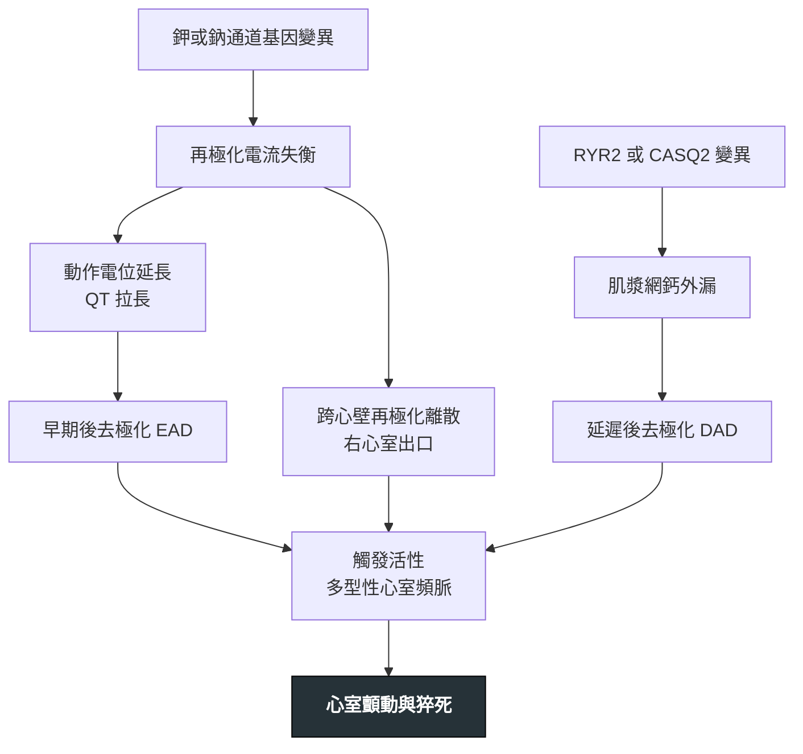

---
tags:
  - Med/Disease/Cardio
  - channelopathy
  - 禁忌
aliases:
  - Long QT syndrome
  - LQTS
  - Brugada syndrome
  - CPVT
  - Short QT syndrome
  - Channelopathy
  - 遺傳性心律不整
  - 離子通道病
  - Inherited arrhythmia syndrome
  - Genetic arrhythmia syndrome
  - 長 QT 症候群
  - 短 QT 症候群
  - 兒茶酚胺敏感性多形性心室頻脈
created: 2026-07-27
updated: 2026-07-28
status: 可用
source: 114-1 醫學(三) 10、11、114-2 醫學(三) 11 延伸；2022 ESC 心室性心律不整與猝死指引；2013 HRS/EHRA/APHRS 專家共識
cssclass: clinical-note
presents_as:
  - "[[Syncope]]"
  - "[[Sudden cardiac death]]"
diagnosed_by:
  - "[[Echocardiography]]"
  - 運動負荷測試
  - 鈉離子通道阻斷劑激發試驗
treated_by:
  - "[[Beta blocker]]"
  - "[[ICD]]"
  - "[[Antiarrhythmics]]"
differential:
  - "[[Ventricular tachycardia]]"
  - "[[HCM]]"
complication:
  - "[[Sudden cardiac death]]"
  - "[[Atrial fibrillation]]"
---

# Inherited arrhythmia syndromes ｜ 遺傳性心律不整症候群 · 離子通道病

> [!abstract] 一句話總覽
> 一群**心臟結構正常、只有電性異常**的遺傳病：離子通道或鈣處理蛋白的基因變異 → 再極化或去極化失衡 → 觸發活性或再極化離散 → 多型性心室頻脈與猝死。它們的共同外觀是「**年輕、心臟看起來正常、卻會突然倒下**」，而**分辨彼此靠的不是心電圖，是「在什麼情境下倒下」**。

> [!tip] 30 秒行動卡
> **診斷關鍵**：**12 導程心電圖量 QTc** ＋ 問**發作情境**（運動／游泳、聽到聲響、睡夢中、發燒）＋ 問**三代家族猝死史**。靜息心電圖正常也不能排除——**CPVT** 就是這樣
> **治療骨架**：**[[Beta blocker]]** 是 **LQTS** 與 **CPVT** 的骨幹；**Brugada syndrome** 與 **Short QT syndrome** **以 [[ICD]] ＋ 避誘因為主，唯一有角色的口服藥是 quinidine**
> **絕對不可**：對任何一個給**延長 QT 的藥**；對 **Brugada** 給 **Class I 抗心律不整藥**或放著發燒不退；對 **Brugada** 常規給 beta-blocker

---

## 定義與定位

心室性心律不整的第一個分岔是「**有沒有結構性心臟病**」：有 → 疤痕折返（心肌梗塞後最多，見 [[Ventricular tachycardia]]）；沒有 → 想離子通道病或特發性心室頻脈。本篇處理的就是後者這一支，它們是**可命名、可遺傳、可家族篩檢**的症候群，而不是單一心電圖現象。

### 主表 — 一張表分開五個症候群（＋一個結構性對照）

| 症候群 | 基因 | 電流／機制 | 靜息心電圖 | **典型誘發情境** | 第一線治療 |
|---|---|---|---|---|---|
| **LQT1** | ***KCNQ1*** | **I_Ks** 功能喪失 | QT 延長 ＋ **寬底 T 波** | **運動，尤其游泳** | **beta-blocker（三型中反應最好）** |
| **LQT2** | ***KCNH2***（hERG） | **I_Kr** 功能喪失 | QT 延長 ＋ **切跡狀低振幅 T 波** | **突發聲響**（鬧鐘、電話）、情緒、**產後** | beta-blocker ＋ **嚴防低血鉀** |
| **LQT3** | ***SCN5A*** **功能增強** | **晚期鈉電流（late I_Na）** 持續內流 | QT 延長 ＋ **ST 段拉長後才出現 T 波** | **睡眠與休息** | beta-blocker 效果較差 → 加 **mexiletine** |
| **Brugada syndrome** | ***SCN5A*** **功能喪失**（僅約 2–3 成找得到） | 峰值 I_Na 減少 → **右心室出口再極化離散** | **V1–V2 type 1 coved ST 上升** | **發燒（最重要）**、睡眠、飽餐、飲酒 | **[[ICD]] ＋ 避誘因**；藥物只有 quinidine |
| **CPVT** | ***RYR2***（體染色體顯性，最常見）、*CASQ2*（隱性） | 肌漿網鈣外漏 → **延遲後去極化** | **完全正常** | **運動、情緒** | **非選擇性 beta-blocker ＋ flecainide** |
| **Short QT syndrome** | *KCNH2* 等**功能增強** | I_Kr 增強 → 再極化過快 | **QTc 極短**、ST 幾乎消失、**高尖對稱 T 波** | 不特定，休息時亦可 | [[ICD]]；藥物 quinidine |
| （對照）**ARVC** | *PKP2* 等 **desmosome 基因** | **結構性**：右心室心肌被纖維脂肪取代 | **epsilon wave**、**V1–V3 T 波倒置** | **運動**（耐力運動加速惡化） | 禁競技運動、beta-blocker、[[ICD]] |

**LQTS 亞型已知 1–17 型，但 LQT1–3 合計佔九成以上**，其餘罕見到臨床上不影響決策。

> [!tip] 情境就是基因型——問診比讀圖更早給出答案
> **游泳／跳水 → LQT1**（運動 ＋ 冷水刺激，最專一的一句話）｜**鬧鐘、電話鈴、被叫醒 → LQT2**｜**睡夢中 → LQT3 或 Brugada**｜**發燒 → Brugada**｜**運動或情緒激動且靜息心電圖正常 → CPVT**。
> **產後與哺乳期是 LQT2 的高風險窗口**（雌激素下降 ＋ 睡眠中斷 ＋ 嬰兒哭聲這種突發聲響），這一段常被漏掉。

> [!warning] 同一個基因，兩個方向相反的病
> ***SCN5A*** **功能增強**（去極化後鈉通道關不緊、晚期電流持續內流）＝ **LQT3**；***SCN5A*** **功能喪失**（鈉電流變小）＝ **Brugada syndrome**。兩者都是 SCN5A，卻一個延長動作電位、一個造成再極化離散，發作時機也剛好都在睡眠——**看到 SCN5A 不能直接答其中一個，要看功能是增強還是喪失**。同一家族甚至可能出現重疊表型。
> 同樣的翻面在鉀通道也成立：***KCNH2*** **功能喪失 → LQT2**，***KCNH2*** **功能增強 → Short QT syndrome**。

## 病因與機制

再極化這件事只有兩種壞法：**慢下來**（動作電位拉長 → 早期後去極化）或**變得不整齊**（跨心壁離散 → 局部再進入）。加上鈣處理異常這條獨立路徑，三條線最後匯進同一個結局。

> [!tip] 這條線推得出「誰該用什麼藥」
> **走 EAD 的（LQTS）**：交感刺激會加深後去極化 → **beta-blocker 是治療核心**；LQT3 的問題出在鈉通道關不緊，所以**用鈉通道阻斷劑 mexiletine 把晚期電流關掉、QT 縮短**。
> **走 DAD 的（CPVT）**：鈣外漏由兒茶酚胺驅動 → **beta-blocker 同樣是核心**，再加 **flecainide** 直接抑制 RyR2 的鈣釋放（不只是擋鈉）。
> **走離散的（Brugada、Short QT）**：問題不在動作電位長短而在**不整齊**，交感阻斷幫不上忙，所以 **beta-blocker 沒有角色**；有效的藥是**阻斷 Ito 與 I_Kr 的 quinidine**——這也是唯二兩個用 quinidine 的症候群。

## 臨床表現

- **典型**：**運動或情緒誘發的暈厥／前暈厥**（LQT1、CPVT）、**睡夢中或休息時的瀕死喘息與猝死**（LQT3、Brugada）、心悸
- **提示性**：**年輕（＜40 歲）猝死家族史**、被診斷為「藥物控制不良的癲癇」（其實是心律不整性暈厥合併缺氧性抽搐）、**發燒時發作**（Brugada）
- **少見但重要**：**不明原因溺水或泳池／浴缸溺斃**（LQT1、CPVT）、**單一車輛的不明原因車禍**、家族中的嬰兒猝死症候群、[[Atrial fibrillation]] 出現在 30 歲以下（想 Short QT 或 LQTS）

> [!danger] 三個必須觸發完整評估的紅旗
> ① **運動中、游泳時、或聽到突發聲響時的暈厥**——不是血管迷走性暈厥（那多發生在久站、悶熱、抽血後，且有前驅噁心冒汗）。**運動「當下」暈厥是心因性，直到證明不是為止。**
> ② **一等親在 40 歲前不明原因猝死**，包含被歸為溺水、車禍、癲癇猝死者。
> ③ **心跳停止倖存但冠狀動脈與心臟結構皆正常**（unexplained cardiac arrest）。
> 見到任何一項：12 導程心電圖 ＋ 詳細情境問診 ＋ 三代家系圖，並啟動**一等親級聯篩檢（cascade screening）**——先做心電圖與病史，先證者有致病變異時再做基因檢測。

→ 相關主訴流程：[[Syncope]]、[[Sudden cardiac death]]

## 診斷

共通起手式三件事：**量 QTc**（Bazett 校正）、**排除後天原因**（藥物、[[Hypokalemia]]、低血鎂、低血鈣、心搏過緩、甲狀腺功能低下）、**[[Echocardiography]] 確認心臟結構正常**。後天性 QT 延長遠比先天性常見，而且可以矯正——**先停藥、先補電解質，再談基因病**。

| 症候群 | 診斷門檻／決定性檢查 |
|---|---|
| **LQTS** | **Class I（即可診斷）**：**反覆 12 導程 QTc ≥480 ms**、或 **LQTS risk score（Schwartz）＞3 分**、或 **找到致病基因變異（不論 QT 長度）**。**Class IIa（應考慮，不等於確診）**：**不明原因暈厥 ＋ 反覆 12 導程 QTc ≥460 ms ＋ 排除次發原因**。（**2013 HRS 共識數字不同：QTc ≥500 ms 或 risk score ≥3.5**——看題目問哪一版） |
| **Brugada syndrome** | 心電圖型態：**V1–V2（導程可上移至第 2、3 肋間；標準為第 4 肋間）**、**J 點抬高 ≥2 mm、穹窿型（coved）ST 接負向 T 波**；**type 2 saddleback 不算診斷**。診斷條件（2022 ESC）：**自發性 type 1 → 直接診斷**；**藥物激發的 type 1 單獨存在只列 IIb**，需再合併**心律不整性暈厥／夜間瀕死喘息、家族 Brugada 史、或家族 ＜45 歲不明原因猝死**其一才到 IIa。（2013 HRS 共識則自發或激發皆可診斷——兩版不同） |
| **CPVT** | **運動負荷測試**：心率約 100–120 bpm 起出現心室早期收縮 → 二聯律 → **雙向性心室頻脈（bidirectional VT，QRS 電軸逐跳交替）** → 多型性心室頻脈。**靜息心電圖正常，所以不做運動測試就診斷不出來** |
| **Short QT syndrome** | **2022 ESC 全部只到「應考慮／可考慮」，沒有 Class I 的診斷門檻**：**QTc ≤320 ms → 應考慮（IIa）**；**QTc 320–360 ms ＋ 心律不整性暈厥 → 應考慮（IIa）**；**QTc 320–360 ms ＋ 家族 ＜40 歲猝死 → 可考慮（IIb）**。（**2015 ESC 舊版才是「≤340 ms 即診斷（Class I）」——別把兩版混用**） |
| **ARVC** | Task Force Criteria 綜合影像（右心室擴大與局部運動異常）、心電圖、心律不整、病理與家族史；**不是靠單一項目** |

**正常 QTc 上限**：男性約 **450 ms**、女性約 **460 ms**；**QTc ＞500 ms 是尖端扭轉型心室頻脈的高風險門檻**（急性處置寫在 [[Ventricular tachycardia]]，本篇不重複）。

> [!info] 鈉離子通道阻斷劑激發試驗
> 用 **ajmaline、flecainide、procainamide 或 pilsicainide** 靜脈給藥，讓潛在的 Brugada 型心電圖現形。適用於臨床高度懷疑（不明原因暈厥、家族猝死史、或家族已知帶因）但基礎心電圖只有 type 2／正常者。
> **必須在有心電圖連續監測與去顫器的環境進行**——試驗本身可誘發心室性心律不整。**已經自發出現 type 1 的人不需要做**，且**不可用於已診斷者的「複查」**。

> [!warning] 兩個對稱的診斷陷阱
> **靜息心電圖正常不能排除遺傳性心律不整**——CPVT 的靜息心電圖依定義就是正常的（頂多輕度竇性心搏過緩），要靠運動測試；Brugada 的心電圖會隨時間變動，同一人今天正常、發燒時變 type 1。
> 反過來，**單次心電圖異常也不等於診斷**——QT 延長要先排除藥物與電解質；QT 極短要先確認不是量測誤差；saddleback 型不是 Brugada。

![[assets/brugada-ecg-types.jpg|760]]

> [!caption] Brugada ECG patterns
> Type 1 在 V1–V2 呈 J-point／ST elevation ≥2 mm、向下斜的 **coved** ST segment，末端接負向 T wave，具有診斷意義；type 2 是 saddleback 型，單獨不能確診。圖中亦列出歷史上的 type 3，目前已不再視為獨立的診斷型態。來源：[Brugada Syndrome—Clinical Overview（Figure 3）](https://pmc.ncbi.nlm.nih.gov/articles/PMC4475254/)。

![[assets/long-qt-t-wave-morphology.jpg|700]]

> [!caption] LQT1／LQT2／LQT3 的典型 T-wave morphology
> (a) LQT1：寬底 T wave；(b) LQT2：低振幅、雙峰／切跡 T wave；(c–d) LQT3：延長的等電位 ST segment 後才出現較窄、晚發的 T wave。型態可提示 genotype，但不能取代臨床與基因判讀。來源：[Long QT syndrome—Bench to bedside（Figure 5）](https://pmc.ncbi.nlm.nih.gov/articles/PMC5089354/)。

| 靜息 ECG | 活動時的 bidirectional VT |
|---|---|
| ![[assets/cpvt-resting-ecg.jpg\|320]] | ![[assets/cpvt-bidirectional-vt.jpg\|520]] |

> [!caption] CPVT 的心電圖特徵
> 靜息 ECG 可完全正常；隨運動或 catecholamine 上升，PVC 可進展為 ventricular bigeminy，再出現 QRS 形態／電軸逐搏交替的 bidirectional VT，並可能惡化成 polymorphic VT 或 VF。來源：[Catecholaminergic polymorphic ventricular tachycardia（Figures 1–2）](https://pmc.ncbi.nlm.nih.gov/articles/PMC3337370/)。

## 鑑別診斷

| 要排除的 | 支持它的線索 | 怎麼分開 |
|---|---|---|
| **後天性 QT 延長** | 有用延長 QT 的藥、低血鉀／低血鎂、心搏過緩、[[Hypokalemia]] | 停藥 ＋ 矯正電解質後複查心電圖——**QTc 回到正常就不是先天性** |
| **Brugada phenocopy** | 高血鉀、鈉通道阻斷劑中毒、右心室缺血、肺栓塞、心包炎、高熱 | 矯正誘因後心電圖恢復；**真正的 Brugada 在誘因移除後仍可被激發試驗誘發** |
| **前壁 ST 段上升型心肌梗塞** | 胸痛、對應導程互為鏡像、心肌旋轉蛋白升高 | 型態不同（Brugada 是 coved 且限於 V1–V2、無互為鏡像的壓低）；見 [[EKG ischemia]] |
| **早期再極化型態** | J 點抬高在下壁與側壁導程、年輕運動員常見 | 位置不同（不在 V1–V2）；有症狀且有猝死家族史者才算早期再極化症候群 |
| **[[HCM]]** | 心雜音隨 Valsalva 增強、心電圖左心室肥厚 ＋ 深倒 T 波 | **[[Echocardiography]] 看到心室壁增厚——結構性，不是離子通道病** |
| **ARVC** | 右胸導程 T 波倒置、epsilon wave、**運動**誘發、LBBB 型心室頻脈 | 影像可見**右心室擴大與局部運動異常**；desmosome 基因 |
| **特發性心室頻脈**（右心室流出道型） | 心臟結構完全正常、單型性、預後好 | 見 [[Ventricular tachycardia]]；**可電燒根治**，與離子通道病的處置完全不同 |

> [!tip] 「結構性 vs 遺傳性」不是同一條軸
> 常見的簡化規則是「**有結構性心臟病 → 後天疤痕折返；心臟正常 → 離子通道病**」，這條規則在多數情況下好用，但 **ARVC 與 [[HCM]] 同時是遺傳性又是結構性**，正好踩在規則的破口上。
> 正確的說法：**「結構性／非結構性」講的是基質，「遺傳性／後天性」講的是來源，兩者可以任意組合。** 心肌梗塞後的心室頻脈之所以不算遺傳性症候群，是因為它的基質是**後天的疤痕**，不是因為它有結構異常。

## 治療

### 分層次的共通骨架

| 層次 | 內容 |
|---|---|
| **① 移除誘因（每一個症候群都做，成本最低）** | 停用禁忌藥物、矯正電解質、**Brugada 積極退燒**、避免脫水與大量飲酒 |
| **② 藥物** | **LQTS**：beta-blocker（**propranolol、nadolol** 這類非選擇性優先）｜**LQT3 加 mexiletine**｜**CPVT**：**nadolol 或 propranolol ＋ flecainide**｜**Brugada／Short QT**：**quinidine**（其餘口服藥無效） |
| **③ 生活與運動限制** | 見下方 |
| **④ 裝置** | **[[ICD]]**——次級預防（曾發生非可逆原因的心跳停止或持續性心室頻脈）證據最強；初級預防依各症候群風險分層。**門檻、等待期與試驗證據全部寫在 [[ICD]]，此處不重複** |
| **⑤ 進階** | **左側心臟交感神經去除術（LCSD）**：用於 CPVT 或 LQTS 已用足量 beta-blocker 仍反覆發作者｜Brugada 反覆電風暴可考慮右心室出口心外膜基質電燒 |

### 各症候群的重點差異

| 症候群 | beta-blocker | 專屬藥物 | 專屬的非藥物處置 |
|---|---|---|---|
| **LQTS** | **核心**；LQT1 反應最好、LQT2 次之、**LQT3 較差** | LQT3 加 **mexiletine**（縮短 QT） | 避免所有延長 QT 的藥；補足鉀鎂 |
| **CPVT** | **核心且救命**；用**非選擇性**（nadolol 最佳）、要用到足量 | **flecainide**（直接抑制 RyR2 鈣釋放） | LCSD；**ICD 要謹慎**（見下方陷阱） |
| **Brugada syndrome** | **沒有角色**（且屬應避免藥物） | **quinidine**（阻斷 Ito） | **發燒立即積極退燒**；電風暴用 **isoproterenol** |
| **Short QT syndrome** | 無效 | **quinidine**（延長 QT） | 以 ICD 為主 |
| **ARVC** | 有角色（減少心律不整負擔） | 需要時 amiodarone、sotalol（見 [[Antiarrhythmics]]） | **嚴格禁止競技與高強度耐力運動**——運動本身會加速疾病進展 |

> [!warning] 運動限制的嚴格程度不是一視同仁
> **最嚴格：ARVC**——運動不只誘發心律不整，還**加速心肌被纖維脂肪取代**，禁競技與高強度耐力運動。
> **次嚴格：CPVT**——運動是主要觸發，須限制競技與高強度運動；但**在 beta-blocker 治療下的中等強度運動反而有益**，不是完全禁止活動。
> **LQTS**：現行立場已放寬，在專科評估、規則用藥、周邊備有自動體外去顫器的前提下多可參與運動；**LQT1 的游泳仍是最需要個別化評估的一項**，且絕不單獨下水。
> **Brugada**：發作多在休息與睡眠，運動本身風險相對低，**真正要避免的是運動造成的高體溫與脫水**。

## 併發症與預後

- **要盯的併發症**：多型性心室頻脈／尖端扭轉型心室頻脈 → 心室顫動 → [[Sudden cardiac death]]；**電風暴**（Brugada 與 CPVT 皆可）；[[ICD]] 不適當放電；**Short QT 的心房顫動**（[[Atrial fibrillation]] 出現在極年輕族群）；長期反覆事件後的缺氧腦病變

| 面向 | 高風險指標 |
|---|---|
| 事件史 | **曾心跳停止或曾在足量藥物下仍暈厥**——最強的單一預後因子，任何症候群皆然 |
| 心電圖 | **LQTS：QTc ＞500 ms（＞550 ms 更高）**；**Brugada：自發性 type 1**（比藥物激發才出現者風險高得多） |
| 基因型 | LQTS 三型的誘因、藥物反應與風險不同（**LQT2 女性、LQT3 事件致死率較高**）；CPVT 的 RYR2 變異位置影響嚴重度 |
| 其他 | 發病年齡早、家族中有猝死事件、藥物順從性差 |

> [!info] 基因型會改變預後與治療反應，這是「做基因檢測」的臨床理由
> 不只是為了貼標籤：**知道是 LQT1 就知道要盯運動與游泳、且 beta-blocker 會有效；知道是 LQT3 就知道要盯睡眠、beta-blocker 可能不夠、要加 mexiletine。** 同時基因結果讓家族成員可以做級聯篩檢——**這是唯一能在事件發生前找到帶因者的方法**。

## 禁忌與陷阱

> [!danger] 絕對不可
> | 情境 | 絕對不可 | 為什麼 | 該做什麼 |
> |---|---|---|---|
> | 已知或疑似 **LQTS** | 開任何**延長 QT 的藥**（Class IA／III 抗心律不整藥、巨環類與氟喹諾酮類抗生素、azole、haloperidol、ondansetron、methadone 等；清單見 [[Antiarrhythmics]]） | 疊加在先天已延長的 QT 上 → 尖端扭轉 | 換不延長 QT 的替代藥；查藥物交互作用；把清單交給病人隨身 |
> | **LQTS** 病人合併腹瀉、嘔吐、利尿劑或減重 | 放著**低血鉀、低血鎂**不補 | 電解質是先天長 QT 的加乘因子（LQT2 尤其敏感） | 積極補鉀補鎂（見 [[Hypokalemia]]）；生病時降低門檻就醫 |
> | **Brugada syndrome** | 給 **Class I 抗心律不整藥**（flecainide、propafenone、procainamide、ajmaline，治療用途） | 進一步壓低鈉電流 → 誘發 type 1 與心室顫動 | 需要抗心律不整時用 **quinidine**；心律控制走 [[ICD]] 與電燒 |
> | **Brugada syndrome 發燒** | 當成一般發燒觀察 | **發燒是最重要且可矯正的猝死誘因** | **立即退燒**（acetaminophen ＋ 物理降溫）；高燒合併症狀者需心電圖監測 |
> | **Brugada syndrome** | 把 **beta-blocker 當常規治療**（**它對 Brugada 沒有療效；propranolol 更被列為「宜避免」**）；**三環抗憂鬱劑、鋰鹽、古柯鹼、過量酒精（列於明確應避免清單）** | 迷走／副交感張力升高會加重 ST 上升 | 查 BrugadaDrugs 清單；**有其他適應症需要 beta-blocker 時可用，但須個別權衡並監測** |
> | **先天性長 QT 症候群**的尖端扭轉 | 給 **isoproterenol** | 腎上腺素刺激正是誘發因子，方向相反 | 硫酸鎂 ＋ 補鉀 ＋ **[[Beta blocker]]**；必要時起搏（處置細節見 [[Ventricular tachycardia]]） |
> | **CPVT** | 只放 **[[ICD]] 而不用足量 beta-blocker** | 電擊造成疼痛與恐懼 → 兒茶酚胺激增 → **再誘發心律不整 → 電風暴的惡性循環** | 藥物優先且用到足量；ICD 只作為藥物之外的保險，並設長偵測延遲 |
> | 任何症候群的**一等親** | 因為「沒症狀」就不篩檢 | 首發表現可能就是猝死 | 心電圖 ＋ 病史 ＋ 級聯基因篩檢；帶因未發病者仍須避開禁忌藥 |

> [!warning] 常見錯誤
> - **把 SCN5A 直接等於 Brugada**——**功能喪失才是 Brugada，功能增強是 LQT3**。
> - **因為靜息心電圖正常就排除遺傳性心律不整**——**CPVT 的靜息心電圖本來就正常**，要做運動測試。
> - **把 saddleback（type 2）當診斷**——只有 **type 1 coved** 有診斷意義。
> - **把 Brugada 的發燒當無關的感冒**——它是最重要、也是唯一能立刻矯正的誘因。
> - **在 Brugada 用 beta-blocker、在 CPVT 忘記用 beta-blocker**——兩者剛好相反。
> - **把 flecainide 的兩個身分搞混**：在 **Brugada 是激發試驗與禁用藥**，在 **CPVT 是治療藥**。
> - **忘記 LQT3 要加 mexiletine**——它縮短 QT，是三型中唯一有專屬加藥的。
> - **把「ICD 對這類病人都無效」或「一律都要放 ICD」當正確**——兩個極端都錯；次級預防證據最強，初級預防看風險分層（見 [[ICD]]）。
> - **看到「有結構性心臟病」就斷定不是遺傳病**——**ARVC 與 [[HCM]] 同時是遺傳性與結構性**。
> - **只查病人自己的心電圖而不畫家系圖**——家族史本身就是風險分層的一部分。

## 相關連結

- [[Ventricular tachycardia]] — 寬 QRS 心搏過速的判讀、尖端扭轉的急性處置、電風暴，全部在那裡
- [[ICD]] — 適應症門檻、等待期、試驗證據與併發症
- [[Beta blocker]]、[[Antiarrhythmics]] — LQTS 與 CPVT 的骨幹用藥；延長 QT 的完整藥物清單
- [[Sudden cardiac death]]、[[Syncope]] — 首發表現與最重要的紅旗主訴
- [[HCM]]、[[Heart failure]] — 「遺傳 ＋ 結構性」的對照組；猝死風險分層的另一條路
- [[Hypokalemia]] — 先天長 QT 最常見的加乘因子
- [[Echocardiography]]、[[EKG ischemia]] — 排除結構性心臟病；Brugada 與前壁 ST 上升的分辨
- [[Atrial fibrillation]] — 極年輕的心房顫動要回頭想 Short QT 與 LQTS
