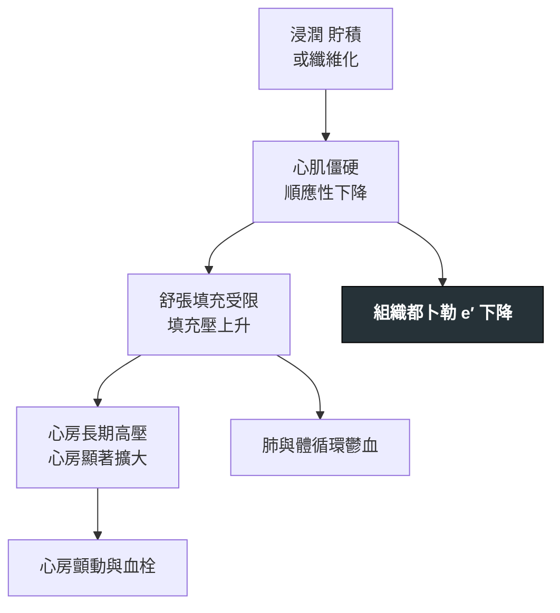

---
tags:
  - Med/Disease/Cardio
  - cardiomyopathy
  - 禁忌
aliases:
  - RCM
  - 限制型心肌症
  - 限制性心肌病變
  - Restrictive Cardiomyopathy
created: 2026-07-26
updated: 2026-07-26
status: 可用
source: 113-1 醫學(三) 6 延伸；Harrison's；ASE 2013 心包疾病影像指引
cssclass: clinical-note
presents_as:
  - "[[Edema]]"
  - "[[Dyspnea]]"
diagnosed_by:
  - "[[Echocardiography]]"
  - "[[Cardiac catheterization]]"
differential:
  - "[[Constrictive pericarditis]]"
  - "[[HCM]]"
complication:
  - "[[Atrial fibrillation]]"
---

# Restrictive cardiomyopathy ｜ 限制型心肌症 · Restrictive Cardiomyopathy

> [!abstract] 一句話總覽
> **心肌自己變僵硬**，心室裝不進血但收縮功能常常正常。臨床長得跟 [[Constrictive pericarditis]] 幾乎一樣，但**病灶在心肌不在心包**——這個差別決定了它**不能靠手術根治**，只能治底層疾病。成人最重要的病因是**心臟類澱粉沉積症**。

> [!tip] 30 秒行動卡
> **診斷關鍵**：雙側心衰竭表現 ＋ **心房明顯擴大、心室不大** ＋ 組織都卜勒 **e′ ＜8 cm/s** → 一定要回頭找病因（先想類澱粉）
> **治療骨架**：治病因（類澱粉的 tafamidis／針對輕鏈的化療）＋ 小心地利尿；末期考慮心臟移植
> **絕對不可**：在類澱粉心肌病變用 digoxin 或 CCB；也不要因為 EF 正常就當作「不嚴重」

---

## 定義與定位

| 項目 | 重點 |
|---|---|
| 本質 | 心肌順應性下降 → **舒張填充受限**；心室腔**不擴大**、壁厚正常或增厚、EF 常保持 |
| 特徵型態 | **心房顯著擴大、心室相對小**——這個對比是超音波上的第一印象 |
| 分類位置 | 心肌症的第三型（對照擴張型、肥厚型 [[HCM]]）；同時屬「舒張填充障礙」家族 |
| 病灶在哪 | **心肌**（對照：CP 在心包） |

### 病因分類

| 類別 | 代表 |
|---|---|
| **浸潤性** | **類澱粉沉積症（最重要）**、類肉瘤病、Gaucher disease |
| **貯積性** | 血鐵沉積症（hemochromatosis）、Fabry disease、肝醣貯積症 |
| **心內膜病變** | 心內膜心肌纖維化、**Löffler 心內膜炎**（嗜酸性球增多）、類癌心臟病 |
| **治療相關** | **縱膈放射治療**、anthracycline 化療 |
| 特發性／家族性 | 肌小節或 desmin 基因突變 |

> [!tip] 放射治療是唯一會同時造成 CP 與 RCM 的病因
> 所以縱膈放療病史**不能**用來區分這兩個病，反而要兩個都想。

## 病因與機制

## 臨床表現

- **典型**：運動耐受不良、疲倦；**左右心衰竭同時出現**（比 CP 更常見明顯的肺鬱血）
- **提示性**：心房顫動（心房大）、傳導阻滯（浸潤到傳導系統）、**低血壓／姿勢性低血壓**
- **少見但重要**：類澱粉的**心外線索**——腕隧道症候群（常早於心臟症狀數年）、眶周瘀斑、巨舌、蛋白尿、周邊神經病變

→ 相關主訴流程：[[Edema]]、[[Dyspnea]]

## 診斷

| 診斷條件 | 內容 |
|---|---|
| 超音波 | 心房大／心室小、壁厚正常或增厚、**e′ ＜8 cm/s**、二尖瓣 E 波呼吸變異 **＜10%**、心肌**顆粒閃爍狀**（類澱粉） |
| 心導管 | **LVEDP 比 RVEDP 高 ＞5 mmHg**；RV 收縮壓常 **＞50 mmHg** |
| 心臟 MRI | 瀰漫性心內膜下 LGE（類澱粉的典型型態）；T1 mapping／ECV 上升 |
| 病因確認 | 血清／尿液免疫固定電泳 ＋ 血清游離輕鏈（找 AL 型）；骨掃描示蹤劑（PYP／DPD）攝取（找 ATTR 型）；必要時**心肌切片** |

**要開的檢查**：[[Echocardiography]] → [[Cardiac catheterization]]（與 CP 難分時）

> [!danger] 壁厚 + ECG 低電壓 = 類澱粉，直到證明不是
> 心肌明明變厚，心電圖電壓卻**低**——這個矛盾只有浸潤性疾病能解釋。
> 對照：[[HCM]] 是壁厚 **+ ECG 高電壓**。

![[assets/cardiac-amyloidosis-echo.jpg|720]]
*類澱粉心肌病：A–C 可見室壁增厚、顆粒閃爍與少量心包積液（黃箭頭）；D 是右心室游離壁增厚（綠箭頭）；E 的 bull’s-eye 顯示 apical sparing。雙心房擴大要回到 apical four-chamber 一併確認。Source: [Weber et al., *Diagnostics* 2022, Figure 2](https://pmc.ncbi.nlm.nih.gov/articles/PMC8946926/)（CC BY 4.0）。*

## 鑑別診斷

| 要排除的 | 支持它的線索 | 怎麼排除 |
|---|---|---|
| [[Constrictive pericarditis]] | Kussmaul sign、心包叩擊音、心包增厚鈣化、**e′ ≥8 cm/s** | **完整對照表寫在 [[Constrictive pericarditis]] 那一篇**，不在此重抄 |
| [[HCM]] | 非對稱性中膈肥厚、SAM、**ECG 高電壓**、家族史 | 肥厚型態 ＋ ECG 電壓 |
| 高血壓性心臟病 | 長期高血壓、對稱輕度肥厚 | 病史 |

> [!info] 深度歸屬
> CP vs RCM 的完整鑑別表由 [[Constrictive pericarditis]] 擁有。本篇只寫「怎麼想到 RCM、想到之後往哪裡找病因」。

## 治療

| 情境 | 處置 |
|---|---|
| 核心原則 | **治底層病因**——RCM 本身沒有通用療法 |
| ATTR 類澱粉 | tafamidis 等穩定劑；早期治療效果較好 |
| AL 類澱粉 | 針對漿細胞的化療／自體移植（由血液科主導） |
| 血鐵沉積症 | 放血或鐵螯合劑 |
| 症狀控制 | **謹慎**利尿（心輸出量依賴前負荷，減太多會掉血壓）；控制心律、維持竇性節律 |
| 合併 Afib | 抗凝——心房大且類澱粉本身易生血栓（見 [[DOAC]]） |
| 末期 | 心臟移植（AL 型須先控制原發病） |

## 併發症與預後

- **要盯的併發症**：[[Atrial fibrillation]] 與心房血栓、傳導阻滯與需要節律器、進行性心衰竭
- **預後因子**：**病因決定一切**——AL 型類澱粉未治療預後最差（以月計）；ATTR 型較慢；血鐵沉積症早期治療可逆

## 禁忌與陷阱

> [!danger] 絕對不可
> | 情境 | 絕對不可 | 為什麼 | 該做什麼 |
> |---|---|---|---|
> | 類澱粉心肌病變 | 給 **digoxin** | 會與類澱粉纖維結合，容易中毒且易誘發心律不整 | 用其他方式控制心率，優先維持竇性節律 |
> | 類澱粉心肌病變 | 給 **CCB（verapamil、diltiazem）** | 同樣會結合並造成明顯低血壓 | 避免；心衰竭藥物也常因低血壓而無法耐受 |
> | 任何 RCM | 積極利尿至容積不足 | 心輸出量高度依賴前負荷 | 小劑量起、密切追蹤腎功能與血壓 |
> | 診斷 RCM 後 | 停在「限制型心肌症」就結案 | 這是**病生理描述不是最終診斷**，病因決定治療與預後 | 一定要往下找病因，先排除類澱粉 |

> [!warning] 常見錯誤
> - 把 **e′ ≥8 cm/s** 記成 RCM——那是 **CP**；RCM 是 **＜8**。
> - 把 **LVEDP − RVEDP ≤5 mmHg** 記成 RCM——那是 **CP**；RCM 是 **＞5**。
> - EF 正常就以為病情輕微——RCM 的問題在舒張，EF 幫不上忙。
> - 忘記問腕隧道症候群病史——它常是類澱粉最早的線索。

## 相關連結

- [[Constrictive pericarditis]] — 鑑別的主戰場，完整對照表在那一篇
- [[HCM]] — 另一個「壁厚」的鑑別；靠 ECG 電壓反差分開
- [[Cardiac catheterization]] — 壓力曲線判讀
- [[DOAC]] — 合併 Afib 時的抗凝
