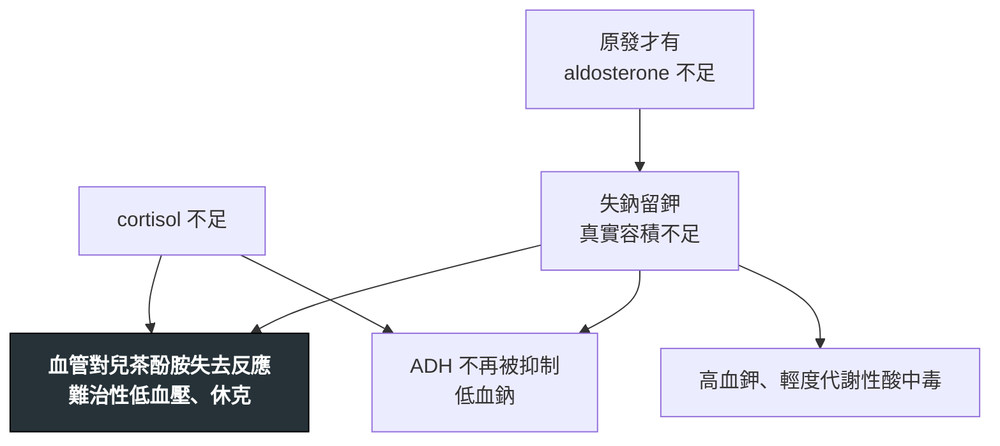

---
tags:
  - Med/Disease/Endo
  - 禁忌
aliases: [Adrenal insufficiency, 腎上腺功能不足, Adrenal crisis, 腎上腺危象, Addison disease, 愛迪生氏病, Sheehan syndrome, 席漢氏症候群, 續發性腎上腺功能不足]
created: 2026-07-28
updated: 2026-07-28
status: 可用
source: 114-1 醫學(三) 57、115-1 醫學(三) 52 延伸；Endocrine Society 原發性腎上腺不全診療指引；成人腎上腺危象預防與急救共識（Society for Endocrinology／Endocrine Society）；Harrison's 與 UpToDate 腎上腺不全章節（cosyntropin test 切點、危象 hydrocortisone 劑量、續發性偽陰性時間窗、免疫檢查點抑制劑 hypophysitis 發生率均已查證）
cssclass: clinical-note
presents_as:
  - "[[Shock]]"
  - "[[Delirium]]"
  - "[[Fever]]"
  - "[[Hyponatremia]]"
diagnosed_by:
  - "[[Cosyntropin stimulation test]]"
  - "[[Arterial blood gas]]"
treated_by:
  - "[[Hydrocortisone]]"
  - "[[Fludrocortisone]]"
differential:
  - "[[Shock]]"
  - "[[SIADH]]"
  - "[[Hypothyroidism]]"
  - "[[Hypercalcemia]]"
complication:
  - "[[Shock]]"
  - "[[Delirium]]"
  - "[[Osmotic demyelination syndrome]]"
  - "[[Cushing syndrome]]"
---

# Adrenal insufficiency ｜ 腎上腺功能不足 · 腎上腺危象

> [!abstract] 一句話總覽
> 一個荷爾蒙就把鑑別分成兩半——**ACTH 高 ＝ 腺體自己壞（原發，Addison）**，皮質整層垮掉、**aldosterone 一起不足 → 高血鉀、姿勢性低血壓、皮膚色素沉著**；**ACTH 低或「不適當地正常」＝ 上游腦下垂體／下視丘壞（續發／三發）**，aldosterone 由 RAAS 撐著仍正常 → **不會高血鉀、不會變黑**。低血鈉兩邊都有，**不能拿來分兩者**。「下游壞則上游代償升高、上游壞則上下游一起低」這條方向性可原封不動搬到甲狀腺與性腺軸。急性期只有一條鐵律：**懷疑 adrenal crisis 就先治療，不要等報告。**

> [!tip] 30 秒行動卡
> **想到它**：低血壓對**大量輸液與升壓劑都反應不良** ＋ 低血鈉 ＋（原發才有的）高血鉀。
> **做**：抽一管 cortisol ＋ ACTH（給藥前**唯一一次乾淨的診斷機會**）→ **立刻 hydrocortisone 100 mg IV bolus → 200 mg／24 h 持續輸注（或 50 mg IV q6h）＋ 大量 0.9% NaCl** → 同時找誘因（**感染最常見**）。「抽血」與「等結果」是兩件事。
> **長期**：hydrocortisone 15–25 mg/day 分 2–3 次模擬生理節律、**最大一劑在起床時**；**原發性才要加 fludrocortisone**。

## 原發 vs 續發／三發：全篇骨幹

| 項目 | **原發（Addison，腺體自己壞）** | **續發／三發（上游壞）** |
|---|---|---|
| **ACTH** | **高**（常 > 正常上限兩倍） | **低，或在低 cortisol 下「不適當地正常」** |
| **Aldosterone** | **低**——皮質整層壞，球狀帶一起沒了 | **正常**——受 RAAS ＋ 血鉀驅動，不靠 ACTH |
| **血鉀** | **高**（失去留鈉排鉀的能力） | **正常** |
| 血鈉 | **低**（失鹽 ＋ ADH 未被抑制，兩個機轉疊加） | **一樣會低**（只有 ADH 未被抑制這一個機轉） |
| **姿勢性低血壓／鹽渴** | **明顯**（真實容積不足） | 少見或輕微 |
| **皮膚黏膜色素沉著** | **有**（ACTH 與同源 POMC 前驅物刺激黑色素細胞） | **沒有，甚至偏蒼白** |
| 其他垂體軸／長期治療 | 正常；**hydrocortisone ＋ fludrocortisone** | 常合併 **TSH／LH／FSH／GH／prolactin** 一起不足；**hydrocortisone 即可** |

## 病因與機制

![[assets/adrenal-hpa-axis.svg|1000]]
*HPA 軸與三層病灶：原發性 adrenal insufficiency 的 ACTH 上升且 aldosterone 一起缺；續發／三發性的 ACTH 低，而 aldosterone 多半由 RAAS 與血鉀保留。自製示意圖。*

> [!danger] 輸液與升壓劑都拉不起來，本身就是診斷線索
> 血管平滑肌要對 catecholamine 起反應，需要 cortisol 的 **permissive effect**；沒有 cortisol，打再多 norepinephrine 也踩不到油門。**難治性低血壓 ＋ 找不到相稱的失血或感染灶**，就該把危象放進前三名——這是給了 hydrocortisone 之後**幾小時內看得到血壓回來**的少數情況之一。休克總分類與輸液通則見 [[Shock]]。

> [!note]- 病因：原發先想自體免疫與結核，續發／三發第一名是外源性類固醇突然停用
> | 分類 | 病因 | 線索 |
> |---|---|---|
> | **原發①** | **自體免疫 adrenalitis（已開發地區最常見）** | **21-hydroxylase 抗體陽性**；常合併 [[Hashimoto thyroiditis]]、[[T1DM]]、白斑、惡性貧血（autoimmune polyglandular syndrome type 2）。CT 腺體**萎縮、無鈣化** |
> | **原發②** | **[[Tuberculosis]] 結核性腎上腺炎** | **在台灣仍必須主動想到**；CT 早期**雙側腫大**、後期**鈣化** |
> | 原發③ | 雙側腎上腺出血、轉移癌、浸潤性疾病（[[Sarcoidosis]]）、藥物（ketoconazole、etomidate、mitotane） | 出血＝突發腹背痛 ＋ 血比容驟降 ＋ 休克；etomidate **單次插管劑量**即可短暫抑制 |
> | **續發／三發①** | **外源性類固醇突然停用——遙遙領先的第一名** | 任何途徑都算（口服、關節注射、吸入、外用）。**> 20 mg/day prednisolone 當量用超過 3 週 → 直接假設 HPA 軸被抑制、不必先驗**；但這**不是安全門檻**，只要**超過生理劑量（約 4–6 mg/day 當量）且連續 ≥ 3–4 週**就可能造成 |
> | **續發／三發②** | **Sheehan syndrome 席漢氏症候群** | **產後大出血 → 腦下垂體缺血性壞死**。最早是**無法泌乳與無月經**；ACTH／TSH 不足**可能拖十幾二十年才顯現**，病史要問到很久以前 |
> | 續發／三發③ | 腦下垂體腫瘤／術後／放療、**pituitary apoplexy**、淋巴球性腦下垂體炎、**免疫檢查點抑制劑 hypophysitis** | 卒中＝突發劇烈頭痛 ＋ 視野缺損 ＋ 眼肌麻痺 ＋ 休克。ICI 以 **anti-CTLA-4 風險最高**（單用約 3%、與 anti-PD-1 併用約 6%，呈劑量依賴），多在治療後 6–12 週，**ACTH 缺乏常是永久的** |

## 臨床表現與診斷

- **慢性**：倦怠、無力、食慾差、體重減輕、低血壓、**姿勢性頭暈與鹽渴**、噁心嘔吐腹痛（可像急腹症）；**原發獨有**的皮膚黏膜色素沉著（掌紋、關節伸側、疤痕、乳暈、**頰黏膜與牙齦**）。續發者反而常見**無泌乳、無月經、其他垂體軸不足**。
- **實驗室背景**：低血鈉（最常見）、**高血鉀（僅原發）**、輕度代謝性酸中毒、**嗜酸性球與淋巴球增多**、正球性 [[Anemia]]、低血糖、輕度高血鈣。**「低血鈉 ＋ 高血鉀 ＋ 嗜酸性球高」湊在一起，立刻想到原發性。**
- **危象的誘因**：感染最常見（[[Pneumonia]]、腸胃炎、泌尿道感染）、手術麻醉、外傷、心肌梗塞、**病人自己漏吃或停掉類固醇**。**危象病人多半早就知道自己有腎上腺不全——失誤不在診斷不出來，而在沒有及早加量。** 發燒評估見 [[Fever]]；急性期一管 [[Arterial blood gas]] 最快拿到鉀、鈉與酸鹼。

> [!danger] 反直覺：長期類固醇造成的續發性，病人不會變瘦，反而是庫欣外觀
> 「倦怠 ＋ 體重減輕」是慢性**原發性**的樣子。**外源性類固醇造成的續發／三發，病人常是月亮臉、中心肥胖、體重不減反增**——**不能用「有沒有變瘦」來排除腎上腺不全**。同理，**沒有色素沉著、沒有高血鉀，只能排除「原發」，不能排除腎上腺不全**。問病史時關節注射、吸入劑、外用藥、中草藥與來路不明的「消炎藥」都要問到，病人多半不覺得那是類固醇。

> [!danger] 反直覺：續發性早期，cosyntropin test 可能「正常」——但病人真的不足
> 這個試驗測的是**腎上腺對一劑超生理量 ACTH 的反應能力**，不是腦下垂體的分泌能力。腦下垂體剛壞掉時（**術後、卒中、外傷後數週內**），腎上腺還沒萎縮，被大劑量 ACTH 一戳仍噴得出 cortisol → **偽陰性**。臨床高度懷疑而試驗正常時**不能就此收工**：**6–8 週後重做**，或改用低劑量 1 µg 試驗、insulin tolerance test。
> 同理，重症壓力下的單次 cortisol「落在正常範圍」也不代表足夠——**該高而不高就是不足**。

> [!note]- 早晨 cortisol 與刺激試驗的切點：15 和 18 不能混用，新式分析法還要再下修
> - **早晨 8 點（起床後 1 小時內）血清 cortisol**：**< 3 µg/dL（83 nmol/L）幾乎確定不足；> 15 µg/dL（415 nmol/L）幾乎可排除；中間是灰區 → 做刺激試驗**。無法做刺激試驗時，Endocrine Society 2016 以**晨間 cortisol < 5 µg/dL ＋ ACTH 升高**作為支持診斷的初步依據。
> - **[[Cosyntropin stimulation test]]**：**250 µg IV／IM，測 0／30／60 分鐘 cortisol，峰值 < 18 µg/dL（500 nmol/L）判為不足**。**18 是刺激試驗峰值的切點，不要和晨間基礎值的門檻混用。**
> - **高劑量（250 µg）與低劑量（1 µg）傳統上共用同一個切點，差別在採檢時間而不是數字。**
> - **18 來自舊式多株抗體免疫分析；改用新式單株抗體法時切點要下修**——Roche Elecsys II 與 Abbott Architect 建議約 **14–15 µg/dL**，LC-MS/MS 另有自己的切點。**判讀一律以自家檢驗室採用的方法為準。**

> [!note]- 分完上下游還要補的檢查，以及最會混淆的三個鑑別
> | 檢查 | 什麼時候開 | 怎麼讀 |
> |---|---|---|
> | **血漿 ACTH（與 cortisol 同時抽）** | 一律 | **分上下游最關鍵的一步**；需冰浴送檢，採檢條件不對會假性偏低 |
> | Renin、aldosterone | 疑似原發 | **renin 高 ＋ aldosterone 低** ＝ 礦質皮質素也不足 → 需要 fludrocortisone |
> | **21-hydroxylase 自體抗體** | 已確認原發 | 陽性 → 自體免疫病因；陰性才往結核／出血／浸潤找 |
> | 腎上腺 CT | 原發且抗體陰性 | **雙側腫大或鈣化 → 結核、出血、轉移**；萎縮 → 自體免疫 |
> | **腦下垂體 MRI ＋ 其他垂體軸**（TSH／free T4、LH／FSH、prolactin、IGF-1） | 確認為續發 | 找腫瘤、hypophysitis、空蝶鞍；**一次評估完所有軸** |
>
> - **敗血性休克**：兩者**經常同時存在**（感染誘發危象）。升壓劑反應差 ＋ 低血鈉 ＋ 高血鉀 → 抽 cortisol 後直接給 hydrocortisone。
> - **[[SIADH]]**：與續發性長得幾乎一樣（低血鈉、尿滲透壓高、尿鈉不低）。差別在 **SIADH 容積正常且無低血壓**；**診斷 SIADH 前必須先排除腎上腺不全與甲狀腺低下。**
> - **[[Hypothyroidism]]／黏液水腫昏迷**：續發性時兩者常併存；**垂體功能低下的病人 TSH 不能用來評估甲狀腺功能**，要看 free T4。
> - 另外要想到 [[Hypercalcemia]]（腎上腺不全是它的少見病因）、[[Delirium]]，以及急腹症——危象的腹痛**沒有相稱的影像發現**，別在補類固醇前把病人推進開刀房。

| **掌紋色素加深** | **頰黏膜色素沉著** |
|---|---|
| ![[assets/adrenal-insufficiency-palmar-hyperpigmentation.jpg\|360]] | ![[assets/adrenal-insufficiency-oral-hyperpigmentation.jpg\|420]] |

*曬黑通常不會選擇性加深掌紋與口腔黏膜；這兩個「不該曬到的位置」是原發性 adrenal insufficiency 的高價值線索。Source: Mosca et al., *Cureus* 2021, Figures 1–2（[PubMed](https://pubmed.ncbi.nlm.nih.gov/33747659/)，CC BY 4.0）。*

## 治療

> [!danger] 反直覺且致命：先給類固醇，再給甲狀腺素——順序顛倒會誘發危象
> 甲狀腺素會**加快 cortisol 的代謝清除**。在一個 cortisol 本來就不夠的病人身上先補 levothyroxine，等於**把僅存的庫存加速燒掉** → 直接點燃 adrenal crisis。**只要同時懷疑腎上腺不全與甲狀腺低下（Schmidt syndrome、全垂體功能低下、Sheehan），一律先補或至少同時補 glucocorticoid，再開始 levothyroxine。** 同屬「先治療再確診」的還有 [[Thyroid storm]] 與黏液水腫昏迷。

> [!note]- 危象與長期替代的完整劑量，以及診斷未定時該用哪一種類固醇
> | 步驟 | 做什麼 | 重點 |
> |---|---|---|
> | **① Hydrocortisone** | **100 mg IV／IM bolus → 200 mg／24 h 持續輸注，或 50 mg IV q6h** | 此劑量**本身已有足夠礦質皮質素作用**，急性期不必另加 fludrocortisone |
> | **② 大量等張生理食鹽水** | **0.9% NaCl**，第一小時常需 1 L 以上，之後依血壓、尿量、心腎功能調整 | 原發者是**真實容積不足**，補液量往往超乎預期；有低血糖時併用含糖輸液 |
> | ③ 處理誘因 ＋ 監測 | 感染、心肌梗塞、外傷、漏藥；鈉、鉀、血糖每數小時追 | **只補類固醇不處理誘因，血壓會再掉下去**。高血鉀多半隨補液與類固醇自行下降，重點反而在**別讓血鈉衝太快** |
> | ④ 診斷未定時 | **改用 dexamethasone 撐住** | 常用類固醇中**只有 dexamethasone（與 betamethasone）幾乎不與 cortisol 免疫分析交叉反應——prednisolone／prednisone 會顯著交叉反應，絕不能替代**。但它**沒有礦質皮質素作用**（補液不能省），且**仍會抑制 ACTH**，刺激試驗要儘早補做 |
> | ⑤ 長期替代 | **Hydrocortisone 15–25 mg/day 分 2–3 次**（原發與續發都要）＋ **fludrocortisone 0.05–0.2 mg 每早一次（只有原發需要）** | Hydrocortisone **沒有可靠血中指標可追**，以症狀、體重、血壓調整；fludrocortisone 依**姿勢性血壓變化、水腫、血鉀、plasma renin** 調，**不要限鹽**。續發者再依缺損補甲狀腺素與性荷爾蒙 |

> [!note]- Sick day rules：生病加倍、吐了改打針、手術比照危象、隨身注射套組與識別卡
> **① 生病加量**：發燒或需要看醫師的感染 → **口服劑量加倍**（病得更重可到三倍），**持續到康復後 24–48 小時**再回原劑量。
> **② 吃不下、吐、腹瀉 → 改注射**：口服吸收不了時，**hydrocortisone 100 mg IM 立刻打**，然後就醫。
> **③ 手術與檢查要事先加量**：小處置／小手術當日給到數十毫克即可；**大手術或全身麻醉比照危象劑量**（100 mg IV 後 200 mg／24 h），術後幾天逐步減回。
> **④ 隨身兩樣東西**：**緊急 hydrocortisone 注射套組**（病人與家屬都要會打）＋ **識別卡或手環**。危象多半發生在家裡或送醫途中，**第一劑打得早晚決定生死；懷疑時打下去不會有事，不打才會。**

> [!note]- 併發症與預後：反覆危象才是死因，補過頭就走到 Cushing 那一端
> - **要盯的併發症**：反覆 adrenal crisis（死亡主因）、低血容性與分佈型 [[Shock]]、低血糖、[[Delirium]]、**血鈉矯正過快造成的 [[Osmotic demyelination syndrome]]**。
> - **長期類固醇過量**：向心性肥胖、骨質疏鬆與骨折、高血糖與糖尿病（見 [[T2DM]]、[[Antidiabetics]]）、高血壓與血脂異常（見 [[Metabolic syndrome]]）、感染風險上升——也就是走到 [[Cushing syndrome]] 那一端。**替代的目標是「剛好夠」，不是「補到病人完全沒症狀」。**
> - **Fludrocortisone 過量**：水腫、高血壓、低血鉀；不足則是姿勢性低血壓、鹽渴、renin 持續偏高。
> - **預後**：規律替代 ＋ 懂得加量 ＋ 生病時提早行動 → **壽命與生活品質可以接近常人**。決定預後的**不是腺體壞了多少，而是病人與家屬會不會處理生病的那幾天**。

## 禁忌與相關連結

> [!danger] 絕對不可
> | 情境 | 絕對不可 | 為什麼 | 該做什麼 |
> |---|---|---|---|
> | 休克 ＋ 強烈懷疑 adrenal crisis | **為了等 cortisol／ACTH／cosyntropin 結果才給類固醇** | 這些不是急檢，要數小時到隔天；未治療的危象會死人 | **抽完血立刻給 hydrocortisone 100 mg IV**，報告事後再看 |
> | 診斷尚未確定但病人撐不住 | 先打 **hydrocortisone** 再送 cortisol | hydrocortisone 就是 cortisol，**會被免疫分析測到**，之後所有 cortisol 檢驗與 cosyntropin test 全部作廢 | 改用 **dexamethasone** 撐住，**再補做 cosyntropin test** |
> | 疑似或已知腎上腺不全 ＋ 甲狀腺低下 | 先給 **levothyroxine** | 甲狀腺素**加速 cortisol 代謝清除** → 直接誘發危象 | **先給／至少同時給 glucocorticoid**，再開始 levothyroxine |
> | 長期口服類固醇者 | **突然停藥**，或生病、手術時照原劑量 | HPA 軸被抑制、腎上腺已萎縮，需求一上升就完全跟不上 | **緩慢減量**；生病／手術一律**加量或改注射**（sick day rules） |
> | 原發性腎上腺不全的長期替代 | 只給 hydrocortisone、**不給 fludrocortisone** | aldosterone 缺失沒補上 → 持續失鹽、姿勢性低血壓、高血鉀 | 加 **fludrocortisone 0.05–0.2 mg/day**，依血壓、姿勢性變化、鉀、renin 調 |
> | 腎上腺不全 ＋ 嚴重低血鈉 | 補了類固醇後**放著血鈉自己往上衝** | cortisol 一補、**ADH 立刻被抑制 → 大量排自由水 → 血鈉矯正過快** | 限制每日上升幅度、密集追鈉與尿量；衝過頭時以 5% 葡萄糖水（±desmopressin）回拉 |

- [[Shock]] · [[Fever]] · [[Arterial blood gas]] — 危象是分佈型 ＋ 低血容型的混合休克；休克總分類、輸液通則、升壓劑選擇、發燒起手式與急性期電解質都寫在那裡，這裡不重複
- [[Primary aldosteronism]] · [[Cushing syndrome]] — 完美鏡像對讀：一個是高血壓 ＋ 低血鉀，一個是類固醇過量的那一端，替代劑量沒抓好就會走過去
- [[Thyroid storm]] · [[DKA]] — 同屬「先治療再確診」的內分泌急症，急診鑑別時常同框出現
- [[Hypercalcemia]] · [[SIADH]] · [[Delirium]] · [[Hypothyroidism]] · [[T2DM]] · [[Antidiabetics]] · [[Metabolic syndrome]] · [[禁忌選項]] — 低血鈉／高血鈣／意識混亂的鑑別鄰居、類固醇替代推高血糖時要一起調的藥與代謝後果，以及四欄禁忌表的索引
