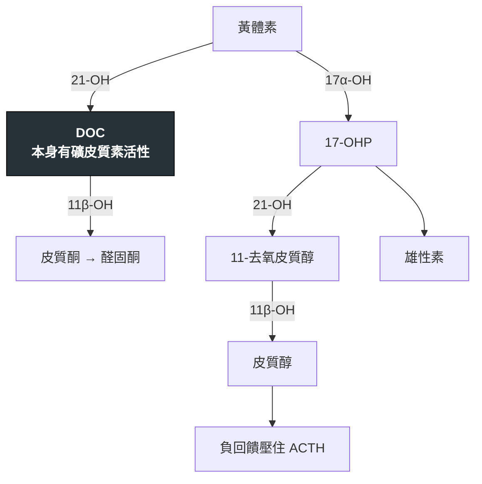

---
tags:
  - Med/Disease/Endo
  - 繼發性高血壓
  - 禁忌
aliases:
  - CAH
  - Congenital adrenal hyperplasia
  - 先天性腎上腺增生
  - 先天性腎上腺皮質增生症
  - 21-hydroxylase deficiency
  - 21-羥化酶缺乏
  - 11-beta-hydroxylase deficiency
  - 11β-羥化酶缺乏
  - 17-alpha-hydroxylase deficiency
  - 17α-羥化酶缺乏
  - 失鹽危象
  - Salt-wasting crisis
created: 2026-07-29
updated: 2026-07-29
status: 可用
source: Endocrine Society《Congenital Adrenal Hyperplasia Due to Steroid 21-Hydroxylase Deficiency》Clinical Practice Guideline；Harrison's 腎上腺皮質疾病章；台灣新生兒篩檢項目
cssclass: clinical-note
presents_as:
  - "[[Hypokalemia]]"
  - "[[Hypertension]]"
differential:
  - "[[Adrenal insufficiency]]"
  - "[[Primary aldosteronism]]"
  - "[[Cushing syndrome]]"
complication:
  - "[[Adrenal insufficiency]]"
---

# Congenital adrenal hyperplasia ｜ 先天性腎上腺增生 · CAH

> [!abstract] 一句話總覽
> 皮質醇合成路上有一個酵素壞掉 → 皮質醇做不出來 → **ACTH 失去負回饋而狂升** → 腎上腺被撐大(這就是 hyperplasia 的由來),同時**堵住點上游的中間產物大量堆積**。所以每一型的長相只由一個問題決定:**塞住的位置在哪,前驅物往哪邊溢出去。**

> [!tip] 30 秒行動卡
> **一句話分三型**:**21 型失鹽 ＋ 男性化**;**11β 型高血壓 ＋ 男性化**;**17α 型高血壓 ＋ 沒有性徵**
> **血鉀的方向是最快的分水嶺**:**21 型高血鉀**(失鹽),**11β 與 17α 型往低血鉀方向**(DOC 堆積)
> *(方向可靠,但別當成「一定有」:典型 11β 型診斷時只約 2/3 有高血壓,血鉀也可以正常。)*
> **絕對不可**:懷疑失鹽危象時等檢驗結果才給藥;壓力事件不加類固醇劑量

---

## 定義與定位

| 型別 | 佔比 | 血壓／鹽 | 雄性素 | 標記物 |
|---|---|---|---|---|
| **21-羥化酶缺乏** | **約 90–95%** | **失鹽**、血壓低、**高血鉀** | **高** → 男性化 | **17-OHP** 大量升高 |
| **11β-羥化酶缺乏** | 約 5% | **高血壓**、**低血鉀** | **高** → 男性化 | **11-deoxycortisol、DOC** 升高 |
| **17α-羥化酶缺乏** | 罕見 | **高血壓**、**低血鉀** | **低** → 無第二性徵 | **DOC、corticosterone** 升高;17-OHP **低** |

> [!important] 三型的差異只有兩個問句
> **① 塞住的位置在礦皮質素那條線的上游還是下游?**
> 21 型塞在 DOC **之前** → 礦皮質素做不出來 → **失鹽**。11β 與 17α 型塞在 DOC **之後** → **DOC 堆積**,而 DOC 本身就有礦皮質素活性 → **高血壓 ＋ 低血鉀**。
> **② 前驅物能不能溢到雄性素那條線?**
> 21 與 11β 型的阻斷點在雄性素分支**之後**,堆積的前驅物只能往雄性素跑 → **男性化**。17α 型的阻斷點在雄性素分支**之前**,連做都做不出來 → **性荷爾蒙全面缺乏**。

## 病因與機制

**兩條平行的線,共用 21-OH 與 11β-OH 兩個酵素。** 左線做礦皮質素,右線做皮質醇,右線的中途岔出雄性素。

| 型 | 塞在哪 | 左線(鹽) | 右線(皮質醇) | 雄性素 |
|---|---|---|---|---|
| **21-OH** | 兩條線的**第一步** | DOC 做不出來 → **失鹽** | 不足 | **17-OHP 大量堆積 → 溢向雄性素 → 男性化** |
| **11β-OH** | 兩條線的**第二步** | **DOC 堆積 → 高血壓** | 不足 | 11-去氧皮質醇堆積 → 溢出 → **男性化** |
| **17α-OH** | 右線的**入口** | 全部被推向左線 → **DOC 更多 → 高血壓** | 不足 | 岔路在阻斷點下游 → **雄性素做不出來** |

> [!important] 記住 DOC 這個節點就記住三型
> DOC 在 **21-OH 的下游、11β-OH 的上游**。塞在它前面 → 失鹽;塞在它後面 → 堆積 → 高血壓。
> 而 **17-OHP 是右線的入口產物**:21 型堵在它下游 → **17-OHP 爆高**(所以是篩檢標記);17α 型堵在它上游 → **17-OHP 反而低**。

> [!note] 三型的共同點與一個例外
> **皮質醇都不足 ＋ ACTH 都高 ＋ 腎上腺都增生。** 差別全在礦皮質素與雄性素這兩軸。
> **例外:17α 型很少發生腎上腺危象**——堆積的**皮質酮(corticosterone)濃度可達正常的 50–100 倍**,本身有足夠的糖皮質素活性頂著。這是容易被推論錯的一格。

## 臨床表現

**21-羥化酶缺乏(最重要)**

| 亞型 | 長相 |
|---|---|
| **典型失鹽型**(約 75%) | **新生兒 1–3 週**出現嘔吐、脫水、**休克**;**低血鈉 ＋ 高血鉀 ＋ 低血糖 ＋ 代謝性酸中毒**;**女嬰外生殖器男性化**(男嬰外觀正常,所以更容易被漏掉直到休克) |
| **典型單純男性化型** | 沒有失鹽;女嬰生殖器模糊、兒童期性早熟、生長快但**骨齡超前 → 最終身高變矮** |
| **非典型／晚發型** | 青春期後才出現多毛、痤瘡、月經不規則、不孕——**長得像 PCOS** |

**11β-羥化酶缺乏**:高血壓 ＋ 低血鉀 ＋ **女性男性化／男童性早熟**。是 CAH 裡唯一「高血壓 ＋ 男性化」的組合。

**17α-羥化酶缺乏**:高血壓 ＋ 低血鉀 ＋ **性徵缺乏**。46,XX 表現為**原發性無月經 ＋ 青春期不發育**;46,XY 因睪固酮做不出來而外生殖器女性化(但 AMH 正常 → **沒有子宮**)。

→ 相關主訴流程:[[Hypokalemia]]、[[Hypertension]]

## 診斷

| 步驟 | 內容 |
|---|---|
| **新生兒篩檢** | 台灣已納入,測 **17-OHP** → 抓 21-羥化酶缺乏 |
| **第一線生化** | **17-OHP**(清晨、女性取卵泡期);電解質、血糖、血氣 |
| **11β 型** | **11-deoxycortisol** 與 **DOC** 升高 |
| **17α 型** | **DOC、corticosterone、黃體素**升高;**17-OHP 與雄性素都低**;性荷爾蒙低而 **LH/FSH 高** |
| **界線值** | **ACTH(cosyntropin)刺激試驗**看前驅物的反應 |
| 確診／帶因 | 基因檢測(CYP21A2、CYP11B1、CYP17A1) |

> [!tip] 晚發型 21 型 vs PCOS——有數字
> 清晨、卵泡期 **17-OHP**:**<200 ng/dL(6 nmol/L)基本可排除**;**>1000 ng/dL 可診斷**;**200–1000 之間 → 做 ACTH 刺激試驗**。
> 這是成人內分泌門診真正會用到的一格,也是「多年被當 PCOS 治」的解方。

> [!warning] 新生兒 17-OHP 篩檢的偽陽性
> **早產、低體重、生病或有壓力的新生兒 17-OHP 本來就偏高**,偽陽性率不低。台灣採**依出生體重調整的切點**並安排複檢。
> 看到一張陽性初篩不等於診斷——**但也不能放著**,要照流程複檢與臨床評估。

## 鑑別診斷

| 要排除的 | 支持它的線索 | 怎麼排除 |
|---|---|---|
| **[[Adrenal insufficiency]]**(其他原因) | 皮質醇不足、休克 | 沒有前驅物堆積;沒有生殖器異常 |
| 幽門狹窄(新生兒嘔吐) | 嘔吐、脫水 | 幽門狹窄是**低血鉀、低血氯、代謝性鹼中毒 ＋ 尿氯低 ＋ 反常性酸尿**;21 型 CAH 是**高血鉀、代謝性酸中毒**——方向完全相反 |
| **Bartter type 2(ROMK)新生兒期** | 羊水過多、早產、脫水,**出生第一週可能先出現暫時性高血鉀** | 之後轉為低血鉀;沒有生殖器異常、17-OHP 正常 → [[Renal tubulopathies]] |
| [[Primary aldosteronism]] | 高血壓 ＋ 低血鉀 | PA 的 **aldosterone 高**;CAH 的 aldosterone 與 renin **都低** |
| [[Renal tubulopathies\|Liddle syndrome]] · 甘草／AME | 高血壓 ＋ 低血鉀 ＋ 兩個都低 | **沒有性徵異常**;各自的病史與試驗 |
| [[Cushing syndrome]] | 高血壓 ＋ 低血鉀 | 有皮質醇**過多**的外觀;CAH 是皮質醇**不足** |
| PCOS | 多毛、月經不規則 | 清晨 17-OHP |

## 治療

| 情境 | 處置 |
|---|---|
| **失鹽危象** | **不等結果**:立刻**生理食鹽水 ＋ 葡萄糖 ＋ 靜脈 hydrocortisone**;先抽好檢體再給藥,但**不能為了等結果延遲給藥** |
| **長期(21 型)** | **Hydrocortisone**(兒童首選,對生長影響最小)＋ **fludrocortisone**;嬰兒另加**氯化鈉補充** |
| **長期(11β／17α 型)** | 給糖皮質素**壓下 ACTH → DOC 隨之下降**,高血壓與低血鉀多能改善;不足時加礦皮質素受體拮抗劑 |
| **17α 型另加** | 依性別認同給予**性荷爾蒙補充**以誘導青春期 |
| **壓力事件** | **Stress dose**:發燒、手術、外傷時劑量加倍至三倍 |

> [!warning] 兒童不要長期用 dexamethasone
> 效價強、半衰期長,**抑制生長**。兒童期以 hydrocortisone 為主,成年後才考慮長效製劑。

## 併發症與預後

- **要盯**:腎上腺危象(終身風險)、最終身高偏矮、骨齡超前、生育力下降、**睪丸腎上腺殘餘瘤(TART)**、長期類固醇的骨質與代謝副作用
- **預後**:新生兒篩檢與規則治療下可正常生活;**死亡幾乎都來自未被辨識的失鹽危象或壓力時未加量**

## 禁忌與陷阱

> [!danger] 絕對不可
> | 情境 | 絕對不可 | 為什麼 | 該做什麼 |
> |---|---|---|---|
> | 新生兒休克 ＋ 低鈉高鉀 | 等 17-OHP 結果才給類固醇 | 失鹽危象數小時內致命 | **先抽檢體,立刻給 hydrocortisone ＋ 生理食鹽水 ＋ 葡萄糖** |
> | 已知 CAH 病人發燒／手術／外傷 | 維持原劑量 | 做不出壓力所需的皮質醇 → 危象 | **Stress dose 加倍至三倍**,並教會家屬 |
> | 外生殖器模糊的新生兒 | 匆促登記性別 | 染色體、性腺與外觀可能不一致 | 先做染色體與內分泌評估,多專科討論 |
> | 男嬰 | 因為外觀正常就排除 CAH | **男嬰沒有生殖器線索**,常常直接以休克表現 | 新生兒不明休克一律驗電解質與血糖 |
> | 兒童 | 長期用 dexamethasone | 抑制生長 | 用 hydrocortisone |

> [!warning] 常見錯誤
> - **把三型的血鉀方向搞混**——**21 型高血鉀、另外兩型低血鉀**。這是最快也最常考的分辨點
> - **忘記 11β 與 17α 都是高血壓**,只記得 CAH ＝ 失鹽
> - **17α 型只想到高血壓不想到性腺**——原發性無月經 ＋ 高血壓幾乎就是它
> - **把晚發型 21 型當 PCOS 治了好幾年**——沒驗過清晨 17-OHP

## 相關連結

- [[Hypokalemia]] — 11β 與 17α 型的入口;三問演算法寫在那裡
- [[Adrenal insufficiency]] — 危象的處置與 stress dose 的通則
- [[Primary aldosteronism]] · [[Cushing syndrome]] · [[Renal tubulopathies|Liddle syndrome]] — 「高血壓 ＋ 低血鉀 ＋ renin/aldosterone 都低」的其他出口
- [[Arterial blood gas]] — 失鹽危象是酸中毒、幽門狹窄是鹼中毒,方向相反
