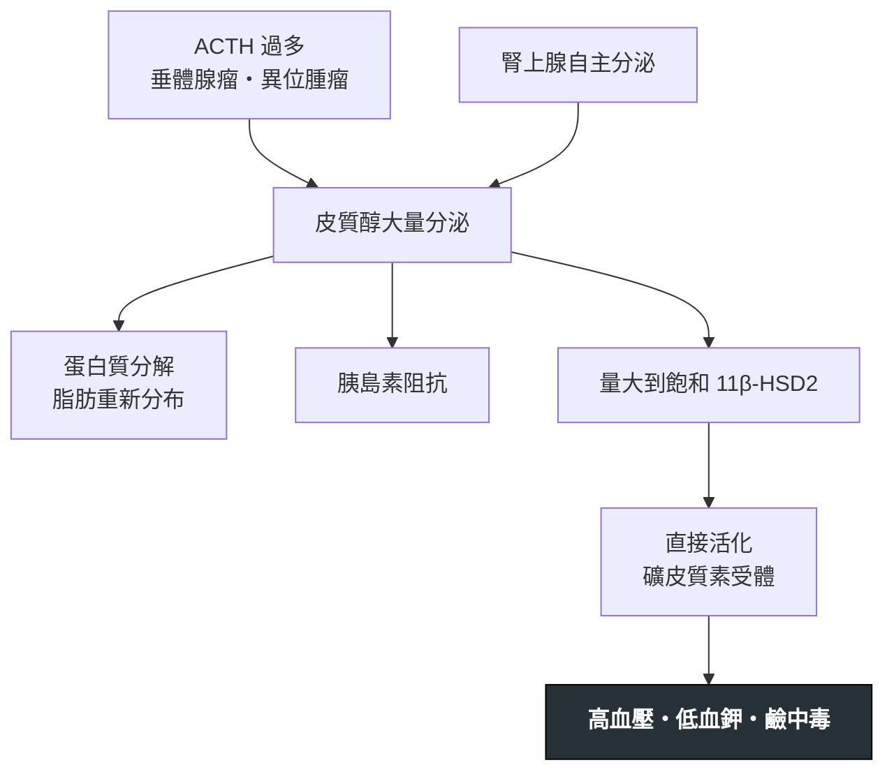

---
tags:
  - Med/Disease/Endo
  - 繼發性高血壓
  - 禁忌
aliases:
  - Cushing syndrome
  - Cushing's syndrome
  - Cushing disease
  - 庫欣氏症候群
  - 庫欣症候群
  - 皮質醇過多症
  - Hypercortisolism
  - 異位 ACTH 症候群
  - Ectopic ACTH syndrome
created: 2026-07-29
updated: 2026-07-29
status: 可用
source: "Endocrine Society《Cushing's Syndrome: Diagnosis》Clinical Practice Guideline；Endocrine Society《Treatment of Cushing's Syndrome》；Harrison's 腎上腺皮質疾病章"
cssclass: clinical-note
presents_as:
  - "[[Hypertension]]"
  - "[[Hypokalemia]]"
treated_by:
  - "[[Adrenalectomy]]"
differential:
  - "[[Primary aldosteronism]]"
  - "[[Metabolic syndrome]]"
  - "[[Renal tubulopathies]]"
complication:
  - "[[Adrenal insufficiency]]"
  - "[[T2DM]]"
  - "[[Heart failure]]"
---

# Cushing syndrome ｜ 庫欣氏症候群 · 皮質醇過多症

> [!abstract] 一句話總覽
> 皮質醇長期過多。**整體最常見的原因是外源性類固醇**,所以第一步永遠是問藥。內源性的診斷是**兩段式、順序不可顛倒**:先證明「**皮質醇真的過多**」(篩檢),再問「**從哪來**」(驗 ACTH 定位)。跳過第一步直接做影像,是這個病最常見的診斷災難——因為正常人有一成帶著腦下垂體偶發瘤。

> [!tip] 30 秒行動卡
> **診斷關鍵**:先停外源性類固醇 → **三個篩檢試驗選兩個做**(1 mg 隔夜 DST、午夜唾液皮質醇、24 小時尿液游離皮質醇)→ 陽性後**驗 ACTH** 分成兩支
> **鑑別力最高的理學表現**:**近端肌無力、寬 >1 cm 的紫紋、易瘀青、臉部多血症**(肥胖、高血壓、糖尿病沒有鑑別力)
> **絕對不可**:憑 MRI 上的小病灶就開刀;術後不補充類固醇

---

## 定義與定位

| 項目 | 重點 |
|---|---|
| 本質 | 慢性皮質醇過量。**Cushing syndrome ＝ 所有原因**;**Cushing disease ＝ 特指腦下垂體 ACTH 腺瘤** |
| **外源性** | **整體最常見**。長期口服／注射／吸入／外用類固醇 |
| **ACTH 依賴**(約 80% 的內源性) | **腦下垂體腺瘤(Cushing disease)** 最多;**異位 ACTH**(小細胞肺癌、支氣管類癌、胸腺類癌、胰臟神經內分泌瘤) |
| **ACTH 非依賴**(約 20%) | 腎上腺腺瘤、腎上腺癌、雙側增生 |
| 分類位置 | 繼發性高血壓;腎上腺偶發瘤必查三病之一(另兩個是 [[Primary aldosteronism]] 與 Pheochromocytoma) |

## 病因與機制

> [!important] 為什麼皮質醇會造成低血鉀——這是本篇與 [[Hypokalemia]] 的接點
> 皮質醇對礦皮質素受體的親和力其實與 aldosterone 相當,平常靠腎小管的 **11β-HSD2** 把它就地代謝成無活性的 cortisone,受體才輪得到 aldosterone。
> **皮質醇濃度大到把這個酵素飽和時,它就直接去踩礦皮質素受體。** 結果是高血壓 ＋ 低血鉀 ＋ 代謝性鹼中毒,而 **aldosterone 與 renin 都是低的**。
> 同一個機制的另外兩個版本:**甘草／AME** 是把 11β-HSD2 抑制掉,**[[Congenital adrenal hyperplasia|CAH]]** 是堆積 DOC 這個本身就有礦皮質素活性的中間產物。
>
> **臨床推論**:低血鉀性鹼中毒在**其他原因的 Cushing <10%**,在**異位 ACTH 高達 70–100%**(文獻多落在 57–100%)。**顯著低血鉀 ＋ 快速進展 ＝ 先想異位。**

## 臨床表現

- **鑑別力高(看到就該驗)**:**近端肌無力**(蹲下站不起來)、**寬 >1 cm 的紫色條紋**、**易瘀青**、臉部多血症、兒童**長胖卻長不高**
- **常見但沒有鑑別力**:向心性肥胖、月亮臉、水牛肩、高血壓、糖尿病、憂鬱、骨質疏鬆、月經不規則、多毛
- **異位 ACTH 的特殊長相**:**體重減輕**而非增加、**顯著色素沉著**(ACTH 極高)、嚴重低血鉀、數週到數月內快速進展——**外觀反而不像 Cushing**

→ 相關主訴流程:[[Hypokalemia]]、[[Hypertension]]

## 診斷

### 第 0 步:排除外源性

問到底,包含**吸入型、外用藥膏、關節注射、來路不明的中草藥與減肥藥**。外源性的長相是 **ACTH 低 ＋ 皮質醇低**(藥不被試劑測到),與腎上腺腫瘤不同。

### 第 1 步:篩檢——三選二

| 試驗 | 判讀 | 適用 |
|---|---|---|
| **1 mg 隔夜 dexamethasone 抑制試驗** | 早上 8 點 cortisol **>1.8 μg/dL ＝ 未被抑制** | 最方便;偽陽性最多 |
| **午夜唾液皮質醇 ×2** | 升高 | 抓「失去日夜節律」,門診可做 |
| **24 小時尿液游離皮質醇 ×2** | 升高(依實驗室倍數) | 不受 CBG 影響;收集易出錯,**CrCl <60 時不可靠** |
| **2 mg × 48 小時低劑量 DST** | 同 1 mg 版判讀 | 指引列的第四個第一線選項 |

**兩項一致陽性**才往下走。單項陽性 → 換另一項或重驗。
**選試驗要看病人**:腎功能差 → 別用 UFC;**輪班工作者與吸菸者** → 午夜唾液皮質醇不準;吃 CYP3A4 誘導劑 → 別用 DST。

> [!warning] 篩檢的偽陽性來源
> **生理性(pseudo-Cushing)**:酒精、重度憂鬱、嚴重肥胖、PCOS、懷孕、未控制糖尿病、住院急症壓力
> **藥物**:**CYP3A4 誘導劑**(phenytoin、rifampin、carbamazepine)加速 dexamethasone 代謝 → DST 假陽性;**口服避孕藥／雌激素**拉高皮質醇結合球蛋白 → 血中總皮質醇假性升高(**建議停 6 週再驗**)
> 遇到這些,選**不受影響**的試驗(唾液皮質醇、尿液游離皮質醇)。

### 第 2 步:驗 ACTH——這一步決定往哪走

| 血漿 ACTH | 分類 | 下一步影像 |
|---|---|---|
| **低**(受抑制) | **ACTH 非依賴** → 腎上腺 | **腎上腺 CT** |
| **正常或升高** | **ACTH 依賴** → 垂體或異位 | **腦下垂體 MRI** |

### 第 3 步:ACTH 依賴者要再分垂體 vs 異位

| 工具 | 支持垂體 | 支持異位 |
|---|---|---|
| 高劑量(8 mg)DST | 被抑制 | 不被抑制 |
| CRH 刺激試驗 | ACTH／cortisol **有反應** | 無反應 |
| MRI | 明確腺瘤 **≥6 mm** | 陰性或病灶太小 |
| **IPSS(岩下竇取樣)** | 中央／週邊 ACTH 比升高 | 無梯度 → 找胸腹部原發灶 |

> [!danger] MRI 看到小東西不等於找到答案
> **一般人約 10% 帶有腦下垂體偶發瘤**,而 Cushing disease 的腺瘤又常常 <6 mm 根本照不到。
> 所以「MRI 有一個 4 mm 的病灶」既可能是兇手,也可能是路人。
> **MRI 陰性、病灶 <6 mm、或生化與影像不一致時 → IPSS 才是定位的黃金標準。**

## 鑑別診斷

| 要排除的 | 支持它的線索 | 怎麼排除 |
|---|---|---|
| **外源性類固醇** | 用藥史;**ACTH 與 cortisol 都低** | 問藥,問到底 |
| **Pseudo-Cushing** | 酒癮、重度憂鬱、肥胖、PCOS | 移除誘因後重驗;dexamethasone-CRH 試驗 |
| [[Metabolic syndrome]] · 單純肥胖 | 有肥胖高血壓糖尿病,**但沒有近端肌無力與寬紫紋** | 篩檢試驗陰性 |
| [[Primary aldosteronism]] | 高血壓 ＋ 低血鉀 ＋ 鹼中毒 | **PA 的 aldosterone 高**;Cushing 的 aldosterone 低 |
| [[Renal tubulopathies\|Liddle syndrome]] · 甘草／AME | 高血壓 ＋ 低血鉀,**aldosterone 與 renin 也都低** | 沒有皮質醇過多的表現;篩檢試驗陰性 |
| [[Congenital adrenal hyperplasia]] | 高血壓 ＋ 低血鉀 ＋ 性徵異常 | 17-OHP、DOC、性荷爾蒙 |

## 治療

| 情境 | 處置 |
|---|---|
| **第一線** | **手術切除病灶**:垂體腺瘤走經蝶竇;腎上腺腫瘤做 [[Adrenalectomy\|腎上腺切除]];異位 ACTH 切原發腫瘤 |
| **術前準備／無法手術／等待放療生效** | 藥物降皮質醇:**ketoconazole、metyrapone、osilodrostat**(合成抑制);**mifepristone**(受體阻斷,用於合併糖尿病者);**pasireotide**(針對垂體) |

> [!important] Metyrapone 與 osilodrostat 會讓高血壓與低血鉀**惡化**
> 兩者擋的是 **CYP11B1(11β-羥化酶)**——也就是把 **DOC 卡在上游堆積**,和 **[[Congenital adrenal hyperplasia|11β-羥化酶缺乏]]** 是同一個機制。
> 所以用藥期間要盯血壓與血鉀,必要時加礦皮質素受體拮抗劑。**一個藥、兩篇筆記,同一條路。**

> [!warning] Mifepristone 不能用抽血追療效
> 它阻斷的是受體,不是合成 → **血中與尿中皮質醇反而會上升**,只能看臨床反應與血糖。
> 而且過多的皮質醇轉去踩礦皮質素受體 → **低血鉀可能惡化**。
| **難治** | 垂體放射治療;最後手段是**雙側腎上腺切除** |
| **支持性** | 控制血糖血壓、補鉀、骨質保護、血栓預防(高凝狀態) |

> [!warning] 雙側腎上腺切除之後要盯 Nelson 症候群
> 失去皮質醇的負回饋 → 殘餘的垂體腺瘤加速長大、ACTH 飆高 → **腫瘤壓迫 ＋ 明顯色素沉著**。術後要長期追 MRI 與 ACTH。

## 併發症與預後

- **要盯**:[[Adrenal insufficiency]](術後必然發生)、感染、靜脈血栓、[[T2DM]]、骨折、精神症狀
- **預後**:良性病灶手術治癒率高,但**代謝與骨骼的傷害恢復要數月到數年**;腎上腺癌與異位 ACTH 的惡性原因預後差

## 禁忌與陷阱

> [!danger] 絕對不可
> | 情境 | 絕對不可 | 為什麼 | 該做什麼 |
> |---|---|---|---|
> | 尚未生化確診 | 先照 MRI／CT 找腫瘤 | 一成正常人有垂體偶發瘤、腎上腺偶發瘤也常見 → 會切錯地方 | **先篩檢、再驗 ACTH、最後才影像** |
> | 術後(任何成功的手術) | 不補充類固醇 | HPA 軸被長期抑制,**必然發生急性腎上腺功能不足** | **術後給類固醇並緩慢減量**,教病人 sick day rule → [[Adrenal insufficiency]] |
> | 長期用外源性類固醇者 | 突然停藥 | 同上,會誘發腎上腺危象 | 逐步減量 |
> | 病人正在酗酒／重度憂鬱／急性住院 | 用當下的結果診斷 | pseudo-Cushing | 處理誘因後重驗 |
> | 在吃 phenytoin／rifampin | 用 1 mg DST 判讀 | dexamethasone 被加速代謝 → 假陽性 | 改用唾液或尿液游離皮質醇 |
> | 懷疑腎上腺偶發瘤 | 只驗一個病 | 偶發瘤要**同時**排除 Cushing、[[Primary aldosteronism]]、Pheochromocytoma | 三個病、三個不同的第一線試驗 |

> [!warning] 常見錯誤
> - **用肥胖、高血壓、糖尿病當診斷線索**——這三個在人群裡太常見,沒有鑑別力
> - **只做一次篩檢就下結論**——皮質醇分泌可以是週期性的
> - **異位 ACTH 想成「長得像 Cushing」**——它常常是體重**減輕**、色素沉著、嚴重低血鉀的快速病程
> - **忘記問吸入型與外用類固醇**

## 相關連結

- [[Hypokalemia]] — 「renin 低 ＋ aldosterone 低」那一格的出口之一;導航寫在那裡
- [[Primary aldosteronism]] — 同屬繼發性高血壓;分辨點是 aldosterone 的方向
- [[Congenital adrenal hyperplasia]] · [[Renal tubulopathies|Liddle syndrome]] — 同一格的另外兩個出口
- [[Adrenal insufficiency]] — 治療成功之後必然要面對的另一端
- [[Metabolic syndrome]] · [[T2DM]] — 最常見的「長得像但不是」
