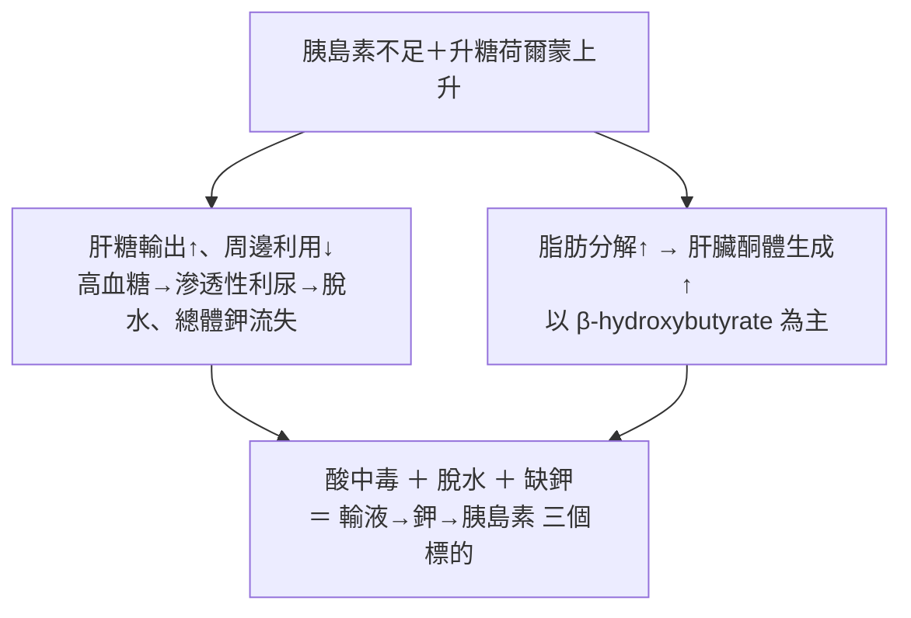

---
tags:
  - Med/Disease/Endo
  - 禁忌
aliases: [DKA, Diabetic ketoacidosis, 糖尿病酮酸中毒, 酮酸血症, 糖尿病酮症酸中毒, Euglycemic DKA]
created: 2026-07-28
updated: 2026-07-28
status: 可用
source: 114-1 醫學(三) 56、114-2 醫學(三) 58 延伸；ADA/EASD "Hyperglycemic Crises in Adults With Diabetes" Consensus Report（Diabetes Care 2024）與 ADA 2009 高血糖危症聲明（新舊版數字差異已於文中標註）；Harrison's Principles of Internal Medicine 糖尿病急性併發症章節
cssclass: clinical-note
presents_as:
  - "[[Abdominal pain]]"
  - "[[Dyspnea]]"
  - "[[Delirium]]"
diagnosed_by:
  - "[[Arterial blood gas]]"
  - "[[Anion gap]]"
treated_by:
  - "[[Insulin]]"
  - "[[Antidiabetics]]"
differential:
  - "[[Alcoholic ketoacidosis]]"
  - "[[Lactic acidosis]]"
  - "[[Acute pancreatitis]]"
  - "[[Adrenal insufficiency]]"
complication:
  - "[[Hypokalemia]]"
  - "[[Hypoglycemia]]"
  - "[[Cerebral edema]]"
  - "[[Acute kidney injury]]"
  - "[[Shock]]"
---

# DKA ｜ 糖尿病酮酸中毒 · Diabetic Ketoacidosis

> [!abstract] 一句話總覽
> **胰島素不足 ＋ 升糖荷爾蒙上升**同時打開兩條閥門：肝臟狂造葡萄糖（高血糖 → 滲透性利尿 → 脫水）與脂肪狂分解成酮體（anion gap 酸中毒）。診斷靠**高血糖 ＋ 酮體 ＋ anion gap 酸中毒**三本柱；治療永遠是**輸液 → 鉀 → 胰島素**；治療終點看**酸中毒解除**，不是血糖數字。

> [!tip] 30 秒行動卡
> **診斷**：高血糖 ＋ Kussmaul 呼吸 ＋ 噁心嘔吐腹痛 → 驗血糖、電解質（尤其鉀）、血氣 pH／bicarbonate、anion gap、β-hydroxybutyrate，同時找誘因。**血鉀一定要在給胰島素之前拿到手。**
> **治療**：0.9% NaCl 第 1 小時 1–1.5 L →（K 到手）補鉀 → regular insulin **0.1 U/kg/hr** 持續輸注 → 血糖降到 200 mg/dL 就**加 dextrose 並繼續打胰島素**，直到酸中毒解除。
> **絕對不可**：K < 3.3（2024 版 3.5）就打胰島素｜血糖正常就停輸注｜用尿酮試紙判斷療效｜血糖不高就排除 DKA｜第一型糖尿病改用口服降糖藥。

## 定義與機制
| 項目 | 重點 |
|---|---|
| 本質 | **胰島素不足 ＋ counterregulatory hormone（glucagon、catecholamine、cortisol、GH）過多** → ketogenesis 失控 |
| 三本柱 | **高血糖 ＋ 酮體 ＋ anion gap 代謝性酸中毒**，三者缺一不成立 |
| 好發族群 | 典型是第一型（分型見 [[T2DM]]）；**第二型在感染／手術／心肌梗塞下也會**，ketosis-prone diabetes、LADA 亦然 |
| 發病速度 | **數小時到一天**（HHS 是數天到數週）——病人常是「昨天還好好的」 |
| 誘因 5 個 I | **Infection（最常見**：[[Pneumonia]]、泌尿道感染、敗血症；**沒發燒不代表沒感染**，酸中毒使體溫偏低，有發燒才是異常）｜**Infarction**（[[ACS]]、中風、腸繫膜缺血；年長者一律 [[EKG ischemia]] ＋ [[Troponin]]）｜**Insulin 沒打**（年輕第一型第一名；要問「這幾天實際打了幾針」）｜**Intoxication**（酒精，另見 [[Alcoholic ketoacidosis]]）｜**Iatrogenic**（類固醇、SGLT2 inhibitor） |

![[assets/dka-ketogenesis.svg|1000]]
*Ketogenesis 與酮體三兄弟：acetoacetate 可逆轉成 β-hydroxybutyrate，也可不可逆脫羧成 acetone；nitroprusside 尿酮只看得到前者與少量 acetone，完全看不到 DKA 最重時占比最高的 BHB。自製示意圖。*

> [!note]- SGLT2 inhibitor 為什麼會造出「血糖漂亮的 DKA」，以及術前要停 3–4 天、台灣適應症不含第一型
> **機轉**：SGLT2 inhibitor 把葡萄糖從尿裡倒掉，血糖被壓在 200 mg/dL 上下；但尿糖流失同時降低胰島素分泌、抬高 glucagon，脂肪分解與 ketogenesis 照常進行。同機轉還有**懷孕**（胎盤消耗葡萄糖）與**長時間飢餓**（肝醣耗盡）。
> **停藥時程**：FDA 2020 仿單——canagliflozin／dapagliflozin／empagliflozin 術前至少停 **3 天**，ertugliflozin 至少停 **4 天**，進食恢復且酮酸中毒風險因子解除後再開始。2024 ADA/EASD 共識另建議**住院期間不要啟用或續用**。
> **台灣**：核准適應症為第二型糖尿病（部分品項另有心衰竭、慢性腎病），**不含第一型**；用於第一型屬仿單外使用且顯著提高 DKA 風險（查證 2026-07，以最新健保規範與 TFDA 許可證為準）。

## 臨床表現與診斷
- **典型**：多尿多渴、體重下降 → 噁心嘔吐、**腹痛（按壓卻無壓痛、無反彈痛，與酸中毒嚴重度成正比、矯正後會消失）** → **Kussmaul 呼吸**、呼氣水果味、皮膚乾燥、心搏過速、姿勢性低血壓；DKA 多半清醒，**意識明顯改變要想滲透壓已很高或另有中樞病因**（[[Delirium]]、[[Abdominal pain]]、[[Dyspnea]]）

| 三本柱 | 傳統數值（考試常用） | 2024 ADA/EASD 版 | 備註 |
|---|---|---|---|
| **① 高血糖** | 血糖 **> 250 mg/dL** | **≥ 200 mg/dL，或已知糖尿病病史即符合** | 放寬是為了把 euglycemic DKA 納進來 |
| **② 酮體** | 血清或尿液酮體陽性 | **β-hydroxybutyrate ≥ 3.0 mmol/L**；無血酮機時尿酮 ≥ 2+ | **首選 β-hydroxybutyrate，不是尿酮** |
| **③ 酸中毒** | **pH ≤ 7.30 且／或 bicarbonate ≤ 18**，anion gap 升高 | pH < 7.3 且／或 bicarbonate < 18 | AG ＝ Na⁺ −（Cl⁻ ＋ HCO₃⁻），正常 8–12；**2024 已把 anion gap 移出正式準則**（[[Arterial blood gas]]、[[Anion gap]]） |

> [!note]- 2024 嚴重度分級（決定收哪一層病房）＋ 必開檢查的三個陷阱：白血球、creatinine、血鈉
> **嚴重度**：輕度＝BHB ≤ 6 mmol/L、pH > 7.25、bicarbonate ≥ 15、意識清楚（一般病房）｜中度＝pH 7.0–7.25、bicarbonate 10–<15（次加護）｜重度＝BHB > 6、pH < 7.0、bicarbonate < 10、木僵或昏迷（加護病房）。anion gap 已不再是嚴重度指標，也不必每一項都符合。
> **一定要開**：血鉀＋電解質（最急，決定能不能給胰島素）、血氣（靜脈 pH 約比動脈低 0.03，追蹤用靜脈就夠）、β-hydroxybutyrate、校正血鈉、BUN／Cr、滲透壓、CBC、尿液、CXR、血培養、EKG ＋ troponin、育齡女性驗孕。
> **三個陷阱**：① **DKA 本身白血球就會 15–25 K**，bands 明顯增加或 > 25 K 才強烈指向感染。② **acetoacetate 會干擾 Jaffé 法而假性抬高 creatinine**（酵素法不受影響）——治療後 Cr「下降」可能只是酮體被清掉。③ 校正 Na ＝ 測得 Na ＋ 1.6 ×（血糖 − 100）/100；高三酸甘油酯造成假性低血鈉。

![[assets/dka-ketone-treatment-kinetics.svg|1000]]
*治療後 BHB 快速下降，部分先轉回 acetoacetate，讓 nitroprusside 尿酮在早期可能暫時更強；判斷 DKA 是否解除應追 BHB 與靜脈 pH／bicarbonate，不是追尿酮轉陰。自製示意圖。*

## 鑑別診斷：DKA vs HHS（治療骨架一樣，差在 HHS 更重補水量與滲透壓下降速度）
| | **DKA** | **HHS（hyperosmolar hyperglycemic state）** |
|---|---|---|
| 族群與速度 | 較年輕、第一型；**數小時–1 天** | 年長、第二型；**數天–數週** |
| 血糖 | > 250 mg/dL（**可為 euglycemic**） | **> 600 mg/dL** |
| pH／bicarbonate／酮體 | **≤ 7.30／≤ 18 mEq/L；酮體明顯升高、AG 升高** | **> 7.30／> 18 mEq/L；酮體微量或無、AG 正常** |
| 滲透壓與意識 | 不一定高、**多半清醒** | **> 320 mOsm/kg、常有意識障礙** |
| 脫水量與死亡率 | 約 6 L（100 mL/kg）；成人 **< 1%** | **9 L 以上；數 % 到 20%** |

> [!note]- 除了 HHS，還要排除的六種酮症與酸中毒：血糖不高、或酮體陰性，就是換一條路
> [[Alcoholic ketoacidosis]]：酗酒、暴食後停食、嘔吐，**血糖正常或偏低**，常合併低血鎂低血磷。
> 飢餓性酮症：長時間未進食，酸中毒輕微、**bicarbonate 很少低於 18**。
> [[Lactic acidosis]]：休克、缺氧、metformin 累積；**lactate 高而酮體陰性**，兩者可並存。
> 尿毒症酸中毒：慢性腎病、Cr 高，anion gap 升高但**酮體陰性、血糖不高**。
> 中毒（methanol、ethylene glycol、salicylate）：**osmolar gap 升高**；salicylate 是呼吸性鹼中毒＋代謝性酸中毒混合。
> [[Acute pancreatitis]]（DKA 本身酵素就會升，靠影像）與 [[Adrenal insufficiency]]（輸液反應差、低血鈉高血鉀，可與 DKA 並存）。

## 治療
> [!danger] 順序鐵律：輸液 → 鉀 → 胰島素，不是三件同時做
> 先給輸液是因為病人平均缺水 6 公升，**容積不夠時給胰島素會讓血糖與鉀同時往細胞內移動，血壓直接掉下去**；一定要先看到血鉀數字才給胰島素。這是整個處置中**最容易當場害死病人的一步**（其他當場致命的是滲透壓降太快造成的腦水腫、bicarbonate 造成的低血鉀）。

| 步驟         | 做法與數字（2009 經典版）                                                                                             | 為什麼是這樣                                                               |
| ---------- | ----------------------------------------------------------------------------------------------------------- | -------------------------------------------------------------------- |
| **① 輸液**   | 0.9% NaCl 第 1 小時 **1–1.5 L**（15–20 mL/kg/hr），之後依**校正血鈉**決定要不要換 0.45% NaCl 250–500 mL/hr                     | 起始一定用等張液先救循環；低張液太早給 → 腦水腫（[[Shock]]）                                 |
| **② 鉀**    | K **< 3.3** → 先補 20–30 mEq/hr、**胰島素暫緩**｜3.3–5.2 → 每公升輸液加 20–30 mEq｜**> 5.2 → 先不補**。目標 4–5 mEq/L，每 2–4 小時追一次 | **血鉀「正常」不代表鉀夠**：總體鉀嚴重缺乏，只是酸中毒把鉀趕出細胞「借」了一筆，給胰島素後幾小時內就被收回 → 心律不整、呼吸肌無力 |
| **③ 胰島素**  | **Regular insulin 0.1 U/kg/hr 持續靜脈輸注**，目標血糖每小時降 **50–75 mg/dL**                                             | **是 0.1 U/kg 不是 1 U/kg**——差十倍；血糖降太快本身就是害處（兒童腦水腫），快從來不是目標             |
| **④ 加糖**   | 血糖降到 **200 mg/dL** 就加 **D5**（必要時 D10）＋ 胰島素降到 **0.05 U/kg/hr**，維持 150–200 直到緩解                               | 加 dextrose 不是治療，是**買下繼續給胰島素的空間**，把 ketogenesis 壓到關掉為止                |
| **⑤ 不常規給** | **Bicarbonate**：只有 pH < 6.9（2024 版 < 7.0）才考慮｜**磷**：血磷 < 1.0 mg/dL 才補                                        | bicarbonate 無益且**加重低血鉀、腦脊髓液反常性酸化、延後酮體清除**；補磷未證實有益、補太快低血鈣             |

> [!note]- 2024 ADA/EASD 把數字改在哪：補鉀切點 3.3→3.5、加糖門檻 200→250、bicarbonate 6.9→7.0、輸液改平衡晶體液
> **輸液**：等張食鹽水或**平衡晶體液（優先）** 500–1,000 mL/hr 給前 2–4 小時，缺水量 24–48 小時補完（前 8–12 小時補 50%）；0.45% NaCl 只在 HHS 滲透壓不降時用；老年或心腎功能不佳改 250 mL 小量 bolus。
> **鉀**：K < 3.5 → 先補 10（–20）mmol/hr 並暫緩胰島素；3.5–5.0 → 每公升加 10–20 mmol；> 5.0 先不補。
> **胰島素**：刪去 0.14 U/kg/hr 選項，只在靜脈通路延遲時才考慮 bolus；輕度／無併發症中度 DKA 可用**皮下速效類似物 0.1 U/kg q1h 或 0.2 U/kg q2h** 在一般病房治療；HHS 起始 0.05 U/kg/hr，血糖每小時降幅不得超過 90–120 mg/dL、血鈉 24 小時降幅 ≤ 10 mmol/L。
> **加糖門檻**：DKA 與 HHS 統一為血糖 < 250 mg/dL（傳統版 DKA 200、HHS 300）。**Bicarbonate**：pH < 7.0 才考慮，100 mmol 8.4% NaHCO₃ 溶於 400 mL 無菌水、每 2 小時一次，目標 pH > 7.0。**磷**：< 1.0 mmol/L 且合併肌肉無力／呼吸或心臟功能受損才補。

> [!note]- 緩解準則（2024 改用 BHB < 0.6 mmol/L）、轉皮下的時機，與五個要盯的併發症
> **傳統緩解準則**：血糖 < 200 mg/dL ＋ 下列三取二——bicarbonate ≥ 15、靜脈 pH > 7.3、anion gap ≤ 12。**2024 版**改以 **BHB < 0.6 mmol/L ＋（靜脈 pH ≥ 7.3 或 bicarbonate ≥ 18 擇一）**，理由是大量 0.9% NaCl 會造成 hyperchloremic 非 anion gap 酸中毒，讓 bicarbonate 與 anion gap 一直不漂亮，因此明文不再用 anion gap 判斷緩解。
> **轉皮下順序**：確認已達緩解準則**且吃得下東西** → 先打皮下基礎胰島素 → 靜脈輸注再跑 1–2 小時 → 才停。
> **併發症**：① **低血鉀**（給胰島素後數小時內，最致命）② **低血糖**（沒加糖或沒減速；每 1–2 小時測指尖血糖）③ **腦水腫**（主要見於兒童青少年，治療開始後 4–12 小時；頭痛、意識變差、**心搏變慢＋血壓上升**就是警訊，給 mannitol 或高張食鹽水）④ **高氯性非 anion gap 酸中毒**（良性、會自行恢復；認得它才不會誤以為 DKA 沒好而繼續加胰島素）⑤ [[Acute kidney injury]]、靜脈血栓、吸入性肺炎。
> **預後**：成人死亡率 **< 1%**，死亡多來自**誘因**（敗血症、心肌梗塞）與**併發症**，不是酸中毒本身；反覆發作幾乎都指向可介入的問題（取得胰島素的障礙、幫浦故障、飲食失調、精神社會因素）。

## 反直覺與禁忌
> [!danger] 推不出來、只能記的六件事
> **① 血糖飆很高，通常是「胰島素不夠」不是「胰島素無效」**——需求端暴增（感染、手術、心梗、類固醇、壓力）或病人自己減量漏打。把劑量不足誤判成藥物無效而換掉胰島素，在第一型等於把病人推進 DKA；正確是**加大胰島素、改靜脈持續輸注、同時找誘因**（[[Antidiabetics]]、[[T2DM]]）。
> **② euglycemic DKA：血糖不高不能排除 DKA**——SGLT2 inhibitor、懷孕、長時間飢餓者的酸中毒一樣重，只是血糖被藏起來。不要問「血糖夠不夠高」，要問「**anion gap 有沒有開、BHB 有沒有升**」；治療照給並**同時掛 dextrose**。
> **③ 治療有效時，尿酮試紙反而變更濃**——nitroprusside 只認得 acetoacetate，測不到 BHB；發作時 NADH/NAD⁺ 升高使平衡倒向 BHB（1:1 可拉到 10:1），**病最重時多數酮體正好是試紙看不到的那一種**；治療後 BHB 轉回 acetoacetate → 讀數更強陽性。診斷可用尿酮（陰性不能排除），**追蹤絕對不要用**。
> **④ 血糖降到 200 不是停胰島素，是加糖水繼續打**——要關掉的是 ketogenesis 不是血糖；停了酸中毒立刻反彈，硬撐不加糖則低血糖。
> **⑤ 轉皮下一定要重疊 1–2 小時**——靜脈 regular insulin 半衰期只有幾分鐘，停輸注那一刻濃度幾乎歸零，空窗足以讓酮酸中毒整個反彈回來。
> **⑥ 腹痛是雙向陷阱**——治療後回頭再摸一次肚子：酸中毒好了腹痛卻不減反增 → 回去找 [[Acute pancreatitis]]、闌尾炎、腸繫膜缺血（DKA 本身也會讓 amylase／lipase 非特異性上升，不能只靠酵素診斷）。

> [!danger] 絕對不可
> | 情境 | 絕對不可 | 為什麼 | 該做什麼 |
> |---|---|---|---|
> | 血鉀 **< 3.3 mEq/L（2024：< 3.5）**、或血鉀還沒抽到 | 給胰島素 | 胰島素把鉀趕進細胞 → **致命性心律不整、呼吸肌無力** | **先補鉀 ＋ 繼續輸液**，K 過門檻才開胰島素；電解質與胰島素同時下醫囑，但數字回來才掛上去 |
> | 血糖降到 200 mg/dL（2024：< 250）但酮症未解 | 停掉胰島素輸注 | 要關掉的是酮體不是血糖，**停了 ketogenesis 立刻重開** | **加 dextrose 並繼續打**（降到 0.05 U/kg/hr）直到達緩解準則 |
> | 追蹤治療反應 | 拿**尿酮試紙**判斷「好了沒」 | 測不到 β-hydroxybutyrate，**治療初期讀數反而更濃** | 用 **BHB ＋ bicarbonate ＋ pH** |
> | 血糖只有 180–250 卻有 anion gap 酸中毒（SGLT2 inhibitor、懷孕、久未進食） | 因為「血糖不高」就排除 DKA | **euglycemic DKA 的酸中毒一樣重** | 驗 **BHB ＋ anion gap**，治療照給並同時掛 dextrose |

> [!note]- 這一篇不重複的內容放在哪：分型與慢性照護、藥理、酸鹼判讀、共病急症
> [[T2DM]]：第一型／第二型／LADA 分型、慢性照護與 HbA1c 目標。[[Antidiabetics]]：SGLT2 inhibitor 誘發 euglycemic DKA 的藥理、其他降糖藥為何不能取代胰島素。
> [[Arterial blood gas]] · [[Anion gap]]：混合型酸鹼異常、白蛋白校正、delta gap 與高氯性酸中毒。[[Shock]]：重度脫水進展為低血容性休克的輸液與升壓。
> [[ACS]] · [[Pneumonia]]：最常被漏掉的兩個誘因。[[Acute pancreatitis]]：腹痛與酵素上升的雙向鑑別。[[Adrenal insufficiency]] · [[Thyroid storm]]：另兩個以「輸液反應差／代謝失控」表現的內分泌急症，可與 DKA 並存或互相偽裝。
> [[Metabolic syndrome]] · [[Primary aldosteronism]]：第二型糖尿病常見的代謝與次發性高血壓背景。[[Delirium]]：意識改變的評估流程。[[禁忌選項]]：上表已收錄。
