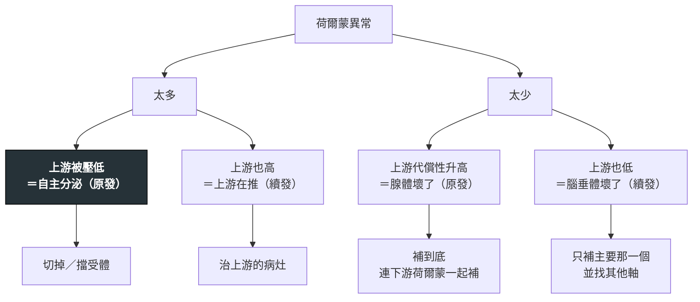

---
tags:
  - Med/MOC/Endo
  - endocrinology
  - metabolism
aliases:
  - Endo Category
  - 新陳代謝科分類
  - 內分泌科索引
  - Endocrinology MOC
  - 新陳代謝暨內分泌
created: 2026-07-28
updated: 2026-07-28
status: 可用
cssclass: clinical-note
---

# 🧬 新陳代謝暨內分泌科分類 · Endocrinology & Metabolism

> [!abstract] 這份筆記怎麼讀
> 內分泌幾乎每一題都可以用**同一組三問**拆開：**① 這個荷爾蒙是太多還是太少？② 壞在軸的哪一層（上游／下游）？③ 這是原發還是續發？** 答完這三問，鑑別診斷、該驗哪一個分子、治療打在哪一層，全部自動掉出來。
> 先看 [[#1. 一眼骨架｜依「軸的哪一層壞了」分]] 抓位置，再用 [[#3. 高產出對照表]] 補容易互換的細節，最後從 [[#2. 專篇索引]] 點進各篇。
> **五個角度分散在五個資料夾**：疾病在 `Disease/Endo/`、藥在 `Drug/`、檢查在 `Test/`、處置在 `Intervention/`、主訴流程在 `Workup/`。本檔把它們串回同一張圖。

---

## 資料夾地圖 Folder Map

```text
Disease/Endo/       ← 疾病專篇（你在這裡）
Disease/General/    Hypercalcemia（鈣磷軸，與副甲狀腺共用）
Disease/GI/         MASLD（胰島素阻抗的肝臟終點）
Drug/               Antidiabetics · Statin（血脂端）
Test/               Arterial blood gas · UPCR UACR
Workup/             （待寫：Polyuria · Weight loss · Hypoglycemia）
```

---

## 1. 一眼骨架｜依「軸的哪一層壞了」分

```text
內分泌
├─ 上游 Hypothalamus–Pituitary
│  ├─ 整層垮掉：Sheehan syndrome →（收在）Adrenal insufficiency
│  └─ 單一軸過多／不足：Acromegaly · Diabetes insipidus · SIADH（待寫）
├─ 甲狀腺軸 Thyroid
│  ├─ 太多失代償：Thyroid storm
│  ├─ 太多（穩定）：Graves disease（待寫）
│  └─ 太少：Hypothyroidism · Hashimoto thyroiditis（待寫）
├─ 腎上腺 Adrenal
│  ├─ 皮質太少：Adrenal insufficiency（含 crisis）
│  ├─ 皮質醛固酮太多：Primary aldosteronism
│  ├─ 皮質固醇太多：Cushing syndrome（待寫）
│  └─ 髓質太多：Pheochromocytoma（待寫）
├─ 鈣磷軸 Calcium–PTH
│  └─ Hypercalcemia ←→ Primary hyperparathyroidism（待寫）
└─ 胰島與代謝 Islet & Metabolism
   ├─ 絕對缺乏 → 急症：DKA
   ├─ 阻抗為主：T2DM（含 LADA 的分型位置）
   ├─ 上游共同體質：Metabolic syndrome（＋台灣體位切點）
   ├─ 器官終點：MASLD
   └─（藥）Antidiabetics ← 四個作用位置各擋一條糖的去路
```



> [!tip] 這張圖就是內分泌的萬用解題器
> **驗上游是最省力的一刀**：aldosterone 高就驗 renin、cortisol 低就驗 ACTH、T4 高就驗 TSH。上游被壓低 ＝ 下游自主；上游同向 ＝ 上游在推。**這條規則跨軸通用，比背個別疾病划算得多。**

---

## 2. 專篇索引

| 篇 | 角度 | 一句話定位 | 最容易錯的那一點 |
|---|---|---|---|
| [[DKA]] | Disease | 胰島素絕對缺乏的急症 | **0.1 U/kg/hr 不是 1**；血糖不高不能排除（euglycemic DKA） |
| [[Thyroid storm]] | Disease | thyrotoxicosis ＋ 誘因 ＋ **器官失代償** | **碘不可給在 thionamide 之前**；amiodarone 含碘 |
| [[Adrenal insufficiency]] | Disease | 含 adrenal crisis 與 Sheehan syndrome | **先治療、不等確診**；診斷未定時用 dexamethasone |
| [[Primary aldosteronism]] | Disease | 自主分泌 → **renin 被壓到極低** | **多數病人血鉀是正常的**；驗 ARR 前 MRA 要停 |
| [[T2DM]] | Disease | 阻抗在先、β 細胞代償失敗在後 | **診斷當下 β 細胞常已剩一半**；糖尿病足是大小血管都有 |
| [[Metabolic syndrome]] | Disease | 五項取三的統計現象，不是開藥適應症 | 台灣腰圍 **90／80**、BMI **24／27**；判定用腰圍不用 BMI |
| [[Antidiabetics]] | Drug | 九類藥的橫向對照 | **glucagon 是升糖不是降糖**；acarbose 低血糖只能給葡萄糖 |
| [[Hypercalcemia]] | Disease | 鈣磷軸的入口，先驗 **PTH** 分兩半 | PTH「正常」在高血鈣時等於不正常 |
| [[MASLD]] | Disease | 胰島素阻抗的肝臟終點 | 影像與抽血都診斷不了 MASH，只能切片 |

---

## 3. 高產出對照表

### 3.1 三個內分泌急症：先治療還是先確診？

| | [[DKA]] | [[Thyroid storm]] | [[Adrenal insufficiency]] 危象 |
|---|---|---|---|
| **診斷靠** | 血糖 ＋ 酮體 ＋ anion gap 酸中毒 | **臨床（器官失代償）**，不是數值 | **臨床 ＋ 對類固醇的反應** |
| **先治療嗎** | 確診很快，同步進行 | **是**——等 free T4 回來人就走了 | **是**——這是最典型的「先給藥」 |
| **怕做錯的一步** | 沒補鉀就打胰島素 | 碘給在 thionamide 之前 | 用 prednisolone 汙染 cortisol 檢驗 |
| **第一步永遠是** | **輸液** | **thionamide** | **hydrocortisone ＋ 大量生理食鹽水** |
| **順序題型** | 輸液 → 鉀 → 胰島素 | thionamide → 碘 → β-blocker → 類固醇 | 類固醇 → 才可以給 levothyroxine |

### 3.2 台灣本土切點總表（考題最愛、且逐年可能修訂）

| 項目 | 台灣 | 國際 | 出處 |
|---|---|---|---|
| **BMI 過重／肥胖** | **≥24 ／ ≥27** | ≥25 ／ ≥30 | 國健署成人肥胖防治 |
| **腰圍（代謝症候群）** | **男 ≥90／女 ≥80 cm** | NCEP：男 ≥102／女 ≥88 | 國健署 96 年版 ＝ IDF 華人切點 |
| 空腹血糖（代謝症候群） | ≥100 mg/dL | 同（2005 起由 110 下修） | 國健署 96 年版 |
| 糖尿病診斷 | 與國際一致 | HbA1c ≥6.5%／FPG ≥126／OGTT 2h ≥200 | ADA |

> [!warning] 台灣的數字有「三套版本」在流通
> 代謝症候群的**判定標準**（國健署 96 年版，用腰圍、不用 BMI）、**93 年舊版**（腰圍**或** BMI ≥27、血糖 110）、**健保署防治計畫的收案條件**（腰圍**或** BMI ≥27）——三者不同。**題目問「判定標準」答 96 年版；問「健保收案」腰圍或 BMI 都算。** 詳見 [[Metabolic syndrome]]。

### 3.3 降糖藥選藥只看三欄

| 藥類 | 低血糖 | 體重 | 心腎效益 |
|---|---|---|---|
| Metformin | 無 | 中性～微減 | 中性（第一線的理由是安全與便宜） |
| **SGLT2 inhibitor** | 無 | **減** | **心衰竭 ＋ 慢性腎病都有** |
| **GLP-1 receptor agonist** | 無 | **減最多** | **ASCVD 有** |
| DPP-4 inhibitor | 低 | **中性** | 中性 |
| **Sulfonylurea** | **最高** | 增 | 無 |
| Pioglitazone | 無 | 增（水腫） | **心衰竭是禁忌** |
| Insulin | 高 | 增 | 無（但誰都能用） |

完整機轉、劑量、禁忌見 [[Antidiabetics]]。

---

## 4. 還沒寫的（依優先序）

> [!todo] 下一輪的候選，理由寫在後面
> 1. **[[Pheochromocytoma]]** — 與 [[Primary aldosteronism]] 同屬「腎上腺自主分泌」主題群，兩場都考過；**術前 α 一定先於 β** 是高頻順序題。目前被 7 處連結指著。
> 2. **[[Cushing syndrome]]** — 被 9 處連結指著（最多），是腎上腺軸唯一還空著的方向。
> 3. **[[Graves disease]]** — [[Thyroid storm]] 的上游母題；三大甲狀腺外表現與攝碘率的分家作用考過。
> 4. **[[Primary hyperparathyroidism]]** — [[Hypercalcemia]] 已把整篇鑑別架好，就差這一端；「高血鈣的症狀 vs 低血鈣的手麻抽筋」是方向題。
> 5. **[[Hypothyroidism]] ／ [[Hashimoto thyroiditis]]** — 甲狀腺軸「太少」那一半完全空白。
> 6. **[[T1DM]]** — [[DKA]] 與 [[T2DM]] 兩篇都在指它。
> 7. **SIADH ／ Diabetes insipidus** — AVP 調控（滲透壓為主、有效循環容積為次要但更強勢）考過，且與低血鈉的鑑別重疊。
> 8. **單基因遺傳代謝**（肝醣儲積症 · 龐貝氏症 · 威爾森氏症）— 考過但屬於「背了就有、不背也推不出來」，投報率排在後面。

---

## 相關連結

- [[Cardio Category]] · [[GI Category]] · [[Hema Category]] — 其他科別 MOC
- [[禁忌選項]] — 本科七篇的 `> [!danger] 絕對不可` 表都已收錄
- [[CONTEXT]] — 五個角度與深度歸屬的定義
