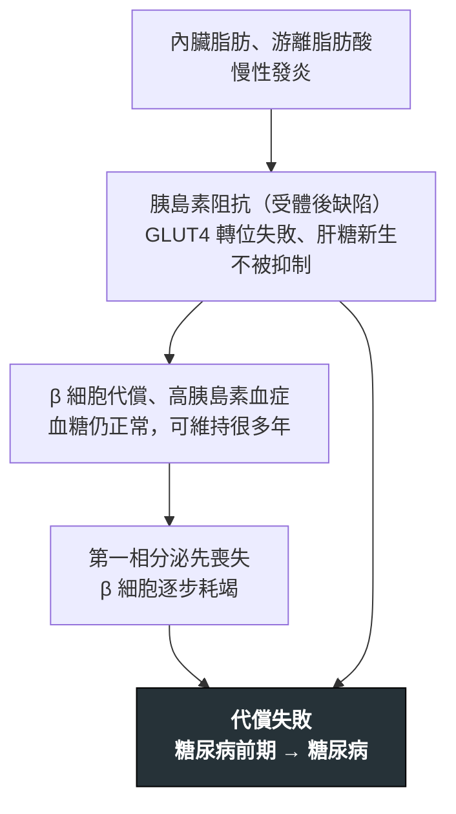

---
tags:
  - Med/Disease/Endo
  - 禁忌
aliases: [T2DM, Type 2 diabetes mellitus, 第二型糖尿病, 糖尿病, LADA, 潛伏性成人自體免疫糖尿病]
created: 2026-07-28
updated: 2026-07-28
status: 可用
source: 115-2 醫學(三) 54、115-1 醫學(三) 56、115-1 醫學(三) 67 延伸；ADA Standards of Care in Diabetes—2026（診斷標準、篩檢年齡、HbA1c 個別化與併發症追蹤）；Harrison's Principles of Internal Medicine 內分泌章（受體後缺陷、自然史）；衛福部國民健康署國民營養健康調查（台灣盛行率量級）
cssclass: clinical-note
presents_as:
  - "[[Polyuria]]"
  - "[[Weight loss]]"
diagnosed_by:
  - "[[HbA1c]]"
  - "[[OGTT]]"
  - "[[UPCR UACR]]"
treated_by:
  - "[[Antidiabetics]]"
  - "[[Statin]]"
differential:
  - "[[T1DM]]"
  - "[[MODY]]"
  - "[[Metabolic syndrome]]"
complication:
  - "[[DKA]]"
  - "[[Diabetic retinopathy]]"
  - "[[Diabetic nephropathy]]"
  - "[[Diabetic foot]]"
  - "[[CAD]]"
  - "[[Heart failure]]"
  - "[[MASLD]]"
---

# T2DM ｜ 第二型糖尿病 · Type 2 diabetes mellitus

> [!abstract] 一句話總覽
> T2DM 的自然史有**固定的先後順序**：**insulin resistance 先出現並持續多年 → β 細胞用代償性高胰島素血症把血糖壓住（此時空腹血糖仍正常）→ 代償撐不住，才依序出現 prediabetes 與糖尿病**。因此**診斷成立的那一刻，β 細胞功能常已剩約一半**，而「血中胰島素低」**不是**早期特徵；阻抗的位置在**受體後 (post-receptor defect)**，不在受體數目。臨床上要做的兩件事：**用個別化的 HbA1c 目標盯血糖，用共病決定選哪一類藥。**

> [!tip] 30 秒行動卡
> **診斷關鍵**：**HbA1c ≥ 6.5%｜空腹血糖 (FPG) ≥ 126 mg/dL｜OGTT 2 小時 ≥ 200 mg/dL｜隨機血糖 ≥ 200 mg/dL ＋ 典型高血糖症狀或高血糖危象**。**無症狀者任何一項達標都必須第二次確認**（重驗同一項或另驗一項）。
> **治療骨架**：生活型態是永遠的底層 → **依共病（動脈粥狀硬化心血管疾病／心衰竭／慢性腎病）與體重、低血糖風險選藥** → 藥物細節全在 [[Antidiabetics]]。

## 自然史：阻抗在前、分泌不足在後

![[assets/t2dm-natural-history.svg|1000]]
*阻抗、分泌與血糖的時間先後：insulin resistance 最早上升，insulin secretion 先代償後衰退，glucose 在代償失敗後才明顯上升。曲線為概念圖，不代表三者可用同一縱軸比較絕對值。自製示意圖。*

> [!danger] 反直覺：早期不是「胰島素不足」，是「胰島素不夠用」
> 確診前後好幾年，**血中胰島素濃度往往是高的，不是低的**——那是 β 細胞在代償。所以**「胰島素濃度低」不能拿來當 T2DM 的早期特徵，也不能拿來跟 [[T1DM]] 分型**（真正低的是 T1DM 與病程很後期的 T2DM）。順序不可對調：**阻抗在前、分泌不足在後**；而**診斷成立就代表代償已經失敗，此時 β 細胞功能常已剩約一半**，而且會繼續往下走——所以多數人最終要加藥、部分人最終需要胰島素，那是自然史，不是「病人不配合」。
> **阻抗壞在受體後**：受體數目與結合親和力大致正常，壞的是 IRS-1 磷酸化、PI3K／Akt 訊號與 **GLUT4 轉位**。**「受體數目減少」或「親和力下降」描述的是極罕見的單基因受體病變（Type A insulin resistance、Rabson-Mendenhall），不是一般 T2DM。** 另外分泌與敏感性呈**雙曲線反比**（乘積約為固定的 disposition index），所以**減重、規律運動後胰島素濃度是往下走的**——兩者同向上升在邏輯上就不可能。

> [!note]- 分型與鑑別：抗體 ＋ C-peptide 兩根柱子，以及六個最會混淆的次發性高血糖
> | | **T1DM** | **LADA** | **T2DM** |
> |---|---|---|---|
> | 發病年齡 | 兒童／青少年 | **成人（多以 ≥ 30 歲為界）** | 成人（逐漸年輕化） |
> | 自體抗體 | 多種陽性、效價高 | **多為單一，以 anti-GAD65 為主** | 陰性 |
> | 體型與代謝症候群 | 偏瘦 | 偏瘦、代謝症候群特徵少 | 多肥胖、腰圍大 |
> | **β 細胞衰竭速度** | **最快（數週至數月）** | **中等（數月至數年）** | **最慢（數年至數十年）** |
> | 診斷時需要胰島素 | 是 | **否（至少 6 個月不需要）** | 否 |
> | 酮酸中毒傾向 | 高（見 [[DKA]]） | 低，後期才出現 | 低 |
>
> - **速度排序背成一串：T1DM ＞ LADA ＞ T2DM。**「latent（潛伏）」這個字本身就代表破壞比 T1DM **慢**（所以初期不必打胰島素），但**比 T2DM 快**——「初期不須」不等於「終生不須」。
> - **LADA 的三要素**：① 成人發病 ② 至少一種胰島自體抗體陽性（臨床首選 **anti-GAD65**，陽性率與敏感度最高）③ 診斷後至少 6 個月不需要胰島素。**懷疑的線索只有一句：「看起來像 T2DM，但人不胖、沒有代謝症候群、口服藥很快就失效。」**
> - **對照組是 [[MODY]]**——那才是「該用 sulfonylurea」的糖尿病：單基因、體染色體顯性、抗體陰性、C-peptide 保留、三代家族史、多在 25 歲前發病（**GCK 型只需觀察**，分型會直接改變治療）。
> - **臨床圖像不典型時加驗 anti-GAD65 ＋ C-peptide**：前者問「有沒有自體免疫」，後者問「β 細胞還剩多少」。**年齡與體型都只是參考。**
> - **其他要排除的**：藥物引起（**類固醇**、部分抗精神病藥、calcineurin inhibitor、免疫檢查點抑制劑；類固醇型的特徵是**餐後與下午血糖特別高、空腹反而還好**）、胰臟外分泌疾病 3c 型（慢性胰臟炎、[[Acute pancreatitis]] 反覆發作、胰臟切除、**[[Pancreatic cancer]]**）、內分泌病因（Cushing syndrome、acromegaly、pheochromocytoma、[[Primary aldosteronism]]、甲狀腺亢進）、**壓力性高血糖**（感染、手術、心肌梗塞期間才升高，**急性期不宜用來診斷**，用 HbA1c 分辨新病舊病）。

> [!note]- 台灣成人盛行率約 12.8%，以及東亞族群為什麼在較低 BMI 就發病
> - **台灣**成人糖尿病盛行率**約一成二到一成三**：衛福部國民健康署「**2019–2023 年國民營養健康調查**」為 **20 歲以上 12.8%**；較早的「106–109 年國民營養健康狀況變遷調查」為 **18 歲以上 11.1%**（男 12.4%、女 9.7%）。**盛行率逐年上升並隨年齡陡升。引用時務必把「調查年份 ＋ 年齡分母」一起記住，否則數字會對不上。**
> - **東亞族群以 β 細胞分泌不足為主、阻抗相對較輕，在較低 BMI 就發病、內臟脂肪比例高**；西方族群以阻抗為主。這是亞洲版 BMI 與腰圍切點較嚴的理由（切點見 [[Metabolic syndrome]]）。
> - 好發族群：成人且逐漸年輕化、中央型肥胖、一等親家族史、妊娠糖尿病病史。

## 診斷

| 項目 | 正常 | **Prediabetes（風險狀態，不是疾病）** | **糖尿病** |
|---|---|---|---|
| **空腹血糖 (FPG)** | < 100 | **100–125 mg/dL** | **≥ 126 mg/dL**（「空腹」＝至少 8 小時未攝取熱量） |
| **OGTT 2 小時** | < 140 | **140–199 mg/dL** | **≥ 200 mg/dL**（75 g 無水葡萄糖；**敏感度最高、最早抓到異常，但最麻煩**；檢查前 3 天每日碳水 ≥ 150 g） |
| **HbA1c** | < 5.7% | **5.7–6.4%** | **≥ 6.5%**（須 NGSP／DCCT 校準；受下方失真情境影響） |
| **隨機血糖** | — | — | **≥ 200 mg/dL ＋ 典型高血糖症狀或高血糖危象——唯一不需要第二次確認的一條** |

> [!danger] 反直覺：多數人完全沒有症狀，有人在診斷當天就已經有併發症
> 高血糖要到相當程度（大致超過腎糖閾）才會產生滲透性利尿與「三多一少」（多尿、多渴、多食、體重減輕）；其餘提示是疲倦、視力波動、傷口難癒、反覆黴菌感染、acanthosis nigricans。**病人沒有症狀完全不能拿來排除糖尿病**——這正是 T2DM 需要「主動篩檢」而不是「等症狀上門」的原因，也是為什麼有人以視網膜病變、蛋白尿、[[ACS]] 甚至 [[DKA]]／HHS 當第一個表現。**診斷當天就要安排眼底與 UACR，不能等一年後。**

> [!note]- 無症狀者的第二次確認怎麼做，以及 prediabetes 與眼底檢查的追蹤間隔
> - **HbA1c、FPG、OGTT 在沒有明確高血糖症狀的人身上都必須有第二次確認**：重驗同一項，或另驗一項也達標。**若同一次抽血中兩項不同檢查都達標，即可直接診斷**；兩項結果不一致時，就**追蹤那個達到診斷標準的項目**再驗一次。
> - **Prediabetes**：每年重驗，並積極介入生活型態。
> - **眼底**：診斷當下就做散瞳檢查；之後原則上每年一次，但**若一次以上檢查完全無視網膜病變且血糖控制良好，ADA 允許放寬到每 1–2 年一次**；已有病變、血糖控制不佳或懷孕者則要更密集。

> [!note]- HbA1c 什麼時候不可信：五種失真情境的方向，以及該改用什麼指標
> HbA1c 反映的是「紅血球活多久 × 這段期間泡在多高的糖裡」。**只要紅血球壽命或血紅素結構被動到，這個數字就不代表血糖**：
> **① 紅血球壽命縮短 → 假性偏低**：溶血性貧血、脾功能亢進、近期輸血、使用 erythropoietin 或鐵劑／維生素 B12 治療中的恢復期貧血（[[Anemia]]）。**② 更新變慢／壽命延長 → 假性偏高**：**未治療的缺鐵性貧血**（方向確定偏高，補鐵後 HbA1c 會下降）、B12／葉酸缺乏、**脾切除後**。**③ 慢性腎病**：carbamylated hemoglobin 干擾檢驗、紅血球壽命縮短、又常合併貧血與 EPO 治療——**兩個方向都可能，等於不可靠**。**④ 血紅素變異（thalassemia、sickle cell 等）**：依檢驗方法可能被高估、低估甚至測不出來，**台灣 thalassemia 帶因並不罕見，要有這根弦**。**⑤ 懷孕**：紅血球更新加快、血漿容積擴張，HbA1c 偏低且反應太慢，**妊娠糖尿病不用 HbA1c 診斷，用 OGTT**。
> **該怎麼辦**：改用**能直接看到血糖**的工具——**fructosamine／glycated albumin**（反映 2–3 週，但受低白蛋白影響，腎病症候群與營養不良者要打折），或 **CGM 的 time in range 與 glucose management indicator** ＋ 自我血糖監測。**進階慢性腎病者以 CGM 最可靠**，因為它完全不受血液學變數影響。

## 治療

- **① 生活型態是永遠的底層，不會被藥取代**：飲食調整、規律運動、**體重管理**、戒菸、睡眠。**體重減 5–10% 就能明顯改善血糖與血壓**，減得更多有機會讓部分早期病人緩解。
- **② 選藥先問共病，再問血糖**：**合併心衰竭（[[Heart failure]]）或慢性腎病 → 優先 SGLT2 inhibitor；合併動脈粥狀硬化心血管疾病或需要顯著減重 → 優先 GLP-1 receptor agonist。這兩個適應症已與 HbA1c 高低脫鉤——就算血糖達標也該用。** 其餘以 metformin 為多數人的起手，再依體重、低血糖風險、腎功能、價格調整；升級時機與順序、機轉、劑量與副作用全在 [[Antidiabetics]]。共病要一起管：血脂 → [[Statin]]、血壓、次級預防的 [[Antiplatelet]]、戒菸——**大血管的減災，血脂與血壓的貢獻不亞於血糖**。

> [!danger] HbA1c 目標必須個別化——「一律 < 7.0%」是錯的
> **一般成人 < 7.0%** 只是預設起點，不是所有人的目標值。**可以更嚴（< 6.5%）**：病程短、預期壽命長、無明顯心血管疾病、**用不易造成低血糖的藥就能達標**的人。**應該放寬（< 8.0% 或更寬）**：**有嚴重低血糖病史、預期壽命有限、已有進階併發症、多重共病或衰弱的長者**——目標改成「**避免高血糖症狀與急性併發症、避免低血糖**」，而不是追一個數字。
> 判準是**年齡、共病、預期壽命、低血糖風險**四項。**看到「不論、一律、皆」這種寫法就要警覺**——血糖、血壓、LDL 的目標沒有一個是統一的。

## 併發症

| 分類 | 病變 | 怎麼抓 | 關鍵一句 |
|---|---|---|---|
| **微血管** | **Retinopathy 視網膜病變** | **診斷當下就做散瞳眼底檢查**，之後原則上每年一次（間隔調整見上方 callout） | 長期是成人失明的主因之一；增殖期需雷射或 anti-VEGF |
| **微血管** | **Nephropathy 腎病變** | **每年 urine albumin-to-creatinine ratio (UACR) ＋ eGFR** | 判讀見 [[UPCR UACR]]。**UACR ≥ 30 mg/g 即為異常，但需在 3–6 個月內重複確認**（運動、發燒、感染、月經都會假陽性） |
| **微血管** | **Neuropathy 神經病變** | 每年 **10 g monofilament ＋ 震動覺／踝反射** | 最常見是遠端對稱性多發性神經病變（襪套式）。**自主神經病變會抹掉低血糖與心肌缺血的警訊** |
| **大血管** | **[[CAD]]／[[ACS]]、腦血管疾病** | 症狀詢問 ＋ 血壓血脂控制；合併 [[Atrial fibrillation]] 者另需抗凝（[[DOAC]]） | **心血管疾病是主要死因**；**糖尿病患者的心肌梗塞可以完全不痛** |
| **大血管** | **Peripheral artery disease (PAD)** | **足背／脛後動脈搏動、ankle-brachial index (ABI)** | 間歇性跛行、傷口不癒；**是糖尿病足預後最關鍵的一塊** |

> [!danger] 糖尿病足不是單純的神經病變——它是微血管與大血管一起出事
> **三個因素疊加**：**① 神經病變（微血管）**——感覺喪失，踩到釘子、鞋子磨破皮都不知道，加上足部變形與皮膚乾裂。**② 周邊動脈疾病 (PAD)（大血管）**——血流不夠，傷口癒合不了，抗生素也送不進去。**③ 感染**——破口後快速深入，可達骨髓炎。**所以「糖尿病足屬於微血管併發症」是錯的敘述，「屬於大血管併發症」也是錯的——它兩者都是。**
> **臨床直接後果**：評估**必須同時包含「感覺」與「血流」**。只做 monofilament 而不摸脈搏／不做 ABI，會漏掉真正決定會不會截肢的那一半。**每次門診都該脫襪子看腳。**

| **非增殖期 (NPDR)** | **增殖期 (PDR)** |
|---|---|
| ![[assets/t2dm-npdr-fundus.png\|430]] | ![[assets/t2dm-pdr-fundus.jpg\|430]] |
| microaneurysm、點狀／斑狀出血與 hard exudate；尚無新生血管 | 視網膜表面形成脆弱的新生血管與纖維組織，容易玻璃體出血 |

*分界只問一句：「有沒有 neovascularization？」左圖：Hao et al., 2022，Figure 1A（[Wikimedia Commons](https://commons.wikimedia.org/wiki/File:Fundus_-_diabetic_retinopathy.png)，CC BY 4.0）；右圖：National Eye Institute／NIH EDA01（[Wikimedia Commons](https://commons.wikimedia.org/wiki/File:Fundus_Proliferative_retinopathy_EDA01.JPG)，public domain）。*

> [!note]- 急性代謝失代償、其他共病，以及「預後由大血管決定」的完整意思
> - **急性代謝併發症**：[[DKA]]（T2DM 也會，尤其感染、停藥、使用 SGLT2 inhibitor 時的血糖正常型）與 hyperosmolar hyperglycemic state (HHS)。
> - **其他共病**：[[MASLD]] 與其進展、[[Metabolic syndrome]] 的其餘成分、感染易感性（含 [[Pneumonia]]）、失智與 [[Delirium]] 風險上升、特定癌症風險。
> - **預後幾乎由大血管事件決定，而非血糖數字本身**：**血糖控制主要降低微血管併發症**；大血管的減災要靠血壓、血脂（[[Statin]]）、戒菸與具心腎保護的藥物。這就是為什麼現代治療目標從「把 HbA1c 壓低」轉成「把事件降下來」。

## 禁忌與相關連結

> [!danger] 絕對不可
> | 情境 | 絕對不可 | 為什麼 | 該做什麼 |
> |---|---|---|---|
> | 高齡、衰弱、有嚴重低血糖病史、預期壽命有限 | 一律套用 **HbA1c < 7.0%** 並為此加藥 | **低血糖的傷害在這群人身上大於高血糖**——跌倒、心律不整、失智加速 | **放寬到 < 8.0% 或更寬**，改用不易低血糖的藥，目標設為避免症狀與急性併發症 |
> | 貧血、溶血、近期輸血、慢性腎病、血紅素變異、**懷孕** | 只憑 **HbA1c** 判斷控制好壞或做診斷 | 紅血球壽命或血紅素結構被動到，數字**與真實血糖脫鉤**，兩個方向都可能 | 改看 **fructosamine／glycated albumin 或 CGM ＋ 自我血糖監測**；**懷孕用 OGTT 診斷** |
> | 成人高血糖但**偏瘦、無代謝症候群、口服藥迅速失效** | 直接當 T2DM 給 **sulfonylurea** | 很可能是 **LADA**；SU 逼一群正在被免疫破壞的 β 細胞加班，**加速衰竭** | **驗 anti-GAD65 ＋ C-peptide**；改用 metformin ± 早期胰島素 |
> | 糖尿病足潰瘍 | 只做感覺評估就開始換藥、清創 | **周邊動脈疾病才是決定癒合與截肢的一半**，血流不夠時清創反而惡化 | **同時摸脈搏、做 ABI ＋ 評估感染深度與骨髓炎**，血流不足者轉血管科 |
> | 無症狀者單次檢驗達標 | 直接診斷並開藥 | 單次檢驗有分析與生物變異，會造成過度診斷 | **重驗同一項或另驗一項**；只有「隨機 ≥ 200 ＋ 典型症狀」可一次定案 |
> | 50 歲後新發糖尿病 ＋ 不明體重減輕、腹背痛 | 當成一般 T2DM 收案追蹤 | 可能是 **[[Pancreatic cancer]]** 的首發表現 | 影像評估胰臟；別讓「新發糖尿病」的合理解釋掩蓋掉真正的病 |

- [[Antidiabetics]] — **所有降糖藥的機轉、體重與低血糖影響、心腎效益、劑量與副作用都在那裡**；本篇只寫「怎麼決定」。相關主訴流程：[[Polyuria]]、[[Weight loss]]（Workup）
- [[Adrenal insufficiency]] · [[Thyroid storm]] · [[Primary aldosteronism]] — 內分泌軸的鄰居：類固醇替代會推高血糖、急性期血糖劇烈波動時要一起想到，後者也是續發性高血糖與難治性高血壓的鑑別
- [[Hypercalcemia]] · [[Metabolic syndrome]] · [[MASLD]] · [[Statin]] · [[CAD]] · [[禁忌選項]] — 「代償關係兩變數必反向」的同型推論（PTH 與血鈣）、共同的代謝根源與肝臟端表現、大血管減災主力與主要死因，以及四欄禁忌表的索引
