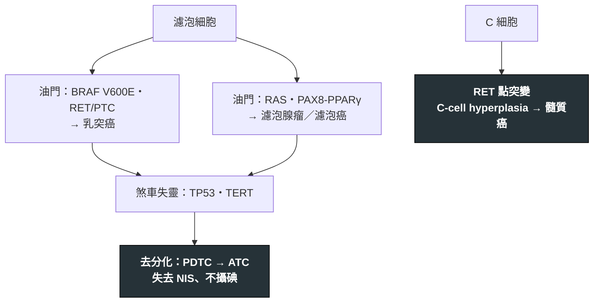

---
tags:
  - Med/Disease/Endo
  - thyroid
  - 禁忌
aliases: [Thyroid cancer, 甲狀腺癌, Thyroid carcinoma, Papillary thyroid carcinoma, PTC, Follicular thyroid carcinoma, FTC, Medullary thyroid carcinoma, MTC, Anaplastic thyroid carcinoma, ATC, Follicular adenoma, NIFTP, 甲狀腺乳突癌, 甲狀腺濾泡癌, 甲狀腺髓質癌, 未分化甲狀腺癌]
created: 2026-09-16
updated: 2026-09-16
status: 可用
source: 外科離站考三年教材《內分泌外科 113–115 年》（115-2 Q42、113-2 Q40、114-2 Q39、115-1 Q13、115-1 Q12、115-2 Q3、114-2 Q41、113-1 Q39、115-2 Q41、114-1 Q40）；ATA 2015 成人甲狀腺結節與分化型甲狀腺癌指引；ATA 2015 髓質癌指引；ATA 2021 未分化癌指引；Bethesda 2023 第三版；WHO 2022 內分泌腫瘤分類；AJCC 8；Nikiforov 2016 JAMA Oncol（NIFTP）；SELECT／DECISION 試驗仿單；StatPearls Thyroid Cancer、Follicular Thyroid Cancer；NCI PDQ Thyroid Cancer Treatment
services:
  - ThyroidSurgery
  - Endo
cssclass: clinical-note
presents_as:
  - "[[Neck mass]]"
diagnosed_by:
  - "[[Thyroid ultrasound]]"
  - "[[Fine-needle aspiration]]"
  - "[[Thyroid function test]]"
treated_by:
  - "[[Thyroid lobectomy]]"
  - "[[Total thyroidectomy]]"
  - "[[Central neck dissection]]"
  - "[[Radioactive iodine]]"
  - "[[Levothyroxine]]"
differential:
  - "[[Thyroid nodule]]"
  - "[[Graves disease]]"
  - "[[Thyroid lymphoma]]"
complication:
  - "[[Recurrent laryngeal nerve injury]]"
  - "[[Post-thyroidectomy hypocalcemia]]"
  - "[[Neck swelling after thyroidectomy]]"
---

# Thyroid cancer ｜ 甲狀腺癌 · 含濾泡腺瘤與 NIFTP

> [!abstract] 一句話總覽
> 甲狀腺只有兩種細胞會變癌：**濾泡細胞**（攝碘、分泌 thyroglobulin）→ 乳突癌、濾泡癌，再去分化成未分化癌；**C 細胞**（分泌 calcitonin）→ 髓質癌。來源細胞決定一切：分化型癌能用放射碘與 Tg 追蹤，髓質癌與未分化癌都不能。手術範圍由腫瘤風險與「之後要不要放射碘」一起決定。

> [!tip] 30 秒行動卡
> **診斷關鍵**：超音波導引 FNA → Bethesda。濾泡型病灶抹片看不到包膜，腺瘤與癌只能整顆切下來判。基因對型別：BRAF、RET/PTC → PTC；RAS → 濾泡譜系；RET 點突變 → MTC；TP53 失能 → ATC。
> **治療骨架**：PTC/FTC：>4 cm、外侵、淋巴或遠端轉移 → total thyroidectomy；1–4 cm cN0 → lobectomy 或 total 皆可；<1 cm → lobectomy 或 active surveillance。要給 RAI 就必須全切除。MTC：total + 中央區廓清，術前先排除嗜鉻細胞瘤。ATC：先保氣道，一律 stage IV。
> **絕對不可**：MTC 沒排除嗜鉻細胞瘤就上刀；只切一葉卻計畫給 RAI；把 ATC 或淋巴瘤當良性甲狀腺腫觀察。

---

## 定義與定位

| 項目 | 重點 |
|---|---|
| 本質 | 濾泡細胞來源（PTC、FTC、oncocytic、PDTC/DHGTC、ATC）與 C 細胞來源（MTC）的惡性腫瘤；淋巴瘤是另一類，不開刀 |
| 好發族群 | 女性為主；PTC 年輕到中年，FTC 中年，ATC 老年人；MTC 遺傳型可在兒童期 |
| 分類位置 | [[Thyroid nodule]] 的惡性分支；工作流程從 [[Neck mass]] 進入 |
| 危險因子 | 兒時頭頸放射線（PTC）、碘缺乏（FTC）、家族史、MEN2（MTC）、FAP／Cowden／Carney |

### 各型總表

| 型別 | 來源／佔比 | 驅動基因 | 擴散 | 攝碘／標記 | 預後 |
|---|---|---|---|---|---|
| **PTC** | 濾泡細胞；>80%，碘充足與影像普及後比例上升 | BRAF V600E（約半數）、RET/PTC 重排、NTRK 融合；TERT 加乘惡化 | **淋巴**；中央區常見；常多發雙側 | ✓／Tg | 極佳，10 年 >90%。Tall cell、columnar、hobnail、diffuse sclerosing 為侵襲性變異 |
| **FTC** | 濾泡細胞；碘充足區約 10%，碘缺乏區高 | RAS、PAX8-PPARγ | **血行**（肺、骨）；淋巴約 2–8%；單一病灶 | ✓／Tg | WHO 2022 三級：minimally invasive（僅包膜）近良性；encapsulated angioinvasive；widely invasive 遠轉高 |
| Oncocytic (Hürthle) carcinoma | 濾泡細胞嗜酸性變體；WHO 2022 獨立成型 | 粒線體 DNA | 血行為主，淋巴比 FTC 多 | 常差／Tg | 比 FTC 差；RAI 反應不佳 |
| PDTC 與 DHGTC（WHO 2022 兩個獨立診斷） | 去分化中途。PDTC：Turin 標準、insular 型；DHGTC：仍具分化形態但有壞死或高有絲分裂 | RAS 或 BRAF + TERT、TP53 | 淋巴＋血行 | 漸失／Tg | 介於 DTC 與 ATC |
| **ATC** | 完全去分化；老年人，多年甲狀腺腫數週暴長 | TP53 失能、TERT；約 1/4 BRAF V600E | 局部侵犯氣管食道、早期遠轉 | ✗／無 | 極差，中位存活數月；一律 stage IV |
| **MTC** | C 細胞；約 1–2%；約 1/4 遺傳性（MEN2A 含舊稱 FMTC 的變異型、MEN2B） | RET 生殖細胞突變（遺傳）；體細胞 RET 或 RAS（散發） | 淋巴早、血行（肝肺骨） | ✗／calcitonin、CEA | 10 年約 75%，看分期與術後 calcitonin 是否正常化 |
| [[Thyroid lymphoma]] | Hashimoto 背景 B 細胞（MALT、DLBCL）；老年女性 | — | 快速長大甲狀腺腫，與 ATC 主要鑑別 | ✗／無 | 不開刀；核心切片後化療（±rituximab）＋放療。MALT 預後好，DLBCL 依分期中等 |

### 良性對照：濾泡腺瘤與 NIFTP

| 病灶 | 本質 | 要點 |
|---|---|---|
| **Follicular adenoma** | 有包膜濾泡型腫瘤，**無**包膜／血管侵犯 | 與 FTC 細胞形態完全相同，只能整顆切下判（114-2 Q39）；腺葉切除即治療 |
| Oncocytic (Hürthle) adenoma | 粒線體豐富嗜酸性細胞 | 同樣靠侵犯判良惡 |
| **NIFTP** | 有包膜／界線清楚、無侵犯、濾泡排列但帶 PTC 核特徵 | 2016 從 noninvasive encapsulated FVPTC 刻意降階（113-2 Q40）；腺葉切除足夠、不需 RAI、追蹤比照良性。任何侵犯、真乳突結構或砂粒體都退回癌症 |

## 病因與機制

- **油門（oncogene 活化）**：MAPK 路徑持續開啟。點突變 BRAF V600E 與重排 RET/PTC 走向乳突癌；RAS 走向濾泡譜系。單獨存在時腫瘤仍分化良好、攝碘、惰性。
- **煞車失靈（tumor suppressor 失能）**：TP53 失能、TERT promoter 突變疊加上去，細胞失去分化特徵與鈉碘同向轉運體（NIS）。這解釋 ATC 常從既有腫塊突然暴長，也解釋 TENIS（Tg 高、碘掃陰性）。**TP53 是抑癌基因，不是 oncogene**（115-1 Q13）。
- **髓質癌另一條路**：RET 生殖細胞突變 → C-cell hyperplasia → MTC，是 MEN2 預防性切除的依據。同一個 RET：**點突變**對 MTC，**重排**對 PTC。
- **碘的角色**：碘缺乏 → TSH 上升 → 濾泡增生，是 FTC 的環境危險因子；食鹽加碘後 FTC 比例下降（114-2 Q39）。

## 臨床表現

- **典型**：無症狀甲狀腺結節（健檢或觸診發現），隨吞嚥上下移動。
- **提示性**：側頸淋巴結（PTC）、聲音沙啞（RLN 侵犯）、固定不動、快速長大、兒時放射線或家族史。
- **少見但重要**：數週內暴長加壓迫症狀（ATC 或淋巴瘤）；腹瀉與潮紅（MTC 大量 calcitonin）；MTC 合併嗜鉻細胞瘤症狀（MEN2）。

→ 相關主訴流程：[[Neck mass]]（Workup）

## 診斷

| 診斷條件 | 內容 |
|---|---|
| PTC | FNA 即可診斷：核溝、核內假包涵體、毛玻璃核（Orphan Annie）、砂粒體 |
| FTC vs adenoma | 只能靠手術標本：包膜侵犯或血管侵犯；FNA 只能報 Bethesda IV |
| MTC | FNA 加 calcitonin 免疫染色；血清 calcitonin、CEA；RET 生殖細胞檢測 |
| ATC | 核心切片（排除淋巴瘤與 PDTC）；BRAF V600E 檢測 |
| 分期 | AJCC 8：DTC 以 55 歲為界，<55 歲無遠轉一律 stage I、有遠轉 stage II；ATC 一律 IV（IVA 腺內、IVB 肉眼腺外侵犯或任何區域淋巴結轉移、IVC 遠轉） |

**要開的檢查**：[[Thyroid ultrasound]]（含側頸淋巴結）、[[Fine-needle aspiration]]、[[Thyroid function test]]；已確診才做 CT／MRI 做術前分期（胸骨後延伸、氣管食道侵犯）。含碘顯影劑後 RAI 需延後 1–2 個月。

### 分子檢測能與不能回答什麼

- 能：BRAF V600E 幾乎確定 PTC；RET/PTC、NTRK 融合對應標靶藥；RAS、PAX8-PPARγ 只說明是濾泡譜系；TERT、TP53 提示去分化與預後差。
- 不能：包膜與血管侵犯；陰性不是零風險；台灣多自費，診斷性腺葉切除仍是合理路線。

## 鑑別診斷

| 要排除的 | 支持它的線索 | 怎麼排除 |
|---|---|---|
| [[Thyroid nodule]]（良性結節、囊腫、腺瘤） | 超音波 very low／low suspicion、Bethesda II | 超音波分層與 FNA；濾泡型靠診斷性腺葉切除 |
| [[Thyroid lymphoma]] | 老年女性、Hashimoto 底子、數週暴長 | 核心切片；不開刀 |
| Riedel thyroiditis | 木質硬、固定、纖維化 | 切片 |
| 轉移到甲狀腺（腎細胞癌、乳癌、肺癌） | 已知原發癌 | 免疫染色 |

## 治療

### 分化型癌（PTC／FTC）：切多少

切除範圍看三件事：腫瘤風險、對側腺體、**之後要不要 RAI 與 Tg 追蹤**。RAI 要求先把正常腺體切乾淨，否則殘留腺葉競爭吸碘、持續分泌 Tg 讓追蹤失效（115-2 Q41）。

| 情境（ATA 2015） | 範圍 | 理由 |
|---|---|---|
| >4 cm；或肉眼甲狀腺外侵犯、臨床淋巴結轉移、遠轉；雙側腫瘤 | [[Total thyroidectomy]]／near-total | 復發風險高，幾乎都需 RAI 與 Tg |
| 1–4 cm、cN0、無 ETE | [[Thyroid lobectomy]] 或 total 皆可 | 存活相當。傾向全切：對側結節、家族史、兒時輻射、想一次處理完。傾向腺葉：保功能、避雙側神經與副甲狀腺風險 |
| <1 cm 微小乳突癌、無侵犯、無淋巴轉移 | 腺葉；符合條件可 active surveillance | 條件：不貼氣管／RLN、無淋巴或遠轉、細胞學非侵襲性變異、願意規律超音波追蹤；長大或轉移再開，預後不因延後變差 |
| 腺葉切除後病理才發現高風險 | Completion thyroidectomy | 為了 RAI；代價是二次手術風險 |
| FTC minimally invasive、無血管侵犯 | 腺葉常已足夠 | Widely invasive 或廣泛血管侵犯 → 全切除 + RAI（114-2 Q39） |
| Oncocytic carcinoma | 比照 FTC，偏向全切 | RAI 反應差，追蹤靠影像 |

**淋巴結廓清**
- [[Central neck dissection]]（level VI）：治療性（影像或術中發現轉移）一律做；預防性只在 cN0 但 T3／T4、或 cN1b、或需資訊決定後續治療時考慮；小 T1／T2 非侵犯 cN0 不需要。雙側廓清明顯拉高副甲狀腺功能低下風險。
- [[Lateral neck dissection]]（level II–V）：只做治療性（影像或 FNA 證實）；modified radical，保留 SCM、IJV、副神經；不做 berry picking。FTC 淋巴轉移少，不常規廓清。

### 髓質癌 MTC

1. **術前**：calcitonin、CEA；所有 MTC 驗 RET 生殖細胞突變（看似散發仍有一部分遺傳）；**先驗血漿 metanephrines 排除嗜鉻細胞瘤**，有的話先切腎上腺；MEN2A 看血鈣排除副甲狀腺亢進。
2. **手術**：Total thyroidectomy + 中央區廓清，沒有腺葉切除選項（C 細胞在腺葉上 1/3 後側、遺傳性常雙側多發）。側頸依影像與 calcitonin 高低決定。
3. **術後**：只有 calcitonin、CEA 可追蹤。不攝碘，RAI 與 TSH 抑制無用，甲狀腺素只補到正常。Calcitonin 倍增時間短 = 進展快。轉移進展：selpercatinib（RET 選擇性）、vandetanib、cabozantinib。
4. **家族**：MEN2 帶因者預防性切除依 RET codon：最高風險 M918T（MEN2B）出生第一年內；高風險 codon 634、A883F 五歲前；中等風險依 calcitonin 或家屬意願。

### 未分化癌 ATC

- **先保氣道**：來診多已壓迫；腫瘤包住氣管時預防性氣切可能做不到。
- **核心切片確診**：排除淋巴瘤（可治癒、不開刀）與 PDTC。
- **一律 stage IV**：少數 IVA／IVB 能 R0／R1 切除後加放化療。
- **先驗 BRAF**：V600E → dabrafenib + trametinib，可 neoadjuvant 縮小再評估手術。
- 中位存活以月計，提早討論照護目標。

### 術後：風險分層決定 RAI、TSH 目標與追蹤

| ATA 2015 風險 | 定義要點 | RAI | TSH 目標 |
|---|---|---|---|
| Low | 腺內、無侵襲性變異、無血管侵犯、無或 ≤5 顆微小（<0.2 cm）淋巴轉移；腺內 FTC 僅包膜侵犯或輕微血管侵犯 | 不常規 | 0.5–2 mU/L |
| Intermediate | 顯微 ETE、血管侵犯、>5 顆淋巴轉移（<3 cm）、侵襲性變異、腺外 BRAF (+) 微小癌 | 考慮（adjuvant） | 0.1–0.5 mU/L |
| High | 肉眼 ETE、切不乾淨、遠轉、淋巴結 ≥3 cm、術後 Tg 暗示遠轉、FTC 廣泛血管侵犯 | 建議 | <0.1 mU/L |

**[[Radioactive iodine]]**
- 前提：total／near-total（115-2 Q41）。腺葉切除者不給。
- 三種目的：remnant ablation（低劑量約 30 mCi）、adjuvant、treatment（已知攝碘轉移 100–200 mCi）。
- 準備：TSH 要高 → 停甲狀腺素 3–4 週或 rhTSH；低碘飲食 1–2 週。治療後 3–7 天做 post-therapy WBS。
- 副作用：唾液腺炎、口乾、暫時骨髓抑制、累積劑量高時續發惡性略升；懷孕哺乳禁用。

**追蹤**
- 全切 + RAI 後 Tg 只可能來自腫瘤；**一定同驗 anti-Tg**，抗體 (+) 時 Tg 被低估，改看抗體趨勢。Tg 在術前結節初評沒有用（115-2 Q42）。
- 頸部超音波 6–12 個月；Tg 升而超音波陰性 → RAI 掃描或 FDG-PET。
- 術後 1–2 年動態再分層（excellent／biochemical incomplete／structural incomplete／indeterminate），反應好者放寬 TSH 目標。
- 只做腺葉者：看 Tg 趨勢與超音波；[[Levothyroxine]] 只在 TSH 升高且有適應症時補，不為了抑制結節（113-1 Q39）。

**放射碘難治（RAI-refractory）與標靶**（114-1 Q40）
- Tg 數千、碘掃陰性、FDG-PET 亮、CT 肺轉移增多 = **TENIS**，本質是去分化失去 NIS。判定看行為不看累積劑量：從不攝碘、原本攝後不攝、部分病灶不攝、攝了仍進展，任一即成立。再給大劑量 RAI 無效。
- 啟動全身治療條件：難治**且**進展或有症狀；穩定無症狀可先觀察。
- 武器：lenvatinib（SELECT PFS 18.3 vs 3.6 月）、sorafenib（DECISION 10.8 vs 5.8 月）；分子導向：BRAF V600E、RET、NTRK 各有藥；局部：骨轉移痛或脊髓壓迫 → 緩解性放療、手術、消融，脊髓壓迫順位在全身治療之前。

## 併發症與預後

- **要盯的併發症**（術後三個不能慢）：[[Neck swelling after thyroidectomy]]（血腫 → 床邊立刻拆線敞開傷口，不等影像）、[[Recurrent laryngeal nerve injury]]（單側沙啞嗆咳；雙側喘鳴需重插管或氣切）、EBSLN 損傷（聲帶不麻痺但高音唱不上）、[[Post-thyroidectomy hypocalcemia]]（術後 1–3 天口周麻木、手足抽搐；6 個月內恢復為暫時性）。詳見 [[Total thyroidectomy]]。
- **預後因子**：年齡 ≥55、腫瘤大小、甲狀腺外侵犯、遠端轉移、侵襲性變異、TERT／TP53、術後 Tg 或 calcitonin 是否正常化。

## 禁忌與陷阱

> [!danger] 絕對不可
> | 情境 | 絕對不可 | 為什麼 | 該做什麼 |
> |---|---|---|---|
> | MTC 準備手術 | 未排除嗜鉻細胞瘤就上刀 | 麻醉誘發高血壓危象 | 血漿 metanephrines；有嗜鉻細胞瘤先切腎上腺 |
> | 計畫給 RAI | 只切一葉 | 殘葉競爭吸碘、Tg 無法解讀 | Total／near-total；已切一葉者做 completion |
> | 老年人甲狀腺腫數週暴長 | 當良性觀察 | ATC 或淋巴瘤，氣道會沒 | 核心切片、先評估氣道 |
> | 濾泡型 Bethesda IV | 用 FNA 或影像宣稱良性 | 抹片看不到包膜 | 分子檢測或診斷性腺葉切除 |
> | 碘掃陰性且進展的轉移 | 再給大劑量 RAI | 不攝碘就到不了 | 標靶治療與局部治療 |

> [!warning] 常見錯誤
> - 把 thyroglobulin 當結節良惡性的篩檢工具；它只在術後追蹤有用。
> - 把 PTC 的「多發雙側、淋巴轉移」套到 FTC；FTC 是單一病灶、血行轉移。
> - 把 p53 叫成 oncogene。
> - 把 NIFTP 當癌症給 RAI；它的診斷要件就是無侵犯。
> - 為了抑制良性結節長期給 levothyroxine 壓 TSH。

## 相關連結

- [[Neck mass]] — 從主訴進入的完整 workup 與 goiter 分類
- [[Thyroid nodule]] — 良性結節的分層與追蹤
- [[Total thyroidectomy]]、[[Thyroid lobectomy]] — 術式、關鍵解剖、併發症
- [[Thyroid storm]] — 甲亢病人術前控制不足的後果
- [[Hypercalcemia]] — MEN2A 合併副甲狀腺亢進
- [[Thyroid Surgery]] — MOC
