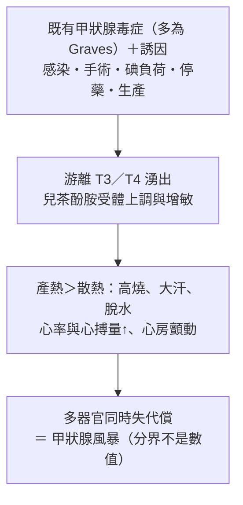

---
tags:
  - Med/Disease/Endo
  - thyroid
  - 禁忌
aliases: [Thyroid storm, 甲狀腺風暴, 甲狀腺危象, Thyrotoxic crisis, 甲狀腺毒症危象, Thyrotoxic storm]
created: 2026-07-28
updated: 2026-07-28
status: 可用
source: 114-1 醫學(三) 58、114-2 醫學(三) 54 延伸；American Thyroid Association (ATA) 2016 甲狀腺亢進與甲狀腺毒症處置指引、Japan Thyroid Association／Japan Endocrine Society (JTA／JES) 2016 甲狀腺風暴診療指引（含診斷準則與全國登錄研究）、Burch & Wartofsky 1993 原始評分文獻、Harrison's 甲狀腺章節、UpToDate「thyroid storm」與「amiodarone and thyroid dysfunction」章節（給藥順序、劑量、BWPS 切點、amiodarone 碘含量、住院死亡率均已查證）
cssclass: clinical-note
presents_as:
  - "[[Fever]]"
  - "[[Delirium]]"
  - "[[Atrial fibrillation]]"
  - "[[Jaundice]]"
diagnosed_by:
  - "[[Thyroid function test]]"
  - "[[Echocardiography]]"
treated_by:
  - "[[Thionamides]]"
  - "[[Beta blocker]]"
differential:
  - "[[Sepsis]]"
  - "[[Malignant hyperthermia]]"
  - "[[Neuroleptic malignant syndrome]]"
  - "[[Anticholinergic toxidrome]]"
complication:
  - "[[Atrial fibrillation]]"
  - "[[Heart failure]]"
  - "[[Shock]]"
  - "[[Delirium]]"
---

# Thyroid storm ｜ 甲狀腺風暴 · 甲狀腺毒症危象

> [!abstract] 一句話總覽
> 甲狀腺風暴是 thyrotoxicosis 加上一個**誘因**（感染、手術、碘負荷、停藥、生產）之後，**多個器官同時失代償**的急症。**它與一般 thyrotoxicosis 的分界是「器官垮了沒有」，不是甲狀腺素數值高低**。治療是四本柱且**順序有機轉理由**：thionamide（危象首選 **PTU**）→ **至少 1 小時後**才給碘 → β-blocker → glucocorticoid。

> [!tip] 30 秒行動卡
> **診斷**：**甲狀腺毒症的生化**（TSH 測不到 ＋ free T4／T3 升高）**加上任一項器官失代償**——高燒、意識改變、心衰竭或心房顫動、腹瀉黃疸。**這是臨床診斷，不等抽血報告就開始治療。**
> **治療**：**PTU →（≥ 1 小時後）碘（Lugol's／SSKI）→ β-blocker（propranolol；不穩定時 esmolol）→ hydrocortisone**，同時降溫、補液、找出並治療誘因；頑固者加 cholestyramine，極端時血漿置換。
> **絕對不可**：碘給在 thionamide 之前｜用 **amiodarone** 控制心律｜退燒用 **aspirin**｜因為「T4 沒有很高」就不當危象處理｜失代償心衰竭照常規劑量推長效 propranolol。

## 定義與誘因
| 項目 | 重點 |
|---|---|
| 本質 | thyrotoxicosis 的極端終點：荷爾蒙過量 ＋ 誘因 → **兒茶酚胺受體上調與增敏** → 產熱、心臟、中樞神經同時撐不住 |
| 好發族群 | **未診斷、或治療不規則／自行停藥的 [[Graves disease]] 病人**；其次為毒性結節、甲狀腺炎、外源性甲狀腺素過量；老年人可能以 apathetic 型呈現 |
| 死亡率 | 即使治療，住院死亡率仍約 **10%**（日本全國 ~10%、教科書 10–25%；美國住院資料庫 2004–2013 為 1.2–3.6%，各國差距大）——內科少數「診斷慢一步就會死」的病 |
| 誘因（找不到就不算處理完） | **感染（最常見**：[[Pneumonia]]、泌尿道感染、敗血症）｜**手術／麻醉**（甲狀腺與非甲狀腺手術都算）｜**碘負荷**（含碘顯影劑 CT、amiodarone、優碘、海帶）｜**放射碘後 1–2 週**｜**自行停 thionamide**（門診最常見，問診一定要問）｜生產、外傷、[[DKA]]、[[ACS]] |

> [!danger] 最重要的一句：分界是「器官失代償」，不是甲狀腺素數值高低
> **風暴與一般 thyrotoxicosis 的 free T4／T3 大幅重疊，沒有可用來分界的切點**。決定的是臨床：體溫 > 38.5℃、意識改變、心搏過速到心衰竭或心律不整、腹瀉嘔吐與黃疸——只要出現「系統一個一個垮下去」的樣子，就是危象。
> 兩個方向都要記：**T4 只是輕度升高，不能拿來排除危象**；反過來 **T4 飆很高但病人清醒、體溫正常、血行動力穩定，那是嚴重 thyrotoxicosis 不是危象**——該收加護病房、該灌四本柱的是前者。

## 臨床表現與診斷
- **四個系統一起垮**：高燒 > 38.5℃、常 > 40℃ 且**大量出汗**｜焦躁、精神症狀、癲癇到昏迷（[[Delirium]]；**受影響愈深死亡率愈高**）｜竇性心搏過速常 > 140、[[Atrial fibrillation]]、**高輸出型 [[Heart failure]]**、脈壓變寬，末期塌陷成 [[Shock]]｜腹瀉嘔吐腹痛、**[[Jaundice]] 與高膽紅素是預後不良指標**
- **提示性**：**發燒與心跳「不成比例」**（燒 38.5℃ 卻心跳 150、輸液退燒都壓不下來）；也可能以**新發生的心房顫動**、或不明原因的黃疸、腹瀉、體重減輕為第一個表現（入口主訴見 [[Fever]]、[[Delirium]]）

> [!danger] 反直覺：老年人的甲狀腺毒症長得完全相反——apathetic thyrotoxicosis
> 教科書畫的是「焦躁、手抖、怕熱、吃很多卻變瘦」的年輕人；**老年人常常是相反的一組**：淡漠、憂鬱、嗜睡、無力、體重減輕，甲狀腺摸不大、眼徵不明顯，唯一線索往往只剩**新發生的 [[Atrial fibrillation]]，或治不好的 [[Heart failure]]**。
> 危險在於它一樣會走到危象，卻更容易被歸因成「老衰」「憂鬱症」「感染」而漏掉。**臨床操作：任何新發心房顫動、原因不明的體重減輕、治療反應差的心衰竭，都要驗 TSH。**

| **Graves 外觀** | **Atrial fibrillation with RVR** |
|---|---|
| ![[assets/thyroid-storm-graves-goiter.jpg\|320]] | ![[assets/thyroid-storm-af-rvr-12lead.jpg\|540]] |
| exophthalmic goiter：瀰漫性甲狀腺腫合併突眼 | 12 導程 ECG：無固定 P 波、RR irregularly irregular，ventricular rate >100/min |

*左圖：Cabot, *Physical Diagnosis*, 1923（[Wikimedia Commons](https://commons.wikimedia.org/wiki/File:Exophthalmic_goitre.jpg)，public domain）；右圖：McGuire et al., *Cureus* 2022, Figure 1（[PubMed](https://pubmed.ncbi.nlm.nih.gov/35812583/)，CC BY 4.0）。*

> [!note] 這是臨床診斷：抽血只負責證明「有甲狀腺毒症」，不可為了等報告而延後治療
> **① 生化**：TSH 被壓到測不到 ＋ free T4 和／或 T3 升高（[[Thyroid function test]]）。**② 器官失代償**：靠病史與理學檢查，數值幫不上忙。**③ 同時找誘因**：血液尿液培養、胸部 X 光、EKG、用藥史（尤其停藥與含碘暴露）。報告要數小時，病人等不起——抽血在給藥前抽好即可。
> **Burch–Wartofsky Point Scale**（≥ 45 高度支持、25–44 為「即將發生」、< 25 不像）是**把臨床印象排序的半量化工具，不是二分閾值**——分數不到 45 但臨床像，照樣當危象治。

> [!note]- 危象該開哪些檢查、每一項要讀什麼：膽紅素＝預後差、心電圖 ST-T 可能只是需氧量暴增
> **12 導程 EKG**（一律）：竇速、[[Atrial fibrillation]] 併快速心室率；ST-T 變化可能只是需氧量暴增而非冠狀動脈疾病（[[EKG ischemia]]）。
> **生化、肝功能、血糖、鈣、[[Arterial blood gas]]**（一律）：**膽紅素升高＝預後差**；常見高血糖、輕度高血鈣（機轉見 [[Hypercalcemia]]）。
> **[[Echocardiography]]**（有心衰竭徵象時）：分辨高輸出型與真正的收縮功能低下——**這決定 β-blocker 敢不敢給、怎麼給**。
> **TSH receptor antibody、甲狀腺攝碘率**：穩定之後再說，用來分辨原發病因（判讀寫在 [[Graves disease]]），危象當下不影響處置。

![[assets/thyroid-storm-drug-targets.svg|1000]]
*Thyroid storm 的四個阻斷點：thionamide 擋 TPO 合成、iodine 擋釋放、PTU／propranolol／glucocorticoid 三者同時擋周邊 T4→T3，β-blocker 另快速壓住 adrenergic 效應。自製示意圖。*

## 鑑別診斷
| 要排除的 | 支持它的線索 | 怎麼分開 |
|---|---|---|
| **[[Sepsis]]** | 感染灶明確、低血壓、白血球左移、乳酸高。**兩者可以同時存在——感染正是最常見誘因** | 甲狀腺功能；但**懷疑就兩邊一起治**，不要二選一 |
| **[[Malignant hyperthermia]]** | 吸入性麻醉劑或 succinylcholine 後數十分鐘–數小時、**肌肉僵直**、呼氣末 CO₂ 暴增、橫紋肌溶解 | 靠用藥時序；治療完全不同：**dantrolene ＋ 停麻醉劑** |
| **[[Neuroleptic malignant syndrome]]** | 抗精神病藥史、**鉛管樣僵直**、CK 極高、自律神經不穩但**沒有高動力循環** | 用藥史 ＋ CK ＋ 甲狀腺功能 |
| **抗膽鹼中毒** | **皮膚乾熱、完全不出汗**、瞳孔放大、尿滯留、腸音消失、譫妄 | **關鍵在排汗**：風暴**大汗淋漓**，抗膽鹼**乾得像骨頭** |

> [!note]- 另外三個容易混淆的：serotonin syndrome、中暑、DKA 各自的分辨點
> Serotonin syndrome：血清素類藥史、**陣攣（clonus）與反射亢進、下肢重於上肢** → 用藥史 ＋ 神經學檢查。
> 中暑／熱衰竭：高溫環境或劇烈勞動史，典型中暑**無汗** → 環境史 ＋ 甲狀腺功能。
> [[DKA]]：多尿、脫水、腹痛、意識改變；**甲狀腺風暴本身也會高血糖** → 看血糖、酮體、血氣。

## 治療
> [!danger] 順序有機轉理由：碘必須排在 thionamide 之後——同一個碘，底盤決定走哪一邊
> **正常甲狀腺**遇到大量碘 → **Wolff–Chaikoff effect**：急性抑制有機化與荷爾蒙釋放（這是危象用 Lugol's 的理由，但約 **10 天後會逃脫**，所以碘是短打不是長打）。**自主功能結節或 Graves 的甲狀腺**遇到大量碘 → **Jod–Basedow phenomenon**：碘變成原料，合成更多荷爾蒙、病情惡化。
> 所以先用 thionamide 把 TPO 擋掉、產線停下來，**這時再給碘，碘就只剩「抑制既有荷爾蒙釋放」一個作用**；那一小時是留給 thionamide 起效的緩衝。這也是為什麼看到甲狀腺功能異常時，要先問「**最近有沒有打顯影劑、有沒有在吃 amiodarone**」。

| 順序 | 打在產線哪一站 | 藥 | 為什麼是它 |
|---|---|---|---|
| **①** | **合成（TPO）** | **PTU（危象首選）**；不能用時改 methimazole (MMI) | PTU 比 MMI 多一個作用：**同時抑制周邊 T4→T3 轉換**，數小時內就把 T3 拉下來 |
| **② 至少晚 1 小時** | **釋放** | **Lugol's solution 或 SSKI** | Wolff–Chaikoff：**降 T4 最快的一步**，但約 10 天 escape，只能短期用 |
| **③** | **標的器官 ＋ 周邊轉換** | **Propranolol**；血行動力不穩或失代償心衰竭改 **esmolol**（先做 [[Echocardiography]]） | 控制心率、顫抖、焦躁，高劑量另外抑制 T4→T3。**心室率不可用 amiodarone；digoxin 在甲狀腺毒症效果差**（[[Atrial fibrillation]]、[[Antiarrhythmics]]） |
| **④** | **周邊轉換 ＋ 腎上腺** | **Hydrocortisone**（或 dexamethasone） | 抑制 T4→T3，同時涵蓋危象常伴隨的**相對腎上腺功能不足**（[[Adrenal insufficiency]]） |
| **支持** | — | 降溫（**acetaminophen ＋ 體表降溫**）、大量補液、找出並治療誘因；頑固加 cholestyramine，極端時血漿置換或緊急甲狀腺切除 | 高代謝＋大汗＋腹瀉 → 嚴重脫水。**只治誘因不治風暴、或只治風暴不治誘因，都一樣會死** |

> [!note]- 四本柱的劑量速記，以及「1 小時」這個間隔在日本指引其實寫成「同時給」
> **PTU** 500–1000 mg 負荷 → 250 mg q4h（口服／鼻胃管）；**MMI** 60–80 mg/日分次（常寫 20 mg q6h）。
> **Lugol's** 8 滴（0.4 mL）q6h 或 10 滴 q8h；**SSKI** 5 滴（0.25 mL ≒ 250 mg）q6h。
> **Propranolol** 60–80 mg PO q4h，或 0.5–1 mg IV 慢推後視情況追加；**esmolol** 250–500 mcg/kg 負荷 → 50–100 mcg/kg/min。
> **Hydrocortisone** 300 mg IV 負荷 → 100 mg q8h。**Cholestyramine** 4 g PO q6h（文獻 16–30 g/日），在腸道結合甲狀腺素、打斷腸肝循環。
> **間隔的兩種寫法**：ATA 指引與教科書寫「thionamide 先，至少 1 小時後給碘」，日本 JTA／JES 2016 指引則建議兩者**同時**投與。站得住的禁忌只有一個：**碘不可給在 thionamide 之前**。

> [!note]- PTU 是危象「首選」不是危象「專用」；碘不會出現在慢性處方箋上——日常門診用 vs 危象才用
> **Methimazole／carbimazole**：門診**第一線**，危象則在 PTU 不能用時使用。carbimazole 是 MMI 的前驅藥，MMI 一天一次、肝毒性較低。
> **PTU**：門診只用在**懷孕第一孕期**、MMI 過敏或不耐；危象**首選**。
> **Propranolol**：從剛診斷到等 thionamide 起效的空窗期都在用，**不是危象專用**；**esmolol** 才是危象專用（半衰期約 9 分鐘，出事可立刻停）。
> **碘（Lugol's／SSKI）**：慢性處方箋上不會出現（約 10 天 escape，長期給反而惡化）；另一個正式用途是**甲狀腺切除術前約 10 天**（縮小腺體、減少術中出血）。**Glucocorticoid／cholestyramine**：只在危象上場。

> [!note]- amiodarone 為什麼被排除（含碘 37%、半衰期以月計）與 AIT 兩型的治療分岔
> **一顆 200 mg 帶進約 75 mg 有機碘（依重量約 37%），其中約 10% 以游離碘釋出＝每日約 7 mg**，是成人每日建議攝取量（150 微克）的數十倍；在自主功能亢進的腺體上灌碘走的是 **Jod–Basedow**，加上半衰期以**月**計，**給下去就收不回來**。
> （誠實標註：amiodarone 本身確實是強力 5'-deiodinase 抑制劑，文獻上有零星用於極頑固甲狀腺毒症的報告，並非藥理上完全無益；不被列入建議用藥的理由是**碘含量與半衰期**。）
> **Amiodarone-induced thyrotoxicosis (AIT)**：**Type 1 ＝ 碘誘發的合成過多**，發生在本來就有結節或 Graves 的腺體 → **thionamide**（必要時加 perchlorate）。**Type 2 ＝ 藥物直接毒性造成的破壞性甲狀腺炎**，腺體本來正常 → **glucocorticoid**。完整藥理見 [[Antiarrhythmics]]。

> [!note]- 治療本身的併發症、預後因子，與台灣本土差異（碘製劑不一定常備、沒有靜脈劑型）
> **要盯的併發症**：[[Atrial fibrillation]] 與血栓栓塞、高輸出與失代償 [[Heart failure]]、[[Shock]]、[[Delirium]] 與癲癇、橫紋肌溶解與急性腎損傷、腸胃道大量體液流失造成的電解質異常。
> **治療的併發症**：thionamide 的 **agranulocytosis**（發燒＋喉嚨痛就立刻停藥驗 CBC with differential）、**PTU 的嚴重肝毒性**（可致猛爆性肝衰竭）、MMI 的致畸胎疑慮（aplasia cutis、後鼻孔閉鎖——正是懷孕第一孕期改用 PTU 的理由）。
> **預後因子**：**中樞神經受影響的深度**與**黃疸／膽紅素升高**最強；年齡大、需機械通氣、休克、多重器官衰竭者更差。**存活不等於處理完**——危象緩解後仍須解決原發病（多為 Graves），長期 thionamide／放射碘／手術三選一。
> **台灣**：methimazole、carbimazole、PTU 三種都有上市（TFDA 已核發 carbimazole 2 張、methimazole 12 張許可證），門診第一線是 methimazole／carbimazole。**碘製劑不是每家醫院都常備、常由醫院藥局自行調製**，懷疑危象時要早一步確認拿不拿得到（半夜尤其重要，各院狀況不一）。**台灣與美國都沒有市售 thionamide 靜脈劑型**，插管或無法吞嚥者需經鼻胃管、必要時直腸投與。

## 禁忌與陷阱
> [!danger] 絕對不可
> | 情境 | 絕對不可 | 為什麼 | 該做什麼 |
> |---|---|---|---|
> | 甲狀腺毒症合併心搏過速／心房顫動 | 用 **amiodarone** 控制心律 | 依重量含碘約 37%，走 Jod–Basedow 讓風暴更嚴重；半衰期以月計、收不回來 | 心室率靠 **β-blocker**（propranolol／esmolol）；有 β-blocker 禁忌（嚴重氣喘）時改 **diltiazem** |
> | 準備給碘時 | 在 thionamide **之前**給 Lugol's／SSKI | 碘是原料，沒先擋住有機化等於送料進廠 → 反而合成更多荷爾蒙 | **thionamide 先，再給碘**（ATA：至少間隔 1 小時；日本 JTA 建議同時給，「同時」並非禁忌） |
> | 風暴病人發燒 | 用 **aspirin／salicylate** 退燒 | 把 T4 從 **thyroxine-binding globulin** 上擠下來 → **游離 T4 反而升高**，火上加油 | **Acetaminophen ＋ 體表降溫** |
> | 高燒＋意識改變＋心衰竭，但 T4 只是輕度升高 | 因為「數值沒有很高」就不當危象處理 | **分界是器官失代償不是數值**，兩者 T4／T3 大幅重疊、沒有切點 | 照危象四本柱治療，同時找誘因 |
> | 失代償性（收縮功能低下）心衰竭合併風暴 | 照常規劑量推長效 propranolol | 可能把僅存的心輸出打掉 → 心因性 [[Shock]] | 先 [[Echocardiography]]，改用**短效 esmolol** 小劑量起、密切監測 |
> | 使用 thionamide 期間出現發燒＋喉嚨痛 | 叫病人「先吃退燒藥觀察」 | 可能是 **agranulocytosis**，拖下去變成致命敗血症 | **立刻停藥、驗 CBC with differential** |

> [!note]- 這一篇不重複的內容放在哪：原發病與根治、心律與心衰竭、共病急症
> [[Graves disease]]：最常見的原發病，**三大甲狀腺外表現與攝碘率判讀寫在那裡**，危象穩定後的根治選擇（長期 thionamide／放射碘／手術）也在那裡。
> [[Atrial fibrillation]] · [[Heart failure]] · [[Antiarrhythmics]]：心室率控制與抗凝的完整原則、高輸出 vs 收縮功能低下的分辨、amiodarone 與 diltiazem、digoxin 的定位。
> [[Adrenal insufficiency]]：給類固醇的第二個理由與壓力劑量。[[DKA]]：同屬「誘因誘發、器官失代償」的內分泌急症，兩者可併存。
> [[T2DM]] · [[Antidiabetics]]：危象期高血糖、急症期口服降血糖藥多需暫停改胰島素。[[Metabolic syndrome]] · [[Primary aldosteronism]]：內分泌病表現在心血管與代謝時的鑑別方向。
> [[Fever]] · [[Jaundice]] · [[Shock]] · [[Delirium]] · [[Hypercalcemia]] · [[Arterial blood gas]]：入口主訴與伴隨異常。[[禁忌選項]]：上方禁忌表已收錄。
