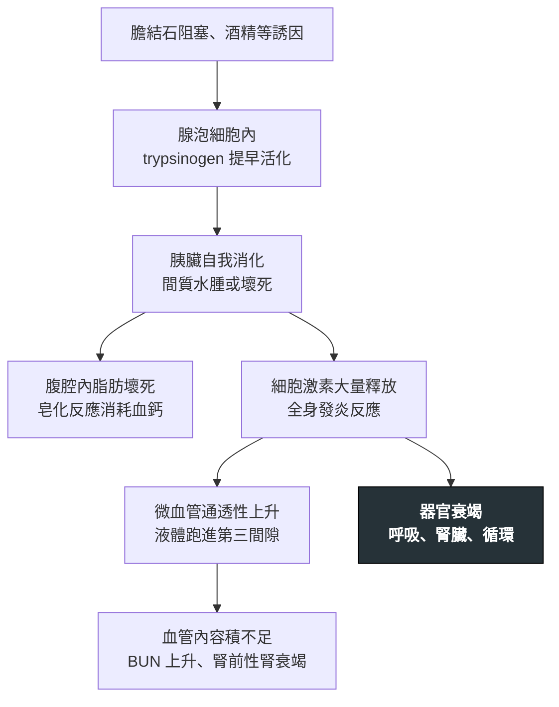

---
tags:
  - Med/Disease/GI
  - pancreas
  - 禁忌
aliases:
  - 急性胰臟炎
  - Acute Pancreatitis
  - AP
created: 2026-07-27
updated: 2026-07-28
status: 可用
source: "114-1 醫學(三) 21、115-2 醫學(三) 74 延伸；2024 ACG Clinical Guideline: Management of Acute Pancreatitis；Revised Atlanta Classification 2012；Harrison's"
cssclass: clinical-note
presents_as:
  - "[[Abdominal pain]]"
  - "[[RUQ pain]]"
  - "[[Fever]]"
diagnosed_by:
  - "[[Abdominal ultrasound]]"
treated_by:
  - "[[ERCP]]"
differential:
  - "[[Acute cholangitis]]"
  - "[[CBD stone]]"
  - "[[Pancreatic cancer]]"
complication:
  - "[[Shock]]"
  - "[[Dialysis]]"
---

# Acute pancreatitis ｜ 急性胰臟炎 · Acute Pancreatitis

> [!abstract] 一句話總覽
> 消化酵素在腺泡細胞內**提早活化**，造成胰臟自我消化與全身發炎反應（SIRS）。**診斷靠三取二**、**嚴重度靠器官衰竭有沒有撐過 48 小時**——這兩件事都**與酵素數值高低無關**。治療是輸液、止痛、早期進食、找病因，不是禁食加抗生素。

> [!tip] 30 秒行動卡
> **診斷關鍵**：三取二成立即確診——① 上腹痛穿透到背 ② lipase 或 amylase **>3× ULN** ③ 影像有胰臟炎表現。前兩項就到位時，**不必為了診斷再打顯影劑做 CT**
> **治療骨架**：**乳酸林格液（lactated Ringer's, LR）中度輸液**（約 1.5 mL/kg/h；有低血容才先 10 mL/kg bolus）＋ 積極止痛 ＋ **24–48 小時內開始經口低脂固體飲食** ＋ 一定要找病因（超音波、三酸甘油酯、血鈣）
> **絕對不可**：常規預防性抗生素、無膽管炎就緊急 [[ERCP]]、長時間禁食、用 amylase／lipase 數值判斷嚴重度或追療效

---

## 定義與定位

*這個病是什麼？在分類樹的哪個位置？跟隔壁的病靠什麼分開？*

| 項目 | 重點 |
|---|---|
| 本質 | 胰蛋白酶原（trypsinogen）在**腺泡細胞內**提早轉成 trypsin → 連鎖活化其他酵素 → 胰臟自我消化 ＋ 細胞激素風暴 |
| 兩大型態 | **間質水腫型（interstitial edematous）約 90%**；**壞死型（necrotizing）約 5–10%**（收案較寬的研究可達 20%）——壞死型才是死亡率的來源 |
| 好發族群 | 中年以上；**膽源性偏女性、酒精性偏男性**；高三酸甘油酯型常合併肥胖、糖尿病控制不良 |
| 分類位置 | 與 [[Pancreatic cancer]]、慢性胰臟炎同屬胰臟疾病；急性是「可逆的自我消化」，慢性是「不可逆的纖維化」 |
| 病程分期 | **早期（第 1 週）**由 SIRS 與器官衰竭主導；**晚期（第 1 週之後）**由局部積聚、感染與併發症主導。另有一條**獨立**的時間軸：**4 週**是局部積聚有無成熟包膜的分界 |

## 病因與機制

*為什麼會發生？病生理鏈條長什麼樣？——這一節寫好，下面的嚴重度與併發症就不用背。*

> [!tip] 一條線推出全部處置
> **液體跑到第三間隙 → 血管內是空的。** 所以輸液是治療核心、BUN 與血比容（Hct）是灌流指標；而胰臟裡漏出多少酵素進血中，跟「漏出多少液體、壞死多少組織」是兩回事——這就是**酵素高低不代表嚴重度**的機制原因。

### 病因骨架：五類就記得完

| 分類 | 代表病因 | 記憶點與門檻 |
|---|---|---|
| **阻塞** | **膽結石／膽泥（40–70%，第一名）**、[[CBD stone]]、壺腹周圍腫瘤（見 [[Pancreatic cancer]]）、pancreas divisum | **ALT >3× ULN** 對膽源性的陽性預測值極高；每位病人都要做 [[Abdominal ultrasound]] |
| **毒性** | **酒精（25–35%，第二名）**、藥物 | 酒精多是長期大量飲用者的急性發作，不是單次狂飲 |
| **代謝** | **三酸甘油酯 >1,000 mg/dL**、高血鈣（見 [[Hypercalcemia]]） | TG 500–1,000 屬風險區、**>1,000 才算病因**；高血鈣常來自副甲狀腺功能亢進 |
| **醫源／外傷** | **[[ERCP]] 後**、腹部手術、腹部鈍傷 | ERCP 後胰臟炎是該檢查最常見的併發症 |
| **免疫／感染／遺傳** | **IgG4 相關自體免疫性胰臟炎**、mumps／CMV、PRSS1 與 SPINK1 突變、蠍毒 | IgG4 型：無痛性黃疸＋影像「香腸狀」胰臟＋類固醇有效，要跟胰臟癌分開 |

> [!tip] ERCP 後胰臟炎的預防（ACG 2024 少數的「強建議」）
> 高風險病人**術中／術後給予肛門塞劑 indomethacin**（strong recommendation），必要時**加放胰管支架**（conditional）。

> [!note] 常考的藥物名單
> azathioprine（本身即為明確的藥物性胰臟炎藥；另注意與 allopurinol 併用時**骨髓抑制**毒性放大須減量，見 [[Gout]]）、valproic acid、thiazide 與 furosemide、estrogen（經由拉高三酸甘油酯）、sulfonamide 類、didanosine、mesalamine、tetracycline。

![[assets/acute-pancreatitis-biliary-anatomy.jpg|760]]
*總膽管（common bile duct）與主胰管（main pancreatic duct）在十二指腸乳頭前匯流；結石若卡在共同出口，可同時阻斷膽汁與胰液，因而並見黃疸與胰臟炎。Source: [NIDDK Media Library — Biliary system](https://www.niddk.nih.gov/news/media-library/18033)；credit: National Institute of Diabetes and Digestive and Kidney Diseases, National Institutes of Health。*

## 臨床表現

*典型病人長什麼樣？哪些症狀是幾乎一定有、哪些是提示性的？*

- **典型**：**持續性上腹痛、穿透到背部、身體前傾會稍緩解**；噁心嘔吐（吐完不會緩解，與腸胃炎相反）；上腹壓痛、腸音減弱
- **提示性**：[[Fever]] 與心搏過速（早期多是無菌性 SIRS，**不等於感染**）、黃疸（提示膽源性，見 [[Jaundice]]）、左側肋膜積液（滲出液且**澱粉酶高**，見 [[Pleural fluid analysis]]）
- **少見但重要**：**Cullen sign（臍周瘀斑）**與 **Grey Turner sign（側腹瘀斑）**——代表後腹腔出血，罕見但預後差；低血鈣造成的手足抽搐；皮下脂肪壞死性結節；[[Shock]] 與呼吸衰竭

→ 相關主訴流程：[[Abdominal pain]]、[[RUQ pain]]

## 診斷

*三取二。不是三項全要，也不是酵素一項說了算。*

| 診斷條件（**符合 2 項即成立**） | 內容 |
|---|---|
| ① 症狀 | 急性發作、持續的上腹痛，常穿透至背部 |
| ② 血清酵素 | **lipase 或 amylase >3× 正常上限（ULN）** |
| ③ 影像 | 增強 CT、MRI 或超音波呈現急性胰臟炎的特徵 |

> [!info] amylase 與 lipase 怎麼挑
> | | amylase | lipase |
> |---|---|---|
> | 特異性 | 較低（唾液腺、腸缺血或穿孔、腎衰竭、子宮外孕、DKA、macroamylasemia 都會升） | **較高** |
> | 時間窗 | 發病 6–12 小時升，**3–5 天就回正常** | 4–8 小時升，**撐 8–14 天** |
> | 陷阱 | **高三酸甘油酯型可能偽陰性**（血清脂質干擾檢驗） | 遲來就診者靠它 |
>
> 所以：**遲了幾天才來的病人、或懷疑 TG 型的病人，看 lipase。**

**要開的檢查**：[[Abdominal ultrasound]]（**每位病人都要做**，找膽結石與膽管擴張）、血液常規與生化（BUN、Cr、Ca、Hct、ALT、bilirubin）、**三酸甘油酯與血鈣**（找病因）、[[Arterial blood gas]]（懷疑低血氧或 ARDS 時）

> [!warning] 增強 CT 不是第一天做的
> 三取二成立就不必為了診斷做 CT。要看**壞死**時，得等 **72 小時後**打顯影劑才準——太早做會**低估**壞死範圍，而且顯影劑會加重此時脆弱的腎灌流。CT 適應症是：診斷不確定、**48–72 小時仍未改善或惡化**、懷疑併發症。

| 間質水腫型（interstitial edematous） | 壞死型（necrotizing） |
|---|---|
| ![[assets/acute-pancreatitis-edematous-ct.jpg\|360]] | ![[assets/acute-pancreatitis-necrotizing-ct.jpg\|360]] |

*左：胰臟瀰漫腫大但實質仍顯影，長箭頭標示周胰脂肪絮狀混濁，短箭頭為急性液體積聚，沒有實質壞死。右：A 的胰頸、體、尾呈瀰漫性低顯影，B 僅鉤突仍保留顯影；C、D 的長箭頭標示廣泛胰實質壞死，短箭頭標示胰外脂肪壞死。Source: [Cunha et al., *Radiologia Brasileira* 2014, Figures 1 and 3](https://pmc.ncbi.nlm.nih.gov/articles/PMC4337140/)（CC BY-NC）。*

## 嚴重度分級

*入院第一天算 BISAP；滿 48 小時後才用 Atlanta 定案。*

### BISAP：五個字母各配一個變數

| 字母 | 項目 | 判準 |
|---|---|---|
| **B** | **B**UN | **> 25 mg/dL** |
| **I** | **I**mpaired mental status | 意識障礙（GCS < 15） |
| **S** | **S**IRS | 符合 ≥2 項：體溫 <36 或 >38°C、心跳 >90、呼吸 >20 或 PaCO₂ <32 mmHg、白血球 <4,000 或 >12,000 或未成熟型 >10% |
| **A** | **A**ge | **> 60 歲** |
| **P** | **P**leural effusion | **胸部**影像可見肋膜積液 |

> [!danger] 這些「像是」BISAP 但都不在裡面
> **腹水、血糖、血鈣、LDH、AST、血比容（Hct）、amylase／lipase 數值。**
> 前六項多半是 **Ranson criteria** 的成分被搬過來當假選項；最後一項則是**任何嚴重度系統都沒有**的東西。
> 另外注意：BISAP 的**唯一影像項目是胸部的肋膜積液，不是腹部的腹水**；BUN 門檻**只能是 25**（Ranson 講的是 48 小時內「BUN **上升** >5 mg/dL」，是另一回事）。

> [!info] 時間軸才是隱藏考點
> **BISAP：入院 24 小時內就能算**（最大優點）／ **Ranson：要等滿 48 小時**（入院 5 項＋48 小時 6 項，共 11 項）／ **CT Severity Index：72 小時後打顯影劑才準** ／ **Revised Atlanta：卡在 48 小時**。
> 問「入院當下就能算的是哪一個」，永遠是 BISAP。

### Revised Atlanta 分類（2012）：看器官衰竭「撐多久」

| 級別 | 定義 |
|---|---|
| **輕度 mild** | 無器官衰竭、無局部或全身併發症 |
| **中重度 moderately severe** | **暫時性**器官衰竭（**≤48 小時**）**或**有局部／全身併發症 |
| **重度 severe** | **持續性**器官衰竭（**>48 小時**，單一或多重器官皆算） |

器官衰竭以 **modified Marshall score ≥2** 定義，只評**呼吸(PF ratio, ARDS)、腎臟AKI、心血管MAP**三個系統。**48 小時是 Atlanta「嚴重度分級」唯一的時間門檻**（另有 1 週用於病程分期、4 週用於積聚命名，三條時間軸不要互相污染）；嚴重度不是由 CT Severity Index、也不是由 Ranson 或 APACHE II 的分數本身決定。

## 併發症 vs 病因：不可混淆

*這是最反直覺、也最容易被寫成錯誤選項的地方——先問一句「這是因還是果」。*

| 系統 | 病因（**因**） | 併發症（**果**） |
|---|---|---|
| 膽道 | **膽結石**、[[CBD stone]]、膽泥 | 少見的膽道狹窄 |
| 代謝 | **三酸甘油酯 >1,000**、**高血鈣**（[[Hypercalcemia]]） | **早期低血鈣**（脂肪皂化）、**慢性化後糖尿病**、外分泌功能不足 |
| 毒性／醫源 | **酒精**、藥物、**[[ERCP]] 後**、腹部外傷 | — |
| 局部積聚 | — | **假性囊腫（pseudocyst）**、**包覆性壞死（walled-off necrosis, WON）**、**感染性壞死** |
| 血管 | — | **脾靜脈血栓 → 孤立性胃底靜脈曲張**、假性動脈瘤破裂造成**腹腔內出血** |
| 胰管 | pancreas divisum、壺腹腫瘤 | **胰管狹窄或中斷**（disconnected pancreatic duct syndrome）→ 反覆發作、胰源性腹水與胸水 |

> [!warning] 「膽結石的產生」永遠不是急性胰臟炎的併發症
> 膽結石是**原因**。唯一沾得上邊的情境是長期禁食或全靜脈營養造成膽囊淤積生出膽泥——但那是**禁食本身**的後果，不是胰臟炎的併發症。把病因塞進併發症清單，是最省力也最常見的錯誤選項做法。

### 4 週是那條分界線

| 期別 | 局部積聚的命名 | 全身與其他 |
|---|---|---|
| **早期（<4 週，無成熟包膜）** | 水腫型 → **acute peripancreatic fluid collection（APFC）**；壞死型 → **acute necrotic collection（ANC）** | SIRS、**器官衰竭**（呼吸／腎／循環）、ARDS、急性腎損傷（嚴重時需 [[Dialysis]]）、低血鈣、[[Shock]] |
| **晚期（>4 週，有成熟纖維包膜）** | 水腫型 → **pseudocyst**；壞死型 → **walled-off necrosis（WON）** | **感染性壞死**、脾靜脈血栓、胰管狹窄或中斷、慢性化後的外分泌功能不足與糖尿病 |

## 鑑別診斷

*要跟誰分清楚？靠什麼分？*

| 要排除的 | 支持它的線索 | 怎麼排除 |
|---|---|---|
| [[Acute cholangitis]] | **Charcot 三徵**：發燒＋黃疸＋右上腹痛；bilirubin 明顯上升 | 兩者可並存；**一旦並存就要緊急 [[ERCP]]** |
| [[CBD stone]] 單純阻塞 | 疼痛偏絞痛型、酵素不到 3× ULN | 影像看膽管擴張；MRCP 或超音波內視鏡 |
| 消化性潰瘍穿孔 | **突發如刀割**、板狀腹、立位影像有游離空氣 | 立位胸腹 X 光或 CT |
| 腸繫膜缺血 | 「痛得比壓痛還誇張」、代謝性酸中毒、乳酸上升 | **amylase／lipase 也會升**，是最容易誤判的一組；靠 CT 血管攝影 |
| 下壁心肌梗塞 | 上腹不適＋噁心、冷汗、心電圖 ST 上升 | 到院先做心電圖 |
| [[Pancreatic cancer]] | 年長、體重減輕、無痛性黃疸、反覆發作或不明原因胰臟炎 | 影像追蹤；**50 歲以上首次不明原因胰臟炎要想到它** |

## 治療

*重點是把血流撐住、把腸子用起來、把病因處理掉——沒有一個藥能「治」胰臟炎本身。*

| 情境                  | 處置                                                                                                                                                                                         |
| ------------------- | ------------------------------------------------------------------------------------------------------------------------------------------------------------------------------------------ |
| **輸液（核心）**          | **乳酸林格液（LR）優於生理食鹽水**；**中度而非過度**輸液：血容量正常者約 **1.5 mL/kg/h**，有低血容徵象者先給 **10 mL/kg bolus**                                                                                                     |
| 輸液的追蹤               | 6 小時與 24–48 小時各重評一次：**BUN 趨勢、Hct、尿量、生命徵象**。改善就降速，不是一路灌到底                                                                                                                                   |
| 止痛                  | 積極給鴉片類（morphine 不是禁忌；「morphine 會讓 Oddi 括約肌收縮所以不能用」是過時說法）                                                                                                                                   |
| **營養**              | **輕症：24–48 小時內、可耐受即開始經口低脂固體飲食**，不必等酵素正常。無法經口者用**鼻胃或鼻空腸管腸道餵食**；全靜脈營養只留給腸道完全用不了的人                                                                                                            |
| 抗生素                 | **不常規預防性給**——即使是壞死性胰臟炎。**只在證實感染時**才給能穿透壞死組織者（carbapenem、metronidazole、fluoroquinolone）                                                                                                     |
| 膽石性＋**合併急性膽管炎**     | **24 小時內緊急 [[ERCP]]** 加括約肌切開取石（這是 24 小時門檻的**唯一**適應症）                                                                                                                                       |
| 膽石性＋**持續膽道阻塞但無膽管炎** | 不適用 24 小時門檻；先以 MRCP 或 EUS 確認結石，住院期間安排 ERCP 並完成膽囊切除                                                                                                                                         |
| 膽石性、**無膽管炎**        | **先保守治療**；穩定後**於同次住院內完成膽囊切除**                                                                                                                                                              |
| 高三酸甘油酯型             | 禁食、靜脈胰島素輸注（合併高血糖時）；**血漿置換不建議常規使用**——證據顯示除快速降低 TG 數值外**未改善器官衰竭或死亡率**，僅在極重症、其他方法無效時個案考量（見 [[Dialysis]] 的體外治療脈絡）；穩定後長期 fibrate，**目標空腹 TG ＜500 mg/dL**（Endocrine Society 以 TG ＞500 為啟動藥物治療的門檻） |
| **壞死需引流時**          | **能等就等到 4 週以上**（包膜成熟後併發症與死亡率較低），採**階梯式（step-up）**：先內視鏡或經皮引流 → 必要時才清創，不是一開始就開腹                                                                                                              |

> [!tip] 為什麼「早期腸道營養」贏過禁食
> 禁食 → 腸黏膜屏障萎縮 → **腸道菌叢移位** → 壞死組織被細菌落腳 → 感染性壞死。早期把腸子用起來，正是在防這條路。這也是為什麼**腸道營養優於靜脈營養**——後者無法維持黏膜屏障。

> [!note] 台灣本土
> 台灣的病因序位與國際一致（膽結石居首、酒精次之），健保下腹部超音波取得容易，**每位急性胰臟炎病人都應於住院期間完成超音波找膽結石**，以免漏掉可根治的病因而反覆發作。

## 預後

- 整體死亡率隨族群與年代差異大：近年大型資料多為 **1–2%**，教科書慣用值約 **5%**；**壞死性胰臟炎**約 **15%**；**感染性壞死** **20–40%**
- 死亡呈**雙峰**：早期死於 SIRS 與多重器官衰竭，晚期死於感染性壞死與敗血症
- **最重要的預後因子是「器官衰竭有沒有持續超過 48 小時」**，不是酵素數值、不是 CT 分數
- 首次酒精性急性胰臟炎後約 **1/4** 會再度發作、約 **15–30%** 在數年內進展為慢性胰臟炎（外分泌功能不足＋糖尿病），**合併抽菸者風險最高**；**戒酒與戒菸**是最有效的兩項介入

## 禁忌與陷阱

> [!danger] 絕對不可
> | 情境 | 絕對不可 | 為什麼 | 該做什麼 |
> |---|---|---|---|
> | 壞死性胰臟炎但無感染證據 | 常規給**預防性抗生素** | 不降低死亡率或感染率，反而選出抗藥菌與黴菌感染 | 只在**證實或高度懷疑感染**時給（積聚內出現氣泡影、菌血症、抗生素治療下仍持續惡化）。**2024 ACG 已建議「不要」為了診斷而做細針抽吸（FNA）** |
> | 膽石性胰臟炎但**無膽管炎、無持續膽道阻塞** | 72 小時內緊急 [[ERCP]] | 不改善預後，還多了 ERCP 後胰臟炎、出血與穿孔的風險 | 先保守治療；**合併膽管炎才在 24 小時內做** |
> | 任何急性胰臟炎 | 禁食到腹痛完全消失或酵素回正常才進食 | 腸黏膜屏障萎縮 → 菌叢移位 → 感染性壞死上升 | **24–48 小時內、可耐受就開始**低脂固體飲食；不能經口就放鼻胃／鼻空腸管 |
> | 判斷嚴重度或評估治療反應 | 用 **amylase／lipase 數值**高低或連續追蹤 | 酵素高低與壞死範圍、器官衰竭、死亡率的**相關性極差、不具預測價值**；任何嚴重度系統都沒有把它列為變數 | 看 **BISAP、SIRS、器官衰竭是否 >48 小時**，加上 BUN 與 Hct 趨勢、尿量 |
> | 膽石性輕症穩定後 | 讓病人出院、「三個月後再回來開刀」 | 等待期間復發率高，可能復發成重症 | **同次住院內完成膽囊切除** |
> | 發病第一天 | 立刻打顯影劑做腹部 CT 來分級 | <72 小時壞死尚未顯影，會**低估**嚴重度；且顯影劑加重此時的腎灌流不足 | 三取二成立即可診斷；**72 小時後**再做增強 CT |

> [!warning] 常見錯誤
> - 把「**膽結石的產生**」當成急性胰臟炎的併發症——它是**因**不是果。
> - 把**腹水、血糖、血鈣、LDH、AST、血比容**塞進 BISAP——那些多半是 **Ranson criteria** 的成分。
> - 把 BISAP 的 **BUN > 25 mg/dL** 記成 45；Ranson 講的是「BUN **上升** >5 mg/dL」，兩者不同。
> - 把 Atlanta **嚴重度分級**的 **48 小時**記成 24 或 72 小時——48 是**嚴重度**唯一的門檻；1 週是病程分期、4 週是積聚命名。
> - 高三酸甘油酯型看到 **amylase 正常就排除胰臟炎**——血清脂質會造成偽陰性，此時要看 lipase。
> - 把 **pseudocyst 當早期併發症**——滿 **4 週**才有成熟包膜，4 週內只能叫 APFC。
> - 早期發燒就當感染衝抗生素——第一週的發燒多半是**無菌性 SIRS**。
> - 更多這類「把因當果、把數值當嚴重度」的題型收在 [[禁忌選項]]。

## 相關連結

- [[Hypercalcemia]] — 代謝性病因之一；胰臟炎本身早期反而會**低**血鈣
- [[CBD stone]]、[[Acute cholangitis]] — 膽源性的上游與最危險的併發情境，決定要不要緊急 [[ERCP]]
- [[ERCP]] — 既是治療手段，也是本病的醫源性病因
- [[Abdominal ultrasound]] — 每位病人都要做的找病因第一站
- [[Pancreatic cancer]] — 50 歲以上不明原因或反覆發作時必須排除
- [[Shock]]、[[Dialysis]]、[[Arterial blood gas]] — 重症期的循環、腎臟、呼吸三條戰線
- [[Pleural fluid analysis]] — 左側肋膜積液為澱粉酶高的滲出液；也是 BISAP 的「P」
- [[Jaundice]]、[[RUQ pain]]、[[Abdominal pain]]、[[Fever]] — 相關主訴的鑑別流程
- [[Cirrhosis]]、[[MASLD]] — 同為酒精與代謝共病譜系的鄰居
- [[禁忌選項]] — 跨科的「絕對不可」總表
