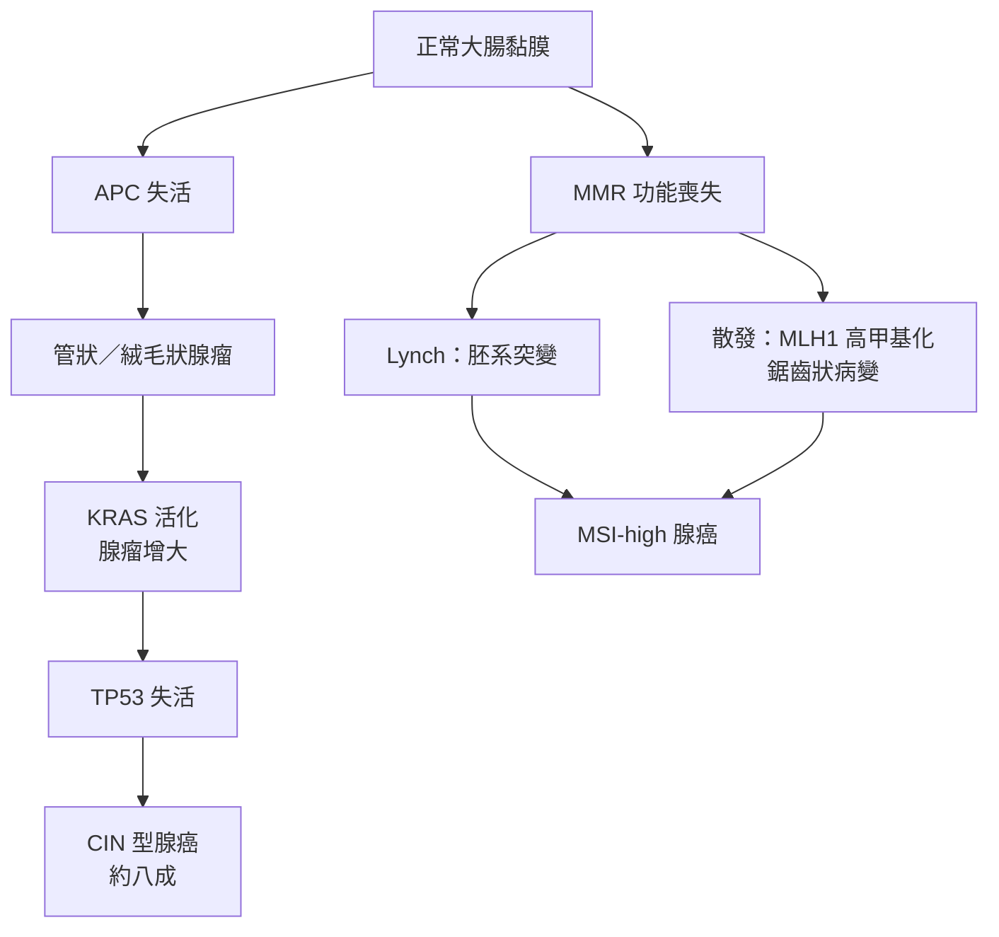

---
tags:
  - Med/Disease/GI
  - oncology
  - 禁忌
aliases:
  - CRC
  - Colorectal cancer
  - 大腸直腸癌
  - 大腸癌
created: 2026-07-28
updated: 2026-07-28
status: 可用
source: 115-2 醫學(三) 20、21 延伸；NCCN Colon／Rectal Cancer Guidelines；Harrison's 21e；USPSTF 2021 Colorectal Cancer Screening；衛福部國民健康署大腸癌篩檢公告（114 年 1 月起現行制度；115 年未變動）
cssclass: clinical-note
presents_as:
  - "[[Anemia]]"
  - "[[Abdominal pain]]"
diagnosed_by:
  - "[[Colonoscopy]]"
  - "[[Stool occult blood]]"
treated_by:
  - "[[Radiotherapy]]"
  - "[[Chemotherapy]]"
differential:
  - "[[IBD]]"
  - "[[Hemorrhoids]]"
complication:
  - "[[Anemia]]"
  - "[[Bowel obstruction]]"
---

# CRC ｜ 大腸直腸癌 · Colorectal Cancer

> [!abstract] 一句話總覽
> 絕大多數由**腺瘤（adenoma）經約 10 年慢慢變成癌**，因此它是少數「可以靠切息肉來預防」的癌症；兩條分子路徑（**染色體不穩定 CIN** 與 **微衛星不穩定 MSI**）決定了它的位置、預後與能不能用免疫治療。臨床上最關鍵的一句：**成人不明原因缺鐵性貧血，等於大腸鏡適應症**。

> [!tip] 30 秒行動卡
> **診斷關鍵**：排便習慣改變／血便／不明原因 [[Anemia]] → **[[Colonoscopy]] ＋ 切片**（一槌定音，且要看完全大腸）
> **治療骨架**：局部 → 手術切除；**淋巴結陽性（stage III）→ 術後輔助化療**；**直腸癌另加術前放化療＋全直腸繫膜切除（TME）**；轉移性 → 先驗 **RAS／BRAF／MMR**
> **絕對不可**：拿 **CEA 當篩檢工具**、成人缺鐵性貧血只補鐵不做大腸鏡、**RAS 突變還給 anti-EGFR**、血便直接歸因痔瘡就結案

---

## 定義與定位

*這個病是什麼？在分類樹的哪個位置？跟隔壁的病靠什麼分開？*

| 項目 | 重點 |
|---|---|
| 本質 | 大腸與直腸黏膜的**腺癌（adenocarcinoma）**，>95%；由癌前病變逐步累積突變而來 |
| 好發族群 | 年齡是權重最高的危險因子；台灣發生人數長年名列所有癌症前段，且 **＜50 歲的早發性 CRC 逐年上升** |
| 分類位置 | 大腸慢性病灶中的「腫瘤型」，與發炎型（[[IBD]]）、感染型、缺血型並列 |
| 關鍵分軸 | ①**部位**：右側（近端）vs 左側（遠端／直腸）②**分子**：CIN vs MSI ③**遺傳性 vs 散發性** |

> [!note] 腺瘤與癌的關係只能單向讀
> 「**幾乎所有大腸癌來自腺瘤**」為真；「**幾乎所有腺瘤會變成癌**」為假——只有約 **5%**（一說 5–10%）的腺瘤最終變癌。
> 50 歲以上族群約 **30–40%** 帶有腺瘤，但終生 CRC 風險僅約 5%。
> 臨床上仍**一律切除所有偵測到的腺瘤**，理由不是「都會變癌」，而是**事先無法辨認哪一顆會變**。

## 病因與機制

*為什麼會發生？兩條路徑分別走到哪裡？*

| 對照項 | **CIN**（chromosomal instability） | **MSI**（microsatellite instability／dMMR） |
|---|---|---|
| 占比 | 約 **80–85%**（＝以「非 MSI 即 CIN」切分；若把 CIMP／鋸齒狀路徑另列，CIN 約 65–70%） | 約 **15%**（其中約 3% 為 Lynch、約 12% 為散發性） |
| 機制 | 非整倍體、雜合性缺失；**APC → KRAS → TP53** 順序累積 | **錯配修復（mismatch repair）失效** → 微衛星序列長度不穩定 |
| 前驅病變 | 傳統管狀／絨毛狀腺瘤 | **無柄鋸齒狀病變（sessile serrated lesion, SSL）**（散發性）；Lynch 走一般腺瘤但進展極快 |
| 好發部位 | 左側為主 | **右側（近端）為主** |
| 特徵標記 | — | 散發性常見 **BRAF V600E ＋ MLH1 promoter 高甲基化**；Lynch **不會**有 BRAF V600E |
| 組織學 | 一般腺癌 | 分化差、黏液狀、腫瘤浸潤淋巴球多 |

> [!important] MSI-high 的三件事一定綁在一起記
> ① **早期（stage II）同分期預後較好**——突變負荷高、免疫浸潤旺盛。
> ② **對 5-FU 單藥輔助化療反應差**，stage II dMMR 不建議單用 5-FU（有研究提示可能無益甚至有害）。
> ③ **轉移期對免疫檢查點抑制劑（ICI，如 pembrolizumab）反應極佳**，已是 dMMR／MSI-H 轉移性 CRC 的第一線——但 **MSI-H 比例隨分期下降：stage II 約 20%、stage III 約 12%、stage IV 僅約 4–5%**，實際能用 ICI 的轉移病人是少數。
> 這三點方向不同（好、壞、好），最容易被混成一句話。

> [!tip] BRAF V600E 是「排除 Lynch」的分流器
> IHC 顯示 MLH1 缺失時：**驗到 BRAF V600E 或 MLH1 高甲基化 → 傾向散發性**；兩者皆無 → 續做胚系檢測找 [[Lynch syndrome]]。但要分清楚：**BRAF V600E 在轉移性 CRC 是不良預後因子**，與「MSI-H 預後好」不衝突，那是兩個不同的分層。

![[assets/crc-mmr-ihc.jpg|760]]
*dMMR 大腸癌的 IHC 範例：A（MLH1）與 B（PMS2）腫瘤細胞核染色消失，但左上角非腫瘤腺體／間質細胞仍呈棕色，證明內部陽性對照有效；C（MSH2）與 D（MSH6）核染色保留。配對原則是 MLH1–PMS2、MSH2–MSH6；若上游 partner 缺失，常連帶失去下游 partner。Source: [Mismatch Repair Proteins and Microsatellite Instability in Colorectal Carcinoma](https://pmc.ncbi.nlm.nih.gov/articles/PMC5320899/), Fig. 2。*

## 癌前病變：哪些腺瘤該擔心

| 型態／特徵 | 癌變風險 | 備註 |
|---|---|---|
| **絨毛狀（villous）** | **最高** | 風險排序：**villous > tubulovillous > tubular** |
| **大小 ≥1 cm** | 明顯上升 | 與「高度異型增生」「絨毛成分」合稱 **advanced adenoma** |
| **高度異型增生（high-grade dysplasia）** | 明顯上升 | 尚未穿破黏膜肌層即非侵襲癌 |
| **無柄鋸齒狀病變（SSL）** | 上升，**走 MSI 路徑** | 右側、扁平、界線不清、覆黏液**易被漏看**；是 interval cancer 的主因 |
| 增生性息肉（hyperplastic，小、左側） | 幾乎不變 | 與 SSL 不同，勿混 |

> [!info] 「10 年」是所有篩檢間隔的來源
> 管狀腺瘤走到腺癌通常需 **10 年以上**，這就是為什麼「乾淨的大腸鏡可以間隔 10 年、糞便潛血需每 1–2 年」。
> 但 **Lynch 與 SSL 的進展明顯較快**，所以這兩者的追蹤間隔要縮短。

## 危險因子與保護因子

| 類別 | 內容 |
|---|---|
| **權重最高（不可改變）** | **年齡**；個人或家族的**腺瘤／CRC 病史**（尤其**一等親**，親屬愈年輕、人數愈多風險愈高） |
| 遺傳與慢性發炎 | [[Lynch syndrome]]、[[FAP]] 等**明確遺傳症候群占全部 CRC 約 5%**；另有約 **20–25%** 有家族聚集但找不到已知致病基因（這兩個數字常被混成同一題）；長期 [[IBD]]（見下方監測段） |
| 可改變（證據較強） | **紅肉與加工肉**、動物脂肪、**肥胖**、缺乏運動、**飲酒**、**吸菸**、糖尿病 |
| 保護因子 | **規律運動**證據最一致；**膳食纖維、鈣**方向為正但效果較弱；aspirin 見下 |

> [!warning] 「吸菸是最重要的危險因子」是錯的
> 吸菸確實是危險因子，但權重遠不及**年齡**與**家族／個人病史**。腫瘤流行病學的敘述只要出現「幾乎所有／一律／最重要」，通常就過滿了——癌症風險本質上是多因子的。

> [!note] Aspirin 的定位有爭議，別寫死
> 曾被視為化學預防手段，但 **USPSTF 2022 已將 CRC 自 aspirin 建議中移除**——理由是**現有證據不足以證實低劑量 aspirin 可降低 CRC 發生率或死亡率**（出血風險與淨效益則是同一份文件下修 CVD 適應症的理由，兩者不要混講）。
> **例外**：[[Lynch syndrome]] 病人使用 aspirin 有較明確的預防證據（CAPP2），仍在指引中被提及。

## 篩檢

一般風險族群的篩檢邏輯是「用低侵襲性工具找出需要做大腸鏡的人」，而 **[[Colonoscopy]] 同時是診斷與治療（切息肉）工具**，所以任何篩檢工具陽性，下一步都只有一個：做全大腸鏡。

| 項目 | 內容 |
|---|---|
| 美國（USPSTF 2021、ACS） | 一般風險族群**起始年齡下修至 45 歲**（原 50 歲），理由正是早發性 CRC 上升 |
| 工具 | **糞便免疫化學法（FIT，[[Stool occult blood]]）每年**；或 **[[Colonoscopy]] 每 10 年**；其他：FIT-DNA、CT colonography、乙狀結腸鏡 |
| 一等親有 CRC | 較一般族群提早開始、間隔縮短（常見做法：40 歲或比該親屬確診年齡早 10 年開始） |
| **陽性後** | **一律做全大腸鏡**，不可只重複驗糞便 |

> [!important] 台灣公費篩檢（數字逐年變動，以國健署最新公告為準）
> 衛福部**國民健康署**自 **114 年（2025）1 月起**擴大：由原本 50–74 歲，改為
> - **45–74 歲**：每 **2 年** 1 次**定量免疫法糞便潛血檢查（FIT）**
> - **40–44 歲且一等親（父母、子女、兄弟姊妹）曾罹大腸癌者**：同樣每 2 年 1 次
>
> **115 年（2026）大腸癌篩檢的對象與間隔維持不變**（未見調整公告）。
> **115 年新增**：45–74 歲民眾**終身 1 次**公費「**糞便抗原檢測胃幽門螺旋桿菌**」，可與大腸癌 FIT **同一次採便**完成。
> **陽性後**：建議 **6 個月內**完成大腸鏡，逾期未做者罹癌風險顯著上升。
> 來源：[國民健康署 · 大腸癌篩檢簡介](https://www.hpa.gov.tw/Pages/Detail.aspx?nodeid=621&pid=1136)。**此政策每年可能調整，臨床請以國健署最新公告為準。**

> [!note] 早發性 CRC（early-onset，＜50 歲）：歐美與亞太**皆呈上升趨勢**
> 台灣全國癌症登記 1994–2018 的 age–period–cohort 分析顯示 **30–49 歲組發生率年增約 3.6%**、死亡率年增約 1.0%，均高於年長族群（約 2.6%）；亞洲的早發性 CRC 傾向**男性較多、直腸癌比例較高**。這是各國下修篩檢起始年齡的直接理由。

### IBD 病人的監測（結論；完整內容見 [[IBD]]）

- 決定要不要監測的是**發炎範圍與病程長度，不是病名**——UC 與侵犯大腸範圍夠廣的 Crohn's colitis 風險相當。
- 一般從**確診後 8 年**（AGA 2021：8–10 年）開始監測性大腸鏡；**合併 PSC 者自診斷當下開始、每年一次**。IBD 相關癌變常是**扁平、界線不清**的，不像散發型 CRC 長成明顯息肉 → 用染色內視鏡＋目標式切片。

## 臨床表現

| 對照項 | **右側（近端）結腸** | **左側（遠端）結腸／直腸** |
|---|---|---|
| 解剖前提 | 管腔**大**、糞便呈**液狀** | 管腔**窄**、糞便已**成形** |
| 主要表現 | **隱匿性出血 → 缺鐵性 [[Anemia]]**、倦怠、**可觸摸腫塊**、體重減輕 | **阻塞症狀**、腹絞痛、**大便變細**、便秘與腹瀉交替 |
| 出血型態 | 糞便潛血陽性，肉眼常看不出來 | **肉眼血便（hematochezia）**、糞便帶血絲 |
| 診斷時機 | 症狀晚出現，**確診時常已較晚期** | 症狀早出現 |
| 分子傾向 | MSI-high 比例較高 | CIN 為主 |

- **典型**：50 歲以上、**排便習慣改變持續數週**＋血便或糞便潛血陽性
- **提示性**：不明原因體重減輕、不明原因缺鐵性貧血、裡急後重（tenesmus，直腸病灶）
- **少見但重要**：以**急性大腸阻塞或穿孔**為首發表現（左側常見）；**Streptococcus gallolyticus（舊稱 S. bovis）菌血症或心內膜炎 → 必須找大腸腫瘤**

> [!important] 成人不明原因缺鐵性貧血 ＝ 大腸鏡適應症
> 男性與**停經後女性**的缺鐵性貧血，在證明其他原因之前一律視為**消化道慢性失血**，必須完成上下消化道評估。
> 只開鐵劑而不安排大腸鏡，是最容易延誤右側大腸癌的單一動作。

→ 相關主訴流程：[[Anemia]]、[[Abdominal pain]]

## 診斷與分期

| 步驟 | 內容 |
|---|---|
| 確診 | **[[Colonoscopy]] ＋ 切片**（gold standard）；務必**看完全大腸**找同時性（synchronous）病灶——約 **2–5%**（彙整約 3.5%）在大腸內有**第二處同時性（synchronous）原發癌**。阻塞使內視鏡無法通過時，術後 3–6 個月內補做完整大腸鏡 |
| 分期影像 | **胸腹骨盆 CT**（[[Chest CT]] 含在內，肺為第二常見轉移處）；**直腸癌加做骨盆 MRI ±經直腸超音波**評估 T／N 與環周切緣（CRM） |
| 血液 | 術前 **CEA** 基線值（作為術後追蹤基準，**不是診斷或篩檢工具**） |
| 病理 | 淋巴結**至少檢視 12 顆**才算充分分期；分化程度、脈管／神經侵犯 |
| 分子檢測 | **MMR／MSI**（所有 CRC 都建議做，兼作 Lynch 篩檢）；轉移性另加 **RAS（KRAS／NRAS）、BRAF V600E、HER2** |

> [!info] 分期怎麼決定治療（不必背完整 TNM 逐條）
> - **T 看侵犯深度**（黏膜下層 → 固有肌層 → 穿出漿膜 → 侵犯鄰近器官）、**N 看淋巴結顆數**、**M 看遠端轉移**。**Stage I**：手術即可。
> - **Stage II（N0 但穿出腸壁）**：一般觀察；有高風險特徵（T4、穿孔、阻塞、淋巴結取樣不足、分化差、脈管侵犯）才考慮輔助化療；**dMMR 者不用 5-FU 單藥**。
> - **Stage III（淋巴結陽性）→ 術後輔助化療**（FOLFOX／CAPOX 類），這是最穩定的一條規則。
> - **Stage IV**：全身治療為主；**肝、肺寡轉移可考慮切除，仍有治癒機會**。

| 有柄（Ip）病灶：柄部清楚 | Tubular adenoma vs SSL | Apple-core 狹窄 |
|---|---|---|
| ![[assets/crc-pedunculated-polyp.png\|300]] | ![[assets/crc-adenoma-ssl-endoscopy.jpg\|300]] | ![[assets/crc-apple-core-ctc.jpg\|300]] |

*左圖示範典型 pedunculated morphology（本病例病理為帶 adenoma component 的早期癌，重點在可辨識的 stalk）。中圖 A 為向腔內突出的 tubular adenoma；C 為扁平、邊界不清且覆 mucus cap 的 sessile serrated lesion。右圖為降結腸 T3 stenosing cancer：3D 外觀呈 apple-core deformity，病灶侵犯超過半圈並有結節狀外緣。Sources: [Kondo et al., 2021](https://link.springer.com/article/10.1186/s12957-021-02382-4), Fig. 1（CC BY 4.0）；[Colorectal Cancer Screening and Surveillance](https://pmc.ncbi.nlm.nih.gov/articles/PMC8501747/), Fig. 1；[Preoperative CT colonography in CRC](https://pmc.ncbi.nlm.nih.gov/articles/PMC3983437/), Fig. 4。*

## 鑑別診斷

| 要排除的 | 支持它的線索 | 怎麼排除 |
|---|---|---|
| [[Hemorrhoids]] | 鮮紅血覆在糞便表面、排便時疼痛、肛診可及 | **痔瘡的存在不能解釋一切**——仍須完成大腸評估 |
| [[IBD]] | 較年輕、慢性腹瀉合併黏液血便、腸道外表現 | 大腸鏡型態＋切片；長病程 IBD 本身也會長癌 |
| 憩室疾病（diverticular disease） | 左下腹痛、突發大量出血 | CT ＋大腸鏡（急性發炎期避開） |
| 感染性大腸炎 | 急性起病、[[Fever]]、旅遊或抗生素史 | 糞便培養、C. difficile 檢驗 |
| 大腸缺血（ischemic colitis） | 年長、突發腹痛後血便、分水嶺區 | CT ＋大腸鏡；病程自限 |

## 治療

| 情境 | 處置 |
|---|---|
| **結腸癌**局部 | **節段性切除＋區域淋巴結廓清**；不常規做放療 |
| **直腸癌**（中低位、T3–4 或 N+） | **術前放化療或全新輔助治療（TNT）→ 全直腸繫膜切除（TME）**；見 [[Radiotherapy]] |
| 淋巴結陽性 | **術後輔助化療**（oxaliplatin 為基礎的組合）；急性阻塞先減壓（支架橋接或造口）再根治手術 |
| 轉移性：RAS／BRAF **野生型且左側** | 化療 ＋ **anti-EGFR**（cetuximab／panitumumab） |
| 轉移性：**RAS 突變** | **不可用 anti-EGFR**；改用化療 ＋ **anti-VEGF**（bevacizumab） |
| 轉移性：**BRAF V600E** | encorafenib ＋ cetuximab（±binimetinib）；預後較差 |
| 轉移性：**dMMR／MSI-H** | **免疫檢查點抑制劑（pembrolizumab）為第一線** |
| 肝／肺寡轉移 | 積極評估**轉移切除或局部治療**，可達長期存活 |

> [!tip] 結腸癌與直腸癌處理不同的理由是解剖
> 直腸位於**骨盆腔、無漿膜覆蓋、周圍空間狹小** → 局部復發率高 → 需要**術前放化療縮小腫瘤＋TME 完整切除繫膜筋膜層**。
> 結腸在腹腔內、可切大範圍腸段，因此不需要常規放療。

## 併發症與預後

- **要盯的併發症**：大腸阻塞、穿孔與腹膜炎（可致 [[Shock]]）、慢性失血造成 [[Anemia]]、**肝轉移**（門靜脈回流，最常見）與**肺轉移**
- **預後因子**：**分期是最重要的**；其次為淋巴結取樣數、脈管／神經侵犯、切緣（直腸癌看 CRM）、術前 CEA 偏高、腸阻塞或穿孔表現。分子上：早期 **MSI-H 較好**、**BRAF V600E 在轉移期較差**
- **術後追蹤**：CEA 定期追蹤＋影像；**確診後 1 年做大腸鏡**找異時性（metachronous）病灶，之後依結果延長間隔

> [!note] CEA 的正確位置
> **不是篩檢工具**（敏感度與特異度都不足；吸菸、肝病、胰臟炎、其他癌症都可能升高）。
> 正確用途只有三個：**術前基線與預後評估、術後追蹤復發、轉移期評估治療反應**。術後 CEA 由降轉升，即使影像還乾淨也要積極找復發。

## 遺傳性大腸癌

| 對照項 | **[[Lynch syndrome]]**（HNPCC） | **[[FAP]]**（familial adenomatous polyposis） |
|---|---|---|
| 基因 | **MLH1、MSH2、MSH6、PMS2、EPCAM**（MMR 系統） | **APC**（約 25% 為新生突變） |
| 遺傳 | 體染色體顯性 | 體染色體顯性 |
| 息肉 | **息肉數不多**，但單顆進展快 | **上百至上千顆**腺瘤，青春期即出現 |
| 癌變 | 終生風險高但非必然 | **幾乎必然癌變**（未治療者多在 40 多歲前發生） |
| 部位 | **右側好發** | 全大腸 |
| 年齡 | **發病早**（常 40–50 歲前） | 更早 |
| 多發性 | **同時性／異時性多原發癌明顯較多** | — |
| 腸外腫瘤 | **子宮內膜癌**（整體第二常見；但對**女性**而言終生風險與 CRC 相當或更高，且約半數女性 Lynch 是**以子宮內膜癌為第一個癌症**被診斷）、卵巢、胃、小腸、泌尿道、膽道 | 十二指腸／壺腹腺瘤、甲狀腺癌、硬纖維瘤（desmoid）、骨瘤、CHRPE |
| 監測／處置 | **MLH1／MSH2（含 EPCAM）約 20–25 歲起、MSH6／PMS2 約 30–35 歲起，每 1–2 年大腸鏡**（若家族最年輕確診者 <25 歲，提早 2–5 年開始）；女性加子宮內膜監測；手術常考慮擴大切除 | **預防性大腸切除**；術後仍需追蹤剩餘直腸與上消化道 |

> [!important] Lynch 的預後不差，問題在「早、多、再發」
> 同分期比較下，Lynch 的 CRC 預後**優於**散發性——因為腫瘤是 MSI-H／dMMR。
> 真正的臨床負擔是**發病年齡早、容易多發、容易出現異時性第二原發癌**，所以策略是更早、更密集的監測與更大的切除範圍。
> 篩選工具：Amsterdam II 準則、revised Bethesda 準則，現多改為**全面 MMR IHC／MSI 檢測**再往上追。

## 禁忌與陷阱

> [!danger] 絕對不可
> | 情境 | 絕對不可 | 為什麼 | 該做什麼 |
> |---|---|---|---|
> | 無症狀者要篩檢 CRC | 用 **CEA 當篩檢工具** | 敏感度與特異度皆不足；早期常不升、良性疾病常假陽性 | 用 **[[Stool occult blood]]（FIT）或 [[Colonoscopy]]**；CEA 只用於術前基線與術後追蹤 |
> | 成人不明原因**缺鐵性貧血** | 只補鐵、不做大腸鏡 | 右側大腸癌以隱匿失血表現，補鐵會讓數值好轉而掩蓋病灶 | 男性與停經後女性一律完成**上下消化道評估**（見 [[Anemia]]） |
> | 轉移性 CRC 帶 **RAS（KRAS／NRAS）突變** | 給 **anti-EGFR**（cetuximab／panitumumab） | 訊號在 EGFR **下游**已持續活化，阻斷上游無效 | **治療前先驗 RAS／BRAF／MMR**；RAS 突變改用 anti-VEGF 為基礎的組合 |
> | 病人主訴血便且有痔瘡 | 直接歸因痔瘡就結案 | 痔瘡極常見，**它的存在不能排除同時有腫瘤** | 依年齡與危險因子完成 **[[Colonoscopy]]** 全大腸評估 |
> | 糞便潛血陽性 | 只重複驗一次糞便、或只做乙狀結腸鏡 | 病灶可能在近端；重驗陰性不代表沒事 | **一律安排全大腸鏡** |

> [!warning] 常見錯誤
> - 把「幾乎所有大腸癌來自腺瘤」反推成「**幾乎所有腺瘤會變癌**」——後者錯，實際只約 5%。切除的理由是無法事先辨認。
> - 以為 **Lynch syndrome 預後比散發性差**——方向相反，同分期是**較好**。
> - 把 **MSI-H「預後好」直接套到治療**——它同時代表 **5-FU 單藥輔助化療無效**，兩件事不可互推。
> - 把 **BRAF V600E 當成 Lynch 的證據**——正好相反，它支持**散發性** MLH1 高甲基化。
> - 把增生性息肉與**無柄鋸齒狀病變（SSL）**混為一談——後者走 MSI 路徑、會變癌且容易漏看。
> - 直腸癌比照結腸癌只開刀不放療——**中低位直腸癌需術前放化療＋TME**。
> - 以為年輕人不會得 CRC——**＜50 歲發生率正在上升**，年輕病人的血便同樣要查。

## 相關連結

- [[IBD]] — 長期黏膜發炎的癌變風險與監測時機（完整內容在該篇）
- [[Colonoscopy]] — 診斷、篩檢與治療（息肉切除）三合一的核心工具
- [[Stool occult blood]] — 台灣公費篩檢主力（FIT）；陽性一律接大腸鏡
- [[Lynch syndrome]]、[[FAP]] — 兩大遺傳性大腸癌；前者早發多發、後者上百顆息肉幾乎必然癌變
- [[Anemia]] — 成人不明原因缺鐵性貧血是最重要的間接線索
- [[Pancreatic cancer]] — 另一個以「症狀晚出現、確診多已晚期」為特徵的消化道癌
- [[禁忌選項]] — 本篇的四條絕對不可已收錄
