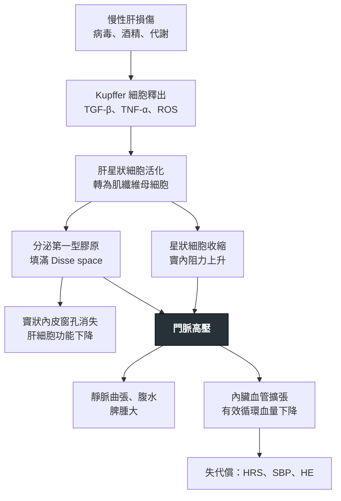

---
tags:
  - Med/Disease/GI
  - liver
  - portal-hypertension
  - 禁忌
aliases:
  - 肝硬化
  - Cirrhosis
  - Liver cirrhosis
  - 肝硬變
  - Advanced chronic liver disease
  - cACLD
created: 2026-07-27
updated: 2026-07-28

status: 可用
source: 114-1 醫學(三) 22、114-2 醫學(三) 20、115-2 醫學(三) 17；Baveno VII Consensus 2022；AASLD Ascites／HRS Guidance 2021；EASL Decompensated Cirrhosis CPG 2018；Harrison's 21e
cssclass: clinical-note
presents_as:
  - "[[Jaundice]]"
  - "[[Edema]]"
  - "[[Delirium]]"
diagnosed_by:
  - "[[Ascitic fluid analysis]]"
  - "[[Liver biopsy]]"
treated_by:
  - "[[NSBB]]"
  - "[[Liver transplantation]]"
differential:
  - "[[Heart failure]]"
  - "[[Budd-Chiari syndrome]]"
  - "[[Portal vein thrombosis]]"
complication:
  - "[[Esophageal varices]]"
  - "[[SBP]]"
  - "[[Hepatic encephalopathy]]"
  - "[[HCC]]"
  - "[[Hepatorenal syndrome]]"
---

# Cirrhosis ｜ 肝硬化 · Liver Cirrhosis

> [!abstract] 一句話總覽
> 任何慢性肝損傷 → **hepatic stellate cell 活化**成肌纖維母細胞 → 膠原填滿 Disse space ＋ 細胞收縮 → **竇狀隙層次的阻力上升＝門脈高壓**，同時肝細胞功能質量下降。之後所有併發症（靜脈曲張、腹水、SBP、HRS、HE）都掛在這一條上游；治療只有三件事：**治病因、防門脈高壓併發症、評估肝移植**。

> [!tip] 30 秒行動卡
> **診斷關鍵**：**血小板低** ＋ 肝表面結節／尾葉肥大 ＋ 脾腫大 ＋ 白蛋白低／INR 延長 → 臨床＋影像即可診斷，**切片非必需**；FibroScan **LSM ＞15 kPa** 高度提示 **cACLD**、**≥25 kPa** 判定臨床顯著門脈高壓（CSPH，限病毒性／酒精性／非肥胖 MASH）。**新發腹水一律做診斷性穿刺**。
> **治療骨架**：治病因（抗病毒／戒酒／減重）→ 內視鏡篩靜脈曲張 ＋ NSBB／EVL → 腹水限鈉＋利尿劑 → 失代償先找誘因 → 算 MELD 排移植
> **絕對不可**：NSAID、aminoglycoside、低血壓時硬用 NSBB、HE 時限制蛋白質、大量放腹水不補白蛋白

---

## 定義與定位

*這個病是什麼？在分類樹的哪個位置？跟隔壁的病靠什麼分開？*

| 項目 | 重點 |
|---|---|
| 本質 | 慢性肝損傷的**共同終點**：瀰漫性纖維化 ＋ 再生結節，取代正常肝小葉結構 |
| 兩個後果 | ① **肝細胞功能質量下降**（合成、排泄、解毒）② **門脈高壓**（血流阻力上升）——所有臨床表現都由這兩條生出來 |
| 台灣病因序位 | **慢性 B 型肝炎**居首（見 [[Hepatitis B]]），其次 C 型肝炎、酒精、**MASLD**（見 [[MASLD]]）；C 肝 DAA 全面給付後比重明顯下降 |
| 關鍵分期 | **代償期（compensated）vs 失代償期（decompensated）**——分水嶺是出現腹水、靜脈曲張出血、肝性腦病變或黃疸。中位存活從 ＞12 年掉到 ~2 年 |
| 分類位置 | 門脈高壓的「**竇狀隙性（sinusoidal）**」原因；竇前性（門脈血栓、血吸蟲病）與竇後性（Budd-Chiari、右心衰竭）不算肝硬化 |

> [!note] 「纖維化」不等於「肝硬化」
> 纖維化是連續變數（F0–F4），**肝硬化＝F4**。近年指引改用 **compensated advanced chronic liver disease (cACLD)** 涵蓋「進階纖維化到早期肝硬化」這段灰帶，因為兩者臨床處置一樣，而切片分期本身有取樣誤差。

## 病因與機制

*為什麼會發生？病生理鏈條長什麼樣？——這一節寫好，下面的「臨床表現」就不用背。*

### 三種細胞的分工

| 細胞 | 平時做什麼 | 損傷後角色 | 一句話定位 |
|---|---|---|---|
| **Hepatic stellate cell**（Ito cell，位於 Disse space） | 儲存**維生素 A** | 活化 → myofibroblast：① 分泌**第一型膠原** ② **本身會收縮** → 竇內阻力↑ | **執行者**。纖維化＋門脈高壓的主導者 |
| **Kupffer cell**（肝內常駐巨噬細胞） | 清除內毒素與碎片 | 釋出 **TGF-β／TNF-α／ROS** 去活化星狀細胞 | **點火者**。不分泌膠原、不造成阻力 |
| **Sinusoidal endothelial cell** | 有窗孔（fenestrae），供物質交換；分泌 **NO** | 發生 **capillarization**（窗孔消失）；**NO 分泌下降** → 竇內張力↑ | **共犯**。變化多半是星狀細胞活化的伴隨結果 |
| **Hepatocyte** | 幹全部的活 | 壞死／凋亡是**啟動訊號** | **受害者**，不是加害者 |

> [!tip] 一個細胞帶走一整組
> **儲存維生素 A、分泌第一型膠原、造成門脈高壓、抗纖維化藥物的標的**——全部指向同一個細胞：**hepatic stellate cell**。
> 但把描述換成「**釋放細胞激素啟動**纖維化的細胞」，主角就變成 **Kupffer cell**；換成「**capillarization 發生在誰身上**」，主角變成 **sinusoidal endothelial cell**。一字之差就換人。

> [!note] 門脈高壓有「固定」與「可逆」兩個成分
> 膠原沉積是**結構性、固定**的；星狀細胞的收縮是**動態、可被藥物放鬆**的（NO／內皮素路徑）。這解釋了為什麼降門脈壓的藥物治療仍然有空間，也解釋了 NSBB 為何有效（它走另一條路：減少內臟血流入量）。

> [!info] 纖維化從哪一區起頭
> **酒精性／代謝性**：從 **zone 3（perivenular）** 開始，呈 **chicken-wire**（周細胞型）分布。
> **病毒性肝炎**：從**門脈區（portal）** 開始，向外形成橋接纖維化。

![[assets/liver-sinusoid-capillarization.jpg|820]]
*正常肝竇（左）有 fenestrated LSEC、quiescent HSC 與稀疏 ECM；纖維化（右）可見 LSEC capillarization、basement membrane、活化並拉長的 HSC，以及堆積於 Disse space 的 ECM。Source: [Liver Sinusoidal Endothelial Cells in Liver Fibrosis](https://pmc.ncbi.nlm.nih.gov/articles/PMC5331310/), Fig. 1。*

## 臨床表現

*典型病人長什麼樣？哪些症狀是幾乎一定有、哪些是提示性的？*

- **典型**：**代償期常完全無症狀**，多半是抽血發現**血小板低**或超音波看到肝表面不平而被抓出來；非特異的疲倦、食慾差
- **提示性（雌激素代謝下降 ＋ 分流）**：蜘蛛痣、手掌紅斑、男性女乳、睪丸萎縮、**腹壁 caput medusae**、Dupuytren 攣縮、Terry's nails（白甲）、肌肉流失與肌少症
- **失代償四徵**：**腹水**（最常見的第一個失代償事件）、**靜脈曲張出血**、**肝性腦病變**、**黃疸**
- **少見但重要**：**肝肺症候群**（platypnea–orthodeoxia：坐起來反而更喘、血氧更低）、門脈肺高壓、cirrhotic cardiomyopathy（平時 EF 正常，壓力下才顯露）

→ 相關主訴流程：[[Jaundice]]、[[Edema]]、[[Delirium]]、[[RUQ pain]]

## 診斷

*診斷標準是什麼？要開哪些檢查？哪個是 gold standard？*

| 面向                | 內容                                                                                                                                                                                                                  |
| ----------------- | ------------------------------------------------------------------------------------------------------------------------------------------------------------------------------------------------------------------- |
| **實驗室**           | **血小板下降是最早的訊號**（脾滯留 ＋ 肝製造 thrombopoietin 減少）；albumin↓、INR↑、bilirubin↑、**AST/ALT ＞1**、低血鈉                                                                                                                            |
| **影像**            | 超音波：肝表面結節、**尾葉／左葉肥大**、脾腫大 ＞12 cm、側枝循環、臍靜脈再通                                                                                                                                                                         |
| **彈性造影**          | **FibroScan LSM**（Baveno VII） **cACLD**：＜10 排除 → 10–15 疑似 → **＞15 高度提示** **CSPH**：≤15 ＋ 血小板 ≥150 K → **排除**；**≥25 → 判定**（限病毒性／酒精性、非肥胖 BMI＜30 的 MASH；**肥胖型 MASLD 不適用**） **免篩檢內視鏡**：＜20 ＋ 血小板 ＞150 K |
| **Gold standard** | **肝切片**（纖維化 F4）——但臨床＋影像＋彈性造影足夠時**不必做**                                                                                                                                                                              |
| **門脈壓**           | **hepatic venous pressure gradient (HVPG)**＝肝靜脈楔壓 − 自由壓。正常 **1–5**；**≥10 mmHg ＝ CSPH**（開始長靜脈曲張、開始會失代償）；**≥12** 才有出血風險；急性出血時 **≥20** 預示止血失敗                                                                          |

> [!warning] HVPG 只量得到「竇狀隙」那一層
> 竇前性門脈高壓（門靜脈血栓、血吸蟲病）**HVPG 是正常的**——阻力在測量點的上游。所以「HVPG 正常但有靜脈曲張」不是矛盾，是在告訴你阻力不在肝竇。

### 嚴重度分級：Child-Turcotte-Pugh 與 MELD

| 系統 | 變數 | 量什麼 | 用在哪 |
|---|---|---|---|
| **Child-Turcotte-Pugh** | **膽紅素、白蛋白、INR（或 PT 延長秒數）、腹水、肝性腦病變**（記法：**膽、白、凝、水、腦**） | **剩餘肝功能**（合成＋排泄＋解毒） | 床邊嚴重度、**手術風險**、靜脈曲張出血預後、某些藥能不能用 |
| **MELD** | 膽紅素、INR、**creatinine**（MELD-Na 加血鈉；**MELD 3.0** 再加**女性**與**白蛋白**） | **短期死亡率** | **肝移植排序**（美國 OPTN 自 2023/7 改用 MELD 3.0） |

- **分級**：**A ＝ 5–6 分、B ＝ 7–9 分、C ＝ 10–15 分**。三段要連著記，動一格就錯。
- **Child-Pugh 有兩個主觀項目（腹水、腦病變）；MELD 全部客觀**——這是最快的辨認法。

> [!tip] 為什麼 Child-Pugh 不含 AST/ALT
> 因為它量的是「**還剩多少肝功能**」，不是「**現在發炎多厲害**」。
> **功能**指標＝白蛋白、PT/INR（合成）、膽紅素（排泄）；**發炎／損傷**指標＝AST、ALT；**膽汁鬱積**指標＝ALP、GGT。**任何肝硬化嚴重度分級都只收功能指標。**
> 更反直覺的是：**肝硬化末期 ALT 常常正常甚至偏低**——可壞死的肝細胞已經不多了。**ALT 正常完全不能排除肝硬化。**

![[assets/cirrhosis-ct-morphology.jpg|900]]
*四位肝硬化病人的典型 CT 形態：A 為 periportal space 擴張、肝表面結節與脾腫大；B 為 right posterior hepatic notch；C 為 gallbladder fossa／肝裂增寬；D 為脾腫大與脾旁 portosystemic collaterals。整體葉段重塑常見右葉與左內側葉萎縮、尾葉與左外側葉代償性肥大；腹水與臍靜脈再通可依門脈高壓程度並存。Source: [Multidetector CT for liver fibrosis](https://pmc.ncbi.nlm.nih.gov/articles/PMC6385963/), Fig. 1。*

## 鑑別診斷

*要跟誰分清楚？靠什麼分？*

| 要排除的                               | 支持它的線索                        | 怎麼排除                                                             |
| ---------------------------------- | ----------------------------- | ---------------------------------------------------------------- |
| [[Portal vein thrombosis]]（竇前性）    | 有靜脈曲張與脾腫大，但**肝功能保留**、無黃疸      | 都卜勒／CT 看門脈；**HVPG 正常**                                           |
| [[Budd-Chiari syndrome]]（竇後性）      | **腹痛＋肝腫大＋腹水**三聯、發病快、常有骨髓增生性疾病 | 肝靜脈都卜勒；**尾葉獨大**特別明顯                                              |
| [[Heart failure]]／縮窄性心包炎           | **頸靜脈怒張**、肝頸迴流、下肢水腫早於腹水       | 腹水 SAAG ≥1.1 但**腹水總蛋白 ≥2.5**（見 [[Ascitic fluid analysis]]）、心臟超音波 |
| 腹膜癌轉移／結核性腹膜炎                       | 體重驟降、發燒盜汗                     | **SAAG ＜1.1**；腹水細胞學、ADA                                          |
| Porto-sinusoidal vascular disorder | 明顯門脈高壓但**切片沒有肝硬化**            | 需切片；HVPG 常僅輕度上升                                                  |

## 治療

*第一線是什麼？什麼情況升級？*

### 一、治病因（唯一能讓纖維化倒退的一步）

| 病因 | 處置 |
|---|---|
| 慢性 B 肝 | 長期口服抗病毒藥（見 [[Hepatitis B]]）。**台灣健保**對肝硬化病人放寬給付，可長期使用不設療程上限 |
| 慢性 C 肝 | DAA 根除；即使已肝硬化仍應治療 |
| 酒精 | **完全戒酒**——對存活的影響大過任何藥物 |
| 代謝性 | 減重 ≥10%、控制糖尿病與血脂（見 [[MASLD]]） |
| 全體 | HAV／HBV／流感／肺炎鏈球菌疫苗；**蛋白質 1.2–1.5 g/kg/day ＋ 睡前點心**（絕不限蛋白） |

### 二、門脈高壓併發症的處置骨架

| 併發症 | 一句話結論 |
|---|---|
| **靜脈曲張篩檢** | 若已因 CSPH 決定使用 NSBB（carvedilol）預防失代償，**可直接免做篩檢內視鏡**；**不打算用 NSBB** 者符合 Baveno VI criteria（**LSM ＜20 kPa ＋ 血小板 ＞150 K**，Baveno VII 沿用）可免做，否則應做。免做者每年追蹤 TE ＋ 血小板。分級：**小 ≤5 mm／大 ＞5 mm**；**red wale sign ＝ 高危** |
| **一級預防** | CSPH 或有靜脈曲張 → **carvedilol 為首選 NSBB**（6.25–12.5 mg/day，兼具 α1 阻斷，降門脈壓較強）；不耐受或有禁忌 → 高危靜脈曲張做 **EVL 結紮**。詳見 [[Esophageal varices]] |
| **急性靜脈曲張出血** | ① 復甦但**限制性輸血，目標 Hb 7–8 g/dL** ② **血管活性藥**（terlipressin／somatostatin／octreotide）**2–5 天** ③ **預防性抗生素 ceftriaxone 1 g/day ×7 天**（降死亡率，不是可有可無）④ **12 小時內**內視鏡 ＋ **EVL** ⑤ 失敗 → 氣囊壓迫／覆膜支架橋接 → **TIPS** ⑥ **Child C ＜14 分、或 Child B ＞7 分（即 8–9 分）且內視鏡見活動性出血、或出血當下 HVPG ＞20 mmHg → 72 小時內（最好 ＜24 小時）pre-emptive TIPS（PTFE 覆膜支架）** |
| **二級預防** | **NSBB ＋ EVL 併用**（單用任一者都較差） |
| **腹水** | 限鈉 ＜2 g/day（不必限水，除非 Na ＜125）＋ **spironolactone : furosemide ＝ 100 : 40** 起始；難治性 → 反覆大量放液（**每放 1 L 補白蛋白 6–8 g**）或 TIPS |
| **SBP** | 腹水 **PMN ≥250/mm³** 即診斷（不必等培養）→ **cefotaxime 2 g q8h**（AASLD 2021 寫 q12h；RCT 顯示 4 g/day 與 8 g/day 同效，q8–12h 皆可）**×5–7 天** ＋ **白蛋白 1.5 g/kg (D1) → 1 g/kg (D3)**（降 HRS 與死亡率；AASLD／EASL 主張**所有 SBP 都給**，Cr ＞1、BUN ＞30 或 bilirubin ＞4 者獲益最大）。**二級預防：norfloxacin 400 mg qd 長期使用**（直到肝移植、腹水消失或死亡）。**norfloxacin 已退出美國市場**，無藥時 ciprofloxacin 500 mg qd 可替代。詳見 [[SBP]]、[[Ascitic fluid analysis]] |
| **肝性腦病變** | 先找誘因（感染、出血、電解質、便祕、藥物），lactulose 第一線、rifaximin 加成。完整見 [[Hepatic encephalopathy]] |
| **HCC 監測** | **每 6 個月**腹部超音波 ± AFP。見 [[HCC]] |
| **根本治療** | **肝移植**——依 MELD 排序。見 [[Liver transplantation]] |

| F1–F3 大小與 red color signs | EVL 結紮環套上後 |
|---|---|
| ![[assets/esophageal-varices-f1-f3-red-signs.jpg\|500]] | ![[assets/esophageal-variceal-ligation.jpg\|320]] |

*左圖 A–C 依序為 F1 小而直、F2 串珠狀、F3 粗大結節狀；E–H 顯示 red wale marks、cherry-red spots 與 diffuse redness。右圖為 EVL 後被 band 吸套形成的結紮隆起。Sources: [Oesophageal and gastric varices: classification and grading](https://pmc.ncbi.nlm.nih.gov/articles/PMC4976684/), Fig. 1；[Management of acute variceal hemorrhage](https://pmc.ncbi.nlm.nih.gov/articles/PMC6347650/), Fig. 7。*

## 併發症與預後

*住院時要盯什麼？出院後會怎麼樣？*

### Hepatorenal syndrome（HRS）— 一條鏈推出全部

> [!danger] 內臟擴張、腎臟收縮
> 門脈高壓 → **內臟血管擴張**（NO 等擴張物質驅動）→ **有效動脈血量↓** → **全身血管阻力↓、心輸出量代償性↑** → 反射活化 **RAAS／交感／ADH** → **腎入球小動脈強烈收縮** → 腎血流與 GFR↓ → 但**腎臟組織學是正常的**。
> 由這條鏈直接推出全部臨床特徵：血壓偏低脈壓大、**尿鈉 ＜10 mEq/L、FENa ＜1%**、尿沉渣乾淨無蛋白尿、**肝移植後腎功能會恢復**、**補液無效**。
> 所以「**全身血管阻力上升**」的說法方向完全相反——**上升的是腎內阻力，全身阻力是下降的**；「腎臟有結構性病變」也不成立。

| 面向 | 重點 |
|---|---|
| **診斷** | **排除性診斷**。要排除低血容（**補白蛋白仍無反應**是與腎前性氮血症的分水嶺）、休克、腎毒性藥物、腎實質病變（蛋白尿 ＞500 mg/day、血尿、超音波異常） |
| **命名版本** | 舊：第一型（2 週內 Cr 加倍到 ＞2.5）／第二型。現行 ICA：**HRS-AKI**（取代舊第一型）／**HRS-NAKI**（取代舊第二型，2019 年後再細分 **HRS-AKD** 與 **HRS-CKD**），取消固定 Cr 門檻，改用 AKI 準則（48 小時內 Cr ↑≥0.3，或 7 天內較基準↑≥50%）以便提早治療 |
| **誘因** | **SBP 是最常見的誘發因子**；大量放液 ＞5 L 未補白蛋白；消化道出血、過度利尿、NSAID |
| **治療方向** | 停利尿劑與腎毒性藥 → **白蛋白 1 g/kg/day（最多 100 g）連 2 天** → 仍無反應且符合 HRS → **血管收縮劑 ＋ 白蛋白**：首選 **terlipressin**——**台灣有藥**，TFDA 核准適應症為「出血性食道靜脈曲張」與「第一型肝腎症候群」（仿單沿用舊命名，**即現行的 HRS-AKI**），健保給付條件依健保署當期規定。無 terlipressin 時用 noradrenaline，或 midodrine ＋ octreotide ＋ 白蛋白 → 無效時 [[Dialysis]] 或 TIPS 作橋接 → **肝移植是唯一根本治療** |
| **預後** | 極差；藥物是**橋接**不是根治。「改善」與「根治」是兩個等級 |

### 其他要盯的與預後

- **要盯的併發症**：[[Esophageal varices]]、[[SBP]]、[[Hepatic encephalopathy]]、[[HCC]]、肝肺症候群、門脈血栓、肌少症、[[Anemia]]（出血＋脾滯留＋營養）
- **預後因子**：**是否失代償**（代償期中位存活 ＞12 年 vs 失代償 ~2 年）、Child-Pugh 分級、MELD、**低血鈉**、腎功能、肌少症
- 出現**任何一次失代償事件**就應啟動肝移植評估

## 禁忌與陷阱

> [!danger] 絕對不可
> | 情境 | 絕對不可 | 為什麼 | 該做什麼 |
> |---|---|---|---|
> | 肝硬化合併腹水 | 給 **NSAID**（含 COX-2） | 抑制前列腺素 → 腎血流↓ → 利尿劑抗性、急性腎損傷、HRS | 止痛用 **acetaminophen ≤2 g/day**；避免長期 NSAID |
> | 感染或腎損傷 | 用 **aminoglycoside** | 腎毒性疊加在已經低灌流的腎上，直接推向 HRS | 用第三代 cephalosporin（cefotaxime／ceftriaxone） |
> | 持續低血壓（MAP ＜65 或收縮壓 ＜90）、或 HRS-AKI 當下 | 繼續／加大 **NSBB** | 心輸出量↓ → 腎與內臟灌流惡化 | **暫停或減量**；血壓回穩／HRS-AKI 緩解後**應重新加回**。**難治性腹水本身不是禁忌**（Baveno VII） |
> | 肝性腦病變 | 限制蛋白質攝取 | 加重肌少症與分解代謝，反而讓氨負荷更高 | **1.2–1.5 g/kg/day ＋ 睡前點心**；治誘因 |
> | 大量放腹水 ＞5 L | 不補白蛋白 | 引流後循環功能障礙（PICD）→ HRS | **每放 1 L 補白蛋白 6–8 g** |
> | 急性靜脈曲張出血 | 大量輸血把 Hb 拉到 10 以上 | 容積擴張使**門脈壓反彈** → 再出血、死亡率上升 | **目標 Hb 7–8 g/dL** 的限制性輸血 |
> | **Child-Pugh ≥14 分**、藥物控制不住的反覆 overt HE、心衰竭／重度肺高壓 | 做 **TIPS** | 分流繞過肝臟 → HE 與肝衰竭惡化；右心後負荷↑ | 走移植評估路線。**注意：Child C ＜14 分且急性靜脈曲張出血反而是 pre-emptive TIPS 的適應症** |

> [!warning] 常見錯誤
> - **ALT 正常就排除肝硬化**——末期可壞死的肝細胞已不多，ALT 常正常甚至偏低。
> - 把 **AST/ALT／AFP／血小板** 塞進 Child-Pugh，或把 **creatinine／血鈉**當成 Child-Pugh 項目——後兩者是 **MELD 家族**，最常混。
> - 把腹水那一格從「**利尿劑控不控得住**」簡化成「有沒有腹水」——這會把 2 分與 3 分混成一格。
> - **SAAG 是減法不是絕對值**：算出 1.0 就不是門脈高壓（見 [[Ascitic fluid analysis]]）。
> - **INR 延長就以為「不會凝血」**：肝硬化是 rebalanced hemostasis，促凝與抗凝因子同步減少；**穿刺前不必常規輸 FFP 或血小板**，INR 也不能拿來預測出血。
> - 把 HRS 當腎前性一直沖生理食鹽水——**補液無效**正是它的定義之一，而且會惡化腹水。
> - 沒事開 **PPI**：增加 SBP 與 HE 風險，沒有適應症就停掉。
> - 靜脈曲張出血時忘記給**預防性抗生素**——它是被證實能降死亡率的處置，不是加分項。

## 相關連結

- [[Ascitic fluid analysis]] — SAAG 與腹水總蛋白的完整判讀（腹水題的真正主場）
- [[Hepatic encephalopathy]] — 誘因、分級與治療的完整版
- [[Esophageal varices]] — 分級、EVL 與 NSBB 的細節
- [[SBP]] — 診斷門檻、抗生素選擇與一級／二級預防
- [[HCC]] — 肝硬化的終點之一；監測與分期
- [[Hepatitis B]]、[[MASLD]] — 台灣最重要的兩個上游病因
- [[Jaundice]] — 膽紅素升高的鑑別路徑
- [[禁忌選項]] — 跨科的「絕對不可」總表
