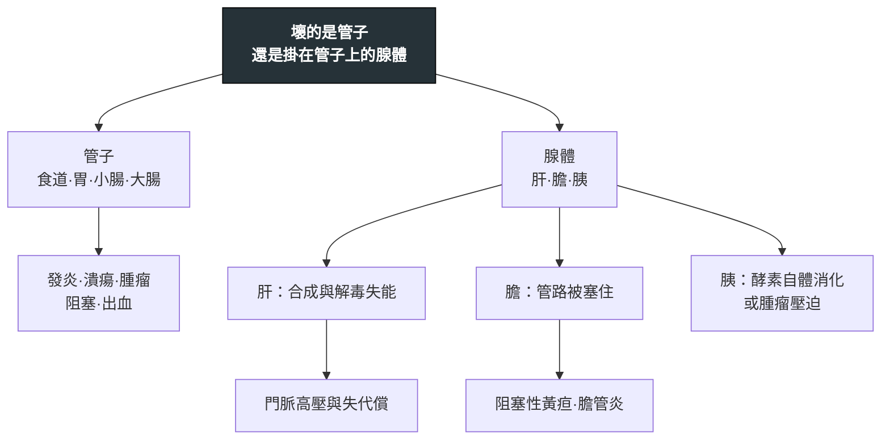

---
tags:
  - Med/MOC/GI
  - gastroenterology
  - hepatology
aliases:
  - GI Category
  - 胃腸肝膽科分類
  - 胃腸肝膽科索引
  - Gastroenterology MOC
  - Hepatology MOC
created: 2026-07-28
updated: 2026-07-28
status: 可用
cssclass: clinical-note
---

# 🫁 胃腸肝膽科分類 · Gastroenterology & Hepatology

> [!abstract] 這份筆記怎麼讀
> 消化系統只有兩種東西：**一根從口到肛門的管子**，和**掛在管子上的三個腺體**（肝、膽、胰）。定位第一問永遠是「**壞的是管子，還是掛在管子上的東西？**」
> 先看 [[#1 一眼骨架｜管子 vs 腺體]] 抓位置，再用 [[#3 高產出對照表]] 補容易互換的細節，最後從 [[#2 專篇索引]] 點進各篇。
> **五個角度分散在五個資料夾**：疾病在 `Disease/GI/`、檢查在 `Test/`、藥在 `Drug/`、處置在 `Intervention/`、主訴流程在 `Workup/`。本檔把它們串回同一張圖。

---

## 資料夾地圖 Folder Map

```text
Disease/GI/         ← 疾病專篇（你在這裡）
Test/               Ascitic fluid analysis
Drug/               （尚無 GI 專篇）
Intervention/       （尚無 GI 專篇；ERCP 待補）
Workup/             Jaundice · RUQ pain · Abdominal pain
```

---

## 1. 一眼骨架｜管子 vs 腺體

```text
消化系統
├─ 管子 Tube
│  ├─ 食道：GERD → Barrett → 腺癌／鱗癌（待補）· 動力障礙（待補）
│  ├─ 胃：H. pylori → 潰瘍／胃癌／MALT lymphoma（待補）
│  ├─ 小腸：吸收不良 · SIBO（待補）
│  └─ 大腸：IBD（發炎）→ CRC（腫瘤）
└─ 腺體 Glands
   ├─ 肝 Liver
   │  ├─ 進行式：MASLD → MASH → 纖維化 → Cirrhosis
   │  └─ 失代償四兄弟：腹水 · SBP · HRS · Hepatic encephalopathy
   ├─ 膽 Biliary（待補）
   │  └─ CBD stone → Acute cholangitis
   └─ 胰 Pancreas
      ├─ 發炎看時間軸：Acute pancreatitis
      └─ 腫瘤看分期軸：Pancreatic cancer
```



> [!tip] 肝那一條是一整條時間軸，不是四個獨立的病
> [[MASLD]] → 纖維化 → [[Cirrhosis]] → 門脈高壓 → **腹水／[[Hepatic encephalopathy]]／HRS**。
> 這條軸線走完，你會發現 [[Ascitic fluid analysis]] 與 [[Hepatic encephalopathy]] 其實都掛在 [[Cirrhosis]] 這一節上，**完整機制只寫在 [[Cirrhosis]]**，其餘各篇只寫自己那一段。

---

## 2. 專篇索引

### Disease 疾病

| 分層 | 專篇 | 一句話定位 |
|---|---|---|
| 腺體 · 肝 | [[Cirrhosis]] | 星狀細胞點的火 → 門脈高壓 → 失代償。**本群的 hub** |
| 腺體 · 肝 | [[Hepatic encephalopathy]] | 找誘因比給藥重要；血氨不能拿來診斷或追蹤 |
| 腺體 · 肝 | [[MASLD]] | 改名之後從「排除性診斷」變成「陽性納入診斷」 |
| 腺體 · 胰 | [[Acute pancreatitis]] | 三條時間軸：48 小時（嚴重度）· 1 週（病程）· 4 週（積聚） |
| 腺體 · 胰 | [[Pancreatic cancer]] | 症狀由解剖決定，可切除率也由解剖決定 |
| 管子 · 大腸 | [[IBD]] | 穿壁 vs 只到黏膜——一句話推出瘻管與血便 |
| 管子 · 大腸 | [[CRC]] | 兩條分子路徑；MSI-H 的三個方向不可寫反 |

### Test 檢查

| 專篇 | 什麼時候想到它 |
|---|---|
| [[Ascitic fluid analysis]] | 有腹水且要回答「是門脈高壓嗎、有沒有感染」——**兩步判讀：先 SAAG，再腹水總蛋白** |

### Workup 主訴流程

| 專篇 | 第一刀切在哪 |
|---|---|
| [[Jaundice]] | **conjugated 還是 unconjugated**，然後才分部位 |
| [[RUQ pain]] | 先排除胸腔與心臟（下壁 MI），再談膽 |
| [[Abdominal pain]] | 尚未撰寫（空檔案） |

---

## 3. 高產出對照表

### 3.1 兩種體腔積液，同一套邏輯的兩個版本

| | [[Pleural fluid analysis]] 胸水 | [[Ascitic fluid analysis]] 腹水 |
|---|---|---|
| 第一步問什麼 | 通透性壞了嗎（Light's criteria） | **壓力高嗎（SAAG）** |
| 切點 | protein 比 >0.5、LDH 比 >0.6 | **SAAG ≥1.1 ＝ 門脈高壓** |
| 第二步 | 這包要不要引流（pH <7.20） | 這包有沒有感染（**PMN ≥250/mm³**） |
| 凝血功能 | **要先矯正** | **證據支持不必常規矯正**（最大的差異） |

> [!warning] 兩者最容易互相污染的一點
> 胸水用的是「**通透性**」的邏輯（血管破了洞，蛋白跟著漏），腹水用的是「**壓力**」的邏輯（門脈壓高，水被擠出來但白蛋白留在血管內）。
> 所以腹水**不要**套 Light's criteria，胸水**不要**算 SAAG。

### 3.2 三個「肝臟數字」各自在量什麼

| 指標 | 量的是 | 不含什麼 |
|---|---|---|
| **AST／ALT** | 肝細胞**正在**壞死的速率 | 與剩餘功能無關；肝硬化末期反而可以正常 |
| **Child-Turcotte-Pugh** | **剩下多少肝功能**（bilirubin、albumin、INR、腹水、HE） | **不含 creatinine**——那在 MELD 裡 |
| **MELD** | 短期死亡風險與移植排序（bilirubin、INR、creatinine、Na） | 不含腹水與 HE 這種主觀項 |

### 3.3 「不是篩檢工具」的三個腫瘤標記

| 標記 | 正確用途 | 為什麼不能篩檢 |
|---|---|---|
| **CEA**（[[CRC]]） | 術後追蹤與療效評估 | 敏感度與特異度都不足；吸菸、發炎也會升 |
| **CA 19-9**（[[Pancreatic cancer]]） | 術後追蹤與療效評估 | **膽道阻塞本身就會升**；Lewis 抗原陰性者是結構性偽陰性 |
| **AFP**（HCC，待補） | 高風險族群的監測輔助 | 單用敏感度不足，要配超音波 |

### 3.4 每一篇的「絕對不可」濃縮成一行

| 篇 | 最該記住的那一條 |
|---|---|
| [[Cirrhosis]] | 持續低血壓或 HRS-AKI 當下**不要繼續加大 NSBB**（但難治性腹水本身不是禁忌） |
| [[Hepatic encephalopathy]] | **不要常規限制蛋白質**、**不要用血氨值決定治療與追蹤** |
| [[Acute pancreatitis]] | **不要常規給預防性抗生素**、無膽管炎**不要**緊急 ERCP、**不要長時間禁食** |
| [[IBD]] | 急性重症結腸炎**不要給止瀉／抗膽鹼藥**（誘發毒性巨結腸） |
| [[MASLD]] | 看到脂肪肝**不要**直接歸因代謝而不排除其他肝病 |
| [[CRC]] | 成人缺鐵性貧血**不要**只補鐵不做大腸鏡 |
| [[Pancreatic cancer]] | 膽道阻塞**未解除前不要**判讀 CA 19-9 |
| [[Jaundice]] | 膽管炎合併敗血症**不要**只給抗生素而不做膽道減壓 |
| [[Ascitic fluid analysis]] | 有腹水的肝硬化病人發燒或意識改變，**不要**不抽腹水就給抗生素 |

完整彙整見 [[禁忌選項]]。

---

## 4. 還沒寫的（依優先序）

> [!todo] 第一批：紅連結需求最大的
> **[[ERCP]]**（被新筆記引用 22 次，全科最大紅連結）· **[[Abdominal ultrasound]]**（18 次）· **[[Colonoscopy]]**（11 次）——這三個是 GI 的核心動作，寫完會一次接上大量斷點。
> ERCP 與 Colonoscopy 要注意角度：**診斷性 → Test；治療性（取石、息肉切除）→ Intervention**，兩篇互連。

> [!todo] 第二批：考題頻次高
> **GERD & Barrett esophagus**（114-2 16、115-2 15、115-2 22，共 3 題）
> **Test/H. pylori 四種檢驗比較**（114-1 19、115-2 16；能接上已寫好的 [[MALT Lymphoma]]）
> **Workup/Dysphagia 吞嚥困難**（114-1 18、114-2 23，achalasia／DES／EoE／GERD 四病對比）
> **[[Wilson disease]]**（114-1 16 出自 GI、115-2 56 出自新陳代謝科——**跨兩科的 2 題**，紅連結 13 次）

> [!todo] 第三批：膽道與肝臟補完
> **[[Acute cholangitis]]**（14 次）· **[[CBD stone]]**（13 次）· **[[SBP]]**（11 次）· **[[HCC]]**（11 次）· **[[Hepatitis B]]**（10 次）· **[[Esophageal varices]]**（6 次）· **[[Liver biopsy]]**（5 次）· Acute cholecystitis

> [!todo] 待處理的結構問題
> **`Workup/Abdominal pain.md` 是 0 行的空檔案**，但已有多篇筆記連過去。要嘛填掉、要嘛刪除——空殼違反本 vault「空的節直接刪掉」的原則。

---

## 5. 資料來源與涵蓋範圍

本科目前的筆記取材自 **114 年第一次、114 年第二次、115 年第二次** 三場醫學(三) 考卷的胃腸肝膽科題（共 31 題）。

> [!warning] 兩個要記得的限制
> 1. **113 年的 GI 題還沒切出來**（`新考卷/113020_1302.pdf` 尚未整理），所以「哪個主題會重複出現」的頻次判斷只根據三場卷。
> 2. **115 年只有第二次（暑考）** 一場資料，別把「115 沒考」讀成「不重要」。

---

## 相關連結

- [[Jaundice]] — 肝膽科最重要的入口主訴
- [[RUQ pain]] — 腹部急症的入口主訴
- [[Cardio Category]] — 另一科的 MOC，格式參考
- [[Hema Category]] — 另一科的 MOC
- [[禁忌選項]] — 各篇「絕對不可」區塊的彙整
