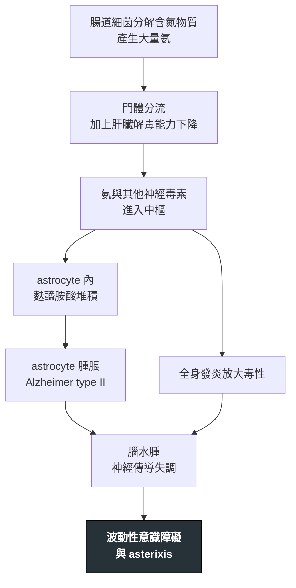

---
tags:
  - Med/Disease/GI
  - Med/Disease/Neuro
  - 肝硬化併發症
  - 禁忌
aliases: [HE, 肝性腦病變, 肝腦病變, Hepatic Encephalopathy, 肝昏迷, Portosystemic encephalopathy]
created: 2026-07-27
updated: 2026-07-28
status: 可用
source: 115-2 醫學(三) 18 延伸；EASL 2022 Clinical Practice Guidelines on the Management of Hepatic Encephalopathy；AASLD／EASL 2014 HE in Chronic Liver Disease Practice Guideline；EASL 2019 慢性肝病臨床營養指引；Harrison's
cssclass: clinical-note
presents_as:
  - "[[Delirium]]"
  - "[[Jaundice]]"
diagnosed_by:
  - "[[Ascitic fluid analysis]]"
  - "[[Arterial blood gas]]"
treated_by:
  - "[[Lactulose]]"
  - "[[Rifaximin]]"
differential:
  - "[[Delirium]]"
  - "[[Alcohol withdrawal]]"
  - "[[Wernicke encephalopathy]]"
  - "[[Hypoglycemia]]"
complication:
  - "[[Pneumonia]]"
---

# Hepatic encephalopathy ｜ 肝性腦病變 · Hepatic Encephalopathy

> [!abstract] 一句話總覽
> 腸道產生的含氮物質（以**氨 ammonia** 為代表）因為**門體分流（portosystemic shunt）＋ 肝臟解毒能力下降**而繞過肝臟進入腦，讓 **astrocyte 腫脹**，造成**可逆的**意識與行為障礙。它幾乎一定有**誘發因子（precipitant）**——所以治療的第一步永遠是**找誘因**，不是把 lactulose 加量。

> [!tip] 30 秒行動卡
> **診斷關鍵**：有肝病或門體分流的病人，出現**波動性意識改變 ＋ asterixis**，且排除其他原因 → 這是**臨床診斷**，**不看血氨值**。
> **治療骨架**：**找並移除誘因**（出血／感染／低血鉀／便秘／脫水／鎮靜劑）→ **lactulose 調到每天 2–3 次軟便** → 反覆發作者**加上 rifaximin** 做次發性預防 → **蛋白質照吃 1.2–1.5 g/kg/day**。
> **絕對不可**：常規限制蛋白質；用血氨值決定治療或追蹤療效；沒找誘因就只給 lactulose；給躁動病人 benzodiazepine。

---

## 定義與定位

*這個病是什麼？在分類樹的哪個位置？跟隔壁的病靠什麼分開？*

| 項目 | 重點 |
|---|---|
| 本質 | 肝功能不全與／或門體分流造成的**可逆性**腦功能障礙；腦部**沒有結構性病灶** |
| 好發族群 | 肝硬化（完整機制見 [[Cirrhosis]]）、TIPS 術後、大型自發性門體分流 |
| 病因分型 | **Type A** 急性肝衰竭／**Type B** 純分流而無肝實質病／**Type C** 肝硬化（最常見） |
| 時序分型 | episodic／**recurrent（6 個月內 ≥2 次）**／persistent |
| 嚴重度分型 | **Covert HE**（West Haven 0–1，含 minimal HE）vs **Overt HE**（West Haven 2–4） |

> [!note] 深度歸屬
> 門脈高壓怎麼來的、Child-Pugh 與 MELD 怎麼算，寫在 [[Cirrhosis]]；腹水數值判讀寫在 [[Ascitic fluid analysis]]。本篇只寫「腦」這一段。

## 病因與機制

*為什麼會發生？病生理鏈條長什麼樣？——這一節寫好，下面的處置就不用背。*

腦內沒有完整的尿素循環，astrocyte 只能靠 **glutamine synthetase** 把氨固定成麩醯胺酸（glutamine）。麩醯胺酸是滲透活性物質，堆在細胞內就把水拉進來——**astrocyte 腫脹**，型態上表現為 **Alzheimer type II astrocyte**（核大、淡染、核仁明顯）。這是 HE 唯一的病理特徵，而它是**代謝性、可逆的**。

> [!warning] 血氨值與嚴重度相關性差——不用它診斷，也不用它追蹤療效
> 氨是機制的核心，但**血中濃度**跟臨床嚴重度對不起來：
> - **每一級 HE 都同時存在血氨正常與血氨升高的病人**；血氨高不能確診，血氨正常也不能排除。
> - AASLD 的立場是：單看血氨升高，對慢性肝病病人的 HE **沒有診斷、分級或預後價值**；HE 是**臨床診斷**。EASL 較承認它的**陰性預測值**——血氨完全正常時要回頭想別的診斷，但仍不用它分級。
> - 採檢技術本身就會造成假性升高：**止血帶綁太久、握拳、檢體沒冰、送檢延遲**。
> - **追蹤療效看的是意識狀態與排便次數，不是複驗血氨。**

> [!tip] 肌肉是肝臟以外主要的氨處理場
> 骨骼肌同樣用 glutamine synthetase 把氨固定住。所以**肌少症（sarcopenia）會讓氨更難清**——這正是「限制蛋白質反而害人」的機制根據，也是為什麼**營養本身就是 HE 的治療**，不是配角。

![[assets/hepatic-encephalopathy-alzheimer-ii-astrocytes.jpg|760]]

> [!caption] Alzheimer type II astrocytes
> 可見腫大的淡染細胞核、清亮稀疏的 chromatin、核膜邊緣點狀濃染，並可成對或三個成群出現；這是 astrocyte 腫脹的表現，並非壞死。來源：[The autophagic marker p62 highlights Alzheimer type II astrocytes in metabolic/hepatic encephalopathy（Figure 1）](https://pmc.ncbi.nlm.nih.gov/articles/PMC7496304/)。

## 誘發因子

*找誘因比給藥重要。這一節是整篇的重心。*

| 誘因 | 為什麼會誘發 | 值班要做的事 |
|---|---|---|
| **消化道出血**（[[Esophageal varices]]） | 腸腔內的血液＝高氮負荷（血紅素蛋白），細菌分解後大量產氨；同時低血容與腎前性氮血症 | 肛診看有無黑便、驗 CBC 與 **BUN／Cr 比值上升**、內視鏡止血並清空腸道積血 |
| **感染，尤其 [[SBP]]** | 發炎細胞激素會**放大氨的神經毒性**；加上低血容與腎損傷 | 肝硬化病人**沒發燒也要找**：腹水穿刺（見 [[Ascitic fluid analysis]]）、血與尿培養、胸部 X 光（見 [[Fever]]） |
| **低血鉀與代謝性鹼中毒**（[[Hypokalemia]]） | 見下方推導 | 補鉀補氯、停或減利尿劑、驗 [[Arterial blood gas]] |
| **便秘** | 腸道傳輸變慢 → 細菌接觸糞便時間變長 → 產氨與吸收都增加 | 問「最後一次排便是什麼時候」；lactulose 調到 2–3 次軟便 |
| **脫水／過度利尿／大量腹水抽除未補白蛋白** | 有效循環血量↓ → 腎前性氮血症、腎產氨↑ | 停利尿劑、補液或白蛋白 |
| **鎮靜劑** | benzodiazepine、opioid、第一代抗組織胺直接壓抑中樞；肝代謝變慢使藥效延長 | **翻藥歷**，能停就停 |
| **TIPS 或大型自發性門體分流** | 血流直接繞過肝臟，解毒完全被跳過 | 難治者評估縮小支架或栓塞分流 |
| **蛋白質「負荷」** | 單次大量動物性蛋白、或腸道積血 | 改成少量多餐＋睡前點心——**不是叫他別吃** |
| **腎功能惡化** | 尿素回流腸道被尿素酶分解成氨；腎清除下降 | 停腎毒性藥；HRS 見 [[Cirrhosis]] |

> [!tip] 低血鉀為什麼會加重 HE——兩條路一起走
> **① 腎小管自己產氨**：低血鉀時細胞內 K⁺ 外移、H⁺ 內移 → **腎近曲小管細胞內酸化** → glutaminase 活性上升、分解麩醯胺酸 → **腎臟氨生成並釋入血流增加**。
> **② 鹼中毒把 NH₄⁺ 推回 NH₃**：低血鉀本身造成代謝性鹼中毒 → pH 上升 → 平衡 **NH₄⁺ ⇌ NH₃ + H⁺** 往 NH₃ 那一側移動；**只有不帶電的 NH₃ 能穿過血腦障壁**，帶電的 NH₄⁺ 不行。
> 兩條路都指向同一個結果：**腦內氨增加**。這也是為什麼 **lactulose 給過頭（脫水＋低血鉀）會把治療變成誘因**。

## 臨床表現

*典型病人長什麼樣？哪些症狀是幾乎一定有、哪些是提示性的？*

- **典型**：**日夜顛倒**與人格／行為改變最早出現，接著注意力下降、定向感喪失、嗜睡；意識**一天之內起伏波動**
- **提示性**：**Asterixis（撲翼樣震顫）**——手腕背屈維持不動時突然失去姿勢張力而下墜再回彈。它是**負性肌陣攣（negative myoclonus）而不是真正的震顫**；肝臭（fetor hepaticus）
- **少見但重要**：純運動性表現（帕金森樣、痙攣性下肢輕癱）；深度昏迷需要保護呼吸道
- **不該有的**：**局部神經學缺損**——出現 focal sign 就要照腦，不要當成 HE

| West Haven | 一句話 |
|---|---|
| 0／Minimal | 臨床看不出來，只有心理計量測驗異常 |
| 1 | 注意力短、日夜顛倒、輕微欣快或焦慮——家屬覺得「怪怪的」 |
| 2 | **時間定向感異常、嗜睡或淡漠、行為不當、asterixis 明顯**——ISHEN／AASLD-EASL 2014 以「出現定向感障礙**或** asterixis」為 overt 起點，故從這級起算 overt |
| 3 | 明顯混亂、對時間地點定向錯亂，嗜睡但可喚醒 |
| 4 | 昏迷 |

> [!note] 兩件事要分開
> **Asterixis 不專屬於 HE**：尿毒症、CO₂ 滯留、藥物中毒都會出現。
> **Covert HE 才是多數**：West Haven 0–1（含 minimal HE）合稱 covert HE，床邊看不出來，卻讓**駕駛與跌倒風險上升**，而且是日後 overt HE 的預測因子；要靠心理計量測驗（PHES、Stroop 類工具）才抓得到。

→ 相關主訴流程：[[Delirium]]（意識改變的總框架）

## 診斷

*診斷標準是什麼？要開哪些檢查？哪個是 gold standard？*

| 診斷條件 | 內容 |
|---|---|
| 前提 | 有**肝功能不全或門體分流**的證據 |
| 本體 | **臨床診斷**：意識／認知／行為改變 ＋ **排除其他原因**（沒有 gold standard 檢驗） |
| 分級 | West Haven；出現**定向感異常或 asterixis** 就是 overt |
| 血氨 | **不是診斷工具、也不是追蹤工具**；完全正常時要回頭想別的診斷 |
| 腦部影像 | 用來**排除**出血與梗塞，不是用來確診 HE；有 focal sign、外傷史、抗凝血中才照 |
| 腦波 | 非必要；典型為三相波（triphasic wave），但不具專一性 |

**要開的檢查**：血糖（意識改變第一根針）、CBC、電解質（K、Na）、腎功能、[[Arterial blood gas]]、感染評估（見 [[Fever]]）、有腹水就穿刺（見 [[Ascitic fluid analysis]]）、**藥歷回顧**。

![[assets/hepatic-encephalopathy-asterixis-exam.jpg|720]]

> [!caption] Asterixis 的誘發姿勢
> 請病人雙臂前伸、手腕背屈、手指張開；若出現短暫、非節律性的手腕向下掉落後回復，即為姿勢張力短暫消失造成的 **negative myoclonus**，不是節律性 tremor。來源：[Flapping Tremor: Unraveling Asterixis—A Narrative Review（Figure 2）](https://pmc.ncbi.nlm.nih.gov/articles/PMC10972428/)。

## 鑑別診斷

*要跟誰分清楚？靠什麼分？*

| 要排除的 | 支持它的線索 | 怎麼排除 |
|---|---|---|
| [[Hypoglycemia]] | 冒汗、心悸、快速惡化 | **床邊血糖**——意識改變一律先驗 |
| [[Alcohol withdrawal]] | **交感亢奮**：心跳快、血壓高、流汗、顫抖、幻視；末次飲酒後 6–72 小時 | 時間軸＋自律神經徵象。**治療方向相反**：這裡 benzodiazepine 是救命藥 |
| [[Wernicke encephalopathy]] | 眼動異常 ＋ 步態失調 ＋ 意識混亂；長期酗酒或營養不良 | 立刻給 **thiamine，且要在葡萄糖之前或同時** |
| 尿毒症腦病變 | BUN／Cr 明顯上升、少尿；**也會有 asterixis** | 腎功能與 [[Dialysis]] 病史 |
| 藥物中毒（BZD、opioid） | 藥歷；瞳孔縮小、呼吸抑制 | 停藥觀察；flumazenil 只作短暫診斷性使用且風險高 |
| 顱內出血／硬腦膜下血腫 | **局部神經學缺損**、頭痛、跌倒或外傷史；肝硬化本身凝血差 | 腦部 CT |
| 非痙攣性癲癇重積（NCSE） | 意識持續不清但無明顯抽搐、對治療無反應 | 腦波 |
| [[Delirium]]（其他原因） | 找得到另一個明確誘因而肝病並不嚴重 | 兩者不互斥——HE 本來就是譫妄的代謝性原因之一 |

## 治療

*第一線是什麼？什麼情況升級？*

| 情境          | 處置                                                                        |
| ----------- | ------------------------------------------------------------------------- |
| **第一步（永遠）** | **找並移除誘因**——出血、感染／[[SBP]]、[[Hypokalemia]]、便秘、脫水、鎮靜劑、腎損傷。多數病人**誘因矯正後就會好**  |
| 急性發作第一線     | **Lactulose** 口服或經鼻胃管；意識差、無法口服 → **灌腸**給予。目標**每天 2–3 次軟便**                |
| 次發性預防       | **Lactulose 長期使用**；若 6 個月內再度發作，**加上 rifaximin 550 mg BID**（**加成，不是取代**）   |
| 營養          | **蛋白質 1.2–1.5 g/kg/day**、熱量約 35 kcal/kg/day；少量多餐 ＋ **睡前點心**；植物性與乳製品蛋白耐受較好 |
| 難治／反覆       | 評估**大型自發性門體分流栓塞**；TIPS 後嚴重 HE 考慮縮小支架；持續難治者評估**肝移植**                       |
| 支持性         | West Haven 3–4 級無法保護呼吸道 → 插管；防跌、防誤吸；避免不必要的鎮靜                              |

> [!tip] Lactulose 的機轉是三件事，「瀉」只是其中一件
> 它是**不被小腸吸收的合成雙醣**，整包送達大腸：
> **① 酸化腸腔**：結腸細菌把它發酵成**乳酸與醋酸等短鏈脂肪酸** → 腸腔 pH 下降 → **NH₃ + H⁺ → NH₄⁺**。NH₄⁺ 帶電、不易被腸黏膜吸收，於是被**留在腸腔隨糞便排出**。
> **② 加速腸道傳輸**：滲透性效果縮短糞便停留時間，細菌產氨與吸收的時間都變短。
> **③ 改變菌相**：酸性環境不利產尿素酶的細菌。
> 所以劑量目標是**每天 2–3 次軟便**，**不是愈瀉愈好**——瀉過頭造成脫水與低血鉀，反而製造出新的誘因。

> [!tip] Rifaximin 的關鍵藥性只有一條：幾乎不被全身吸收
> 全身吸收率 **＜0.4%**，藥效整包留在腸腔壓制產尿素酶的細菌，**全身副作用與抗藥性壓力都低**。這正是它取代舊藥的理由——**neomycin** 有腎毒性與常不可逆的**耳毒性**；**metronidazole** 有周邊神經病變與神經毒性，而且**它自己就可能造成腦病變**，在肝硬化病人身上會跟原病混淆。
> 「腸道用抗生素比的是**不被吸收**」這條規則同樣適用於口服 vancomycin 治 *Clostridioides difficile*。
> 定位要記牢：**國考版本（AASLD／EASL 2014、EASL 2022）＝次發性預防的 add-on**，急性發作的主力是 lactulose。

> [!note] 版本註記
> **2026 年 ACG 新版 HE 指引**已進一步建議「**急性 overt HE 即可在 lactulose 之上加 rifaximin**，不必等 lactulose 失敗」，並建議**選擇性 TIPS 前 14 天開始 rifaximin、術後續用至少 6 個月**。作答仍以 AASLD／EASL 版本為準，臨床可留意此變動。

> [!note] 台灣本土差異
> Rifaximin 在台灣的可近性不如歐美——**健保並未將 rifaximin 納入給付**（健保署藥品給付規定第 10 節抗微生物劑無此條目），臨床上屬**自費用藥**（醫學中心自費價約每錠 300 元上下）。因此台灣實務上 lactulose 仍是絕大多數病人的唯一長期用藥，rifaximin 多保留給經濟可負擔且反覆發作者。實際狀況以健保署最新公告為準。

## 併發症與預後

*住院時要盯什麼？出院後會怎麼樣？*

- **要盯的併發症**：**誤吸與吸入性肺炎**（見 [[Pneumonia]]）、跌倒外傷、**lactulose 過量造成的脫水與 [[Hypokalemia]]**、復發
- **預後因子**：**第一次 overt HE 之後存活明顯下降、一年內復發率高**；overt HE 出現就該把病人放進**肝移植評估**的思考裡
- HE 本身**是可逆的**，不是不可逆腦傷；但反覆發作可能留下持續性認知缺損
- HE 是 **Child-Pugh 的計分項目之一**（分級細節見 [[Cirrhosis]]）

## 禁忌與陷阱

> [!danger] 絕對不可
> | 情境 | 絕對不可 | 為什麼 | 該做什麼 |
> |---|---|---|---|
> | 任何 HE 病人的營養 | **常規限制蛋白質** | 加速**肌少症**，而骨骼肌是肝外處理氨的主場（glutamine synthetase）→ 氨更清不掉，HE 反而惡化 | **1.2–1.5 g/kg/day**；少量多餐＋睡前點心；優先植物性與乳製蛋白 |
> | 診斷與療效追蹤 | **用血氨值決定要不要治療、或當成追蹤指標** | 血氨與嚴重度相關性差：正常不能排除、升高不能確診，採檢技術本身還會造成假性升高 | **臨床診斷**：看意識、看 asterixis、看排便次數 |
> | 意識改變的肝硬化病人 | **沒找誘因就只給 lactulose 結案** | 沒被處理的出血、[[SBP]]、低血鉀會繼續推病人往下掉，藥再多也壓不住 | 一輪誘因搜索：肛診找黑便、腹水穿刺、電解質、藥歷、問排便 |
> | HE 病人躁動 | **給 benzodiazepine 鎮靜** | HE 病人對 BZD 極度敏感（GABA 通路已被活化 ＋ 肝代謝下降），會加深昏迷與抑制呼吸 | 治誘因；先排除**酒精戒斷**（見 [[Alcohol withdrawal]]，那時 BZD 反而是治療），真的必要才用最低劑量抗精神病藥 |
> | Lactulose 調量 | **為了「瀉得多」而無上限加量** | 脫水 ＋ 低血鉀 ＋ 鹼中毒 → 腎產氨↑、NH₄⁺ 轉回 NH₃ → **治療本身變成誘因** | 調到**每天 2–3 次軟便**就停手 |

> [!warning] 常見錯誤
> - 以為 rifaximin「全身吸收好所以有效」——**恰恰相反，不被吸收才是它的賣點**；把它當急性期主力或用來取代 lactulose 也是錯的。
> - 把 neomycin／metronidazole 當成「新型、副作用少」——它們是**因毒性而被淘汰的舊藥**。
> - 看到血氨正常就排除 HE，或用血氨追療效。
> - 把 asterixis 當成 HE 專屬——尿毒症、CO₂ 滯留、藥物中毒都有。
> - 漏問**最後一次排便**——最便宜也最常見的誘因。
> - 肝硬化病人意識改變**不驗血糖**、不翻藥歷。
> - 只看有沒有發燒就決定要不要找感染——肝硬化病人的 [[SBP]] 常常不發燒。
>
> 通則出處見 [[禁忌選項]]。

## 相關連結

- [[Cirrhosis]] — 門脈高壓與肝硬化的完整機制、Child-Pugh 與 MELD；本篇不重複展開
- [[Ascitic fluid analysis]] — 抓 [[SBP]] 這個最常被漏掉的誘因
- [[Delirium]] — 意識改變的總框架；HE 是其中的代謝性原因
- [[Hypokalemia]] — 低血鉀從腎臟產氨與鹼中毒兩條路加重 HE
- [[Esophageal varices]] — 消化道出血這個誘因的上游
- [[Wernicke encephalopathy]] · [[Alcohol withdrawal]] — 酒精性肝病病人最容易混淆的兩個鄰居，且鎮靜方向相反
- [[MASLD]] · [[Jaundice]] — 肝病的其他入口
- [[禁忌選項]] — 蛋白質限制與 BZD 鎮靜這兩條通則的出處
