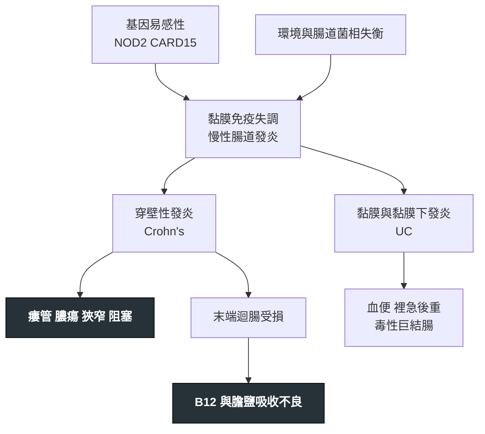

---
tags:
  - Med/Disease/GI
  - IBD
  - 禁忌
aliases:
  - IBD
  - Inflammatory bowel disease
  - 發炎性腸道疾病
  - Crohn's disease
  - 克隆氏症
  - Ulcerative colitis
  - 潰瘍性結腸炎
created: 2026-07-27
updated: 2026-07-28
status: 可用
source: "114-1 醫學(三) 20、114-2 醫學(三) 15、115-2 醫學(三) 20 延伸；2025 ACG Crohn's Disease Guideline；2019 ACG Ulcerative Colitis Guideline；2021 AGA Clinical Practice Update: Endoscopic Surveillance of Colorectal Dysplasia in IBD；Harrison's；健保署藥品給付規定第 8 節"
cssclass: clinical-note
presents_as:
  - "[[Abdominal pain]]"
  - "[[Anemia]]"
  - "[[Fever]]"
diagnosed_by:
  - "[[Colonoscopy]]"
treated_by:
  - "[[5-ASA]]"
  - "[[Anti-TNF]]"
differential:
  - "[[Tuberculosis]]"
  - "[[Clostridioides difficile colitis]]"
complication:
  - "[[Toxic megacolon]]"
  - "[[CRC]]"
  - "[[PSC]]"
---

# IBD ｜ 發炎性腸道疾病 · Inflammatory Bowel Disease

> [!abstract] 一句話總覽
> 基因易感加環境誘發，讓腸道黏膜免疫對自身菌相失控，形成**慢性、反覆緩解與復發**的腸道發炎。分成 Crohn's disease（CD，**穿壁＋跳躍**）與 ulcerative colitis（UC，**黏膜層＋由直腸連續向上**）——這兩組字推得出兩個病幾乎全部的表現、併發症與治療差異。

> [!tip] 30 秒行動卡
> **診斷關鍵**：慢性（>4 週）腹瀉／血便＋CRP 或糞便 calprotectin 上升 → **先排除感染** → 大腸鏡**插到末端迴腸**＋多處切片，看「分布、深度、病理」三件事
> **治療骨架**：UC＝5-ASA → 類固醇誘導 → 免疫調節劑／生物製劑；CD＝類固醇（迴盲部用 budesonide）誘導 → 早期上免疫調節劑／生物製劑；**瘻管型 CD → anti-TNF**
> **絕對不可**：急性重症結腸炎給止瀉／抗膽鹼藥；未排除 [[Clostridioides difficile colitis]] 就免疫抑制；未篩結核與 B 肝就用生物製劑；類固醇長期當維持

---

## 定義與定位

*這個病是什麼？在分類樹的哪個位置？跟隔壁的病靠什麼分開？*

| 項目 | 重點 |
|---|---|
| 本質 | 基因易感（CD 與 **NOD2／CARD15** 相關）＋環境誘發 → 腸道菌相與黏膜免疫失衡 → 慢性復發性腸道發炎 |
| 好發族群 | 雙峰：主峰 **15–30 歲**、次峰 **50–70 歲（部分教科書寫 60–80 歲）**；台灣盛行率低於歐美但逐年上升 |
| 兩大類 | Crohn's disease、Ulcerative colitis；**約 10–15% 的大腸型初診斷時無法明確歸類** → IBD-unclassified（舊稱 indeterminate colitis），多數在追蹤中歸位 |
| 分類位置 | 慢性腹瀉／血便中的「發炎型」，與感染型、缺血型、腫瘤型（[[CRC]]）並列 |

> [!warning] 吸菸是最重要、也最常考的「兩病方向相反」因子
> **CD：危險因子**，加重病情、提高術後復發；**UC：負相關（保護）**，戒菸後反而可能誘發。方向不可對調——但負相關不等於建議 UC 病人抽菸。
> 同理，**闌尾切除**在 UC 也呈負相關、在 CD 則否。

## CD vs UC：一張表反查

*這張表是整篇的骨幹。任何一格被講反，就是另一個病的敘述。*

| 項目 | Crohn's disease | Ulcerative colitis |
|---|---|---|
| 侵犯範圍 | **口腔到肛門任何一段**；約 80% 有小腸侵犯（其中約半數為迴結腸型），約 20% 只犯大腸 | **只局限大腸**；可有 backwash ileitis |
| 好發段 | **末端迴腸（terminal ileum）最好發** | **典型從直腸開始、直腸幾乎都會犯**（但已接受局部治療者可出現相對直腸保留、兒童 UC 肉眼直腸保留約 5%、左側 UC 可有 cecal patch——切片仍多見慢性直腸炎變化） |
| 分布型態 | **跳躍病灶（skip lesions）**、病變段與正常段交錯；**直腸常保留（rectal sparing）** | **連續性**由直腸往近端延伸，中間不留正常黏膜 |
| 發炎深度 | **穿壁性（transmural）** | 只到**黏膜與黏膜下層** |
| 主要症狀 | 右下腹痛、餐後絞痛、腹瀉**常不帶血**、體重減輕、發燒 | **血便黏液便**、**裡急後重（tenesmus）**、左下腹痛與便急 |
| 內視鏡 | 阿弗他潰瘍、**縱走潰瘍**、**鵝卵石外觀（cobblestoning）** | 瀰漫顆粒狀、血管紋消失、易脆出血、**假息肉（pseudopolyps）** |
| 影像 | 末端迴腸狹窄的 **string sign**、腸壁增厚、腸繫膜脂肪爬行 | 袋狀皺襞消失的**鉛管腸（lead-pipe colon）** |
| 病理 | **非乾酪性肉芽腫（non-caseating granuloma）**，僅約 30% 切片看得到 | **隱窩膿瘍（crypt abscess）**、隱窩結構扭曲、杯狀細胞減少 |
| 肛周病變 | **常見**：肛廔、肛周膿瘍、皮膚贅生物 | 罕見 |
| 特有併發症 | **瘻管、膿瘍、狹窄與腸阻塞、穿孔** | **[[Toxic megacolon]]**、大量出血 |
| 吸收不良 | 迴腸受侵 → **B12 與膽鹽**吸收不良、脂肪便 | 少見（大腸不負責營養吸收） |
| 吸菸 | 危險因子（惡化） | 負相關（保護） |
| 手術 | **不能根治**，吻合口會復發；只切必要段落 | **全大腸直腸切除可根治大腸病灶**（＋IPAA 儲袋；術後仍可能有 pouchitis／cuffitis，殘留 cuff 仍需追蹤） |
| 血清抗體 | **ASCA (+)** | **p-ANCA (+)** |
| 大腸癌風險 | 侵犯大腸範圍夠廣時**與 UC 相當** | 隨病程與範圍上升 |

| Crohn disease | Ulcerative colitis |
|---|---|
| ![[assets/ibd-crohn-endoscopy.jpg\|340]] | ![[assets/ibd-uc-endoscopy.jpg\|340]] |
| Aphthous／縱走潰瘍、鵝卵石黏膜、狹窄；病灶呈 patchy，間隔正常黏膜 | 輕症為血管紋消失、顆粒狀充血；重症出現潰瘍、滲出與自發出血，病灶呈連續分布 |

> [!caption] CD 與 UC 的內視鏡表現
> CD 的關鍵是非連續、縱走／蛇行潰瘍與 cobblestoning；UC 則由直腸向近端連續侵犯，和正常黏膜可有清楚界線。來源：[Endoscopic Diagnosis and Differentiation of Inflammatory Bowel Disease（Figures 1–2，CC BY-NC）](https://pmc.ncbi.nlm.nih.gov/articles/PMC3299364/)。

## 病因與機制

*為什麼會發生？病生理鏈條長什麼樣？——這一節寫好，下面的表現與併發症就不用背。*

> [!tip] 兩組字推出 CD 的全部，一組字推出 UC 的全部
> **穿壁 → 發炎穿得出腸壁 → 瘻管（腸-腸、腸-膀胱、腸-陰道、腸-皮膚）、膿瘍、纖維化狹窄與腸阻塞、穿孔、肛周病變。**
> **跳躍 → 影像上病變與正常段交錯、鵝卵石外觀、直腸常被跳過。**
> 反過來，UC **只到黏膜下層、穿不出去 → 不會有瘻管**；但整片黏膜糜爛且從直腸開始 → **血便與裡急後重才是主戲**，最急的併發症是結腸擴張而非穿孔性瘻管。

> [!tip] 末端迴腸壞掉 → 兩條吸收路線同時斷掉
> terminal ileum 是**維生素 B12–intrinsic factor 複合體唯一的吸收部位**，也是**膽鹽主動回收（ASBT）的主要部位（約 95%）**——非結合型膽鹽在近端小腸與大腸仍有少量被動吸收，膽鹽這一邊不能寫「唯一」。
> **B12 斷** → 巨球性貧血、亞急性合併退化（見 [[Anemia]]）。
> **膽鹽斷** → 膽鹽池縮小 → 微膠粒（micelle）形成不足 → **脂肪便（steatorrhea）**、脂溶性維生素 **A D E K** 缺乏。
> 再往下推兩個結石：**膽固醇性膽結石**（膽汁中膽鹽比例下降）、**草酸鈣腎結石**（未吸收的脂肪酸搶走鈣 → 草酸游離被大腸大量吸收）。
> 對比不要記錯：**葉酸吸收在空腸、B12 在迴腸**——但 sulfasalazine 會干擾葉酸吸收，所以 IBD 病人葉酸缺乏另有理由。

> [!note] 廣泛小腸切除後：切多長決定用什麼藥
> **切除迴腸 <100 cm**：肝臟還能代償合成，膽鹽只是漏到大腸刺激分泌 → **膽鹽性（cholerheic）水瀉**，用 **cholestyramine** 有效。
> **切除迴腸 >100 cm**：代償不了、膽鹽池真的縮小 → **脂肪便**，此時 cholestyramine 反而讓膽鹽更少、脂肪便更糟 → 改低脂飲食＋中鏈三酸甘油酯。
> 切除更廣泛 → **短腸症候群**：需終生 B12 注射、脂溶性維生素補充，嚴重者需全靜脈營養。
> （100 cm 分界出自 Hofmann–Poley 經典系列；各版本有 ≥100 與 >100 兩種寫法，遇到「恰好 100 cm」以「脂肪便為主、勿用 cholestyramine」作答較安全。）

## 臨床表現

*典型病人長什麼樣？哪些症狀是幾乎一定有、哪些是提示性的？*

- **CD 典型**：年輕人數月的右下腹痛＋不帶血的腹瀉＋體重減輕＋間歇低燒；**餐後 30–60 分鐘絞痛**＝狹窄段被食物撐開
- **UC 典型**：血便＋黏液＋**裡急後重**＋便急，範圍愈廣全身症狀愈明顯；**只犯直腸者可以只有便血而排便正常甚至便秘**
- **提示性**：CD 的**肛周廔管或膿瘍先於腸道症狀出現**、口腔阿弗他潰瘍；UC 的症狀嚴重度與侵犯範圍平行
- **少見但重要**：以腸阻塞或腹腔膿瘍表現的 CD；以**急性重症結腸炎**（一天血便 **≥6 次**＋至少一項全身毒性徵象（體溫 >37.8°C、心跳 >90/min、Hb <10.5 g/dL、ESR >30 mm/h））首發的 UC，可走向 [[Toxic megacolon]]、穿孔與 [[Shock]]
- **共通**：[[Anemia]]（缺鐵＋慢性病貧血，CD 再加 B12）、生長遲滯（兒童）、**靜脈血栓栓塞風險上升**

→ 相關主訴流程：[[Abdominal pain]]、[[Fever]]

## 腸道外表現

*記憶軸只有一條：**這個表現會不會跟著腸子一起好？***

| 系統 | 與腸道活動度**平行**（腸子緩解就會好） | 與腸道活動度**不平行**（要獨立處理） |
|---|---|---|
| 眼 | 鞏膜外層炎（episcleritis） | **葡萄膜炎（uveitis）** |
| 皮膚 | 結節性紅斑（erythema nodosum） | **壞疽性膿皮症（pyoderma gangrenosum）** |
| 關節 | 周邊關節炎 **Type 1**（寡關節、大關節、急性） | 周邊關節炎 **Type 2**（多關節、小關節、慢性）、**僵直性脊椎炎、薦腸關節炎**（HLA-B27 相關） |
| 肝膽 | — | **原發性硬化性膽管炎 [[PSC]]**（偏 UC） |
| 口腔 | 阿弗他口瘡 | — |

> [!tip] 眼與皮膚各有一對，方向剛好相反
> 眼睛：**鞏膜外層炎平行、葡萄膜炎不平行**；皮膚：**結節性紅斑平行、壞疽性膿皮症不平行**。兩組各記一對，方向剛好互為鏡像。
> [[PSC]] 是最重要的「不平行」代表：偏向 UC、大腸切除也不會好，且同時放大 [[CRC]] 與膽管癌風險，長期可走向 [[Cirrhosis]] 與 [[Jaundice]]。
> 不歸在這條軸上、但一定要記的還有：**靜脈血栓栓塞**、骨質疏鬆（發炎＋類固醇）、膽結石與草酸鈣腎結石（CD）、續發性類澱粉沉積。
> 關節痛病人若同時在用利尿劑或有代謝症候群，別把單關節急性紅腫直接歸給 IBD，先想 [[Gout]]。
> ⚠️ 分類爭議：**葡萄膜炎「不平行」各家寫法一致**；**壞疽性膿皮症則各版本不一**（ECCO 與近年綜述列為「關聯不明確」，部分系列約半數與腸道活動度同步）。作答仍以「PG＝不平行」為主流答案。

## 診斷

*沒有單一「一槌定音」的檢查——是內視鏡＋病理＋影像＋排除感染的組合診斷。*

| 步驟 | 內容 |
|---|---|
| **先排除感染** | 糞便培養（Salmonella、Shigella、Campylobacter）、**C. difficile toxin／PCR**、寄生蟲；台灣一定要同時想**腸結核** |
| 發炎指標 | CRP、ESR；**糞便 calprotectin** 是區分 IBD 與腸躁症、追蹤活動度最實用的非侵入指標 |
| 主力檢查 | **[[Colonoscopy]] 插到末端迴腸＋多處分段切片**——一次回答分布（跳躍 vs 連續）、深度、病理 |
| 小腸評估（CD） | CT／MR enterography；膠囊內視鏡對表淺病灶敏感，但**懷疑狹窄者禁用** |
| 血清學 | ASCA 偏 CD、p-ANCA 偏 UC；敏感度不足，**不能單獨拿來診斷或分類** |
| 嚴重度評分 | UC 用 **Mayo score**（排便次數、直腸出血、內視鏡表現、醫師整體評估四類）；CD 用 **CDAI**（症狀日記、理學發現、實驗室數值等類別組成）——記名稱與由哪幾類組成即可 |
| 急性重症時 | 腹部 X 光看**橫結腸擴張 >6 cm**（[[Toxic megacolon]]）；此時**不做全大腸鏡**，只做不打氣的軟式乙狀結腸鏡取樣 |

| CD：非乾酪性肉芽腫 | UC：隱窩膿瘍 | UC：慢性隱窩結構扭曲 |
|---|---|---|
| ![[assets/ibd-crohn-granuloma.jpg\|300]] | ![[assets/ibd-uc-crypt-abscess.jpg\|300]] | ![[assets/ibd-uc-crypt-distortion.jpg\|300]] |
| 緊密的 epithelioid histiocyte 團塊，中央無乾酪化壞死 | 嗜中性球聚集於 crypt lumen | crypt 分枝、間距不規則與 goblet cell／mucin 減少 |

> [!caption] IBD 的組織病理對照
> 非乾酪性肉芽腫支持 CD，但常取不到；crypt abscess 代表活動性 colitis，並非 UC 專屬，UC 更需搭配瀰漫、慢性的 crypt architectural distortion 判讀。來源：[Crohn’s disease granuloma（Figure 11）](https://pmc.ncbi.nlm.nih.gov/articles/PMC10896637/)；[UC histology（Figures 6、9）](https://pmc.ncbi.nlm.nih.gov/articles/PMC7372624/)。

| CD：string sign | UC：lead-pipe colon |
|---|---|
| ![[assets/ibd-crohn-string-sign.jpg\|390]] | ![[assets/ibd-uc-lead-pipe.jpg\|390]] |
| 末端迴腸長段嚴重狹窄，只剩細線狀顯影 | 結腸袋消失，腸管僵直、縮短而呈鉛管狀 |

> [!caption] CD 與 UC 的典型影像徵象
> CD 的 string sign 來自腸腔顯著狹窄；慢性 UC 的 lead-pipe appearance 則是 haustra 消失所致。來源：[The string sign in Crohn’s disease（Figure 1）](https://www.revistagastroenterologiamexico.org/en-el-signo-cuerda-enfermedad-crohn-articulo-S0375090624000569)；[Lead-pipe colon（Figure 8）](https://pmc.ncbi.nlm.nih.gov/articles/PMC3675246/)。

## 鑑別診斷

*要跟誰分清楚？靠什麼分？*

| 要排除的 | 支持它的線索 | 怎麼排除 |
|---|---|---|
| [[Clostridioides difficile colitis]] | 近期抗生素或住院；**IBD 病人本身就是高風險族群**，任何急性惡化都可能是它 | 糞便 toxin／PCR——**每一次惡化都要驗**，不是只在新病人驗 |
| [[Tuberculosis]]（腸結核） | 台灣不罕見；同樣好犯**迴盲部**、同樣有肉芽腫 | **乾酪性**肉芽腫＋抗酸菌染色／PCR、胸部 X 光、IGRA；潰瘍走向**橫走**（CD 是縱走）、迴盲瓣呈開口固定變形 |
| 急性感染性腸炎 | 起病急、旅遊或食物史；Entamoeba 會做出很像 UC 的潰瘍 | 糞便培養與鏡檢；病程長短是最好用的分界 |
| [[CRC]] | 年長、進行性排便習慣改變、體重減輕、局部狹窄 | 大腸鏡切片；長病程 IBD 本身也會長癌 |
| Behçet disease | 反覆口腔＋生殖器潰瘍、眼炎；迴盲部**單顆深而圓**的潰瘍 | 全身表現＋潰瘍型態 |
| 缺血性腸炎 | 年長、心血管病史；病灶落在脾曲與乙狀結腸等分水嶺區 | 病史＋分布，通常自限 |
| 腸躁症 | 無夜間症狀、無體重減輕、無貧血與發炎指標上升 | **糞便 calprotectin 正常**基本上就可放心 |

## 治療

*先分「誘導緩解」與「維持緩解」兩件事——很多藥只能做其中一件。*

| 階層 | 藥物 | 用在哪一型、哪一階段 |
|---|---|---|
| 5-ASA | mesalamine、sulfasalazine | **UC 的第一線**，輕中度可同時誘導與維持；直腸炎用**塞劑**、左側大腸用灌腸＋口服。**對 CD（尤其小腸病灶）效果有限，不作為 CD 的維持治療** |
| 類固醇 | prednisolone 口服；重症靜脈；**budesonide** 用於迴盲部 CD（首渡代謝高、全身副作用少） | 中重度的**誘導緩解**。**只誘導、不維持**——達到緩解後必須減量停用 |
| 免疫調節劑 | **azathioprine／6-MP**、**methotrexate** | 類固醇依賴或無效時的**維持**主力，起效慢（2–3 個月）。AZA／6-MP 用前驗 **TPMT／NUDT15**（**NUDT15 變異在東亞族群特別重要**，會造成嚴重骨髓抑制）；MTX 對 CD 有證據、UC 較弱，**懷孕為絕對禁忌** |
| 生物製劑：anti-TNF | infliximab、adalimumab | 中重度 CD 與 UC 的誘導＋維持；**瘻管型 CD 效果最好、是首選**；急性重症 UC 靜脈類固醇無效時的搶救。常與 AZA 併用以提高血中濃度、減少抗藥抗體 |
| 生物製劑：其他機轉 | **vedolizumab**（抗 α4β7，作用僅限腸道、全身免疫抑制最少）、**ustekinumab／risankizumab**（IL-12/23、IL-23） | 抗 TNF 失敗或不耐受者；感染風險考量高（年長、共病多）時 vedolizumab 尤其合適 |
| 小分子 | JAK 抑制劑 **tofacitinib、upadacitinib**；S1P 調節劑 **ozanimod**（UC） | 口服、起效快，適合難治型；代價是帶狀疱疹、血栓與心血管事件風險 |
| 手術 | UC：**全大腸直腸切除＋IPAA 儲袋，可根治大腸病灶**（術後 pouchitis 累積約 50%，殘留 cuff 仍需追蹤）；CD：只切必要段落，**不能根治**、吻合口會復發 | UC 適應症：藥物無效的重症、毒性巨結腸、無法內視鏡處理的異型增生或癌。CD 適應症：纖維化狹窄造成阻塞、瘻管、膿瘍、藥物無效 |

> [!note] 急性重症 UC 住院的節奏
> 靜脈類固醇 → **第 3 天評估反應**（Oxford／Travis 標準：第 3 天**排便次數 >8 次／日**，或 **3–8 次／日且 CRP >45 mg/L** → 該次住院需 colectomy 的機率約 85%）→ 無反應改 **infliximab 或 cyclosporine 搶救** → 再無反應**及早會外科**，不要拖到穿孔。
> 同時要做的三件事：停掉止瀉與鴉片類藥物、驗 [[Clostridioides difficile colitis]] 與 CMV、**給預防性抗凝**（IBD 是高凝狀態，血便**不是**禁忌）。

> [!info] 台灣本土
> 生物製劑須為**中重度**、經 5-ASA、類固醇及／或免疫抑制劑充分治療**超過六個月**仍無法控制（**成人 CD 需 CDAI≧300**；廔管型 CDAI≧100）或有嚴重副作用，且**領有重大傷病卡**，由具消化系專科證書之醫師處方、**事前審查**核准後給付；續用需達療效指標（CD 看 CDAI 或瘻管改善、UC 看 partial Mayo score 下降）。

## 併發症與預後

- **CD 要盯的**：狹窄與腸阻塞、腹腔內膿瘍、瘻管、肛周廔管、B12 與 ADEK 缺乏、膽結石、草酸鈣腎結石、短腸症候群
- **UC 要盯的**：[[Toxic megacolon]]、大量下消化道出血、穿孔（可走向 [[Shock]]）
- **共通**：[[CRC]]、靜脈血栓栓塞、骨質疏鬆、[[Anemia]]、[[PSC]] 相關的膽道疾病與膽管癌
- **預後**：兩病都不會自然痊癒，目標是「無類固醇的長期緩解＋黏膜癒合」。CD 的 10 年累積手術率在生物製劑普及前約 40–55%，**2000 年後世代已降至約 25–30%**；UC 的 10 年大腸切除率約 **10–15%**，且多數研究顯示**並未因生物製劑而明顯下降**（與 CD 的對比常考）

### 大腸癌監測

| 情境 | 何時開始 | 間隔 |
|---|---|---|
| UC（直腸炎以外）或 CD 侵犯 **≥1/3 大腸**（ACG 寫 "at least one-third"、BSG 寫 ">30%"、AGA 2021 以「<1/3」為最低風險——三者實質相同） | **確診後 8 年**（AGA 2021 寫確診後 8–10 年；ECCO 才以症狀出現起算） | **每 1–5 年**依風險調整（ACG 2019 寫 1–3 年；AGA 2021 對持續緩解、黏膜癒合且連續兩次陰性者可延長至 5 年） |
| 合併 [[PSC]] | **PSC 診斷當下就開始** | **每年一次** |
| 高風險（內視鏡仍有中重度發炎、一等親 **<50 歲**罹 CRC、假息肉多到看不清黏膜、5 年內曾有低度異型增生） | 同上 | **每年一次** |
| 單純直腸炎、CD 侵犯不到 1/3 大腸 | 風險未明顯上升 | 依一般族群篩檢即可 |

> [!tip] 監測看的是「發炎的大腸黏膜有多少、燒了多久」，不是病名
> 只要大腸黏膜長期發炎，**UC 與侵犯大腸的 CD 風險相當**——把風險或監測綁在病名上就是錯的。
> 做法上已從隨機四象限切片轉向**染色內視鏡或高解析白光＋目標式切片**。IBD 相關的癌變常是扁平、界線不清的，不像散發型 [[CRC]] 那樣長成明顯息肉。

## 禁忌與陷阱

> [!danger] 絕對不可
> | 情境 | 絕對不可 | 為什麼 | 該做什麼 |
> |---|---|---|---|
> | 急性重症結腸炎、疑似毒性巨結腸 | 給**止瀉藥（loperamide）、抗膽鹼藥、鴉片類** | 抑制腸蠕動 → 結腸急速擴張 → [[Toxic megacolon]] 與穿孔 | 停藥、禁食、靜脈輸液＋靜脈類固醇、廣效抗生素、**每日腹部 X 光**追蹤；擴張惡化或穿孔立即外科 |
> | IBD 急性惡化 | 未驗 **C. difficile** 與糞便病原就直接加重免疫抑制 | 把感染誤當發作，免疫抑制會讓感染爆開 | 先送 [[Clostridioides difficile colitis]] toxin／PCR、糞便培養；類固醇無效者加驗 **CMV** 切片 |
> | 準備用生物製劑（尤其 anti-TNF） | 未篩檢**潛伏結核與 B 型肝炎**就開始 | 潛伏 [[Tuberculosis]] 再活化（常為肺外或散播型）、HBV 再活化可致猛爆性肝炎 | IGRA／TST＋胸部 X 光、HBsAg／anti-HBc／HBV DNA；陽性者先治療潛伏結核或給預防性抗病毒 |
> | 已達緩解後的維持 | 把**類固醇當長期維持治療** | 類固醇無法維持緩解，只累積骨鬆、感染、腎上腺抑制、白內障與血糖問題 | 誘導後系統性減量，用免疫調節劑或生物製劑接手 |
> | CD 合併腸道／腹腔膿瘍 | 未引流就給 anti-TNF | 膿瘍在免疫抑制下擴散，可致敗血症 | 影像確認 → 抗生素＋經皮或手術引流 → 再談生物製劑 |
> | 服用 thiopurine 又要治痛風 | 照原劑量併用 **allopurinol** | 黃嘌呤氧化酶被擋 → 6-MP 代謝物大量累積 → **嚴重骨髓抑制** | 換用不影響代謝的降尿酸策略，或由專科將 thiopurine 減至約 1/4–1/3 並密切驗血；見 [[Gout]] |
> | 懷疑腸狹窄的 CD | 做**膠囊內視鏡** | 膠囊卡在狹窄段造成阻塞，須內視鏡或手術取出 | 先做 CT／MR enterography；必要時先試 patency capsule |

> [!warning] 常見錯誤
> - 把**連續性病灶**掛給 CD、把**跳躍病灶**掛給 UC——方向記死：**UC 連續、CD 跳躍**。
> - 把 **crypt abscess** 記成 CD 的病理——那是 **UC 的特徵（但非專屬**，CD 與感染性大腸炎也可見；真正支持 UC 的是**隱窩結構扭曲＋杯狀細胞減少**的慢性變化）；CD 是**非乾酪性肉芽腫**，而且只有約 30% 切片看得到，**看不到不能排除 CD**。
> - 說「手術可以根治 CD」——**只有 UC 的全大腸直腸切除能根治**，CD 吻合口會復發。
> - 把吸菸的方向講反——**CD 惡化、UC 保護**。
> - 以為「CD 不增加大腸癌風險、不必監測」——侵犯大腸範圍夠廣時風險與 UC 相當。
> - 把**葉酸**吸收記在迴腸——**葉酸在空腸、B12 在迴腸**。
> - 把 5-ASA 當成 CD 的主力——**主戰場在 UC**。
> - 看到血便就不敢給預防性抗凝——住院的活動性 IBD 是高凝狀態，**該給** VTE 預防。
> - 忘記 azathioprine／6-MP 與 5-ASA 都可能誘發 [[Acute pancreatitis]]；用藥中突發上腹痛先想到它。
> - 只憑 ASCA／p-ANCA 就替病人歸類——敏感度不足，分類仍靠內視鏡與病理。

## 相關連結

- [[CRC]] — 長期黏膜發炎的終點；監測策略看範圍與病程，不看病名
- [[PSC]] — 最重要的「不平行」腸外表現，也是 CRC 與膽管癌的風險放大器
- [[Cirrhosis]]、[[Jaundice]] — PSC 走下去的兩個結果
- [[Toxic megacolon]] — UC 最急的併發症，止瀉藥與抗膽鹼藥的禁忌就是為它而設
- [[Tuberculosis]] — 最像 CD 的鑑別診斷，也是生物製劑前必篩項目
- [[Clostridioides difficile colitis]] — 每一次惡化都要先排除
- [[Colonoscopy]] — 診斷、分類與癌症監測的主力
- [[Anemia]] — 缺鐵、慢性病貧血、B12 缺乏三種機轉可以同時存在
- [[Acute pancreatitis]] — thiopurine 與 5-ASA 的藥物性副作用
- [[Gout]] — allopurinol 與 thiopurine 的致命交互作用
- [[Abdominal pain]]、[[Fever]]、[[Shock]] — 主訴與急症端的入口
- [[禁忌選項]] — 跨科禁忌的通則整理
