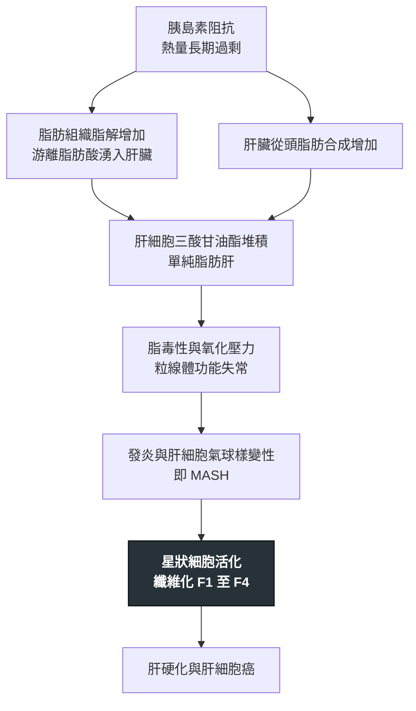

---
tags:
  - Med/Disease/GI
  - Med/Disease/Endo
  - liver
  - metabolic
  - 禁忌
aliases:
  - MASLD
  - MASH
  - NAFLD
  - NASH
  - MetALD
  - 非酒精性脂肪肝
  - 代謝功能障礙相關脂肪肝病
  - 脂肪肝
  - 代謝相關脂肪性肝炎
created: 2026-07-28
updated: 2026-07-28
status: 可用
source: 114-1 醫學(三) 23、114-2 醫學(三) 19、115-2 醫學(三) 57 延伸；2023 AASLD／EASL／ALEH 多學會 Delphi 命名共識（J Hepatol）；AASLD 2023 NAFLD／MASLD Practice Guidance；EASL–EASD–EASO 2024 MASLD CPG；Harrison's 21e
cssclass: clinical-note
presents_as:
  - "[[RUQ pain]]"
  - "[[Jaundice]]"
diagnosed_by:
  - "[[Abdominal ultrasound]]"
  - "[[Liver biopsy]]"
treated_by:
  - "[[GLP-1 receptor agonist]]"
  - "[[Statin]]"
differential:
  - "[[Hepatitis B]]"
  - "[[Hepatitis C]]"
  - "[[Wilson disease]]"
complication:
  - "[[Cirrhosis]]"
  - "[[HCC]]"
  - "[[CAD]]"
---

# MASLD / MASH ｜ 代謝功能障礙相關脂肪肝病 · Metabolic Dysfunction-Associated Steatotic Liver Disease

> [!abstract] 一句話總覽
> 胰島素阻抗把三酸甘油酯堆進肝細胞（steatosis），其中一部分再走向**發炎 ＋ 肝細胞氣球樣變性（＝MASH）**→ 纖維化 → [[Cirrhosis]] → [[HCC]]。兩個必須先記住的反直覺：**決定預後的是纖維化分期，不是發炎程度、不是 ALT**；而**這群病人最常見的死因是心血管疾病，不是肝病**。

> [!tip] 30 秒行動卡
> **診斷關鍵**：影像看到脂肪肝 ＋ **至少一項心代謝危險因子** ＝ MASLD（新版陽性納入）。但要區分單純脂肪肝與 **MASH**（須有 hepatocyte ballooning ＋ lobular inflammation）、以及正式分級分期，**只有肝切片做得到**。
> **治療骨架**：**減重**（3–5% 降肝脂肪／7–10% 讓 MASH 消退／**≥10%** 才動得了纖維化）＋ 全面心血管風險控制；藥物給 **MASH ＋ 顯著纖維化（F2–F3）**——優先以切片證實，**若無切片，AASLD 2024 更新允許以非侵入性評估（VCTE／MRE／ELF／FAST）判定等同 F2–F3 後用藥**。
> **絕對不可**：看到脂肪肝就直接歸因代謝而不排除其他肝病；用超音波正常排除 MASH 或纖維化；對糖尿病患者或未經切片證實者常規給高劑量維生素 E。

---

## 定義與定位

*這個病是什麼？在分類樹的哪個位置？跟隔壁的病靠什麼分開？*

| 項目   | 重點                                                                     |
| ---- | ---------------------------------------------------------------------- |
| 本質   | 肝細胞內三酸甘油酯過度堆積（組織學門檻 **>5% 肝細胞脂肪變性**），源頭是胰島素阻抗                          |
| 好發族群 | 中年、中央型肥胖、[[T2DM]]、血脂異常；全球盛行率約 **30%**（近年區間估計可達 35–38%，且逐年上升），是最常見的慢性肝病 |
| 分類位置 | 脂肪性肝病（SLD）大傘之下，與 MetALD、酒精性肝病並列                                        |
| 疾病譜  | 單純脂肪肝（steatosis）→ **MASH** → 纖維化 F1–F3 → [[Cirrhosis]]（F4）→ [[HCC]]    |
| 比例   | MASLD 成人中約 **20–30%** 已是 MASH；在 [[T2DM]] 或重度肥胖族群可逼近 50%                |

> [!info] 2023 命名改版：從「排除性診斷」變成「陽性納入診斷」
> - **NAFLD → MASLD、NASH → MASH**（2023 年多學會 Delphi 共識）。
> - **舊（NAFLD）＝排除法**：有脂肪肝，且必須**排除**大量飲酒、病毒性肝炎、藥物等其他病因，剩下的才算。
> - **新（MASLD）＝納入法**：有脂肪肝，且**符合五條心代謝條件中至少一條**即成立（是「至少一條」，不是三條、不是全部），並**允許與其他肝病共存**。
> - **考試可能仍照舊名（NAFLD／NASH）與舊的排除定義作答，臨床照新名新定義做。** **筆試上兩套名詞可互相對應（重疊率約 99%），但不是嚴格同義**：原 NAFLD 中完全不符合任何心代謝條件者，在新架構下歸為 **cryptogenic SLD** 而非 MASLD。SLD 大傘的完整子類為：MASLD／MetALD／ALD／**specific aetiology SLD**（藥物、HCV genotype 3、單基因等）／**cryptogenic SLD**。

| 類別 | 條件 | 每週酒精量（男／女） |
|---|---|---|
| **MASLD** | 脂肪肝 ＋ ≥1 項心代謝危險因子 | <210 g／<140 g |
| **MetALD**（新增的中間類別） | 脂肪肝 ＋ ≥1 項心代謝危險因子 ＋ **中量飲酒** | 210–420 g／140–350 g |
| 酒精性肝病（ALD） | 飲酒量超過上限 | >420 g／>350 g |

換算成每日約為男 30–60 g、女 20–50 g。**男女門檻不同**，且判斷 MetALD 需要量化飲酒史，不能只問「有沒有喝」。

### 心代謝危險因子（符合任一項即可）

| # | 面向 | 門檻 |
|---|---|---|
| 1 | 肥胖／中央肥胖 | BMI ≥25（**亞洲族群 ≥23**）或腰圍 男 >94 cm／女 >80 cm（**須依族群調整；華人／台灣用 男 ≥90 cm／女 ≥80 cm**） |
| 2 | 血糖異常 | 空腹血糖 ≥100 mg/dL、**2 小時負荷後血糖 ≥140 mg/dL**、HbA1c ≥5.7%、已診斷 [[T2DM]] 或正在治療 |
| 3 | 血壓 | ≥130/85 mmHg 或正在服用降壓藥 |
| 4 | 三酸甘油酯 | TG ≥150 mg/dL 或正在治療 |
| 5 | HDL 膽固醇 | 男 **≤**40 mg/dL、女 **≤**50 mg/dL 或正在治療（**含等於**，與代謝症候群的「<」不同） |

> [!tip] 這張表 ＝ [[Metabolic syndrome]] 的成分表，可以雙向反查
> 記成分表比記「危險因子清單」有用，因為兩端可以互推：**肥胖、[[T2DM]]、血脂異常、高血壓是核心危險因子；不在這張表上的就不是核心。**
> 高尿酸血症（[[Gout]]）、多囊性卵巢症候群、阻塞型睡眠呼吸中止、甲狀腺功能低下與 MASLD 確有流行病學相關，機轉上也說得通（例如果糖代謝同時產生尿酸與肝脂肪），但屬於**相關共病**，不是主要危險因子，也不是代謝症候群的診斷成分。

## 病因與機制

*為什麼會發生？病生理鏈條長什麼樣？*

> [!tip] 為什麼第一線是減重而不是「保肝藥」
> 上游是**熱量過剩 ＋ 胰島素阻抗**，肝臟只是承接後果的器官。把上游關掉，整條鏈都會往回退；而**退的深度取決於減多少**——脂肪最好退、發炎次之、纖維化最難。這條線同時解釋了為什麼減重百分比的三個階梯會長成那個樣子。

![[assets/mash-histopathology.jpg|760]]
*MASH／NASH 的組織學光譜：A 大、小泡性 steatosis；C ballooned hepatocyte；E–F Mallory–Denk body；G lobular lipogranuloma；I trichrome 下 delicate perisinusoidal／pericellular fibrosis；J bridging fibrosis。診斷 steatohepatitis 的核心仍是 steatosis、lobular inflammation 與 hepatocyte ballooning 的組合，影像無法直接判斷。Source: [Histopathology of nonalcoholic fatty liver disease](https://pmc.ncbi.nlm.nih.gov/articles/PMC4112884/), Fig. 1。*

## 臨床表現

*典型病人長什麼樣？*

- **典型**：**絕大多數無症狀**，多在健康檢查做腹部超音波、或發現肝功能異常時被找到
- **提示性**：疲倦、右上腹悶脹（見 [[RUQ pain]]）、肝腫大；生化上常見 **ALT 略高於 AST**（一旦走到肝硬化才會反轉成 AST > ALT）
- **少見但重要**：第一次表現就是 [[Cirrhosis]] 的併發症（腹水、靜脈曲張出血、[[Hepatic encephalopathy]]）或 [[HCC]]——因為整段過程完全無聲

> [!warning] 「肝指數正常 ＝ 肝沒事」永遠是錯的
> **AST／ALT 的數值高低與組織學嚴重度無關。** 肝指數完全正常的人可能已經是 MASH、甚至已有進階纖維化。所以「定期追蹤 ALT」不是風險分層，**纖維化評估才是**。

→ 相關主訴流程：[[RUQ pain]]

## 診斷

*把「脂肪」「發炎」「纖維化」三件事拆開問——每個工具只回答其中一個問題。*

| 要回答的問題 | 能回答的工具 | 備註 |
|---|---|---|
| 有沒有**脂肪堆積**？ | [[Abdominal ultrasound]]、CT、**CAP**（FibroScan 附帶）、**MRI-PDFF** | MRI-PDFF 定量最準 |
| 有沒有**發炎與氣球樣變性**（＝MASH）？ | **只有 [[Liver biopsy]]** | 影像與抽血都測不到「細胞長什麼樣」；**單一抽血項目無法診斷 MASH**；可用的是複合分數（FAST、MAST、ELF、NIS4）——它們辨識的是「at-risk MASH」，可作為用藥依據，但**組織學診斷（ballooning ＋ lobular inflammation）仍只有切片能給** |
| **纖維化到第幾期**？ | FIB-4／NFS → VCTE（FibroScan）／MRE → 切片 | 非侵入性評估已是第一線分流工具 |

> [!note] 「只能靠切片」的精準範圍——別把它講得太寬
> 1. **偵測脂肪堆積**：影像就做得到，不需要切片。
> 2. **區分單純脂肪肝 vs MASH**：MASH 的組織學定義是 steatosis ＋ **lobular inflammation** ＋ **hepatocyte ballooning**，後兩項只有顯微鏡看得到 → **肝切片是 gold standard**。
> 3. **正式的分級（發炎活性）與分期（纖維化 F0–F4）**：同樣是切片，也是唯一能一次給出兩者的方法。
>
> 反過來也要記住：**非侵入性纖維化評估已經是第一線分流工具**，切片保留給結果不確定、或懷疑合併其他肝病者——不是每個脂肪肝都要切。

> [!tip] 風險分層的實際順序
> **FIB-4**（只由年齡、AST、ALT、血小板四項現成資料算出，不必額外抽血）→ **<1.3 為低風險**（**65 歲以上下切點放寬到 2.0，上切點仍為 2.67**；**<35 歲 FIB-4 準確度差，不宜單獨用來排除**）；**>2.67** 直接視為高風險轉介肝膽科；**中間帶做 VCTE**：肝臟硬度 **<8 kPa** 低風險、**8–12 kPa** 不確定帶、**>12 kPa** 高度懷疑進階纖維化。仍不確定者才考慮 [[Liver biopsy]]。

### 超音波看得出什麼、看不出什麼

| 看得出 | 看不出 |
|---|---|
| **脂肪浸潤**：肝腎回音對比增強、深部回音衰減、肝內血管邊界模糊 | **輕度脂肪肝（<20–30%）**——敏感度差，可能報成正常 |
| 敏感度隨脂肪比例上升：中重度脂肪變性敏感度約 85%、特異度約 93% | **有沒有發炎**（MASH）——完全做不到 |
| **肝硬化的形態學**：肝表面不平整、實質粗糙、脾腫大、腹水 | **纖維化到第幾期**——要靠彈性造影或切片 |

![[assets/fatty-liver-us-grades.jpg|720]]
*脂肪肝超音波分級：a 正常肝回音；b grade 1，肝回音增強；c grade 2，門靜脈分支壁逐漸被高回音肝實質「洗掉」；d grade 3，深部衰減使橫膈輪廓也變模糊。判讀時要確認 gain 設定並比較肝臟與右腎皮質，否則「亮」本身沒有基準。Source: [Imaging of non alcoholic fatty liver disease](https://pmc.ncbi.nlm.nih.gov/articles/PMC3872717/), Fig. 2。*

## 鑑別診斷

*看到脂肪肝，不能直接跳到「代謝」。*

| 要排除的 | 支持它的線索 | 怎麼排除 |
|---|---|---|
| 酒精性肝病／MetALD | 飲酒量超過門檻；**AST/ALT >2**、GGT 上升、MCV 上升 | 量化飲酒史（男 210 g／女 140 g 每週為分界） |
| [[Hepatitis C]] | genotype 3 可直接造成脂肪變性 | Anti-HCV ＋ HCV RNA |
| [[Hepatitis B]] | 台灣盛行率高，常與脂肪肝並存 | HBsAg |
| 藥物性 | **methotrexate、tamoxifen、glucocorticoid**、amiodarone、valproate、部分抗反轉錄病毒藥 | 完整用藥史；停藥後追蹤 |
| [[Wilson disease]] | **年輕**、神經精神症狀、Kayser-Fleischer ring、Coombs 陰性溶血 | ceruloplasmin 低、24 小時尿銅高 |
| 自體免疫性肝炎 | 女性、合併其他自體免疫疾病、球蛋白高 | ANA、anti-smooth muscle antibody、IgG |
| 其他 | 血色素沉著症、α1-antitrypsin deficiency、乳糜瀉、甲狀腺功能低下、脂肪失養症 | ferritin／transferrin saturation、TSH 等 |

> [!warning] 「允許共存」不等於「可以不查」
> 新定義把 MASLD 改成陽性納入，因此**可以與 B 肝、C 肝、酒精同時成立**。但那只是分類上的鬆綁——臨床上仍必須把上表逐一釐清，因為**它們各自有自己的治療，而且是可逆的那一半**。

## 治療

| 情境 | 處置 |
|---|---|
| **所有病人的基石** | 減重與運動：熱量赤字／地中海飲食、每週 150–300 分鐘中強度有氧 ＋ 阻力訓練；限制含糖飲料與酒精 |
| **減重的階梯目標** | **3–5%** → 肝脂肪下降；**7–10%** → 發炎改善、**MASH 消退**；**≥10%** → 才可能改善纖維化 |
| 心血管風險（必做） | 依 ASCVD 風險給 [[Statin]]、控制血壓血糖、戒菸——見 [[CAD]] |
| 合併 [[T2DM]] 且有 MASH | 優先選 **[[GLP-1 receptor agonist]]**（semaglutide）或 **pioglitazone** |
| **MASH ＋ F2–F3**（切片證實，或非侵入性評估等同 F2–F3） | **resmetirom**（甲狀腺素受體 β 促效劑，2024 年 FDA 加速核准，第一個 MASH 適應症藥物）；**semaglutide 2.4 mg**（2025 年 8 月 FDA **加速核准**，適應症為非肝硬化 MASH 併中至重度纖維化 F2–F3，須併飲食與運動；第一個獲此適應症的 GLP-1） |
| 非糖尿病、非肝硬化、切片證實 MASH | **維生素 E 800 IU／天**可考慮（代價見下） |
| 病態性肥胖 | 減重手術，代謝效益最持久 |
| 已達肝硬化 | 依 [[Cirrhosis]] 處理；上述 MASH 藥物**不適用於失代償期** |

> [!warning] 維生素 E：有效，但有價碼
> **適用範圍非常窄**：**非糖尿病、非肝硬化、且經切片證實**的成人 MASH。證據來自非糖尿病族群，換一個族群就不能外推。
> **代價**：長期高劑量與**出血性中風**風險增加、**攝護腺癌**風險增加有關，每日 >400 IU 也曾被報告與全因死亡率上升相關。它不是「吃了沒壞處的保健品」，是需要權衡的處方。

> [!note] 誰不需要藥
> **單純脂肪肝（沒有發炎、沒有顯著纖維化）進展風險低，不需要藥物治療。** 第一線永遠是生活型態，藥物保留給**已證實 MASH 且纖維化達顯著程度（F2–F3）**的高風險族群。「所有脂肪肝病人都該吃藥以免走向肝硬化」在方向上就是錯的。

> [!info] 台灣本土
> 國人**非肥胖型脂肪肝**比例不低，但要注意三個常被混用的分母：**一般人口中約 12% 是「非肥胖＋有脂肪肝」、約 5% 是「瘦型脂肪肝」；在已診斷的 MASLD 病人裡，約四成是非肥胖、約兩成是瘦型**（亞洲更高）。**BMI 正常不代表可以不查**；亞洲族群的 BMI 門檻本來就下修到 ≥23。給付面上，resmetirom 尚未納入健保、FibroScan 多數情境需自費，GLP-1 受體促效劑的健保給付掛在糖尿病適應症下而非 MASH。

## 併發症與預後

> [!important] 兩個反直覺，兩個都會改變處置方向
> **① 預測肝相關死亡與全因死亡最強的因子是「纖維化分期」**——不是發炎程度、不是脂肪含量、不是 ALT。風險自 F2 起明顯上升，這正是所有分流工具（FIB-4、VCTE、MRE）測的都是纖維化而非發炎的原因。
> **② MASLD 病人最常見的死因是心血管疾病，不是肝病。** 大致排序為心血管 > 肝外惡性腫瘤 > 肝病。只盯著肝臟、不管血壓血糖血脂，整個方向就錯了。

- **要盯的併發症**：[[Cirrhosis]] 及其併發症（腹水見 [[Ascitic fluid analysis]]、靜脈曲張出血、[[Hepatic encephalopathy]]、[[Jaundice]]）、[[HCC]]、[[CAD]] 與 [[ACS]]、[[T2DM]]、慢性腎病（進展到 [[Dialysis]]）、大腸癌等肝外惡性腫瘤
- **與病毒性肝炎不同的一點**：**MASLD 相關的 HCC 可以在尚未達到肝硬化時就發生**，因此篩檢對象不像 [[Hepatitis C]] 或酒精性肝病那樣能用「有沒有肝硬化」乾淨切開（[[Hepatitis B]] 也有非肝硬化 HCC，但機轉是病毒 DNA 整合，不同來源）
- **可逆性**：單純脂肪肝與早期纖維化在有效減重後可以退回去；**已建立的肝硬化不可逆**——這是介入要趁早的理由

## 禁忌與陷阱

> [!danger] 絕對不可
> | 情境 | 絕對不可 | 為什麼 | 該做什麼 |
> |---|---|---|---|
> | 超音波發現脂肪肝 | 直接歸因於代謝，不排除其他肝病 | 病毒性肝炎、藥物、[[Wilson disease]]、自體免疫性肝炎都會造成脂肪肝，**而且這些是治得動的那一半** | 至少查 HBsAg、anti-HCV、完整用藥史與量化飲酒史；年輕病人加驗 ceruloplasmin |
> | 想知道有沒有 MASH 或纖維化 | 用「超音波正常」或「ALT 正常」下結論說沒事 | 超音波看不出發炎與纖維化，對 <20–30% 的輕度脂肪也不敏感；ALT 與組織學嚴重度無關 | 算 **FIB-4** → 中高風險做 **VCTE** → 仍不確定才 [[Liver biopsy]] |
> | 糖尿病患者、肝硬化者、或未經切片證實者 | 常規給**高劑量維生素 E** | 療效證據僅來自**非糖尿病**的切片證實 MASH；高劑量與出血性中風、攝護腺癌風險有關 | 這些族群改走 [[GLP-1 receptor agonist]]、pioglitazone 或 resmetirom |
> | MASLD 合併血脂異常 | 因為「怕傷肝」而不給或停掉 [[Statin]] | 這群病人最常見的死因就是心血管疾病；statin 在 MASLD 安全且是標準用藥 | 依 ASCVD 風險給 statin，並完整評估心血管風險 |

> [!warning] 常見錯誤
> - 把「有沒有脂肪」和「有沒有發炎」混為一談——**FibroScan、FIB-4、MRE 都診斷不了 MASH**，它們量的是硬度／纖維化；能診斷 MASH 的只有切片。
> - 誤以為超音波什麼都看不到——它**看不出 MASH，但看得出肝硬化的形態學特徵**（表面不平整、實質粗糙、脾腫大、腹水）。
> - 記成「MASLD 一定要滴酒不沾」——新定義是納入法，飲酒量只用來決定歸在 MASLD、MetALD 還是酒精性肝病，且**男女門檻不同**。
> - 用同一組門檻套所有人：亞洲族群 BMI 門檻是 **≥23**，腰圍與 HDL 門檻男女不同。
> - 以為還沒肝硬化就不必想 [[HCC]]。
> - 以為 statin、pioglitazone「傷肝所以脂肪肝不能用」——恰恰相反。

## 相關連結

- [[Cirrhosis]] — 走到終點之後的完整機制與併發症全寫在那裡
- [[HCC]] — MASLD 可在未達肝硬化前發生，篩檢策略因此棘手
- [[Metabolic syndrome]] — 危險因子清單的本體，兩端可互推
- [[T2DM]] — 同時是危險因子、共病與進展加速器
- [[CAD]]、[[ACS]] — 這群病人真正的頭號死因
- [[Statin]] — 在 MASLD 不是禁忌，是標準用藥
- [[Abdominal ultrasound]] — 能回答與不能回答的問題
- [[Hepatitis B]]、[[Hepatitis C]] — 必須釐清，也可能與 MASLD 共存
- [[GLP-1 receptor agonist]] — 合併 T2DM 或 MASH F2–F3 的首選藥物
- [[禁忌選項]] — 「所有病人都需要」「完全沒有副作用」這類絕對化敘述的通則
