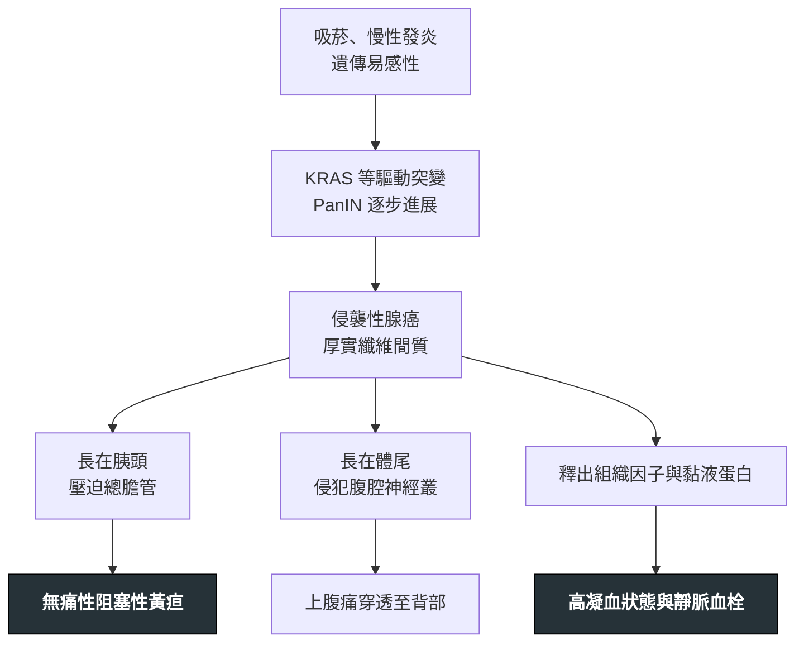

---
tags:
  - Med/Disease/GI
  - pancreas
  - oncology
  - 禁忌
aliases:
  - 胰臟癌
  - 胰腺癌
  - PDAC
  - Pancreatic Ductal Adenocarcinoma
created: 2026-07-28
updated: 2026-07-28
status: 可用
source: "114-2 醫學(三) 17、115-2 醫學(三) 19 延伸；NCCN Guidelines: Pancreatic Adenocarcinoma（v2.2025, 2025-02-03；使用前請確認是否已有更新版）；ASCO Venous Thromboembolism in Patients With Cancer Guideline Update 2023；Harrison's"
cssclass: clinical-note
presents_as:
  - "[[Jaundice]]"
  - "[[Abdominal pain]]"
  - "[[Thrombosis]]"
diagnosed_by:
  - "[[Abdominal ultrasound]]"
  - "[[Chest CT]]"
treated_by:
  - "[[ERCP]]"
  - "[[Radiotherapy]]"
differential:
  - "[[CBD stone]]"
  - "[[Acute pancreatitis]]"
  - "[[Acute cholangitis]]"
complication:
  - "[[Thrombosis]]"
  - "[[Pulmonary embolism]]"
---

# Pancreatic cancer ｜ 胰臟癌 · Pancreatic Ductal Adenocarcinoma

> [!abstract] 一句話總覽
> 胰管上皮來源的腺癌。**症狀完全由腫瘤長在哪決定**：長在頭部就壓到總膽管 → 早黃疸、早被發現、可切除比例反而較高；長在體尾沒東西擋 → 只剩背痛與體重減輕，發現時多半已切不掉。**手術是唯一有機會治癒的手段，但只有少數病人可切**——所有治療決策的第一句話都是「可不可以切」。

> [!tip] 30 秒行動卡
> **診斷關鍵**：**無痛性阻塞性黃疸**（合併可摸到、不會痛的腫大膽囊 ＝ Courvoisier sign），或 **50 歲後新發糖尿病＋不明原因體重減輕** → 直接排 **pancreatic protocol CT（胰臟專用雙期對比電腦斷層）**，不是先做 [[ERCP]]
> **治療骨架**：先分四格（resectable／borderline resectable／locally advanced／metastatic）→ 可切者**手術＋術後輔助化療**；borderline 者**先新輔助治療再重新評估**；locally advanced 與轉移者**全身化療＋早期整合緩和照護**
> **絕對不可**：拿 CA 19-9 當篩檢、膽道阻塞未減黃就解讀 CA 19-9、癌症相關血栓用 [[Warfarin]] 當首選、第 4 期還做以根治為目的的切除

---

## 定義與定位

*這個病是什麼？在分類樹的哪個位置？跟隔壁的病靠什麼分開？*

| 項目 | 重點 |
|---|---|
| 本質 | **胰管上皮（ductal epithelium）**來源的腺癌，佔胰臟惡性腫瘤約 **85–90%**；外分泌部起源，不是內分泌部 |
| 好發部位 | **頭部與鉤突約 60–75%**，體尾部約 25–40%（各來源略有差異，但「頭部佔絕大多數」的方向一致）——這個比例本身就決定了臨床樣貌 |
| 好發族群 | 多在 **60–80 歲**；男性略多；50 歲以下罕見（若發生要想遺傳症候群） |
| 分類位置 | 與**神經內分泌腫瘤（pNET）**、囊性腫瘤（IPMN、MCN）分開；後兩者預後與處置完全不同 |
| 為什麼難治 | 厚實的**纖維增生性間質（desmoplastic stroma）**血流差、藥物難進；沿神經與淋巴早期擴散；早期無症狀 |

> [!note] 別跟壺腹周圍的鄰居混在一起
> **Periampullary tumor**（壺腹周圍腫瘤）包含胰頭癌、壺腹癌（ampullary）、遠端膽管癌、十二指腸癌，臨床上都以阻塞性黃疸表現、都用 Whipple 切。**壺腹癌與十二指腸癌預後明顯較好**，所以病理型態不是細節，是預後。

## 病因與機制

*為什麼會發生？病生理鏈條長什麼樣？——這一節寫好，下面的臨床表現就不用背。*

> [!tip] 本篇最值得背的一條推導：解剖 → 症狀 → 可切除率
> **胰頭緊貼總膽管遠端與十二指腸，體尾旁邊什麼管路都沒有。**
> ① 頭部腫瘤只要長到 **2–3 公分**就會堵住總膽管 → 病人因為**黃疸**而提早就醫 → 發現時腫瘤還小 → **可切除比例相對較高**。
> ② 體尾部腫瘤可以長得很大都不堵到任何東西，要到侵犯**腹腔神經叢（celiac plexus）**才出現背痛 → 那時常已侵犯血管或轉移 → **多數已無法切除**。
> ③ 所以「胰頭癌症狀多」不是壞事，是它相對較好的原因；「體尾癌症狀少」才是它預後更差的原因。**症狀出現得早晚，決定了發現時的期別。**
>
> 同一條解剖也解釋其他表現：腫瘤壓十二指腸 → 噁心嘔吐、胃排空延遲；侵犯**脾靜脈**造成血栓 → **左側門脈高壓（sinistral portal hypertension）與孤立性胃底靜脈曲張**。腫瘤長在哪，就壓到誰。

| 橫切面：胰頭、十二指腸與總膽管 | 前視：胰體尾與脾血管 |
|---|---|
| ![[assets/pancreas-anatomy-cross-section.jpg\|430]] | ![[assets/pancreas-vascular-anatomy.jpg\|430]] |

*胰頭位在十二指腸 C-loop 內，遠端 bile duct 貼／穿胰頭後進入壺腹；胰頸後方是門靜脈匯合與 SMA／SMV，體尾上緣則沿行 splenic artery／vein 至脾門。腹腔神經叢環繞 celiac trunk 與 SMA 根部、位於胰體後方，因此體尾部腫瘤容易沿神經血管平面侵犯並造成背痛。Source: [Holland-Frei Cancer Medicine: Pancreatic anatomy](https://www.ncbi.nlm.nih.gov/books/NBK54134/), Figs. 1–2。*

### 危險因子

| 類別 | 項目 | 記憶點 |
|---|---|---|
| **可改變（最重要）** | **吸菸** | **最強的可改變危險因子**，戒菸後風險逐年下降；酒精本身證據較弱，主要透過造成慢性胰臟炎 |
| 慢性發炎 | **慢性胰臟炎**（見 [[Acute pancreatitis]]）、**遺傳性胰臟炎（PRSS1）** | 遺傳性胰臟炎因為發炎起始得早，終生風險特別高 |
| 代謝 | **糖尿病**、**肥胖** | 見下方 callout——新發糖尿病可能是**果**不是因 |
| 家族與遺傳 | **BRCA2**（最常見的胚源性致病變異）、BRCA1、PALB2、ATM、**Peutz–Jeghers（STK11）**、FAMMM（CDKN2A）、Lynch syndrome | 有 BRCA1／2、PALB2 者對 **platinum 類**與 **PARP 抑制劑**反應較好 |
| 其他 | 年齡、男性、非裔族群、慢性 B 型肝炎、幽門螺旋桿菌（證據較弱） | ABO 血型（非 O 型風險略高）屬冷知識層級 |

> [!warning] 新發糖尿病：可能是果，不是因
> **50 歲以後新診斷、且沒有肥胖或糖尿病家族史的糖尿病病人**，如果同時有**不明原因體重減輕**，要把胰臟癌放進鑑別。腫瘤分泌的因子造成胰島素阻抗，**糖尿病往往在癌症確診前 1–3 年出現**。
> 反過來，長期存在的第二型糖尿病則是真正的危險因子。**新發＋體重減輕＝警訊；長期＋肥胖＝危險因子**——兩者是不同的東西。

## 臨床表現

*典型病人長什麼樣？部位決定一切。*

| | **頭部／鉤突（約 60–75%）** | **體尾部（約 25–40%）** |
|---|---|---|
| 主要症狀 | **無痛性阻塞性黃疸**（招牌）、皮膚搔癢 | **上腹痛穿透至背部**（前傾或屈膝可稍緩解） |
| 伴隨表現 | **茶色尿、灰白便（acholic stool）**、體重減輕 | 體重減輕（常更顯著）、**新發糖尿病** |
| 理學檢查 | **Courvoisier sign**：黃疸＋**可觸及、不會痛**的腫大膽囊 | 多無特殊徵象；晚期可摸到腫塊或腹水 |
| 生化 | 直接型 bilirubin 上升、**ALP 與 GGT 為主**的膽汁鬱積型 | 常僅有輕微異常 |
| 晚期壓迫 | 十二指腸阻塞 → 噁心嘔吐、胃排空延遲 | 脾靜脈血栓 → 孤立性胃底靜脈曲張 |
| **確診時期別** | **相對較早，可切除比例較高** | **多數已局部晚期或轉移** |

- **不分部位的全身表現**：體重減輕、食慾不振、**遊走性血栓性靜脈炎（Trousseau syndrome）**、憂鬱情緒、脂肪便（外分泌功能不足）
- **少見但重要**：**Virchow node**（左鎖骨上淋巴結）、**Sister Mary Joseph nodule**（臍部結節）、Blumer shelf（直腸膀胱陷凹腫塊）——出現任何一個都代表已遠端轉移

> [!note] Courvoisier sign 的邏輯
> 膽囊要能被撐大而不痛，代表阻塞是**慢慢長出來的**。長期結石造成的膽囊壁纖維化反而撐不開。所以**可觸及、無壓痛的腫大膽囊＋黃疸 → 想惡性阻塞，不是結石**。黃疸的完整鑑別流程見 [[Jaundice]]。

→ 相關主訴流程：[[Jaundice]]、[[Abdominal pain]]、[[RUQ pain]]

## 診斷

*懷疑了要怎麼走？順序錯了就全錯。*

| 步驟 | 內容 |
|---|---|
| 初步篩查 | [[Abdominal ultrasound]]：便宜、無輻射，看膽管擴張與肝轉移；**看不到胰臟不等於沒有腫瘤**（腸氣遮蔽） |
| **分期首選** | **Pancreatic protocol CT**：薄切、**動脈期＋門靜脈期雙期對比**，重點是判斷腫瘤與 SMA／SMV／腹腔動脈幹的關係 |
| 遠端轉移評估 | 上腹部 CT 涵蓋肝臟；胸部影像（[[Chest CT]]）看肺部轉移 |
| 取組織 | **EUS ± FNA／FNB**：對 **＜2 公分的小病灶**敏感度最高，且能同時取病理 |
| 膽道處置 | [[ERCP]]：**角色是減黃與放支架**，不是診斷第一站；可同時刷取細胞學 |
| 腫瘤標記 | **CA 19-9**：用於**術後追蹤與療效評估**，不是診斷也不是篩檢 |

> [!danger] CA 19-9 的三個陷阱（最高頻）
> ① **不是篩檢工具**——無症狀族群的陽性預測值極低，指引一致不建議用於一般人篩檢。
> ② **Lewis antigen 陰性者（約佔人口 5–10%）是結構性偽陰性的主要來源**——這群人合成 CA 19-9 的能力低下，可能完全測不到。但「Lewis 陰性＝一定不會升」講得太滿：研究顯示 Lewis(−) 的胰臟癌病人只有約四成 CA 19-9 ≤2 U/mL，仍有約四分之一會升到 >37 U/mL。結論是：**CA 19-9 正常不能排除胰臟癌**。
> ③ **膽道阻塞本身就會讓 CA 19-9 大幅升高**——良性的膽管結石、膽管炎也可以升到很高。**必須先減黃、等膽紅素下降後再重新驗**，否則數值無法解讀。
>
> 它真正的用途：**術前基礎值＋術後追蹤趨勢**（治療後降下來代表有效、回升代表復發），以及當作預後參考。

> [!info] 可切除者不一定需要術前病理確診
> 影像高度懷疑、且判定為 **resectable** 的病人，**可以直接進手術房**，不必為了拿到病理報告而延誤。理由：切片有偽陰性（間質多、腫瘤細胞少），反覆嘗試只會拖延手術。
> **需要術前病理的情境**：要先給新輔助治療或全身化療（borderline、locally advanced、metastatic）、診斷不確定（要排除自體免疫性胰臟炎或淋巴瘤）、要進臨床試驗。

| 三相 CT：胰頭低顯影腫塊 | Double duct sign |
|---|---|
| ![[assets/pancreatic-cancer-multiphase-ct.jpg\|500]] | ![[assets/pancreatic-cancer-double-duct-ct.jpg\|360]] |

*左圖 A–C 依序比較 arterial、pancreatic、portal venous phase；箭頭所指的小胰頭 adenocarcinoma 在 pancreatic／portal venous phase 與正常實質反差最清楚。右圖為 CT MPR：long arrow 是擴張主胰管、short arrow 是擴張 CBD，兩者在胰頭病灶處同時截斷即 double duct sign。實際可切除性還要逐層檢查 tumor–SMA／celiac axis 接觸角度、血管變形與脂肪界面。Source: [Common and unusual CT and MRI manifestations of pancreatic adenocarcinoma](https://pmc.ncbi.nlm.nih.gov/articles/PMC3636472/), Figs. 4 and 8。*

## 分期與可切除性

*分期決定治療，而不是相反。四格分完，治療自動落定。*

| 分類 | 判定依據（看腫瘤與血管的接觸角度） | 標準處置 |
|---|---|---|
| **Resectable** | **完全沒有接觸主要動脈**（SMA、腹腔動脈幹、總肝動脈）；與 SMV／門靜脈無接觸或接觸 **≤180°** 且靜脈輪廓正常 | **手術切除 → 術後輔助化療** |
| **Borderline resectable** | 與 SMA 或腹腔動脈幹接觸 **≤180°**；或總肝動脈接觸但未延伸至腹腔動脈幹／肝動脈分叉、仍可重建；或**接觸下腔靜脈（IVC）**；或 SMV／門靜脈接觸 **>180°**、或 ≤180° 但有輪廓變形／血栓而**仍可重建** | **先新輔助（neoadjuvant）治療 → 重新影像評估 → 再決定開刀** |
| **Locally advanced（局部晚期；NCCN 註明「不等於絕對不可切除」）** | 動脈**包繞 >180°**（SMA 或腹腔動脈幹）；或 SMV／門靜脈**完全阻塞、目前無法切除併一期重建** | 全身化療 ± [[Radiotherapy]]，**不以切除為目標**；少數反應極佳者再重評 |
| **Metastatic（第 4 期）** | 有**遠端轉移**（肝、腹膜、肺）——包括腹膜腔沖洗液細胞學陽性 | **全身化療＋早期整合緩和支持治療**；不做根治性切除 |

> [!note] 版本註記
> 舊版 NCCN（≤2022）曾把「體尾部腫瘤與腹腔動脈幹接觸 >180°，但無主動脈侵犯且 GDA 完好，可行 modified Appleby」列為 borderline 的例外。**現行 NCCN（v2.2025）已刪除此例外**：體尾部腹腔動脈幹接觸 >180° 一律歸 Locally advanced。看到舊講義寫 Appleby 例外，是版本差異不是你記錯。

> [!warning] 分界線只有一條：180°
> **動脈接觸 ≤180° ＝ borderline（還有機會）；>180° 包繞 ＝ locally advanced（切不掉）。** 靜脈（SMV／門靜脈）比動脈寬容——因為靜脈可以切掉重建，動脈不行。
> 診斷時**只有約 10–20% 的病人是可切除的**；「手術有根治的可能」與「手術是所有期別的標準治療」是兩句完全不同的話，前者對、後者錯。

## 鑑別診斷

| 要排除的 | 支持它的線索 | 怎麼排除 |
|---|---|---|
| [[CBD stone]] | **絞痛**、發作型、常有膽結石病史；膽囊多因慢性發炎而萎縮（Courvoisier 陰性） | 超音波看結石；MRCP |
| [[Acute cholangitis]] | **Charcot 三徵**：發燒＋黃疸＋右上腹痛 | 急症，先處理；但仍要找上游阻塞原因 |
| 慢性胰臟炎形成的腫塊 | 長期酗酒、反覆發作病史；胰管內鈣化 | 影像難分，常需 EUS 切片；**兩者可並存** |
| **自體免疫性胰臟炎（IgG4）** | 無痛性黃疸＋影像「**香腸狀（sausage-like）**」瀰漫腫大＋**類固醇有效** | 血清 IgG4、切片；**這是最不能誤切的模仿者** |
| 遠端膽管癌／壺腹癌 | 同樣以阻塞性黃疸表現；壺腹癌可能有**間歇性**黃疸與消化道出血 | 病理定位；**預後較好，術式相同** |
| 胰臟神經內分泌腫瘤 | 動脈期**高顯影**（PDAC 是低顯影）、生長慢、可有荷爾蒙症狀 | 影像顯影型態＋病理 |
| 胰臟囊性腫瘤（IPMN、MCN） | 影像為**囊性**、主胰管擴張；MCN 好發於中年女性體尾部 | 影像形態＋EUS 抽吸囊液分析 |

## 治療

*先問可不可以切，再談給什麼藥。*

| 情境 | 處置 |
|---|---|
| **Resectable — 頭部／鉤突** | **Whipple 手術（pancreaticoduodenectomy，胰十二指腸切除術）**：切除胰頭、十二指腸、膽囊與遠端總膽管（±遠端胃），再做胰腸、膽腸、胃腸三個吻合 |
| **Resectable — 體尾部** | **Distal pancreatectomy ＋ splenectomy（遠端胰切除合併脾臟切除）**——脾臟要一起切是因為脾動靜脈沿胰臟上緣走行，且要清淋巴 |
| 術後輔助化療（**必做**） | 體能狀態（performance status）好者用 **mFOLFIRINOX**；體能較差或無法耐受者用 **gemcitabine-based**（gemcitabine ＋ capecitabine 或單方）。可降低復發、延長存活 |
| **Borderline resectable** | **先新輔助化療 ± [[Radiotherapy]] → 重新影像與 CA 19-9 評估 → 再決定手術**。目的是提高 R0 切除率、先篩掉會快速進展的人 |
| **Locally advanced** | 全身化療為主 ± 放療；不以切除為目標。少數反應極佳者可再評估轉換手術 |
| **Metastatic（第 4 期）** | **全身化療**：體能好者 **(m)FOLFIRINOX**、**NALIRIFOX**（liposomal irinotecan ＋ oxaliplatin ＋ 5-FU/LV，2024 年 FDA 核准的第一線新選項）或 **gemcitabine ＋ nab-paclitaxel**；體能差者 gemcitabine 單方或僅支持治療 |
| 標靶／精準治療 | **BRCA1／2、PALB2** 胚源性變異 → platinum 類敏感、可用 PARP 抑制劑維持；**MSI-H／dMMR** → 免疫檢查點抑制劑 |
| 阻塞性黃疸 | [[ERCP]] 放**膽道支架**（不打算開刀者放金屬支架）；ERCP 失敗時經皮穿肝引流 |
| 十二指腸阻塞 | 十二指腸支架或胃空腸吻合（gastrojejunostomy） |
| **疼痛控制** | 鴉片類為骨幹；頑固性背痛可做 **celiac plexus neurolysis（腹腔神經叢阻斷／毀損）**，EUS 或經皮導引 |
| 支持治療 | **胰酵素補充（pancreatic enzyme replacement）**改善脂肪便與營養、營養師介入、血糖控制、**早期整合緩和照護** |

> [!note] 「手術是唯一可能治癒的手段」與「多數人不能開刀」並不矛盾
> 這兩句話同時為真，而且是本病的核心矛盾。所以真正決定命運的不是術式選得對不對，而是**分期分得對不對**——把不該切的切了，病人不但得不到好處，還會因為術後恢復期而延誤全身治療。

## 癌症相關血栓：Trousseau syndrome

*胰臟癌是實體腫瘤中靜脈血栓風險最高者之一，值班遇到不明原因血栓時要能想到這條路。*

- **機制**：腫瘤細胞釋放**組織因子（tissue factor）**與**黏液蛋白（mucin）**，直接活化外在凝血途徑並促進血小板與白血球聚集 → 全身性高凝血狀態
- **表現**：**遊走性血栓性靜脈炎（migratory thrombophlebitis）**——淺層靜脈炎此起彼落、換位置出現；也可表現為深層靜脈栓塞、[[Pulmonary embolism]]、內臟靜脈血栓（脾靜脈、門靜脈）
- **時序陷阱**：**血栓可以先出現、癌症之後才被找到**。不明原因的自發性 VTE（尤其反覆、非典型部位、抗凝下仍復發）要想到潛在惡性腫瘤
- **治療首選**：**LMWH（低分子量肝素）或特定 [[DOAC]]（apixaban、edoxaban、rivaroxaban）**，療程至少 6 個月且癌症活動期間持續

> [!danger] 抗凝藥的選擇：warfarin 不是首選
> 癌症相關 VTE 用 **[[Warfarin]]（維生素 K 拮抗劑）復發率較高**：病人食慾不定、常嘔吐、化療與抗生素交互作用多，INR 極難穩定。指引一致把 **LMWH 與直接 Xa 抑制劑列在 VKA 之前**；VKA 只在前兩者都拿不到時才用。
> **但胰臟癌正好落在灰區**：**edoxaban 與 rivaroxaban** 在腸胃道與泌尿道腫瘤會增加臨床相關的黏膜出血（尤其腫瘤本身侵犯腸道、有支架、血小板低時），ASCO 建議這兩者用於**沒有** GI／GU 腫瘤的病人；**apixaban 是例外**——CARAVAGGIO 納入大量腸胃道腫瘤仍未見腸胃道出血增加，ASCO 2023 給予強建議。因此此時偏好 **LMWH 或 apixaban**。急性期起始也常用 LMWH 或 [[Heparin]]。

## 併發症與預後

- **要盯的併發症**：**膽道阻塞與膽管炎**（支架阻塞是再入院常見原因）、**十二指腸阻塞**、[[Thrombosis]] 與 [[Pulmonary embolism]]、惡病質與營養不良、**胰臟外分泌功能不足**（脂肪便）與繼發糖尿病、頑固性背痛、腹水與腹膜轉移
- **Whipple 術後特有**：胰腸吻合口**胰瘻（pancreatic fistula）**、胃排空延遲（delayed gastric emptying）、術後出血——這三者是最常見的三個
- **預後方向**：整體五年存活率**極低（一成上下）**，是主要癌症中最差的族群之一；轉移性者以月計。近年因新輔助治療與多藥化療略有改善，但**幅度有限**
- **預後最重要的分水嶺**：**能不能達到 R0 完整切除**。其次是淋巴結是否轉移、腫瘤分化程度、術後 CA 19-9 有沒有降下來
- 「診斷時可切除者約 10–20%」與「五年存活率一成上下」這兩個方向要記住；看到 50%、60% 這類樂觀數字就是錯的

## 禁忌與陷阱

> [!danger] 絕對不可
> | 情境 | 絕對不可 | 為什麼 | 該做什麼 |
> |---|---|---|---|
> | 無症狀的一般族群 | 用 **CA 19-9 篩檢**胰臟癌 | 陽性預測值極低，偽陽性（膽道疾病、胰臟炎、肝硬化）與偽陰性（Lewis 抗原陰性者約 5–10%）都多，徒增侵入性檢查 | CA 19-9 只用於**術前基礎值、療效評估與復發追蹤**；高風險遺傳族群才由專科規劃影像監測 |
> | 病人正在阻塞性黃疸中 | 直接用當下的 **CA 19-9 數值**判斷是良性還惡性、或推估腫瘤負荷 | **膽道阻塞本身**（即使是良性結石）就會讓 CA 19-9 大幅上升，此時數值不具意義 | **先減黃**（[[ERCP]] 放支架），待膽紅素下降後**重驗**再解讀 |
> | 胰臟癌合併靜脈血栓 | 一開始就選 **[[Warfarin]]** 作為長期抗凝首選 | 復發率高於 LMWH 與直接 Xa 抑制劑；嘔吐、化療交互作用使 INR 難穩定 | **LMWH 或特定 [[DOAC]]**；腸胃道出血風險高者偏好 LMWH。VKA 只在前兩者不可得時使用 |
> | 年長者**無痛性**黃疸 | 當成單純膽結石，只做超音波與抗生素就結案 | 無痛性阻塞性黃疸在年長者的第一順位是惡性；延誤會把可切除的變成不可切除 | 排 **pancreatic protocol CT**；超音波看不到胰臟時**不能當作陰性** |
> | 第 4 期（已有遠端轉移） | 做**以根治為目的的切除**再接輔助化療 | 切除無法改善存活，術後恢復期反而延誤全身治療 | **全身化療＋早期緩和支持**；手術只用於解除阻塞等姑息目的 |
> | 高度懷疑胰臟癌、尚未做斷層 | 先安排 **[[ERCP]]** 當作診斷第一步 | ERCP 的角色是減黃與取檢體，不是分期；且有 ERCP 後胰臟炎風險 | **先做 pancreatic protocol CT 完成分期**，再決定要不要 ERCP |
> | 影像判定為 resectable 的病人 | 為了拿到病理報告而反覆切片、延後手術 | 間質多、腫瘤細胞少，切片偽陰性率不低，只會拖延唯一可治癒的機會 | **可直接手術**；需要術前病理的是要先給全身治療或診斷不確定者 |

> [!warning] 常見錯誤
> - 把**體重減輕**當成頭部相對於體尾部的特徵——體重減輕兩邊都有（體尾部甚至更明顯），沒有鑑別力。**能區分部位的只有黃疸**。
> - 把**腹痛／背痛**當成胰頭癌的特徵——方向反了，那是**體尾部**相對突出的表現。
> - 把 **Trousseau syndrome** 歸給某一個部位——它是**胰臟癌整體**的高凝血表現，**頭部與體尾部都會有**。
> - 以為「症狀早出現＝病情比較嚴重」——在這個病剛好相反，**症狀早出現是胰頭癌可切除率較高的原因**。
> - 把 Courvoisier sign 記成「會痛的腫大膽囊」——**關鍵就在無壓痛**；會痛的多半是結石造成的急性膽囊炎。
> - 記錯術式的配對：**頭部＝Whipple；體尾部＝distal pancreatectomy ＋ splenectomy**。
> - 把可切除性的分界記成別的數字——**動脈接觸的分界只有 180°**。
> - 看到 CA 19-9 正常就排除胰臟癌——**CA 19-9 正常不能排除**，Lewis 抗原陰性者是最典型的結構性偽陰性（但不是「永遠不會升」）。
> - 把「手術有根治的可能」偷偷擴張成「手術是所有期別的標準治療」——更多這類跨科的推理陷阱收在 [[禁忌選項]]。

## 相關連結

- [[Jaundice]] — 無痛性阻塞性黃疸的完整鑑別流程在這裡，本篇不重複展開
- [[Acute pancreatitis]] — 50 歲以上不明原因或反覆發作的胰臟炎要回頭排除本病；慢性胰臟炎則是危險因子
- [[ERCP]]、[[CBD stone]]、[[Acute cholangitis]] — 膽道阻塞的處置與最危險的鄰居
- [[Abdominal ultrasound]]、[[Chest CT]] — 第一站篩查與遠端轉移評估
- [[Thrombosis]]、[[DOAC]]、[[Heparin]]、[[Warfarin]]、[[Pulmonary embolism]] — 癌症相關 VTE 的完整抗凝決策
- [[Radiotherapy]] — 新輔助與局部晚期的角色
- [[Cirrhosis]] — 另一個會讓 CA 19-9 偽陽性升高的常見情境
- [[CRC]] — 同為消化道腺癌，但篩檢策略完全相反（CRC 可篩、PDAC 不可）
- [[Abdominal pain]]、[[RUQ pain]] — 相關主訴的鑑別流程
- [[禁忌選項]] — 跨科的「絕對不可」總表
