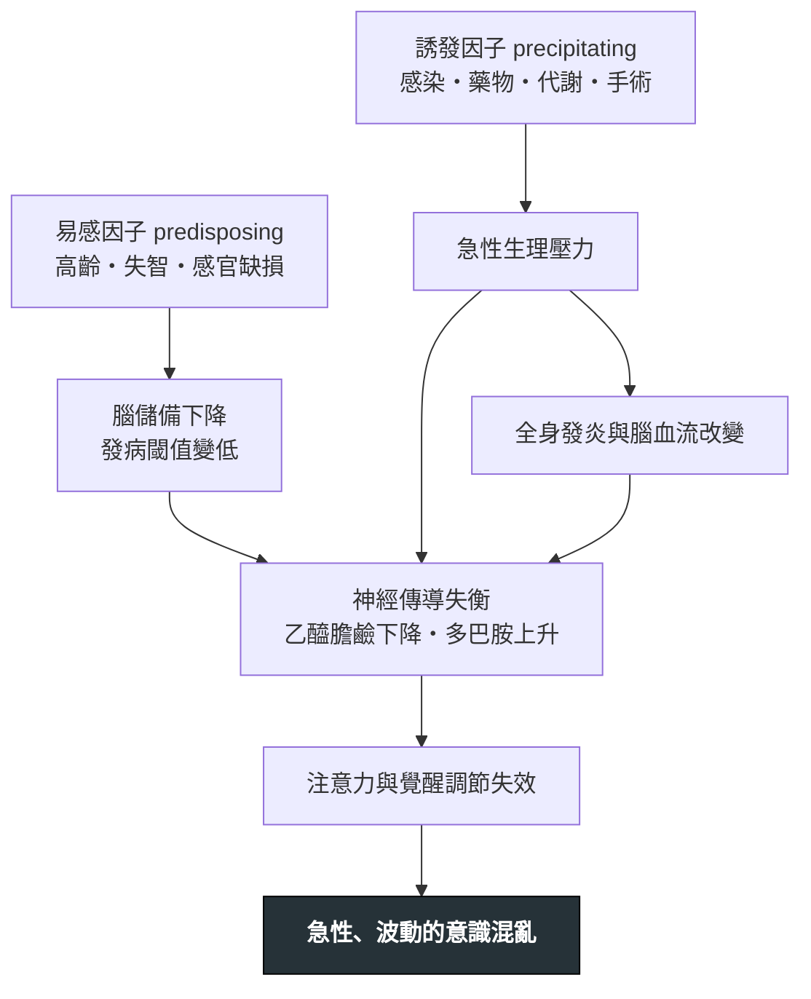

---
tags:
  - Med/Disease/General
  - Med/Disease/Neuro
  - syndrome
  - delirium
  - 禁忌
aliases: [Delirium, 譫妄, 急性意識混亂, Acute confusional state, ICU delirium, Sundowning]
created: 2026-07-27
updated: 2026-07-27
status: 可用
source: 老年醫學與重症譫妄處置框架；DSM-5-TR 急性神經認知障礙定義；CAM 四項特徵與判定規則、CAM-ICU；術後與重症譫妄指引（非藥物介入為第一線、抗精神病藥與約束的界線）；I WATCH DEATH 誘因助記
cssclass: clinical-note
presents_as:
  - "[[Fever]]"
  - "[[Dyspnea]]"
diagnosed_by:
  - "[[Arterial blood gas]]"
  - "[[Urinalysis]]"
differential:
  - "[[Dementia]]"
  - "[[Alcohol withdrawal]]"
  - "[[Wernicke encephalopathy]]"
  - "[[Hepatic encephalopathy]]"
  - "[[Hypoglycemia]]"
complication:
  - "[[Pneumonia]]"
---

# Delirium ｜ 譫妄 · Acute confusional state

> [!abstract] 一句話總覽
> 譫妄是**急性發生、一天之內起伏波動的注意力與意識障礙**，本質上就是**「腦部的器官衰竭」**。它是**症狀不是診斷**——看到譫妄的第一件事是回頭找身體出了什麼問題（感染、藥物、代謝、缺氧、尿滯留），**不是給一支鎮靜劑把病人壓下去**。

> [!tip] 30 秒行動卡
> **診斷關鍵**：**急性起病 ＋ 一天內波動 ＋ 注意力不集中**，三個湊齊就是譫妄。床邊 30 秒的動作是**請他從十二月倒背月份**。家屬或護理師說出「**跟昨天不一樣**」，就是全篇最有價值的一句話。
> **治療骨架**：**找誘因並移除**（先驗血糖 → 翻藥歷 → 摸膀胱問排便）→ **非藥物多成分介入是第一線** → **藥物只用在病人有立即危險、非藥物無效時**，最低劑量、最短時間。
> **絕對不可**：意識改變不驗血糖；非戒斷性譫妄給 benzodiazepine；用約束取代找病因；把 hypoactive delirium 當成憂鬱或「今天比較安靜」。

---

## 定義與定位

| 項目 | 重點 |
|---|---|
| 本質 | **急性腦功能衰竭**——注意力 (attention) 與覺醒程度 (arousal) 的整體失調；**核心是注意力，不是記憶** |
| **不是什麼** | **不是最終診斷，是一個徵候群**。病歷上只寫「delirium」而沒寫誘因，等於什麼都沒診斷 |
| 起病與病程 | **數小時到數天**內發生；**一天之內波動**，典型**傍晚與夜間加重（sundowning）** |
| 好發族群 | **高齡（尤其 ≥ 65 歲）**、已有 [[Dementia]]、**術後**（髖部骨折、心臟手術）、**ICU 與插管中**、多重用藥、**視聽覺缺損（感覺剝奪）**、脫水與營養不良、入院前已有失能 |
| 可逆性 | **原則上可逆**，但**不是隔天就好**——見〈併發症與預後〉 |
| 分類位置 | 神經認知障礙的**急性端**；慢性端是 [[Dementia]]。兩者**經常並存**——失智是譫妄最強的易感因子 |

## 病因與機制

> [!tip] 兩因子模型：底子 × 刺激
> 譫妄不是「某個病因直接造成」，而是**易感因子 (predisposing) 與誘發因子 (precipitating) 相乘**的結果：**底子好的人**（年輕、認知正常）要**很大的刺激**才會譫妄（敗血性休克、大手術、嚴重代謝異常）；**底子差的人**（高齡合併失智、多重共病、聽不見看不清）**一顆安眠藥、一次便秘、一條新插的尿管**就足以引爆。
> 兩個推論：**① 病人愈老、認知愈差，愈要在小事上找誘因**——不要因為「只是輕微泌尿道感染」就覺得不合理；**② 誘因常常不只一個**，找到一個不代表找完了。

*誘因用 **I WATCH DEATH** 掃一遍：Infection／Withdrawal／Acute metabolic／Trauma／CNS pathology／Hypoxia／Deficiencies／Endocrinopathies／Acute vascular／Toxins-drugs／Heavy metals。*

| 字母 | 類別 | 具體要想到的 |
|---|---|---|
| **I** | Infection 感染 | [[UTI]]、[[Pneumonia]]、[[Sepsis]]、膽道感染、腦膜炎；**高齡感染可以不發燒，只以譫妄表現**（見 [[Fever]]） |
| **W** | Withdrawal **戒斷** | **酒精（[[Alcohol withdrawal]]）、benzodiazepine、opioid、nicotine**；**入院第 2–4 天突然躁動先想這個** |
| **A** | Acute metabolic 急性代謝 | [[Hypoglycemia]]、[[Hyponatremia]]、[[Hypercalcemia]]、尿毒症、[[Hepatic encephalopathy]]、酸鹼異常 |
| **T** | Trauma 外傷與術後 | 頭部外傷、**跌倒後的慢性硬腦膜下血腫**、大手術後（髖部骨折、心臟手術最高風險） |
| **C** | CNS pathology 中樞病變 | 中風、顱內出血、腫瘤、**癲癇後狀態與非痙攣性癲癇重積** |
| **H** | Hypoxia 缺氧 | 低血氧、二氧化碳滯留、[[Heart failure]]、[[ACS]]、肺栓塞、嚴重 [[Anemia]]、[[Shock]] |
| **D** | Deficiencies 營養缺乏 | **thiamine（[[Wernicke encephalopathy]]）**、B₁₂、葉酸；長期酗酒或術後長期禁食者 |
| **E** | Endocrinopathies 內分泌 | 甲狀腺功能過高或過低、腎上腺功能不全、血糖劇烈波動 |
| **A** | Acute vascular 急性血管 | 高血壓腦病變、腦部低灌流、心律不整（[[Atrial fibrillation]] 快速心室反應） |
| **T** | Toxins / drugs **藥物** | **最重要的一格**，見下方 |
| **H** | Heavy metals 重金屬 | 少見；有職業暴露或民俗療法史才想 |

> [!danger] 兩類最常被漏掉，偏偏又最好處理
> **① 藥物——先翻藥歷，再開檢查。** **Anticholinergic**（抗組織胺如 diphenhydramine、三環抗憂鬱劑、oxybutynin、部分止吐藥）、**benzodiazepine 與 Z-drug**、**opioid**、**類固醇**、抗癲癇藥、抗巴金森藥、H₂ blocker。重點不只是「有沒有這些藥」，而是 **anticholinergic 負擔會累加**——五種弱效藥加起來就足以造成譫妄；**最近 24–72 小時新加或加量的藥嫌疑最大，突然停掉的藥（酒、安眠藥）嫌疑一樣大**。
> **② 尿滯留與便秘。** 不太能表達的老人家「莫名躁動」，非常高比例是**膀胱脹到肚臍**或**好幾天沒解便**——**摸下腹 → 膀胱超音波掃描 → 問最後一次排便**，三個動作、零成本，處理完常常當場就安靜下來。
> 再加上**未被評估的疼痛**（術後痛、骨折）與**環境因素**（約束帶、各種導管、日夜顛倒、眼鏡助聽器被收走）：這四類是值班最常見、也最容易矯正的誘因。

## 臨床表現

| 亞型 | 表現 | 出現頻率與被發現的機率 | 陷阱 |
|---|---|---|---|
| **Hyperactive 躁動型** | 躁動不安、拔管拔線、吵著下床回家、**幻覺與妄想明顯**、大聲喊叫 | **最少見**，卻**最容易被發現**——因為它會吵到別人 | 容易被當成「單純的精神症狀」處理掉，而略過找病因 |
| **Hypoactive 低活動型** | **嗜睡、動作變慢、話變少、目光呆滯、不主動進食**、對答遲緩 | **最常見**（約佔一半），卻**最常被完全漏掉**；**預後不會比躁動型好** | **被誤認為憂鬱、疲倦、失智惡化，或「今天比較乖、比較好照顧」** |
| **Mixed 混合型** | 一天內在上述兩者間切換；夜間偏躁動、白天偏嗜睡 | 常見；日夜班各自只看到一半 | 白班說「還好」、夜班說「亂了一整晚」——**這個落差本身就是診斷線索** |

> [!danger] 全篇最重要的反直覺：安靜的那個病人才是危險的
> **Hypoactive delirium 最常見（約佔一半）、最常被漏診，而且預後不會比躁動型好。** 原因很單純：**它不製造麻煩**——病人安靜躺著、不拔管、不按鈴，護理紀錄寫「病人休息中」，查房時看起來「今天比較配合」。
> **反射動作**：只要有人說「他今天比較安靜／比較沒精神／比較不想吃」，就把它當成**警訊而不是好消息**，走過去做一次注意力測試。反過來也一樣：**被照會來看「老年憂鬱」的住院病人，第一件事是先排除譫妄**——憂鬱不會急性起病、不會一天之內波動、注意力也可以被喚起。

- **其他常見表現**：**視幻覺**（看到不存在的人或動物）與被害妄想、日夜節律顛倒、情緒起伏大、語無倫次或答非所問
- **少見但重要**：以**跌倒**、**突然不吃不喝**、**新出現的尿失禁**為唯一表現的老年病人——這些「非特異老年症候群」常常就是譫妄的門面

→ 相關主訴流程：[[Fever]]、[[Dyspnea]]

![[assets/delirium-subtypes.jpg|760]]
*圖下半部是三種 psychomotor subtype：hyperactive＝躁動、活動增加；hypoactive＝嗜睡、低活動、語速與說話量下降、對環境覺察減少；mixed＝24 小時內兩端交替。臨床上最容易漏掉的是右側那個「安靜、低警醒」的 hypoactive delirium。Source: [OpenStax, *Psychiatric-Mental Health Nursing*, Figure 24.3](https://openstax.org/books/psychiatric-mental-health/pages/24-4-delirium)（CC BY-NC-SA 4.0）。*

## 診斷

### CAM：四項特徵，兩個必要條件

**Confusion Assessment Method (CAM)** 是床邊最通用的工具，把診斷壓縮成四項特徵：

| 特徵 | 內容 | 怎麼問／怎麼看 |
|---|---|---|
| **① 急性起病 _或_ 病程波動** | 相對於**病人自己的基準狀態**急性改變，**或**一天之內起伏——**兩者任一即為陽性** | **一定要問家屬或原照顧者**：「他平常是這樣嗎？」拿不到基準線時，光憑護理紀錄的日夜落差也算數 |
| **② 注意力不集中** | 無法維持注意力、容易被打斷、需要重複發問 | 見下方床邊測試 |
| **③ 思考紊亂** | 答非所問、語無倫次、話題跳躍、邏輯不通 | 讓他自發講一段話 |
| **④ 意識程度改變** | 過度警醒、嗜睡、木僵——任何非「清醒且警覺」的狀態 | 觀察即可 |

> [!danger] 判定規則：①＋② 是門檻，③④ 二擇一
> **必須同時具備 ① 與 ②，再加上 ③ 或 ④ 其中一項**才算 CAM 陽性——換句話說，**注意力沒有受損就不是譫妄**；特徵①則是「急性變化」與「波動」二者有其一即可。
> **ICU 或插管無法言語的病人用 CAM-ICU**（不需口語回答的版本）：**Step 1 一定是先評 Richmond Agitation-Sedation Scale (RASS)**——**RASS −4 或 −5（深度鎮靜／無法喚醒）＝ unable to assess，直接停手、減鎮靜後再測；RASS ≥ −3 才往下做**。要記的就是四項特徵與「①＋②＋（③或④）」這條規則。

### 床邊注意力測試：30 秒做完

| 測試 | 怎麼做 | 判讀 |
|---|---|---|
| **倒背月份** | 「請從十二月往回念到一月」 | 最常用、受教育程度影響最小；念不完或跳號即為異常 |
| **倒背星期** | 認知基礎較差者改用這個 | 同上，難度較低 |
| **數字廣度 digit span** | 念一串數字請他複述；正向約 5 位、反向約 3–4 位 | **反向明顯差於正向** → 注意力受損；連續減 7 受教育程度影響大，不宜單獨用 |

> [!warning] 「意識清楚、對答如流」不等於注意力正常
> 病人可以正確說出姓名、地點、今天幾號，卻在倒背月份時三秒鐘就卡住。**Orientation（定向感）不是 attention（注意力）**——只問「這裡是哪裡、今天禮拜幾」會漏掉大量譫妄，尤其是 hypoactive 型。**一定要真的做一次注意力測試。**

### 必做的第一批檢查

**要開的檢查**：目的只有一個——**找誘因**。譫妄是**臨床診斷**，沒有任何一項檢查能確診、也沒有任何一項正常值能排除它。

| 時機 | 檢查 | 想回答的問題 |
|---|---|---|
| **床邊立刻** | **指尖血糖 finger-stick glucose** | **[[Hypoglycemia]]——最快致命也最快能逆轉的一個，永遠排第一** |
| 立刻 | 完整 vital signs ＋ SpO₂ | 發燒、低血壓（[[Shock]]）、低血氧、心搏過快 |
| 立刻 | **藥物回顧** | 近 72 小時新加或加量的藥、anticholinergic 總負擔、**突然停掉的酒精或安眠藥** |
| 立刻 | **床邊身體評估**：下腹膀胱、最後一次排便、疼痛部位 | 尿滯留、便秘、未被處理的疼痛 |
| 常規 | CBC、電解質（**含鈣**）、腎功能、肝功能 | [[Hyponatremia]]、[[Hypercalcemia]]、尿毒、[[Hepatic encephalopathy]] |
| 常規 | [[Arterial blood gas]] | 低血氧、二氧化碳滯留、酸鹼異常（判讀原理全部在那篇） |
| 常規 | [[Urinalysis]] ＋ 尿培養 | [[UTI]]——**但先看下方警語** |
| 常規 | [[Chest X-ray]] | [[Pneumonia]]、[[Heart failure]] |
| 常規 | 12 導程心電圖 | 心律不整、心肌缺血（[[EKG ischemia]]、[[Troponin]]）、**以及用藥前的 QTc 基準值** |
| 依情境 | 血液培養、TSH、B₁₂、血氨、藥物濃度、毒物篩檢 | 對應的個別誘因 |
| **依情境** | **腦部影像** | **有下列之一才做**：局部神經學缺損、頭部外傷或跌倒、抗凝血中、癲癇、全身性誘因完全找不到 |
| **依情境** | **Lumbar puncture** | **發燒併腦膜刺激徵、疑似腦膜炎或腦炎、免疫低下且原因不明才做**——不是常規 |

> [!warning] 常規腦部電腦斷層的產出極低
> 譫妄的誘因**絕大多數在腦子外面**——感染、藥物、代謝、缺氧。無適應症就送 CT，不但診斷產出低，還要把一個混亂的病人推離熟悉環境、平躺不動、甚至為此鎮靜，**反而讓譫妄惡化**。**有適應症才做**（見上表）；那段時間花在藥歷、膀胱和血糖上收穫大得多。

> [!warning] 尿液分析陽性 ≠ 找到病因
> 老年人的**無症狀菌尿 (asymptomatic bacteriuria) 非常常見**。看到膿尿就宣布「就是泌尿道感染引起的譫妄」然後停止思考，是最典型的診斷早閉——真正的誘因（新加的藥、低血鈉、尿滯留）就這樣被放過。**要有全身感染的其他證據**才把它當主因。

## 鑑別診斷

| | **Delirium 譫妄** | **[[Dementia]] 失智** | **Depression 憂鬱** | **精神病性疾患** |
|---|---|---|---|---|
| **起病** | **數小時至數天，急性** | **數月至數年，隱匿** | 數週至數月 | 多在青壯年發病，亞急性 |
| **病程** | **一天之內波動**，夜間加重 | **穩定漸進**，一般不會一天內起伏（**例外：Lewy body dementia 有顯著認知波動；血管性失智為階梯式退化**） | 持續低落，晨間較差 | 慢性病程，可急性發作 |
| **注意力** | **一定受損**（核心特徵） | **早期保留**，晚期才受損（**Lewy body dementia 例外：早期即有波動性的注意力缺損**） | **可被喚起**——鼓勵催促後做得出來 | 大致保留，可因思考干擾而分心 |
| **意識程度** | **改變**（過度警醒或嗜睡） | **清醒** | 清醒 | 清醒 |
| **幻覺** | **常見，以視幻覺為主** | 少見；**Lewy body dementia 例外**（早期即有栩栩如生的視幻覺） | 少見；重度可有情緒一致的幻覺 | **以聽幻覺為主** |
| **可逆性** | **原則上可逆**——移除誘因就改善 | 多數為進行性不可逆，**但少數可逆**（normal pressure hydrocephalus、B₁₂ 缺乏、甲狀腺低下、慢性硬腦膜下血腫、神經梅毒） | 可治療 | 可控制 |

> [!tip] 三個最實用的分辨動作
> **① 問基準線**：「他一個月前能自己出門買菜嗎？」**急性偏離基準線 ＝ 譫妄**；一直都這樣、慢慢變差 ＝ 失智。**② 測注意力**：早期失智的病人可以順利倒背月份，譫妄的不行——**這是分開兩者最快的單一動作**。**③ 看日夜落差**：問夜班「他半夜怎麼樣？」**白天晚上差很多就是譫妄**。
> **但兩者不是二選一**：失智病人合併譫妄叫 **delirium superimposed on dementia**，非常常見而且最難認（他本來就混亂）。判準仍然是同一句：**跟他自己的平常比，有沒有急性變差。**

> [!warning] 憂鬱與假性失智的雙向陷阱
> 老年憂鬱可以表現成**假性失智 (pseudodementia)**：反應慢、記不住、什麼都答「不知道」，但**注意力可以被喚起**——多花點時間鼓勵他做得出來；譫妄的病人再怎麼鼓勵都抓不住注意力。反過來的錯更常見也更危險：**把 hypoactive delirium 直接標成憂鬱**，然後開抗憂鬱劑（其中不少有 anticholinergic 作用）→ 譫妄更嚴重。**先排除譫妄，再談情緒。**

## 治療

| 順序 | 做什麼 | 重點 |
|---|---|---|
| **① 找誘因並移除** | 血糖、vital signs、藥歷、感染、電解質、缺氧、尿滯留與便秘、疼痛 | **唯一真正的治療**；誘因常不只一個，處理完一個要再掃一遍 |
| **② 非藥物多成分介入** | 見下表 | **第一線**；**每一個譫妄病人都要做**，不論躁動與否 |
| **③ 藥物** | **Haloperidol 0.25–0.5 mg**（老年起始；成人 0.5–1 mg）PO 或 IM，必要時間隔 ≥ 30–60 分鐘重複；或 quetiapine 12.5–25 mg | **只在有立即安全危險、且非藥物無效時**；最低劑量、最短時間。**IV 途徑非仿單核准、torsades 風險最高，要用需連續心電圖監測** |
| **④ 物理約束** | 只在其他方法全部失敗、且有立即傷害風險時 | **最後手段**；**約束本身會加重譫妄**——見禁忌表 |

### 非藥物介入：第一線，也是唯一真正有效的預防

| 面向 | 具體做法 |
|---|---|
| **重新定向與人** | 房內放時鐘與日曆、每次接觸先自我介紹、簡短說明現在幾點、這是哪裡、要做什麼；**家屬陪伴**、熟悉的物品、固定照顧者，減少換床換房換人 |
| **睡眠與日夜節律** | 白天拉窗簾開燈、避免白天補眠；**夜間降低燈光與噪音、集中護理操作，不要整夜把人叫醒**；不要用安眠藥換睡眠 |
| **早期活動** | 能下床就下床，不能下床就做被動關節活動；**臥床本身就是危險因子** |
| **恢復感官** | **把眼鏡與助聽器戴回去**——零成本，而且是效果最明顯的一項 |
| **水分與營養** | 主動協助進食飲水、盯脫水與便秘 |
| **移除束縛** | **拔掉不必要的導尿管、點滴、心電監視線、約束帶**——每一條線都是一個誘因 |

> [!tip] 預防遠比治療有效
> 針對高風險病人的**多成分預防計畫**（同時處理定向、睡眠、活動、視覺、聽覺、脫水六個面向）**是唯一被所有指引列為「每個高風險病人都該做」的第一線預防；藥物預防證據弱，不列為常規**。而一旦譫妄已經發生，**沒有任何藥物能讓它縮短**。
> 值班版的推論很直接：**這些事要在高風險病人還沒混亂之前就做完**，不是等半夜被 call 才開始。

### 藥物：界線要畫得非常清楚

> [!danger] Benzodiazepine 的預設答案是「不要」——例外只有這幾個，要背熟
> **酒精（[[Alcohol withdrawal]]）或 benzodiazepine 戒斷造成的譫妄**：這時候 benzodiazepine 是治療本身，而且是救命的。**除此之外的所有譫妄，benzodiazepine 都會讓它更糟**——它本身就是譫妄最常見的藥物誘因，會加深意識障礙、在老人身上造成**反常的躁動 (paradoxical agitation)**、增加跌倒與呼吸抑制。「病人很吵，先給一支讓他睡」是值班代價最大的一個反射動作。
> **例外清單**（除酒精／benzodiazepine 戒斷外）：癲癇與非痙攣性癲癇重積｜**catatonia**（lorazepam 是治療本身，而 catatonia 最常被誤標成 hypoactive delirium）｜neuroleptic malignant syndrome｜擬交感神經藥物中毒（古柯鹼、安非他命）的躁動｜**抗精神病藥有禁忌時（Parkinson disease／Lewy body dementia）**｜安寧末期的終末躁動。**這些以外，一律不給。**

| 情境 | 用什麼 | 注意 |
|---|---|---|
| **有立即傷害風險的躁動**（拔管、拔中央靜脈導管、攻擊、無法完成必要治療） | 低劑量 **haloperidol**；或 quetiapine、olanzapine、risperidone 等非典型抗精神病藥 | **給藥前先看心電圖的 QTc**；目標是「安全」不是「睡著」，給完就重評 |
| **酒精／benzodiazepine 戒斷** | **Benzodiazepine**（常用 lorazepam：半衰期短、無主要活性代謝物、肌肉注射吸收可預期）＋ thiamine | **不要拿抗精神病藥當主力**——它治不了戒斷，還降低癲癇閾值 |
| **Parkinson disease／Lewy body dementia** | 避免 haloperidol，**也避免 olanzapine 與 risperidone**（D2 拮抗仍強）；必須用藥時**首選 quetiapine 6.25–25 mg**，次選 clozapine（需監測白血球）；DLB 的精神症狀可考慮 **rivastigmine 等 cholinesterase inhibitor** | 見禁忌表 |
| **Hypoactive delirium** | **不給抗精神病藥** | 沒有安全風險就沒有用藥適應症；鎮靜只會讓他更不動、更難進食 |

> [!warning] 抗精神病藥不會治好譫妄
> 它**只壓住躁動與精神症狀**，不縮短病程、不改善功能、也不降低死亡率；同時帶來**錐體外症狀、QT 延長與 torsades de pointes、鎮靜過度與吸入性肺炎**，在失智老人身上還會**增加死亡率**。用藥三條紀律：**① 有安全適應症才開；② 從最低劑量開始；③ 每天問一次「今天可不可以停」**——太多病人的抗精神病藥就這樣一路帶出院、帶進安養機構。

## 併發症與預後

- **要盯的併發症**：**跌倒與骨折**、**吸入性肺炎**（[[Pneumonia]]）、自拔管路與非計畫性拔管、壓瘡、脫水與營養不良、**住院天數延長**、**功能退化到回不去原本的自理程度**
- **預後方向**：**譫妄不是良性事件**——即使誘因被矯正，**日後發生 [[Dementia]] 的風險上升**、**住院期間與一年內的死亡率上升**、入住長照機構的機率上升
- **反直覺**：**譫妄不是「隔天就好」**。急性期過後常留下**數週至數月**的殘留——注意力、記憶與執行功能慢慢才回來，部分高齡病人**永遠回不到原本的基準線**。出院衛教要主動告訴家屬「這需要一段時間」，並安排認知與功能追蹤

![[assets/delirium-cognitive-trajectory.jpg|760]]
*老年手術族群的平均認知軌跡：delirium 組（藍色點畫線）在一個月時下降較深，約兩個月才回升，之後 36 個月的下降斜率也較陡。這是群體平均，所以把急性期逐時、逐日的鋸齒狀波動平滑掉了；對單一病人仍要預期「急性波動＋以週到月計的恢復」，且不保證回到原基準。Source: [Inouye et al., *Alzheimer's & Dementia* 2016, Figure 1A](https://pmc.ncbi.nlm.nih.gov/articles/PMC4947419/)。*

## 禁忌與陷阱

> [!danger] 絕對不可
> | 情境 | 絕對不可 | 為什麼 | 該做什麼 |
> |---|---|---|---|
> | 任何**急性意識改變** | 沒驗血糖就開始想鑑別診斷 | [[Hypoglycemia]] 是最快致命、也最快能逆轉的一個；延遲會造成不可逆腦損傷 | **床邊指尖血糖列為第一個動作**；低就立刻矯正 |
> | **非戒斷性譫妄** | 給 benzodiazepine 讓病人「安靜下來」 | 它本身就是譫妄誘因，會加深意識障礙、造成反常躁動、呼吸抑制與跌倒 | 找誘因 ＋ 非藥物介入；真的危及安全才用低劑量抗精神病藥 |
> | 疑似**酒精或 benzodiazepine 戒斷** | 只給抗精神病藥、不給 benzodiazepine | 抗精神病藥治不了戒斷，還降低癲癇閾值 → 可能走向戒斷癲癇與 delirium tremens | **給 benzodiazepine ＋ thiamine**；thiamine 要在葡萄糖之前或同時（見 [[Wernicke encephalopathy]]） |
> | 躁動的譫妄病人 | **用物理約束取代找病因** | 約束會加重躁動與譫妄，並增加壓瘡、肢體缺血、吸入與死亡風險 | 先做非藥物介入與家屬陪伴；約束是最後手段，要有明確期限與頻繁重評 |
> | **QT 延長、併用其他延長 QT 的藥、低血鉀低血鎂** | 反射性給 haloperidol | 可誘發 torsades de pointes | **給藥前看 QTc、先矯正電解質**；必要時換藥或減量 |
> | **Parkinson disease／Lewy body dementia** | 給 haloperidol 等典型抗精神病藥 | 阻斷多巴胺會急速惡化運動症狀；Lewy body 對抗精神病藥有**嚴重敏感反應**（僵硬、意識惡化、neuroleptic malignant syndrome 樣表現） | 優先非藥物；非用不可時選錐體外症狀較少者，最低劑量最短時間 |
> | **變得安靜、嗜睡、話變少的老年住院病人** | 記成「憂鬱」或「今天比較配合」 | 這正是 hypoactive delirium 的典型樣子——**最常見、最常被漏、預後不會比較好** | **主動做注意力測試**；把「比較安靜」當成惡化訊號 |
> | 已診斷譫妄、也找到一個誘因 | 就此停止尋找其他誘因 | 誘因常同時存在（感染 ＋ 藥物 ＋ 尿滯留），只處理一個不會好 | 誘因矯正後仍不改善 → **回頭把 I WATCH DEATH 重掃一遍** |
> | 譫妄病人**新出現的局部神經學缺損** | 全部歸給「他本來就在譫妄」 | 中風、顱內出血、非痙攣性癲癇重積會被埋掉 | **重新神經學檢查 ＋ 腦部影像**，必要時加腦波 |

> [!warning] 常見錯誤
> - **把 delirium 當成最終診斷寫進病歷**——它是問題陳述的開頭不是結尾，後面一定要接誘因。
> - **自己製造誘因**——收走眼鏡助聽器、留著不必要的尿管與約束帶、整夜開燈量血壓；**抗精神病藥開了沒人停**，一路帶進安養機構。

## 相關連結

- [[Dementia]] — 最重要的鑑別
- [[Sepsis]] · [[UTI]] · [[Pneumonia]] · [[Fever]] — 最常見誘因
- [[Hypoglycemia]] · [[Hyponatremia]] · [[Hypercalcemia]] · [[Hepatic encephalopathy]] — 代謝性誘因
- [[Alcohol withdrawal]] · [[Wernicke encephalopathy]] — 戒斷與 thiamine
- [[Arterial blood gas]] · [[Dyspnea]] — 缺氧與酸鹼
- [[Shock]] — 腦灌流不足
- [[禁忌選項]] — 上表已收錄
