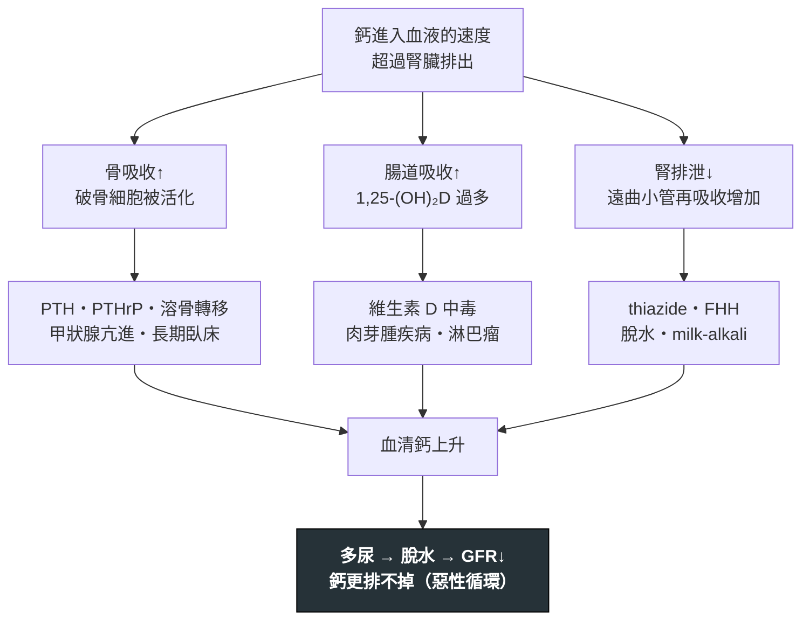

---
tags:
  - Med/Disease/General
  - Med/Disease/Endo
  - hypercalcemia
  - 禁忌
aliases: [Hypercalcemia, 高血鈣, 高鈣血症, 惡性腫瘤高血鈣, Hypercalcemia of malignancy]
created: 2026-07-27
updated: 2026-07-27
status: 可用
source: 內分泌／電解質鑑別框架；惡性腫瘤高血鈣與原發性副甲狀腺亢進處置共識；Harrison's 與 UpToDate 高血鈣章節（白蛋白校正、CCCR 切點、藥物起效時間均已查證）
cssclass: clinical-note
presents_as:
  - "[[Delirium]]"
  - "[[Abdominal pain]]"
  - "[[Nephrolithiasis]]"
diagnosed_by:
  - "[[Arterial blood gas]]"
  - "[[UPCR UACR]]"
treated_by:
  - "[[Dialysis]]"
differential:
  - "[[Primary hyperparathyroidism]]"
  - "[[Multiple Myeloma]]"
  - "[[Sarcoidosis]]"
  - "[[Tuberculosis]]"
complication:
  - "[[Acute kidney injury]]"
  - "[[Nephrolithiasis]]"
  - "[[Acute pancreatitis]]"
  - "[[Delirium]]"
  - "[[Shock]]"
---

# Hypercalcemia ｜ 高血鈣 · 高鈣血症

> [!abstract] 一句話總覽
> 高血鈣的鑑別幾乎全部由**一個檢驗值分成兩半——parathyroid hormone (PTH)**。PTH 高、或在高血鈣下「不該正常卻正常」＝ 沒被抑制 → **副甲狀腺來源**；PTH 被壓到很低 → **惡性腫瘤或其他**。**門診看到的多半是前者**（健檢發現、無症狀、鈣輕微升高），**住院看到的多半是後者**（已知癌症、鈣升得快、症狀明顯）。先驗 PTH，鑑別診斷立刻砍掉一半。

> [!tip] 30 秒行動卡
> **診斷關鍵**：先確認是真的高——低白蛋白要校正、重症與腎衰竭者直接驗 **ionized calcium**。接著**驗 intact PTH**：這一步決定後面所有動作。PTH 低 → 驗 **parathyroid hormone-related protein (PTHrP)、25-OH-D、1,25-(OH)₂D、serum protein electrophoresis (SPEP)**；PTH 高 → 驗 **24 小時尿鈣**排除 familial hypocalciuric hypercalcemia (FHH)。
> **治療骨架**：**等張生理食鹽水積極補液 →（有症狀或重度）calcitonin 橋接 → bisphosphonate 或 denosumab 撐住 → 治本**（副甲狀腺切除／治療原發癌／停掉肇事藥物）。
> **絕對不可**：容積還沒補足就給 loop diuretic；繼續給 thiazide、鈣片、維生素 D；把 FHH 當原發性副甲狀腺亢進送去開刀；用 digoxin 的病人放著高血鈣不管；只看總鈣不看白蛋白。

---

## 定義與定位

| 項目 | 重點 |
|---|---|
| 本質 | **骨吸收、腸道吸收、腎臟再吸收**三條路其中一條（或多條）失控，超過腎臟的排泄上限 |
| **血中三種形式** | **約 50% 游離態（ionized，唯一有生理活性）／40% 結合於白蛋白／10% 與 citrate、phosphate 等陰離子結合** |
| **白蛋白校正公式** | **校正鈣（mg/dL）＝ 測得總鈣 ＋ 0.8 ×（4.0 − albumin g/dL）** |
| 分類位置 | 電解質異常。分類的第一刀是 **intact PTH**，不是病史也不是症狀 |
| 好發族群 | **門診**：停經後女性（[[Primary hyperparathyroidism]]）／**住院**：已知惡性腫瘤者 |

> [!danger] 校正公式不是萬用的——重症與腎衰竭者要直接驗 ionized calcium
> 公式假設「白蛋白與鈣的結合行為是穩定的」；在**重症、大量輸液、酸鹼異常、嚴重低白蛋白（< 3.0 g/dL）、慢性腎病**身上這個假設會塌掉。方向要記住：**低白蛋白時公式傾向高估 ionized calcium** → 造成**假性的「高血鈣」**與漏掉的低血鈣。
> 所以只要臨床決策要靠這個數字（要不要給 bisphosphonate、要不要洗腎），就**直接驗 ionized calcium**——多數醫院的血氣分析儀會同時報，抽一管就有（[[Arterial blood gas]]）。**最新立場已建議檢驗室不要再常規報告「校正鈣」。**

| 分級（校正鈣） | 數值 | 處置急迫性 |
|---|---|---|
| **輕度** | **10.5–11.9 mg/dL** | 多半無症狀。**不急著降鈣**，重點是找病因、停掉肇事藥、衛教避免脫水 |
| **中度** | **12.0–13.9 mg/dL** | 看**症狀**與**上升速度**決定。有症狀就住院補液 |
| **重度／高血鈣危象** | **≥ 14.0 mg/dL** | **住院、立刻靜脈補液 ＋ calcitonin ＋ bisphosphonate**，同時找病因 |

## 病因與機制

> [!warning] 最後那個惡性循環，就是「先補液」的全部理由
> 高血鈣會**干擾腎小管對 antidiuretic hormone (ADH) 的反應** → 腎源性尿崩 → 多尿 → 脫水 → 腎絲球過濾率下降 → 鈣排得更少 → 鈣更高。所以**幾乎每一個症狀性高血鈣的病人都是嚴重脫水的**——這不是併發症，是機制本身的一部分，也是為什麼治療的第一步永遠是生理食鹽水，而不是任何一種降鈣藥。

![[assets/calcium-homeostasis-axis.jpg|760]]
*PTH／calcitriol 鈣恆定軸：PTH 增加腎鈣再吸收、腸道吸收與骨鈣動員；calcitriol 也促進腸吸收與骨動員，而血鈣與 calcitriol 反過來抑制 PTH。圖下方標出 steroids 主要壓低 calcitriol-mediated calcium absorption／production 這一軸。延伸到惡性腫瘤時，**PTHrP 與 PTH 共用 PTH1R**，因此主要模仿 PTH 在骨與腎的作用。Source: [Çetin et al., *Front Endocrinol* 2023, Figure 1](https://pmc.ncbi.nlm.nih.gov/articles/PMC10073684/)（CC BY 4.0）；PTHrP–PTH1R connection: [Datta & Abou-Samra, *Front Biosci* 2009](https://pmc.ncbi.nlm.nih.gov/articles/PMC2723940/)。*

### 病因表：先分成 PTH 兩半

**PTH 依賴型**（PTH 高，或在高血鈣下未被抑制）

| 病因 | 線索 |
|---|---|
| **[[Primary hyperparathyroidism]]** 原發性副甲狀腺亢進 | **門診高血鈣最常見的原因**。多為單一腺瘤；病程以年計、鈣輕度升高、常是健檢意外發現；**磷偏低** |
| Tertiary hyperparathyroidism | 長期慢性腎病／[[Dialysis]] 病人的副甲狀腺**變成自主分泌**，即使腎移植後仍持續 |
| **Familial hypocalciuric hypercalcemia (FHH)** | 體染色體顯性、**calcium-sensing receptor (CASR) 功能失能突變**；年輕、無症狀、家族多人高血鈣、**尿鈣低**。**開刀無效** |
| 副甲狀腺癌 | 罕見。鈣常 > 14 mg/dL、PTH 極高、頸部可摸到腫塊 |
| **Lithium 相關副甲狀腺亢進** | 提高 CASR 設定點 → PTH 不被抑制。生化長相與 [[Primary hyperparathyroidism]] 一模一樣（鈣高、PTH 不低、**尿鈣偏低**）。**逾半數為多腺體疾病**，定位影像常陰性；先問藥史再談開刀 |

**PTH 非依賴型**（PTH 被抑制）

| 分類 | 病因 | 線索 |
|---|---|---|
| **惡性腫瘤 ①** | **PTHrP 分泌型（humoral hypercalcemia of malignancy）——四型中最常見** | 鱗狀細胞癌（肺、頭頸、食道）、腎細胞癌、乳癌。**PTH 低、PTHrP 高**；骨掃描可能乾淨 |
| **惡性腫瘤 ②** | **溶骨性骨轉移** | 乳癌、[[Multiple Myeloma]]；影像見溶骨病灶，常伴骨痛與病理性骨折 |
| **惡性腫瘤 ③** | **1,25-(OH)₂D 分泌型——見於淋巴瘤** | [[DLBCL]]、[[Hodgkin Lymphoma]]、[[Follicular Lymphoma]]。腫瘤細胞自帶 1α-hydroxylase；**對類固醇反應好** |
| **惡性腫瘤 ④** | 異位 PTH 分泌 | **極罕見**。生化上像副甲狀腺亢進，但腺體正常 |
| 維生素 D 過多 | 維生素 D 中毒（保健食品過量） | **25-OH-D 極高**；病人常不覺得那是「藥」 |
| 維生素 D 過多 | **肉芽腫疾病**：[[Sarcoidosis]]、[[Tuberculosis]]、黴菌感染 | 巨噬細胞的 **1α-hydroxylase 活性升高** → **1,25-(OH)₂D 高而 25-OH-D 不高**；常伴 [[Fever]]、體重減輕 |
| 藥物 | **Thiazide**（減少遠曲小管排鈣，同時升尿酸 → [[Gout]]）、維生素 A 過量、teriparatide | 停藥後 1–3 個月重驗 |
| 其他 | **Milk-alkali syndrome**（大量鈣片＋制酸劑） | **高血鈣 ＋ 代謝性鹼中毒 ＋ 腎損傷**三聯——現在多見於長期吃鈣片的骨鬆病人 |
| 其他 | 甲狀腺亢進 | 甲狀腺素直接刺激骨吸收；多為輕度 |
| 其他 | **長期臥床／制動** | 骨吸收 > 骨形成；在**本來骨轉換就快**的人（青少年、Paget、已有骨轉移）才明顯 |
| 其他 | 腎上腺不全 | 常同時有低血壓、低血鈉、對輸液反應差 |

## 臨床表現

| 口訣 | 系統 | 表現 |
|---|---|---|
| **Stones** | 腎 | [[Nephrolithiasis]] 腎結石、nephrocalcinosis 腎鈣化、腎源性尿崩、[[Acute kidney injury]] |
| **Bones** | 骨 | 骨痛、骨質疏鬆、病理性骨折；重度副甲狀腺亢進可見 osteitis fibrosa cystica |
| **Groans** | 腸胃 | 便秘（最常見）、噁心嘔吐、食慾差、[[Abdominal pain]]、消化性潰瘍、[[Acute pancreatitis]] |
| **Thrones** | 泌尿 | 多尿、夜尿、口渴——結果是**嚴重脫水**，重度者可進展為低血容性 [[Shock]] |
| **Psychiatric overtones** | 神經精神 | 倦怠、憂鬱、注意力差、肌肉無力、意識混亂 → 表現為 [[Delirium]]；極重度可昏迷 |

- **典型**：無症狀，健檢或例行生化意外發現（尤其原發性副甲狀腺亢進）
- **提示性**：已知癌症病人突然變得倦怠、便秘、意識混亂——**先驗鈣，不要先歸因於癌症本身或止痛藥**
- **少見但重要**：以急性胰臟炎、反覆腎結石、或無法解釋的譫妄為第一個表現

> [!danger] 反直覺：症狀嚴重度取決於「上升速度」，不是絕對值
> 同樣是 13 mg/dL：**原發性副甲狀腺亢進**的病人可能爬了三年才到、身體已完全適應，**照常上班、什麼症狀都沒有**；**惡性腫瘤高血鈣**的病人可能兩週內從 9.5 衝到 13，**已經意識混亂、脫水、躺在急診**。
> 所以**不能用數字決定要不要積極治療**，判準是「**有沒有症狀 ＋ 升得多快**」——一個 12.5 但兩天內冒上來又意識改變的病人，比一個穩定 13.5 的無症狀病人急得多。反過來也成立：慢性穩定的輕度高血鈣**不需要在急診處理**，該做的是查因與門診追蹤。

**EKG**：最典型的是 **QT interval 縮短**（主要是 ST 段被壓縮）。極重度時可見 PR 延長、QRS 增寬、心搏過緩，甚至心搏停止。**用 digoxin 的病人特別危險**（見下方禁忌表）。

→ 相關主訴流程：[[Delirium]]、[[Abdominal pain]]（Workup）

## 診斷

> [!note] 診斷流程：確認 → 驗 PTH → 分兩半
> **① 確認真的高**：重驗一次校正鈣（止血帶綁太久、脫水都會假性偏高）；**重症、低白蛋白、腎衰竭 → 直接驗 ionized calcium**。**② 驗 intact PTH**——這是唯一的分岔點，其他檢查都等它的結果。
> **③ PTH 高，或「數值在正常範圍但高血鈣時本來就該被壓低」**（＝未被抑制）→ 走副甲狀腺路線：**24 小時尿鈣 ＋ calcium/creatinine clearance ratio (CCCR)** 先排除 FHH，再做定位影像（頸部超音波、sestamibi scan）。
> **④ PTH 被抑制**（通常 < 20 pg/mL）→ 走惡性與維生素 D 路線：**PTHrP、25-OH-D、1,25-(OH)₂D、SPEP ＋ 血清游離輕鏈 (serum free light chain)、影像**。

| 檢查 | 什麼時候開 | 怎麼讀 |
|---|---|---|
| 校正鈣／**ionized calcium** | 一律 | 確認診斷；重症與腎衰竭以 ionized 為準 |
| **Intact PTH** | **一律，而且是第一個** | **高或未被抑制 → 副甲狀腺／lithium；被抑制 → 其他** |
| **PTHrP** | PTH 被抑制時 | 升高 → humoral hypercalcemia of malignancy |
| 25-OH-D | PTH 被抑制時 | 極高 → 維生素 D 中毒 |
| **1,25-(OH)₂D** | PTH 被抑制時 | 升高而 25-OH-D 不高 → 淋巴瘤、[[Sarcoidosis]]、[[Tuberculosis]] |
| **SPEP ＋ 血清游離輕鏈 ＋ 尿液免疫固定電泳** | PTH 被抑制、又有貧血／腎損傷／骨痛 | [[Multiple Myeloma]]；尿蛋白判讀見 [[UPCR UACR]] |
| **24 小時尿鈣 ＋ CCCR** | **PTH 高或未被抑制時**（開刀前必做） | **CCCR < 0.01 支持 FHH** |
| 磷、ALP、Cr／eGFR、鎂 | 一律 | **低磷**支持 PTH／PTHrP 在作用；Cr 上升 ＝ [[Acute kidney injury]] |
| TSH、free T4、早晨 cortisol | 前面都沒答案時 | 甲狀腺亢進、腎上腺不全 |
| 影像（CXR、CT、骨掃描、乳房／攝護腺篩檢） | 疑似惡性 | 找原發灶與骨轉移 |

**CCCR 怎麼算**：**（尿鈣 × 血清肌酸酐）÷（血清鈣 × 尿肌酸酐）**，尿與血同時採。

![[assets/hypercalcemia-diagnostic-algorithm.jpg|760]]
*先確認 adjusted／ionized calcium，再以 intact PTH 作第一個分岔。PTH 高或在高血鈣下「不適當地正常」都走左側：尿鈣／CCCR 分 FHH 與 primary／tertiary hyperparathyroidism；PTH suppressed 才走右側：惡性腫瘤（PTHrP、myeloma／SPEP、骨轉移、lymphoma／1,25-(OH)₂D）與其他內分泌、肉芽腫、制動、藥物病因。圖中 CCR 的概念對應本文使用的 CCCR；臨床仍以本文列出的 `<0.01` 與 `>0.02` 解讀。Source: [Nadarajah et al., *Cureus* 2024, Figure 2](https://pmc.ncbi.nlm.nih.gov/articles/PMC11492973/)（CC BY 4.0）。*

### FHH vs Primary hyperparathyroidism：這兩個一定要分開

| | **Primary hyperparathyroidism** | **FHH** |
|---|---|---|
| 機轉 | 副甲狀腺腺瘤**自主分泌 PTH** | **CASR 功能失能突變**，體染色體顯性——腺體是無辜的 |
| 血清 PTH | 高或未被抑制 | 高或未被抑制（**兩者長得一樣，靠 PTH 分不出來**） |
| 血鈣 | 輕–中度升高，**多年會慢慢進展** | **輕度、終身穩定**——翻舊資料常發現十年前就這個數字 |
| **24 小時尿鈣** | 正常或偏高 | **低**（腎小管把鈣抓回去） |
| **CCCR** | 一般 **> 0.02** | **< 0.01 支持 FHH** |
| 年齡與家族史 | 多為停經後女性 | **年輕即發病、家族多人有高血鈣** |
| 併發症 | 腎結石、骨質疏鬆 | **幾乎沒有**——這是良性狀態 |
| **處置** | 符合條件者**副甲狀腺切除可治癒** | **不開刀、不治療、只追蹤** |

> [!warning] CCCR 有灰區，不要只憑一個數字送病人進開刀房
> **0.01–0.02 是灰區，兩邊都有相當比例落在其中——CCCR 支持診斷，不能單獨定案。** 真正的三根支柱是：**① 家族史 ② 過去多年的鈣值是否一路穩定 ③ CCCR**；三者都指向 FHH 而仍猶豫時做 **CASR 基因檢測**，這比開一次無效的刀便宜太多。
> 另外：**維生素 D 缺乏會把尿鈣壓低**，讓真正的副甲狀腺亢進看起來像 FHH——驗尿鈣前先看 25-OH-D。

## 鑑別診斷

| 要排除的 | 支持它的線索 | 怎麼排除 |
|---|---|---|
| [[Primary hyperparathyroidism]] | 無症狀、健檢發現、鈣輕度升高、病程數年、**磷低** | **PTH 高／未被抑制 ＋ 尿鈣不低** |
| 惡性腫瘤高血鈣 | **鈣在數週內快速上升**、症狀明顯、體重減輕、已知癌症 | **PTH 被抑制 ＋ PTHrP 或影像** |
| FHH | 年輕、家族史、終身輕度穩定高鈣、無併發症 | **24 小時尿鈣低、CCCR < 0.01** |
| [[Multiple Myeloma]] | 貧血（[[Anemia]]）、腎損傷、骨痛、溶骨病灶、ESR 高 | SPEP、血清游離輕鏈、骨髓檢查 |
| [[Sarcoidosis]] ／ [[Tuberculosis]] | 咳嗽、發燒、雙側肺門淋巴結、體重減輕 | **1,25-(OH)₂D 高**、影像、病理／抗酸染色 |
| 維生素 D 或鈣片過量 | 保健食品史、長期制酸劑 | 25-OH-D 高；milk-alkali 另有**代謝性鹼中毒** |
| Thiazide／lithium | 用藥史 | 停藥後 1–3 個月重驗鈣與 PTH |
| **Pseudohypercalcemia 假性高血鈣** | 高白蛋白（脫水）、骨髓瘤的 M protein 結合鈣、止血帶綁太久 | **ionized calcium 正常** |

## 治療

| 階梯 | 處置 | 起效時間 | 重點 |
|---|---|---|---|
| **① 補液（永遠的第一步）** | **等張生理食鹽水 0.9% NaCl 積極靜脈輸注** | 數小時 | 病人幾乎都嚴重脫水。恢復腎絲球過濾率＋抑制腎小管再吸收鈣。**輸液速度依心腎功能與尿量調整** |
| **② Calcitonin** | 皮下或肌肉注射 | **數小時內（最快的一個）** | **48–72 小時後 tachyphylaxis**（受體 downregulation）→ **只是橋接**，撐到 bisphosphonate 起效為止，不要一直用下去 |
| **③ Bisphosphonate** | **Zoledronic acid**（首選）或 pamidronate 靜脈輸注 | **24–72 小時起效、4–7 天達最大效果** | 抑制破骨細胞，效果可持續數週。**腎功能不佳要減量／延長輸注時間**；嚴重腎衰竭改用 denosumab |
| ④ **Denosumab** | 皮下注射（惡性腫瘤高血鈣用 120 mg） | 數日 | 用於 **bisphosphonate 無效或腎衰竭**者；劑量不需依腎功能調整，**但 eGFR < 30 或透析病人有嚴重低血鈣的黑框警示、可致死**。給藥前先補足 25-OH-D 與鎂，給藥後 1–2 週密集追鈣；停藥後另有鈣反彈。**現行指引已把它與 IV bisphosphonate 並列第一線** |
| ⑤ **Glucocorticoid** | Prednisolone 口服／靜脈（20–60 mg/day） | 2–5 天 | **主要對 1,25-(OH)₂D 過多型有效**：淋巴瘤、肉芽腫疾病、維生素 D／A 中毒。**[[Multiple Myeloma]] 也有效**（直接抗腫瘤作用）。**對 PTH 型與實體腫瘤的 PTHrP 型無效** |
| ⑥ Loop diuretic | Furosemide | — | **不是常規**。只用於**補液後仍容積過載**、或心衰竭／腎衰竭撐不住輸液量的病人 |
| ⑦ **[[Dialysis]]** | 低鈣或無鈣透析液 | 數小時 | **危及生命的高血鈣 ＋ 腎衰竭或心衰竭無法承受大量輸液**時的最後手段 |
| **治本** | 副甲狀腺切除；治療原發癌；停 thiazide／鈣片／維生素 D／lithium；無法開刀者用 cinacalcet | — | **前面六項全是暫時的**。沒有治本，鈣一定會回來 |

**劑量速記**：0.9% NaCl **200–300 mL/h** 起（依心腎功能調整，目標尿量 100–150 mL/h）｜Calcitonin **4 IU/kg SC/IM q12h**（可增至 8 IU/kg q6–12h）｜Zoledronic acid **4 mg IV，輸注 ≥ 15 分鐘**｜Pamidronate **60–90 mg IV，2–4 小時**｜Denosumab **120 mg SC**｜Prednisone **20–60 mg/day**

> [!danger] 為什麼補液排第一、loop diuretic 不是
> 高血鈣的病人是**脫水**的（腎源性尿崩 → 多尿）。容積還沒補足就給 furosemide，等於把**唯一還在排鈣的路（尿量）**建立在更缺的容積上——鈣不會降，脫水與 [[Acute kidney injury]] 會更糟。
> 「furosemide 促進排鈣」是真的，但它**不是降鈣的主力**。**正確位置**：補液到容積正常**之後**，若出現 [[Dyspnea]]、[[Edema]] 等容積過載徵象（[[Heart failure]]、慢性腎病者最常見），才加進來幫忙排水。

> [!tip] 重度病人要三管齊下，不是排隊等
> 校正鈣 **≥ 14 mg/dL** 或有明顯症狀時，**補液、calcitonin、bisphosphonate 是同一時間開的**：補液幾小時內起效但幅度有限、calcitonin 撐住前 **48–72 小時**、bisphosphonate 恰好在 **24–72 小時**接手、**4–7 天**達最大效果並撐得久。**三者的時間曲線是設計來嚴絲合縫銜接的。**

## 併發症與預後

- **要盯的併發症**：[[Acute kidney injury]]、[[Nephrolithiasis]] 與腎鈣化、骨質疏鬆與病理性骨折、[[Acute pancreatitis]]、[[Delirium]]、心律不整、嚴重脫水導致的低血容性 [[Shock]]
- **治療中要盯的**：bisphosphonate 或 denosumab 之後的**低血鈣**（維生素 D 缺乏、腎功能差、副甲狀腺切除後者風險最高）、denosumab 停藥後的鈣反彈、zoledronic acid 的腎毒性
- **預後**：**惡性腫瘤高血鈣是預後不良指標**——它出現通常代表腫瘤負荷大、疾病正在進展，中位存活期以**月**計；把鈣降下來能改善症狀與意識，**但不改變腫瘤本身的病程**（跟家屬談話前要先想清楚）。相對地，**原發性副甲狀腺亢進與 FHH 的預後很好**——前者手術可治癒、後者根本不需要治療。同樣是「高血鈣」，兩端天差地遠，所以**先分兩半**不只是診斷程序，也是預後判斷。

## 禁忌與陷阱

> [!danger] 絕對不可
> | 情境 | 絕對不可 | 為什麼 | 該做什麼 |
> |---|---|---|---|
> | 高血鈣但容積尚未補足 | 先給 furosemide 等 loop diuretic | 病人本來就嚴重脫水；利尿讓 GFR 更差、鈣排得更少 | **先用 0.9% NaCl 補到容積正常**，之後才依需要加 loop |
> | 任何高血鈣病人 | 繼續給 **thiazide、鈣片、維生素 D、含鈣輸液**（如大量 lactated Ringer's） | 直接把鈣推更高，或擋住腎臟排鈣 | 全部停掉；輸液一律選 **0.9% NaCl** |
> | 高血鈣 ＋ PTH 未被抑制 | 沒驗 24 小時尿鈣就送去副甲狀腺切除 | **FHH 的問題在 CASR 受體設定點，不在腺體——切了鈣還是高** | 開刀前**一定要有 24 小時尿鈣與 CCCR ＋ 家族史**；必要時 CASR 基因檢測 |
> | 正在用 **digoxin** 的病人（[[Heart failure]]、[[Atrial fibrillation]]） | 放著高血鈣不處理，或快速把鈣拉高 | **高血鈣會增強 digoxin 毒性**（兩者都拉高細胞內鈣）→ 惡性心律不整 | 積極降鈣、監測 digoxin 濃度與 EKG；補鈣時要慢、要監測 |
> | 低白蛋白、重症、腎衰竭病人 | 只看**總鈣**就下結論或決定治療 | 白蛋白低會低估鈣；**校正公式在這些人身上不可靠** | **直接驗 ionized calcium** |
> | 重度（≥ 14 mg/dL）或明顯症狀 | 只給 bisphosphonate 就結束 | **要 24–72 小時起效、4–7 天才達最大效果**，這段空窗病人會繼續惡化 | **補液 ＋ calcitonin 橋接**，同時給 bisphosphonate |
> | 嚴重腎功能不全 | 照常規劑量與速度給 zoledronic acid | 可能進一步惡化腎功能 | 減量／延長輸注，或改 **denosumab**；危及生命時 [[Dialysis]] |
> | 意識改變的高血鈣病人 | 直接歸因「老年人本來就會譫妄」而不驗鈣 | 高血鈣是**可逆**的譫妄病因，漏掉就一直治不好 | 驗校正鈣／ionized calcium；譫妄本身的評估與處置見 [[Delirium]] |

> [!warning] 常見錯誤
> - **忘了先驗 PTH 就開始亂猜**——一個檢驗值可以砍掉一半的鑑別診斷，卻常常最後才被想到。
> - **看到 PTH「在正常範圍」就排除副甲狀腺亢進**——高血鈣時 PTH 本來就該被壓到很低，**「正常」等於不正常**。
> - **找不到原因就停下來**——鈣升得快、體重減輕、[[Anemia]]，就回頭認真找惡性腫瘤。

## 相關連結

- [[Primary hyperparathyroidism]] — 門診最常見病因
- [[Multiple Myeloma]] — CRAB 的 C
- [[Sarcoidosis]] · [[Tuberculosis]] — 1,25-(OH)₂D 型
- [[Delirium]] — 意識改變處置
- [[Dialysis]] — 適應症與時機
- [[Arterial blood gas]] — ionized calcium
- [[Shock]] — 極重度脫水
- [[Dyspnea]] · [[Edema]] — 補液過頭
- [[EKG ischemia]] — QT 縮短的鑑別
- [[禁忌選項]] — 上表已收錄
