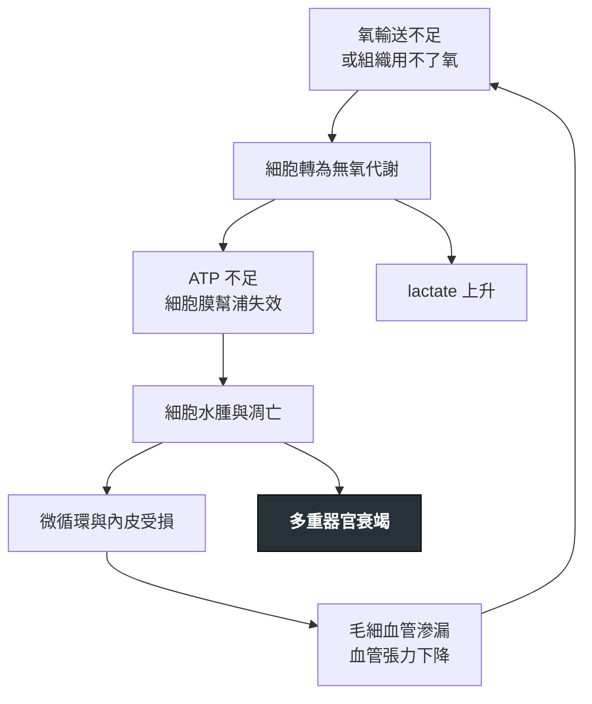

---
tags:
  - Med/Disease/General
  - syndrome
  - 禁忌
aliases: [Shock, 休克, 循環休克, Circulatory shock]
created: 2026-07-27
updated: 2026-07-27
status: 可用
source: 急重症休克分型框架；Surviving Sepsis Campaign 2026；SCAI 心因性休克分期；ESC；ATLS 11；Harrison's
cssclass: clinical-note
presents_as:
  - "[[Dyspnea]]"
  - "[[Chest pain]]"
  - "[[Abdominal pain]]"
  - "[[Fever]]"
diagnosed_by:
  - "[[Arterial blood gas]]"
  - "[[Echocardiography]]"
treated_by:
  - "[[Chest tube drainage]]"
differential:
  - "[[Sepsis]]"
  - "[[Cardiac tamponade]]"
  - "[[Pulmonary embolism]]"
  - "[[Tension pneumothorax]]"
  - "[[ACS]]"
complication:
  - "[[Delirium]]"
  - "[[Acute kidney injury]]"
---

# Shock ｜ 休克 · Circulatory shock

> [!abstract] 一句話總覽
> 休克不是「血壓低」，是**循環衰竭導致組織氧輸送不足以支應代謝需求**的狀態。四型的差別只在氧輸送鏈上斷在哪一環——**沒血、泵不動、被卡住、管子鬆掉**——而認出型別就等於知道第一線該做什麼。**血壓正常不能排除休克**。

> [!tip] 30 秒行動卡
> **診斷關鍵**：低血壓 ＋ 任何一項灌流不足（意識改變、尿量 < 0.5 mL/kg/hr、微血管回填 > 3 秒、膝蓋花斑）＝ 休克。分型靠兩個床邊動作：**摸末梢溫冷**、**看頸靜脈脹塌**，再用床邊超音波確認。
> **治療骨架**：氣道與氧合 → 兩條大管徑靜脈 → 平衡晶體液（心因性與未止血的出血例外）→ **norepinephrine 撐住 mean arterial pressure (MAP) ≥ 65 mmHg** → **同一時間找可逆病因**（感染源、缺血、出血點、阻塞）。
> **絕對不可**：obstructive shock 只調升壓藥而不解除阻塞；未止血就狂灌晶體液；右心室梗塞／填塞／張力性氣胸給 nitrate 或利尿劑；急性心因性休克給 β-blocker。

---

## 定義與定位

| 項目       | 重點                                                                                               |
| -------- | ------------------------------------------------------------------------------------------------ |
| 本質       | 氧輸送 **oxygen delivery (DO₂)** 不足以支應**氧消耗 oxygen consumption (VO₂)** → 細胞轉為無氧代謝 → lactate 上升、器官衰竭 |
| **不是什麼** | **不是「收縮壓 < 90」**。低血壓是休克常見的伴隨現象，**不是定義的一部分**                                                      |
| 分類位置     | 四型：**distributive（分布型）／cardiogenic（心因型）／hypovolemic（低血容型）／obstructive（阻塞型）**。臨床上**混合型很常見**       |
| 最常見的一型   | **Distributive**——其中又以敗血性休克為大宗                                                                   |
| 死得最快的一型  | **Obstructive**——但也是**最有機會在幾分鐘內被一個機械性動作逆轉**的（其他能秒逆轉的還有：心律不整 → 電擊；外出血 → 壓迫／止血帶）                   |

> [!danger] 血壓正常不等於沒有休克
> 血壓 ≈ **cardiac output (CO) × systemic vascular resistance (SVR)**，任一項掉下來另一項可以代償撐回正常——**血壓是最後才崩的指標，不是最早的**。
> **Compensated shock**：心輸出量已經掉了，靠頻脈與血管收縮把血壓撐在 120/80，但末梢已冷、尿量已少、脈壓已窄（**年輕人、孕婦、慢性高血壓者**最容易被騙——他平常 160，掉到 110 已經是休克）。**Cryptic shock**：血壓正常但 **lactate 已升高**。
> 所以**低血壓不能當篩檢工具，灌流指標才是**；反過來也成立——慢性低血壓而沒有灌流不足，就不是休克。

## 病因與機制

> [!tip] 一條公式推出四型
> **DO₂ ＝ CO × 動脈血含氧量**；**CO ＝ 心搏量 × 心率**，心搏量取決於**前負荷、收縮力、後負荷**。斷在哪一環就是哪一型：**前負荷不夠 → hypovolemic**；**前負荷進不去、血打不出去 → obstructive**；**收縮力不夠 → cardiogenic**；**血管張力崩掉又漏 → distributive**。
> **容易被整組忘掉的是公式的另一半**：動脈血含氧量掉下來（嚴重 [[Anemia]]、一氧化碳中毒）同樣造成氧輸送不足；細胞拿到氧卻用不了（敗血症的粒線體失能、cyanide 中毒）叫 **cytopathic**——這種病人的 **ScvO₂ 會是高的**。

| 型別 | 代表病因 |
|---|---|
| **Distributive** | **敗血症**（[[Sepsis]]，最大宗）、anaphylaxis、neurogenic（脊髓損傷、高位硬脊膜外麻醉）、adrenal crisis、肝衰竭、藥物與毒物 |
| **Cardiogenic** | 大面積心肌梗塞（[[ACS]]，尤其前壁）、**右心室梗塞**、猛爆性心肌炎、末期 [[Heart failure]]、嚴重瓣膜病變、心梗機械併發症（乳突肌斷裂、中膈破裂、游離壁破裂）、心律不整（[[Ventricular tachycardia]]、心室率極快的 [[Atrial fibrillation]]）、β-blocker／CCB 中毒 |
| **Hypovolemic** | **出血**（外傷、消化道、主動脈瘤破裂、產科、術後）；非出血性流失（嘔吐腹瀉、燒燙傷、DKA、嚴重 [[Hypercalcemia]] 造成的多尿、第三腔積液） |
| **Obstructive** | **Tension pneumothorax、cardiac tamponade、massive pulmonary embolism、auto-PEEP** 四個；少見：嚴重主動脈瓣狹窄、[[HCM]] 的流出道阻塞、心房黏液瘤 |

## 四型血行動力學對照

*欄位縮寫：**CO** 心輸出量、**SVR** 全身血管阻力、**CVP** central venous pressure（右心前負荷）、**PCWP** pulmonary capillary wedge pressure（左心前負荷）、**ScvO₂** central venous oxygen saturation（正常約 70%）。*

| 型別 | 代表病因 | CO | SVR | 前負荷 CVP／PCWP | ScvO₂ | 末梢 | 第一線處置 |
|---|---|---|---|---|---|---|---|
| **Distributive** | 敗血症、anaphylaxis、neurogenic | **↑ 或正常** | **↓↓** | ↓ 或正常 | **↑ 或正常** | **溫、紅、脈壓寬** | 輸液 ＋ **norepinephrine**；同時處理源頭（抗生素／epinephrine） |
| **Cardiogenic** | 大面積心梗、猛爆性心肌炎 | ↓↓ | ↑ | **兩者都 ↑**（**例外：右心室梗塞 CVP ↑↑ 但 PCWP 正常／偏低，且要補液不是限水**）| ↓ | 冷、濕黏、花斑 | **再灌流／矯正病因**；左心衰型輸液要極保守，norepinephrine ± dobutamine |
| **Hypovolemic** | 出血、嚴重腹瀉、燒燙傷 | ↓ | ↑ | **兩者都 ↓** | ↓ | 冷、乾、脈壓窄 | **止住流失** ＋ 補容積（出血就補血品） |
| **Obstructive** | 張力性氣胸、心包填塞、大量肺栓塞、auto-PEEP | ↓ | ↑ 或正常 | **CVP ↑**；PCWP 看阻塞位置（**大量肺栓塞的 PCWP 不高**） | ↓ | 冷、**頸靜脈怒張** | **機械性解除阻塞**——不是給藥 |

> [!tip] 這張表只要記兩件事，其餘可以推
> **① 只有 distributive 是「高輸出」**：CO 不低、SVR 崩掉 → **末梢溫、脈壓寬**；組織抽不走氧（分流 ＋ 粒線體失能）→ **ScvO₂ 偏高**。
> **② 另外三型都是「低輸出」**：CO 掉 → 交感把 SVR 拉高、血流集中核心 → **末梢冷**；組織拼命多抽氧 → **ScvO₂ 低**。剩下的差別只在**前負荷**：低血容是「沒東西可裝」（都低）、心因性是「裝進去打不出來」（都高）、阻塞型是「卡在中間」（CVP 高但 PCWP 不一定）。

> [!tip] 床邊分辨四型的最短路徑：兩個軸、四個象限
> **軸一：摸末梢**——冷 ＝ 心輸出量不夠、血流集中到核心；溫 ＝ 心輸出量還在，問題出在血管張力。**軸二：看頸靜脈**——怒張 ＝ 血堵在右心之前或之中；塌陷 ＝ 前負荷本來就不夠。
>
> | | **頸靜脈怒張** | **頸靜脈塌陷** |
> |---|---|---|
> | **末梢冷** | **Cardiogenic ／ Obstructive** | **Hypovolemic** |
> | **末梢溫** | 提示**混合型**（敗血症合併心肌抑制或右心衰竭） | **Distributive** |
>
> 落進「冷 ＋ 怒張」之後只剩一題：**是泵壞了還是被卡住？** 床邊超音波一掃就分開——**左心室不動 → cardiogenic；心包積液＋腔室塌陷 → 填塞；右心室脹大而左心室空 → 大量肺栓塞；沒有肺滑動 → 張力性氣胸**。
> **「溫的休克」不等於比較安全**：敗血性休克末梢是溫的，死亡率卻最高。

![[assets/shock-hemodynamic-profiles.svg|760]]
*典型早期血行動力學：低血容量、心因性、阻塞型都是低 CO／高 SVR／低 ScvO₂；CVP 讓「沒東西可裝」與「回流或泵被卡住」分開。分布型則是唯一典型高 CO／低 SVR／高 ScvO₂ 的一型。敗血症晚期、尚未補液或合併 septic cardiomyopathy 時可以偏離這張表，因此要把它當作**分型起點，不是硬性診斷標準**。Source data: [Siddiqui et al., *J Clin Med* 2024, Table 1](https://pmc.ncbi.nlm.nih.gov/articles/PMC11432640/)；[Jentzer et al., *JACC Advances* 2023, Table 1](https://pmc.ncbi.nlm.nih.gov/articles/PMC10606987/)（依資料重排）。*

## 臨床表現

- **典型**：心搏過快、呼吸急促、少尿、意識改變、末梢冰冷或濕黏；**低血壓常常是晚期才出現**
- **提示性**：微血管回填時間延長、**膝蓋開始的皮膚花斑**、脈壓變窄（低輸出）或變寬（distributive）、lactate 上升
- **反直覺（會讓你錯過診斷）**：
  - **Neurogenic shock 是低血壓 ＋ 心搏過緩 ＋ 末梢溫暖**——交感被截斷，代償性頻脈根本不會出現
  - **心跳可以不快**：β-blocker 使用者、老年人、心臟移植後、傳導系統疾病
  - **年輕人與孕婦血壓可以撐到失血三、四成才掉**——看起來還好的那一段，正是可以救的那一段
  - **高齡與免疫低下的敗血症**可以完全不發燒，只以意識改變或跌倒表現（見 [[Fever]]）

### 灌流指標：不用儀器就能重複量的四項

| 指標 | 怎麼看 | 為什麼有用 |
|---|---|---|
| **意識** | 躁動、混亂、嗜睡 → [[Delirium]] | 腦灌流不足最早的表現之一，零成本 |
| **尿量** | **< 0.5 mL/kg/hr** | 腎灌流的即時代表；休克病人插尿管後逐小時記 |
| **微血管回填時間 capillary refill time (CRT)** | 壓指甲床放開，**> 3 秒為異常**（部分教材用 2 秒） | 可重複、對治療有反應，**比血壓早變化**；老年、低體溫會延長 |
| **皮膚花斑 mottling** | 以**膝蓋為中心**向外擴散的網狀紫斑 | 擴散範圍愈大、預後愈差 |

![[assets/shock-mottling-score.jpg|620]]
*Mottling score 以**膝蓋中心**為起點，按向上擴散範圍由 0 到 5 分：1 分約硬幣大小，2 分不超過髕骨上緣，3 分不超過大腿中段，4 分不超過腹股溝，5 分超過腹股溝。這是面積分級，不是只看顏色深淺。Source: [Ait-Oufella et al., *Crit Care* 2013, Figure 1](https://pmc.ncbi.nlm.nih.gov/articles/PMC3848827/)（CC BY 2.0）。*

## 診斷

> [!danger] 休克是臨床診斷，不是等報告等出來的
> **不要等 lactate 回報才開始復甦**。低血壓（或不明原因的心搏過快）＋ 任何一項灌流不足，就當休克處理：**一邊復甦、一邊分型、一邊找可逆病因**，三件事同時進行。

| 立刻做 | 想回答的問題 |
|---|---|
| **床邊心臟與肺部超音波** — [[Echocardiography]] | 一次分開四型：左心室收縮力、右心室大小、心包積液、下腔靜脈、肺滑動、腹腔游離液 |
| **Lactate** | 有沒有組織缺氧；**趨勢比單一數值重要**——復甦有效的第一個客觀訊號就是 lactate 開始下降 |
| **動脈血液氣體分析** — [[Arterial blood gas]] | 酸鹼狀態、陰離子間隙、氧合。**判讀原理與計算全部寫在那一篇** |
| **ScvO₂**（已有中心靜脈導管時） | **低 → 心輸出量不足；高 → 分布型或組織用不了氧** |
| 12 導程心電圖 — [[EKG ischemia]]、[[Troponin]] | 心因性休克的病因；**下壁 ST 段抬高一定要加做右側導程 V4R** |
| 血液培養 ×2、CBC/DC、生化、凝血 | 感染源與器官功能（採檢時機見 [[Fever]]） |
| **血型與交叉配血** | 只要腦中閃過「會不會在出血」，這一項就同時開 |

> [!warning] Lactate 升高不一定等於組織缺氧
> 兒茶酚胺（**包括我們自己給的 epinephrine**）、肝衰竭、metformin、thiamine 缺乏、癲癇後、惡性腫瘤都會讓 lactate 上升。但在當下**先當灌流不足處理**；只有「復甦到位、灌流指標都回來了，lactate 還是不降」時，才回頭想這些原因。

> [!tip] 「還要不要再給水」問的是輸液反應性，不是 CVP
> **輸液反應性** ＝ 再給一次容積，心輸出量會不會真的上升。休克病人裡**大約只有一半有反應**；給了沒反應，那袋水全部變成肺水腫與組織水腫，氧合與器官灌流反而更差。
> **靜態指標（單次的 CVP、PCWP、下腔靜脈直徑）預測不了反應性**——要用**動態邏輯**：給一個可逆的容積挑戰（一小袋液體，或抬腿把下肢血液暫時借回中心），**再看心輸出量有沒有跟著變**。
> **值班版的一句話**：每給 **250–500 mL 就回床邊重評一次**灌流指標，不要一次掛 2000 mL 然後回去睡覺。

## 鑑別診斷

| 要排除的 | 支持它的線索 | 怎麼排除 |
|---|---|---|
| 單純低血壓（不是休克） | 血壓低但意識清楚、尿量正常、末梢溫暖、lactate 正常；慢性低血壓、降壓藥、透析後 | **看灌流指標，不是看數字** |
| 血管迷走神經性昏厥 | 誘因明確、平躺後迅速完全恢復、可伴心搏過緩 | 短暫且自行恢復，不會有持續的 lactate 上升 |
| **混合型休克** | 治療反應不如預期、超音波與臨床互相矛盾 | 敗血症合併心肌抑制、出血合併填塞——**四型不互斥，反應不對就重新分型** |
| Adrenal crisis | 對輸液與升壓藥都沒反應的低血壓、低血鈉、高血鉀、類固醇使用史 | **懷疑就先給 hydrocortisone**，不等抽血結果（見 [[Fever]]） |
| Anaphylaxis | 分鐘內發作、蕁麻疹、喉頭水腫、喘鳴、暴露史 | **立刻肌肉注射 epinephrine**——不是先給抗組織胺 |

## 治療

### 初始復甦：前 60 分鐘的骨架

| 順序 | 做什麼 | 目標與注意 |
|---|---|---|
| ① 氣道與氧合 | 給氧、必要時輔助通氣 | **插管本身會讓休克惡化**（見禁忌表）——能先撐住循環再插就先撐 |
| ② 血管通路 | **兩條大管徑週邊靜脈**或骨內針；同時抽血、配血 | 大量輸液靠**管徑短而粗**，不是靠中心靜脈導管 |
| ③ 容積 | **平衡晶體液優先於生理食鹽水**；每 250–500 mL 重評 | **心因性休克與尚未止血的出血是例外** |
| ④ 升壓藥 | 與輸液**同時**開始，**不必等中心靜脈導管** | 週邊給藥可作橋接，但要挑大血管並密切看有無外滲 |
| ⑤ 血壓目標 | **MAP ≥ 65 mmHg**；**≥ 65 歲者初始目標可放在 60–65 mmHg** | 同時追灌流指標與 lactate 趨勢，不是只看數字 |
| ⑥ 找可逆病因 | 床邊超音波 ＋ 病史 | **obstructive 的四個病因必須在這一步被排除掉** |

> [!warning] MAP 65 是起點，不是終點
> 訂在 ≥65 是因為常規往上追到 80–85 並不會讓多數病人更好，反而多付心律不整與升壓藥的代價——但那是**族群平均值**。
> 這個病人**血壓達標而 lactate 不降、尿量不回、花斑不退** → 對他而言就是不夠：往上調，同時回頭問「**是不是型別判錯了、還是漏了一個沒解除的阻塞**」。

### 升壓藥與強心劑

| 藥 | 主要作用 | 用在哪 | 要注意 |
|---|---|---|---|
| **Norepinephrine** | α₁ 為主 ＋ 少量 β₁ | **絕大多數休克的第一線**：敗血性、心因性、還沒分型的低血壓 | 外滲會造成組織壞死；升壓時心率上升不多，是它勝出的原因之一 |
| **Vasopressin** | V₁ 受體，不經腎上腺素受體 | **第二線加成**（NE 劑量往上爬時就加，臨床慣例約 NE 0.25–0.5 µg/kg/min） | **通常固定 0.03 U/min、不滴定；0.03–0.04 U/min 是上限，超過即屬 salvage**；末梢與腸道缺血 |
| **Epinephrine** | α 與 β 都強 | **Anaphylaxis 的第一線（肌肉注射）**；難治型休克、心跳停止 | **會推高 lactate 與血糖**——用了之後 lactate 暫時不能當灌流指標看 |
| **Dobutamine** | β₁ 為主的強心劑 | **心輸出量不足**：末梢冷、ScvO₂ 低、前負荷已補足仍灌流不良 | **會擴張血管、可能讓血壓更低**——通常要配著升壓藥用；心律不整 |
| **Dopamine** | 劑量依賴 | **已不是第一線**（見下） | 心律不整 |
| **Phenylephrine** | 純 α₁ | 少數情境：頻脈嚴重、短期橋接 | 純血管收縮會反過來壓低心輸出量 |

> [!tip] 為什麼 dopamine 不再是第一線
> **它在不同滴速是不同的藥**（低劑量偏 β、高劑量才轉 α），效果不可預測；而且**同樣的升壓效果，dopamine 的心律不整（尤其心房顫動）明顯較多，心因性休克這一群死亡率更高**——預設值因此是 norepinephrine。
> **「低劑量 dopamine 保護腎臟」已經被推翻**——不要為了尿量開它。

### Obstructive shock：四個病因，四個機械性解法

> [!danger] 這一型的共同點是「解法不在藥」
> 升壓藥只是替你買時間。**只調滴速而不解除阻塞，病人會在你調滴速的過程中死掉。**

| 病因 | 為什麼給藥沒用 | 解法 |
|---|---|---|
| **Tension pneumothorax** | 胸腔內正壓把大靜脈與縱膈壓垮，回流進不來 | **立刻針刺減壓／指式開胸，再放 [[Chest tube drainage]]**——**不等 X 光** |
| **Cardiac tamponade** | 心包內壓超過心腔舒張壓，心臟從外面被掐住 | **心包穿刺引流**；病因若是主動脈剝離或心室破裂 → 直接進開刀房（見 [[Cardiac tamponade]]、[[Aortic dissection]]） |
| **Massive pulmonary embolism** | 右心室後負荷暴增、中膈被推向左，左心吃不到血 | **全身性血栓溶解**；有禁忌或失敗 → 導管／外科取栓，並抗凝（見 [[DOAC]]） |
| **Auto-PEEP（動態肺過度充氣）** | 氣吐不完就吸下一口，肺內殘留正壓壓迫縱膈與靜脈回流 | **把病人從呼吸器上斷開，用手壓胸幫他把氣吐出來**；之後降呼吸速率、延長呼氣時間、治支氣管痙攣 |

### 另外三型的特異性處置

| 型別 | 特異性處置的核心 |
|---|---|
| **Septic shock** | **抗生素愈早愈好**——有休克時**1 小時內**給，抽完培養就給、不等結果；**源頭控制**（膿瘍引流、拔掉感染的導管、清創）常常比抗生素更決定成敗；輸液**至少 30 mL/kg 晶體液於 3 小時內**；類固醇不是每個敗血症都給，但**只要是敗血性休克（已需升壓藥）就給 IV corticosteroid，不再設升壓藥劑量門檻**——hydrocortisone 200 mg/day（50 mg q6h 或持續輸注） |
| **Cardiogenic shock** | **急性冠心症造成的 → 儘快再灌流**（見 [[ACS]]、[[CAD]]）；心律不整造成的 → 先矯正節律（[[Ventricular tachycardia]]、[[Atrial fibrillation]]）；機械併發症 → 外科；藥物難治 → 機械循環支持 |
| **Hypovolemic（出血）** | **止血優先於輸液**：壓迫／止血帶、內視鏡、栓塞、開刀。**大量晶體液會稀釋凝血因子、降低體溫、沖掉已形成的血栓**；出血就補**血品**（紅血球、血漿、血小板依比例）。外傷考慮 **tranexamic acid：必須在受傷 3 小時內給（1 小時內效益最大）；超過 3 小時反而增加出血死亡風險，不要補打**，並同時矯正**低體溫、酸中毒、凝血病**這個致死三角 |
| **Anaphylaxis** | **立刻肌肉注射 epinephrine（大腿外側）**——抗組織胺與類固醇都不能取代它，也都太慢 |
| **Neurogenic** | 輸液反應有限，早期就要用 norepinephrine 維持灌流壓；**心搏過緩**用 atropine。外傷病人**先當作出血處理**，排除出血後才歸神經性 |

## 併發症與預後

- **要盯的併發症**：急性腎損傷（可能走到 [[Dialysis]]）、急性呼吸窘迫症候群、腸道缺血與 shock liver、瀰漫性血管內凝血、[[Delirium]] 與缺氧性腦損傷、升壓藥造成的末梢與腸道缺血
- **預後因子**：**lactate 下降的速度**、需要幾種升壓藥與到什麼劑量、器官衰竭數目，以及**從發病到解決病因的時間**——抗生素、再灌流、解除阻塞三者都是以分鐘與小時計價的
- **反直覺**：**血壓被藥撐回正常不等於病人變好**。判斷有沒有改善，看的是灌流指標與 lactate 趨勢，不是螢幕上的數字

## 禁忌與陷阱

> [!danger] 絕對不可
> | 情境 | 絕對不可 | 為什麼 | 該做什麼 |
> |---|---|---|---|
> | **右心室梗塞**、[[Cardiac tamponade]]、張力性氣胸 | 給 **nitrate、利尿劑**或任何降前負荷的藥 | 這三種的心輸出量完全靠前負荷撐著，抽掉前負荷血壓當場崩掉 | **補液維持前負荷 ＋ 解除阻塞／再灌流**；下壁心梗一定要加做右側導程 V4R |
> | **出血尚未止住** | 猛灌大量晶體液把血壓「灌回正常」 | 稀釋凝血因子與紅血球、降低體溫、沖掉已形成的血栓 → 出得更多 | **止血優先**；補血品、限制晶體液、同時矯正低體溫與酸中毒 |
> | **Obstructive shock** | 只調升壓藥、不解除阻塞 | 阻塞在那裡，任何藥都只是延後死亡時間 | 針刺減壓／心包引流／溶栓／斷開呼吸器——**先把那個東西拿掉** |
> | **急性心因性休克** | 給 **β-blocker** 或其他負性肌力藥（如非二氫吡啶類 CCB） | 已經泵不動的心臟再被壓下去，心輸出量直接崩 | 先穩定循環；β-blocker 等休克解除、無容積過載後再談 |
> | 疑似**張力性氣胸** | 為了先照胸部 X 光而延後減壓 | 這是臨床診斷，等影像的那幾分鐘就是病人的命 | **立刻減壓**，再放胸管、再補影像 |
> | **敗血性休克** | 為了等培養、影像或會診而延後抗生素 | 每延遲一小時死亡率上升 | **抽完培養立刻給**，休克時 1 小時內；同時安排源頭控制 |
> | **Anaphylaxis** | 把抗組織胺或類固醇當主要治療 | 兩者都太慢，救不了喉頭水腫與循環崩潰 | **先肌肉注射 epinephrine**，其餘之後再說 |
> | 尚未引流的 [[Cardiac tamponade]] | 直接誘導插管接正壓通氣 | 胸腔內正壓 ＋ 誘導藥降血管張力 → 常在插管當下心跳停止 | **先引流／先把循環撐起來**再插管 |
> | 已在用升壓藥的休克病人 | 因為「血壓已經正常」就停止評估 | 那個血壓是藥撐出來的，灌流可能仍然不足 | 用 **lactate 趨勢、尿量、CRT、花斑**決定要不要繼續升級 |

> [!warning] 常見錯誤
> - **拿血壓當休克的篩檢工具**——代償期與 cryptic shock 的血壓是正常的；要看灌流指標。
> - **看到低血壓就無差別灌水**——心因性灌下去是肺水腫，obstructive 灌下去換不到心輸出量。
> - **忘記混合型**——治療反應不如預期時，第一件事是回頭重新分型，不是把劑量調上去。

## 相關連結

- [[Sepsis]] — 最大宗
- [[Cardiac tamponade]] · [[Pulmonary embolism]] · [[Tension pneumothorax]] — 阻塞型三代表
- [[ACS]] · [[CAD]] · [[Heart failure]] — 心因型來源
- [[Arterial blood gas]] — 酸鹼與 lactate
- [[Echocardiography]] · [[EKG ischemia]] · [[Troponin]] · [[Chest tube drainage]] — 分型與處置
- [[Fever]] · [[Dyspnea]] · [[Chest pain]] · [[Abdominal pain]] — 常見入口
- [[Delirium]] · [[Hypercalcemia]] · [[Dialysis]] — 併發症與少見來源
- [[禁忌選項]] — 上表已收錄
