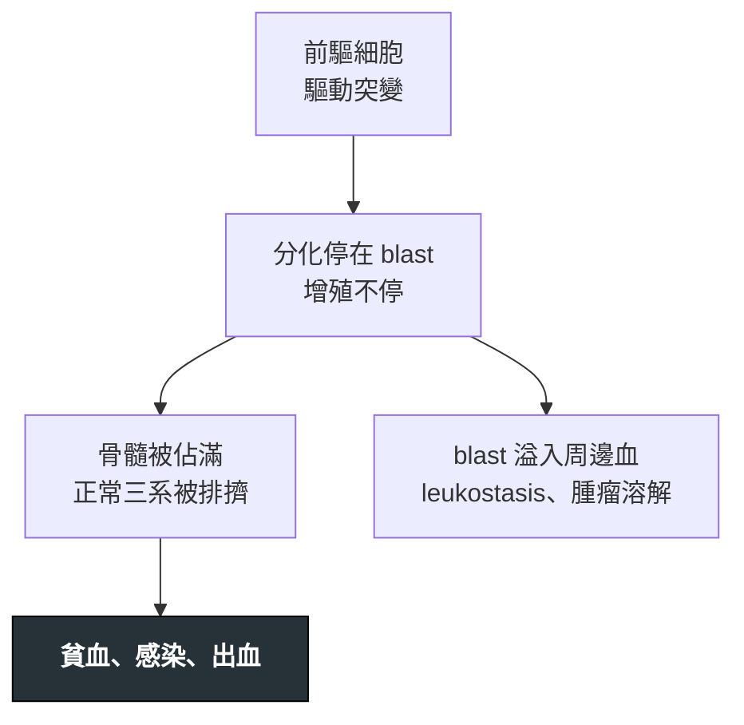

---
tags:
  - Med/Disease/Hema
  - leukemia
  - acute-leukemia
  - 禁忌
aliases:
  - AML
  - 急性髓性白血病
  - Acute Myeloid Leukemia
created: 2026-07-11
updated: 2026-07-26
status: 可用
source: 依 [[Hema Category]] 展開；WHO HAEM5（2022）
cssclass: clinical-note
presents_as:
  - "[[Pancytopenia]]"
  - "[[Fever]]"
diagnosed_by:
  - "[[Bone marrow biopsy]]"
  - "[[Cytogenetics FISH]]"
treated_by:
  - "[[Allogeneic HSCT]]"
differential:
  - "[[APL]]"
  - "[[MDS]]"
complication:
  - "[[Leukostasis]]"
  - "[[Tumor lysis syndrome]]"
---

# AML ｜ 急性髓性白血病 · Acute Myeloid Leukemia

> [!abstract] 一句話總覽
> 髓系芽細胞（blast）增殖塞滿骨髓，正常造血被排擠 → 貧血、感染、出血。門檻 blast **≥20%**，但 WHO 2022 對多數基因定義型已取消。第一步永遠是**先排除 [[APL]]**。

> [!tip] 30 秒行動卡
> **診斷關鍵**：blast ＋ **Auer body／MPO+** ＝髓系；先形態、再基因
> **治療骨架**：「**7+3**」誘導 → 依分層鞏固或 [[Allogeneic HSCT]]
> **絕對不可**：未排除 [[APL]]；未水化降尿酸就降細胞

---

## 定義與定位

| 項目 | 重點 |
|---|---|
| 本質 | 髓系前驅細胞惡性克隆：分化停滯＋增殖失控 |
| 好發族群 | **偏中老年**（口訣：[[B-ALL]] 小小孩 → [[T-ALL]] 青少年 → AML 老人） |
| 分類位置 | 急性 × 髓性；見 [[Hema Category]] |
| 門檻 | blast **≥20%**；🆕 WHO 2022 多數基因定義型**取消門檻**，***BCR::ABL1***、***CEBPA*** **兩型**仍需 20% |

## 病因與機制

> [!tip] 一條線推出全部處置
> 「**塞滿**」不是「壞掉」→ 兩軸：**清掉 blast** ＋ **撐住三系**；殺太快會反噬（腫瘤溶解），故先水化降尿酸。[[APL]] 因 [[DIC]] 最急。

## 臨床表現

- **典型**：疲倦、蒼白、喘；發燒／感染；瘀青、牙齦出血
- **提示性**：**牙齦腫大、皮膚浸潤 → 單核系**；骨痛
- **少見但重要**：[[Leukostasis]]、[[Tumor lysis syndrome]]

→ 相關主訴流程：[[Pancytopenia]]、[[Bleeding]]

### 血球分布（CBC 長相）

> [!tip] 記憶錨點
> **兩低 ＋ 一不定**：Hb ↓↓、Plt ↓↓；WBC **↑／正常／↓ 都可以**。本質是 blast 排擠正常造血 → 貧血、感染、出血。

| 系列 | 通常怎樣 | 機轉／臨床 | 備註 |
|---|---|---|---|
| **紅血球（Hb）** | **幾乎一定 ↓** | 紅系被擠掉 → 疲倦、蒼白、喘 | 典型**正球性正色素性**貧血（骨髓造不出來，不是缺鐵為主） |
| **血小板（Plt）** | **幾乎一定 ↓** | 巨核系被擠掉 → 瘀青、牙齦出血、月經過多 | [[APL]] 再疊 **[[DIC]]**，出血更兇 |
| **白血球（WBC）** | **↑／N／↓ 皆可** | 看 blast 有無大量釋出周邊血 | **不是「AML ＝ WBC 一定高」**（考試陷阱） |

**WBC 三種表現**

| 表現 | 意義 | 臨床要點 |
|---|---|---|
| **WBC ↑** | blast 大量進周邊血 | 注意 **[[Leukostasis]]**、腫瘤溶解 |
| **WBC 正常** | 總數可「看起來還好」 | 抹片上**可能已有 blast** |
| **WBC ↓**（含 aleukemic） | 總數低，像再生不良／感染 | 周邊可幾乎無 blast → **一定要骨髓** |

**周邊血抹片（比總數更重要）**

- 常可見 **circulating blasts**；有 **Auer body** → 支持髓系
- 也可周邊幾乎看不到 blast（aleukemic）→ 靠骨髓定案
- 成熟顆粒球、正常紅系與血小板生成變少 → 臨床就是**感染 ＋ 貧血 ＋ 出血**

## 診斷

| 診斷條件 | 內容 |
|---|---|
| 確診 | 骨髓／周邊血 blast **≥20%**（例外見上表） |
| 形態／表型 | **Auer body**、**MPO+**＝髓系；單核系 **NSE+** |
| 分子 | karyotype ＋ FISH ＋ **NGS** |
| WHO 2022 | ① 基因定義型 ② 分化定義型（原 NOS／FAB M0–M7）③ MDS 相關／治療相關 |
| favorable | **t(15;17) PML::RARA**→[[APL]]；**t(8;21) RUNX1::RUNX1T1**、**inv(16)／t(16;16) CBFB::MYH11**＝**CBF**（伴嗜酸球異常） |

**要開的檢查**：[[Peripheral blood smear]]、[[Bone marrow biopsy]]、[[Flow cytometry]]、[[Cytogenetics FISH]]

## 鑑別診斷

| 要排除的 | 支持它的線索 | 怎麼排除 |
|---|---|---|
| [[APL]] | 凝血異常先於一切、faggot cell | PML::RARA；**未排除前不可當一般 AML** |
| [[B-ALL]]／[[T-ALL]] | 年齡不同、無 Auer body | **TdT+、MPO−** |
| [[MDS]] | 無效造血、細胞減少、blast 未達門檻 | blast 比例；**有 defining genetics 者仍歸 AML** |

## 治療

| 情境 | 處置 |
|---|---|
| 誘導 | 「**7+3**」（cytarabine ＋ anthracycline） |
| 緩解後 | 依**基因分層**：CBF／favorable 鞏固化療；高危、二次性評估 **[[Allogeneic HSCT]]** |
| [[APL]] | 完全不同路徑：**[[ATRA]] ± [[Arsenic trioxide]]** |
| 高白血球 | 降細胞（[[Hydroxyurea]]／化療）±**[[Leukapheresis]]**（APL 除外） |

## 併發症與預後

- **要盯的併發症**：[[Leukostasis]]、[[Tumor lysis syndrome]]、[[Febrile neutropenia]]
- **預後**：看**基因分層**——CBF 與 [[APL]] 佳，複雜核型、*TP53*、[[MDS]] 演變或治療相關者差；高齡限制誘導強度，**MRD 陽性**易復發

## 禁忌與陷阱

> [!danger] 絕對不可
> | 情境 | 絕對不可 | 為什麼 | 該做什麼 |
> |---|---|---|---|
> | 像 [[APL]] | 延後 [[ATRA]] | 早期死於 DIC 出血 | 懷疑就給，同時送 PML::RARA |
> | 高白血球 | 為補血積極輸紅血球 | 加重黏稠度 → [[Leukostasis]] | 先降細胞，優先補血小板 |
> | 降細胞前 | 未水化降尿酸 | 大量溶解 → [[Tumor lysis syndrome]] | 先水化降尿酸，追鉀、磷、腎功能 |

> [!warning] 常見錯誤
> - 以為 **AML 一定 WBC 高**——aleukemic 型必須靠骨髓。
> - blast 未達 20% 就排除 AML。
> - 高白血球直接 [[Leukapheresis]]——**先確認不是 [[APL]]**。

## 相關連結

- [[APL]] — 必須第一個排除，路徑完全不同
- [[MDS]] — 界線模糊、可演變
- [[B-ALL]] · [[T-ALL]] — 淋巴系對照（TdT+）
- [[Hema Category|血液淋巴腫瘤分類 · Master Map]]
