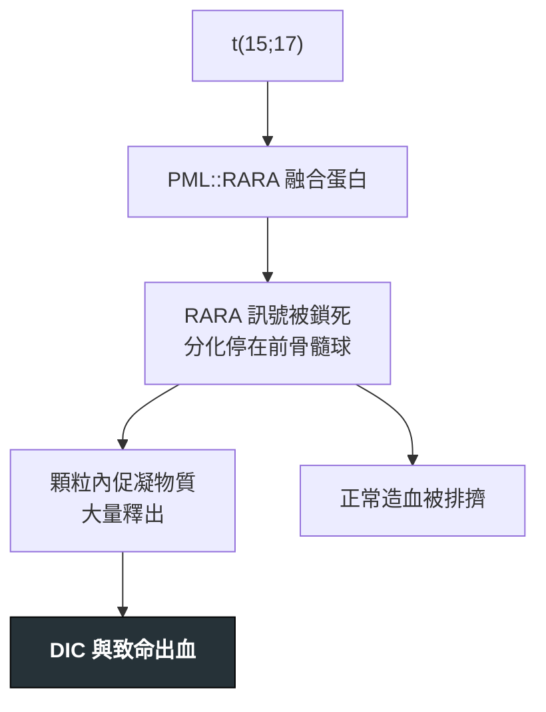

---
tags:
  - Med/Disease/Hema
  - leukemia
  - acute-leukemia
  - 禁忌
aliases:
  - APL
  - AML-M3
  - 急性前骨髓球白血病
  - Acute Promyelocytic Leukemia
  - PML-RARA
created: 2026-07-11
updated: 2026-07-26
status: 可用
source: 依 [[Hema Category]] 展開；WHO HAEM5（2022）
cssclass: clinical-note
presents_as:
  - "[[Bleeding]]"
  - "[[Pancytopenia]]"
diagnosed_by:
  - "[[Peripheral blood smear]]"
  - "[[Cytogenetics FISH]]"
treated_by:
  - "[[ATRA]]"
  - "[[Arsenic trioxide]]"
differential:
  - "[[AML]]"
  - "[[DIC]]"
complication:
  - "[[DIC]]"
  - "[[Differentiation syndrome]]"
---

# APL ｜ 急性前骨髓球白血病 · Acute Promyelocytic Leukemia

> [!abstract] 一句話總覽
> AML 的特殊亞型，**t(15;17) PML::RARA** 阻斷前骨髓球分化。它與其他 AML 的差別不在細胞，而在**時間**——初期死因是 DIC 出血而非白血病本身，所以「懷疑就治療」，不等報告。

> [!tip] 30 秒行動卡
> **診斷關鍵**：抹片大量異常 promyelocyte ＋ **faggot cells** ＋ 凝血異常 → 立刻送 PML::RARA FISH
> **治療骨架**：**ATRA 立即開始**（懷疑當下）＋ ATO；高危（WBC >10,000）加化療；同時積極輸血小板與冷凍沉澱品
> **絕對不可**：等基因報告才給 ATRA；對 APL 做 leukapheresis

---

## 定義與定位

| 項目 | 重點 |
|---|---|
| 本質 | AML 亞型，腫瘤細胞停在**異常前骨髓球**階段 |
| 好發族群 | 中年為主，較其他 AML 年輕 |
| 分類位置 | [[AML]] 之下的 defining genetic abnormality 型；見 [[Hema Category]] |
| 為何獨立成篇 | 治療路徑（分化治療）與急症處理都與其他 AML 完全不同 |

## 病因與機制

> [!tip] 一條線推出全部處置
> 融合蛋白只是**擋住分化**，沒有摧毀分化能力 → 所以 ATRA／ATO 用**藥理劑量推開這個鎖**就能讓細胞成熟，而不是靠化療殺光。這也是為什麼它預後最好卻最容易在第一週死掉。

## 臨床表現

- **典型**：皮膚黏膜出血、瘀斑、牙齦出血；貧血與血小板低下
- **提示性**：**凝血異常先於白血球異常**——PT/aPTT 延長、fibrinogen ↓、D-dimer ↑
- **少見但重要**：**顱內出血**為主要早期死因；WBC 可高可低，不能靠 WBC 排除

→ 相關主訴流程：[[Bleeding]]、[[Pancytopenia]]

## 診斷

| 診斷條件 | 內容 |
|---|---|
| 確診 | **PML::RARA**（FISH／PCR），或 t(15;17) 細胞遺傳學 |
| 形態 | 異常 promyelocyte；**Auer rods 成束＝faggot cell** |
| 免疫表型 | 髓系標記＋；**HLA-DR 弱／負、CD34 常負**（與其他 AML 的對照線索，非絕對） |
| 必查 | **凝血套組**——PT、aPTT、fibrinogen、D-dimer，且需連續追蹤 |

**要開的檢查**：[[Peripheral blood smear]]、[[Bone marrow biopsy]]、[[Flow cytometry]]、[[Cytogenetics FISH]]、[[Coagulation panel]]

![[assets/apl-faggot-cell.jpg|420]]
*中央異常 promyelocyte 的胞質內可見多根 Auer rods 成束交錯，形成典型 faggot cell；一旦抹片看到這個外觀，應把 APL／DIC 當急症處理，不等分子結果才開始 ATRA。Source: [Wikimedia Commons — Faggot cell in AML-M3](https://commons.wikimedia.org/wiki/File:Faggot_cell_in_AML-M3.jpg), Armed Forces Institute of Pathology（public domain）。*

## 鑑別診斷

| 要排除的 | 支持它的線索 | 怎麼排除 |
|---|---|---|
| 其他 [[AML]] 亞型 | 無 faggot cell；HLA-DR 陽性 | PML::RARA 陰性 |
| 敗血症引起的 [[DIC]] | 有感染源；抹片無大量異常前骨髓球 | 抹片＋基因 |
| 類白血病反應 | 有明確感染／發炎；細胞為成熟顆粒球 | 抹片形態 |

> [!warning] 鑑別未完成前就要開始治療
> 這是少數「診斷還沒定案就該給藥」的血液疾病。抹片看到大量異常前骨髓球＋凝血異常 → 當 APL 處理。

## 治療

| 情境 | 處置 |
|---|---|
| 懷疑當下 | **立刻給 [[ATRA]]**，不等骨髓／基因報告 |
| 低／中危（WBC ≤10,000） | [[ATRA]] ＋ [[Arsenic trioxide]]，可不加傳統化療 |
| 高危（WBC >10,000） | ATRA ＋ ATO ＋ 化療（anthracycline 或 gemtuzumab） |
| 支持性（同等重要） | 輸血小板維持 **≥30–50×10⁹/L**；冷凍沉澱品／FFP 維持 **fibrinogen ≥100–150 mg/dL**（各指引取值不一，取保守端） |
| 分化症候群 | 立即 **dexamethasone**；嚴重時暫停 ATRA/ATO |
| 追蹤 | **PML::RARA MRD** 決定鞏固與維持 |

## 併發症與預後

- **要盯的併發症**：[[DIC]]（第一週最致命）、[[Differentiation syndrome]]（發燒、呼吸窘迫、體重增加、肋膜心包積液、低血壓）、[[Tumor lysis syndrome]]
- **預後**：撐過誘導期後**預後是所有 AML 中最好的**，多數可治癒。死亡率集中在診斷後最初數日
- **早期死亡的最大可修正因子**：延遲給 ATRA

## 禁忌與陷阱

> [!danger] 絕對不可
> | 情境 | 絕對不可 | 為什麼 | 該做什麼 |
> |---|---|---|---|
> | 抹片高度懷疑 APL | 等基因報告確認才給 ATRA | 等待期間就是顱內出血高峰 | 懷疑當下就給，報告陰性再停 |
> | APL 合併高白血球 | 做 **leukapheresis** | 機械操作加重凝血病變與出血 | 靠 ATRA ± 化療降細胞 |
> | 血小板 30–50×10⁹/L 但無出血 | 因「沒流血」而不輸血小板 | APL 的閾值高於一般白血病 | 主動輸到 ≥30–50×10⁹/L |

> [!warning] 常見錯誤
> - 以為 WBC 一定高——APL 常以**白血球正常或偏低**表現。
> - 把分化症候群當肺炎或體液過多處理——遲給類固醇會致命。
> - 只驗 CBC 不驗凝血。

## 相關連結

- [[AML]] — 母分類
- [[DIC]] — 主要致死機轉
- [[ATRA]] · [[Arsenic trioxide]] — 分化治療
- [[Hema Category|血液淋巴腫瘤分類 · Master Map]]
