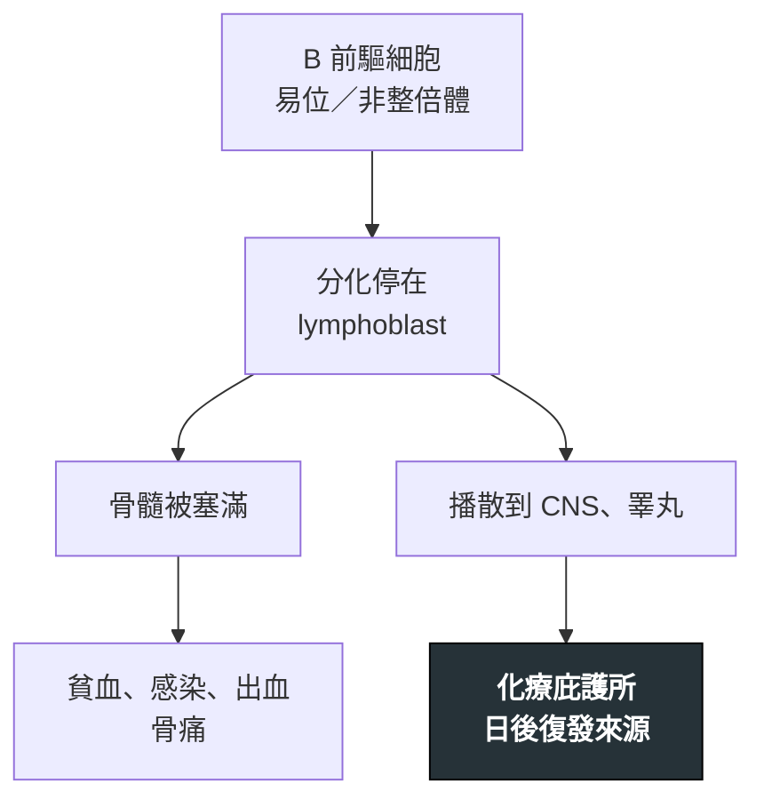

---
tags:
  - Med/Disease/Hema
  - leukemia
  - acute-leukemia
  - lymphoblastic
  - 禁忌
aliases:
  - B-ALL
  - B-LBL
  - B-淋巴母細胞白血病／淋巴瘤
  - B-lymphoblastic Leukemia/Lymphoma
created: 2026-07-11
updated: 2026-07-26
status: 可用
source: 依 [[Hema Category]] 展開；WHO HAEM5（2022）
cssclass: clinical-note
presents_as:
  - "[[Pancytopenia]]"
  - "[[Bone pain]]"
diagnosed_by:
  - "[[Bone marrow biopsy]]"
  - "[[Flow cytometry]]"
  - "[[Cytogenetics FISH]]"
treated_by:
  - "[[Imatinib]]"
  - "[[Allogeneic HSCT]]"
differential:
  - "[[T-ALL]]"
  - "[[AML]]"
  - "[[Burkitt]]"
complication:
  - "[[Tumor lysis syndrome]]"
  - "[[Febrile neutropenia]]"
---

# B-ALL ｜ B-淋巴母細胞白血病／淋巴瘤 · B-lymphoblastic Leukemia/Lymphoma

> [!abstract] 一句話總覽
> 未成熟 **B 淋巴母細胞（TdT+）**惡性增殖，**兒童最常見的急性白血病**。骨髓／血液為主稱 **B-ALL**，腫塊為主、骨髓負荷低稱 **B-LBL**——同一譜系。治療是長療程多藥方案，且**人人都要 CNS 預防**——CNS 與睪丸是化療打不到的庇護所。

> [!tip] 30 秒行動卡
> **診斷關鍵**：小小孩＋骨髓衰竭＋骨痛 → 骨髓 blast **TdT+、CD19+、CD10+、MPO−**
> **治療骨架**：多藥誘導 → 鞏固 → **維持（長療程）**＋**CNS 預防**；Ph+ 加 TKI（[[Imatinib]] 等）
> **絕對不可**：省略 CNS 預防；**vincristine 走鞘內**

---

## 定義與定位

| 項目 | 重點 |
|---|---|
| 本質 | 未成熟 **B 淋巴母細胞（TdT+）**惡性克隆 |
| 好發族群 | **兒童**（peak 約 2–5 歲）；口訣：**B-ALL 小小孩 → [[T-ALL]] 青少年 → [[AML]] 偏老人** |
| 分類位置 | 急性 × 淋巴性；見 [[Hema Category]] |
| 白血病 vs 淋巴瘤 | 骨髓／血液為主＝**B-ALL**；腫塊為主、骨髓負荷低＝**B-LBL**（同譜系） |

## 病因與機制

> [!tip] 一條線推出全部處置
> blast 會躲進化療濃度不足的 **CNS 與睪丸** → 治療不能只靠靜脈：必須**把藥額外送進 CNS**（鞘內、高劑量 MTX），並用**長維持期**耗完殘存細胞。這就是 ALL 療程遠比 [[AML]] 長的原因。

## 臨床表現

- **典型**：骨髓衰竭三聯——貧血、發燒／感染、瘀青出血
- **提示性**：**骨痛、跛行、小孩不肯走路**；肝脾與淋巴結腫大
- **少見但重要**：**CNS 侵犯**（頭痛、嘔吐、腦神經麻痺）、**睪丸腫大**——庇護所，緩解後復發先想到

→ 相關主訴流程：[[Pancytopenia]]、[[Bone pain]]、[[Fever]]

## 診斷

| 診斷條件 | 內容 |
|---|---|
| 確診 | 骨髓／組織淋巴母細胞增生；骨髓負荷低、以腫塊為主者稱 LBL |
| 形態 | lymphoblast：高核質比、胞質少無顆粒、**無 Auer body** |
| 免疫表型 | **TdT+**；**CD19、CD10（CALLA）、CD22、cCD79a**；**表面 Ig 通常陰性**（與成熟 B 的分界） |
| 細胞遺傳／分子 | karyotype ＋ FISH；🆕 WHO 2022 依 transcriptome 增列多個亞型（如 *BCR::ABL1*-like） |
| 必查 | **腰椎穿刺＋CSF 細胞學**（同時給第一次鞘內藥）；男童睪丸檢查 |

**細胞遺傳分層（必背）**

| 預後 | 異常 | 註 |
|---|---|---|
| **佳** | **Hyperdiploid**、**t(12;21) ETV6::RUNX1** | 兒童常見的好預後組 |
| **差** | **t(9;22) BCR::ABL1（Ph+）**、**KMT2A 重排**（嬰兒） | Ph+ 需加 TKI |
| 差 | **hypodiploid**、*BCR::ABL1*-like | 高危，MRD 導向強化 |

**要開的檢查**：[[Bone marrow biopsy]]、[[Flow cytometry]]、[[Cytogenetics FISH]]

## 鑑別診斷

| 要排除的 | 支持它的線索 | 怎麼排除 |
|---|---|---|
| [[AML]] | **Auer body**、**MPO+**、牙齦浸潤 | MPO 與 TdT |
| [[T-ALL]] | 青少年男性、**前縱膈腫塊** | **cCD3、CD5、CD7**（兩者都 TdT+） |
| [[Burkitt]] | 成熟 B：**表面 Ig+、TdT−**、Ki-67 極高 | **TdT 與表面 Ig** |
| Hematogone（良性） | 兒童骨髓再生時也 TdT+ CD10+ | 流式看**連續成熟光譜 vs 單一克隆** |

## 治療

| 情境 | 處置 |
|---|---|
| 誘導 | 多藥合併（類固醇＋vincristine＋anthracycline＋asparaginase） |
| 鞏固／維持 | 鞏固後進入**以年計的維持**（6-MP ＋ MTX） |
| **CNS 預防** | **幾乎人人都要**：鞘內化療 ± 高劑量 MTX；高危加顱部放療 |
| Ph+（BCR::ABL1） | 化療 **＋ TKI**（[[Imatinib]] 等） |
| 高危／MRD＋／復發 | 免疫治療、**CAR-T**、[[Allogeneic HSCT]] |

## 併發症與預後

- **要盯的併發症**：[[Tumor lysis syndrome]]（誘導初期）、[[Febrile neutropenia]]、asparaginase 相關 [[Thrombosis]] 與胰臟炎
- **預後**：**兒童遠優於成人**；決定因子是**細胞遺傳分層**與**MRD**
- **復發部位**：骨髓外首推 **CNS 與睪丸**

## 禁忌與陷阱

> [!danger] 絕對不可
> | 情境 | 絕對不可 | 為什麼 | 該做什麼 |
> |---|---|---|---|
> | 準備鞘內給藥 | 把 **vincristine** 打進鞘內 | **必死、無解藥** | vincristine 只走靜脈；鞘內限 MTX／cytarabine／類固醇，並分開時段與包裝 |
> | 全療程 | 省略 **CNS 預防** | 全身化療進不了庇護所 → CNS 復發 | 依方案完成鞘內治療與 CSF 評估 |
> | 血小板極低或凝血異常 | 硬做腰椎穿刺 | 出血；**traumatic tap 把周邊 blast 帶進 CNS** | 先矯正血小板與凝血，由熟練者一次到位 |
> | 誘導前 | 未水化降尿酸 | 高負荷 → [[Tumor lysis syndrome]] | 先水化降尿酸，追鉀、磷、腎功能 |

> [!warning] 常見錯誤
> - 把 B-ALL 與 B-LBL 當兩種病——**同一譜系**，差在骨髓負荷。
> - 緩解後小孩頭痛或睪丸腫大只當一般問題——先想**庇護所復發**。
> - 看到 TdT+ CD10+ 就診斷 B-ALL——**hematogone** 也長這樣。
> - 忘記查 **Ph（BCR::ABL1）**——會漏掉該加 TKI 的病人。

## 相關連結

- [[T-ALL]] — 同為母細胞，靠免疫表型分開
- [[AML]] — MPO+／Auer body 的對照
- [[Burkitt]] — 成熟 B 的對照（TdT−、表面 Ig+）
- [[Hema Category|血液淋巴腫瘤分類 · Master Map]]
