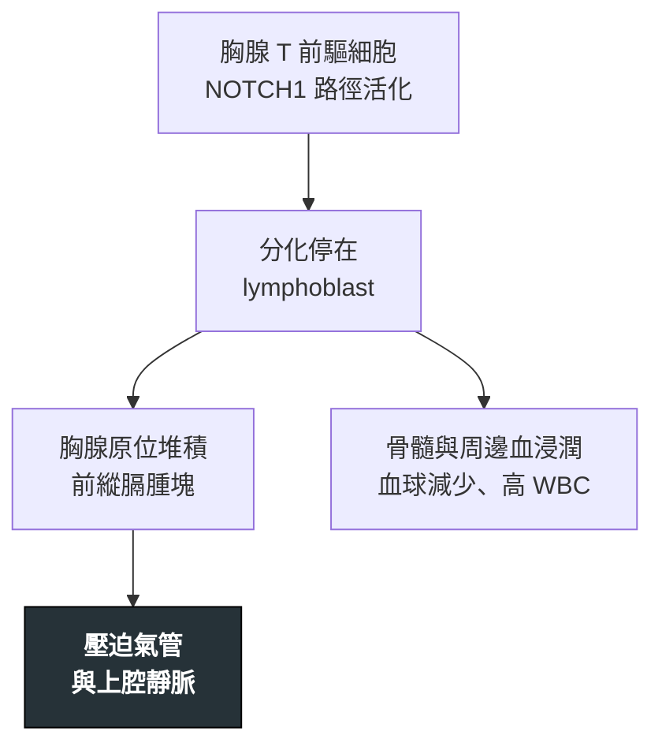

---
tags:
  - Med/Disease/Hema
  - leukemia
  - acute-leukemia
  - lymphoblastic
  - 禁忌
aliases:
  - T-ALL
  - T-LBL
  - T-淋巴母細胞白血病／淋巴瘤
  - T-lymphoblastic Leukemia/Lymphoma
created: 2026-07-11
updated: 2026-07-26
status: 可用
source: 依 [[Hema Category]] 展開；WHO HAEM5（2022）
cssclass: clinical-note
presents_as:
  - "[[Lymphadenopathy]]"
  - "[[Pancytopenia]]"
diagnosed_by:
  - "[[Flow cytometry]]"
  - "[[Bone marrow biopsy]]"
treated_by:
  - "[[Allogeneic HSCT]]"
  - "[[Radiotherapy]]"
differential:
  - "[[B-ALL]]"
  - "[[AML]]"
  - "[[Hodgkin Lymphoma]]"
complication:
  - "[[Tumor lysis syndrome]]"
  - "[[Febrile neutropenia]]"
---

# T-ALL ｜ T-淋巴母細胞白血病／淋巴瘤 · T-lymphoblastic Leukemia/Lymphoma

> [!abstract] 一句話總覽
> 未成熟 **T 淋巴母細胞（TdT+）**腫瘤，好發**青少年／年輕男性**，招牌是**前縱膈（胸腺）腫塊**。骨髓負荷高＝白血病像（T-ALL），腫塊為主＝淋巴瘤像（T-LBL）。第一個要命的常不是白血病本身，而是**腫塊壓迫氣道與大血管**。

> [!tip] 30 秒行動卡
> **診斷關鍵**：青少年男性＋**前縱膈腫塊** → **TdT+、cCD3、CD5、CD7**
> **治療骨架**：高強度多藥 ALL 方案＋**CNS 預防**；高危／MRD＋考慮 [[Allogeneic HSCT]]
> **絕對不可**：大前縱膈腫塊病人**全身麻醉／仰臥深度鎮靜**

---

## 定義與定位

| 項目 | 重點 |
|---|---|
| 本質 | 未成熟 **T 淋巴母細胞（TdT+）**惡性克隆，源自胸腺分化階段 |
| 好發族群 | **青少年／年輕男性**（口訣：[[B-ALL]] 小小孩 → T-ALL 青少年 → [[AML]] 老人） |
| 分類位置 | 急性 × 淋巴性；見 [[Hema Category]] |
| 白血病 vs 淋巴瘤 | 骨髓負荷高＝**T-ALL**；縱膈／淋巴結腫塊為主＝**T-LBL**（同譜系） |

## 病因與機制

> [!tip] 一條線推出全部處置
> 起點在**胸腺**：先變成縱膈腫塊、才變成白血病。這一條解釋三件事——為什麼先咳嗽喘而不是先貧血、為什麼**躺平與麻醉是禁忌**、以及為什麼要挑**風險最低的檢體**（周邊血、骨髓、肋膜液）。

![[assets/tall-mediastinal-mass.jpg|560]]
*T-LBL／T-ALL 縱膈侵犯：a 的 CXR 可見巨大縱膈腫塊與右側胸腔白化；c、e 的 CT 顯示腫塊壓迫心包與包繞大血管，f 顯示 SVC encasement。躺平、鎮靜或全身麻醉前必須先評估氣道與血管受壓。Source: [Li et al., *Sci Rep* 2017, Figure 1](https://pmc.ncbi.nlm.nih.gov/articles/PMC5451435/)（CC BY 4.0）。*

## 臨床表現

- **典型**：青少年男性，**咳嗽、呼吸困難、胸痛**；縱膈腫塊；**躺下更喘**
- **提示性**：**上腔靜脈症候群**（顏面頸部腫脹、頸靜脈怒張）；肋膜／心包積液；淋巴結腫大
- **少見但重要**：骨髓浸潤 → 血球減少、**可有很高的 WBC**；CNS 侵犯；**數天到數週急速惡化**

→ 相關主訴流程：[[Lymphadenopathy]]、[[Pancytopenia]]

## 診斷

| 診斷條件 | 內容 |
|---|---|
| 確診 | 骨髓／組織見淋巴母細胞；**優先取風險最低的檢體** |
| 形態 | lymphoblast：高核質比、胞質少、**無 Auer body** |
| 免疫表型 | **TdT+**＝母細胞性；T 系 **cCD3（最專一）、CD5、CD7**；階段相關 **CD1a／CD4／CD8** 組合 |
| 分子 | **NOTCH1** 路徑突變常見（預後意義依情境）；**不靠單一易位定名**，WHO 2022 亞型更多樣 |
| 必查 | 胸部影像評估**氣道／血管受壓**；腰椎穿刺＋CSF 細胞學；TLS 生化 |

**要開的檢查**：[[Flow cytometry]]、[[Bone marrow biopsy]]、[[Lymph node biopsy]]（無安全替代檢體時）

## 鑑別診斷

| 要排除的 | 支持它的線索 | 怎麼排除 |
|---|---|---|
| [[B-ALL]] | 小小孩、骨痛、無縱膈腫塊 | **CD19／CD10** vs **cCD3／CD5／CD7** |
| [[AML]] | **Auer body**、**MPO+**、牙齦浸潤 | MPO 與 TdT |
| [[Hodgkin Lymphoma]] | 同為年輕人前縱膈腫塊，但病程慢 | 組織病理（RS cell）；**TdT−** |
| 成熟 T 淋巴瘤（[[PTCL]]） | 年紀較大、結外表現 | **TdT−** |

## 治療

| 情境 | 處置 |
|---|---|
| 誘導 | **高強度多藥 ALL 方案**（參考兒童／年輕成人強度） |
| CNS | **CNS 預防必做**：鞘內化療 ±（高危）顱部 [[Radiotherapy]] |
| 縱膈腫塊急症 | 先穩定氣道，**診斷與治療同步加速**；必要時類固醇／化療緊急減積 |
| 高危／MRD＋ | 強化療程或 [[Allogeneic HSCT]] |
| 支持性 | **TLS 預防**（高負荷風險大）、[[Febrile neutropenia]] 處置 |

## 併發症與預後

- **要盯的併發症**：初診的**氣道阻塞與上腔靜脈壓迫**、[[Tumor lysis syndrome]]、[[Febrile neutropenia]]、CNS 復發
- **預後**：治療強度足夠時可治癒；決定因子是**治療反應與 MRD**，不是單一基因
- **注意**：傳統上視為比兒童 [[B-ALL]] 高危，現代強化方案已大幅改善

## 禁忌與陷阱

> [!danger] 絕對不可
> | 情境 | 絕對不可 | 為什麼 | 該做什麼 |
> |---|---|---|---|
> | **大前縱膈腫塊** | **全身麻醉、深度鎮靜、平躺** | 肌肉鬆弛＋仰臥使腫塊壓塌氣管與大血管 → **可能無法通氣且無法急救** | 改半坐臥、局部麻醉可完成的檢查（周邊血流式、骨髓、肋膜液），必要時先會麻醉科 |
> | 上腔靜脈壓迫 | 從**上肢**大量輸液給藥 | 回流受阻、藥物滯留 | 走**下肢**靜脈；同時降腫瘤負荷 |
> | 高 WBC／大腫塊要化療 | 未水化降尿酸 | 對化療極敏感 → 大量溶解 → [[Tumor lysis syndrome]] | 先水化降尿酸，追鉀、磷、腎功能 |
> | 全療程 | 省略 **CNS 預防** | CNS 是化療庇護所 → 日後復發 | 依方案完成鞘內治療 |

> [!warning] 常見錯誤
> - 年輕人前縱膈腫塊只想 [[Hodgkin Lymphoma]]／生殖細胞瘤——T-ALL 可在數天內惡化。
> - 為「拿最好的檢體」直接安排縱膈鏡／開胸——先看周邊血與骨髓能否定案。
> - 忘了 **TdT**——成熟 T 淋巴瘤與 T-ALL 的分界就在這裡。

## 相關連結

- [[B-ALL]] — 靠免疫表型與年齡分開
- [[AML]] — MPO+／Auer body 的對照
- [[Hodgkin Lymphoma]] — 年輕人前縱膈腫塊的主要鑑別
- [[Hema Category|血液淋巴腫瘤分類 · Master Map]]
