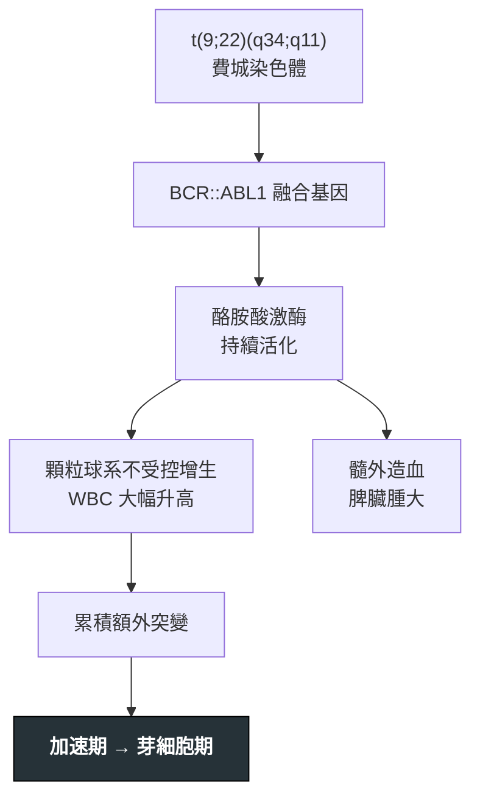

---
tags:
  - Med/Disease/Hema
  - MPN
  - leukemia
  - 禁忌
aliases:
  - CML
  - 慢性骨髓性白血病
  - 慢性髓性白血病
  - Chronic Myeloid Leukemia
  - Ph chromosome
created: 2026-07-11
updated: 2026-07-26
status: 可用
source: 依 [[Hema Category]] 展開；WHO HAEM5（2022）
cssclass: clinical-note
presents_as:
  - "[[Splenomegaly]]"
diagnosed_by:
  - "[[Peripheral blood smear]]"
  - "[[Cytogenetics FISH]]"
treated_by:
  - "[[Imatinib]]"
  - "[[Allogeneic HSCT]]"
differential:
  - "[[PMF]]"
  - "[[MDS]]"
  - "[[AML]]"
complication:
  - "[[Leukostasis]]"
  - "[[Tumor lysis syndrome]]"
---

# CML ｜ 慢性骨髓性白血病 · Chronic Myeloid Leukemia

> [!abstract] 一句話總覽
> 唯一由 **t(9;22) 費城染色體／BCR::ABL1** 定義的 MPN：一個關不掉的酪胺酸激酶讓顆粒球系不受控增生。病根是單一激酶，所以 **TKI 就能長期控制**；放著不管則沿慢性期 → 加速期 → 芽細胞期走成急性白血病。

> [!tip] 30 秒行動卡
> **診斷關鍵**：WBC 大幅升高 ＋ 抹片**顆粒球成熟全譜** ＋ **嗜鹼球↑** ＋ 脾腫 ＋ **LAP score 低** → **BCR::ABL1**（FISH／PCR）一槌定音
> **治療骨架**：慢性期 **[[Imatinib]] 等 TKI** 長期口服，以 **BCR::ABL1 IS 定量**追里程碑
> **絕對不可**：只憑 WBC 高就當感染／類白血病反應處理，沒看抹片、沒驗 BCR::ABL1

---

## 定義與定位

| 項目 | 重點 |
|---|---|
| 本質 | Ph 染色體陽性的骨髓增生性腫瘤，**BCR::ABL1 酪胺酸激酶持續活化** |
| 好發族群 | 成人，中年後漸增；**常在健檢意外發現白血球升高** |
| 分類位置 | 慢性 × 髓性 → MPN 中**唯一 Ph 陽性**者；見 [[Hema Category]] |
| 關鍵分型 | 三期：**慢性期 CP ／ 加速期 AP ／ 芽細胞期 BC** |

## 病因與機制

> [!tip] 一條線推出全部處置
> 病根只是「一個關不掉的激酶」——治療不是殺光細胞，而是用小分子把它**關掉**（標靶治療的原型）。療效因此看 **BCR::ABL1 定量下降**而非 WBC；抗藥＝激酶結構改變（如 **T315I**）→ 換能結合該構型的藥。

![[assets/cml-smear.jpg|700]]
*CML 周邊血：同一視野可見從未成熟 myeloid precursor 到成熟 neutrophil 的完整連續譜，而不是只剩單一 blast population；實際判讀再主動找 basophilia、eosinophilia 與 myelocyte bulge。Source: [Wikimedia Commons — Chronic Myeloid Leukemia smear](https://commons.wikimedia.org/wiki/File:Chronic_Myeloid_Leukemia_smear_2009-04-09.JPG), Paulo Henrique Orlandi Mourao（CC BY-SA 3.0）。*

## 臨床表現

- **典型**：多數無症狀，健檢發現 WBC 顯著升高；疲倦、體重下降、盜汗；**左上腹飽脹／早飽**（脾腫）
- **提示性**：**嗜鹼球升高**（幾乎恆定）、常伴嗜酸球升高；**LAP score 低**
- **少見但重要**：WBC 極高時的 [[Leukostasis]]（視力模糊、呼吸窘迫、意識改變）；芽細胞期表現如急性白血病

→ 相關主訴流程：[[Splenomegaly]]

## 診斷

| 診斷條件 | 內容 |
|---|---|
| 確診 | 證實 **Ph 染色體 t(9;22)** 或 **BCR::ABL1**（細胞遺傳學／FISH／RT-PCR）——**缺此不可診斷** |
| 血象 | WBC 顯著升高、**顆粒球成熟全譜**、**嗜鹼球↑**、PLT 可升高 |
| 對照線索 | **LAP score 低**（類白血病反應為高） |
| 骨髓 | 過細胞；評估**芽細胞比例**與取染色體，據以分 CP／AP／BC |

**要開的檢查**：[[CBC with differential]]、[[Peripheral blood smear]]、[[Bone marrow biopsy]]、[[Cytogenetics FISH]]

## 鑑別診斷

| 要排除的 | 支持它的線索 | 怎麼排除 |
|---|---|---|
| 類白血病反應 | 有感染／發炎；毒性顆粒、Döhle body；**LAP 高**、無嗜鹼球↑ | **BCR::ABL1 陰性** |
| [[PMF]] | 淚滴狀 RBC、leukoerythroblastosis、乾抽、巨脾 | BCR::ABL1 陰性；驗 JAK2／CALR／MPL |
| [[MDS]]／CMML | 單核球↑、明顯 dysplasia、計數常↓ | BCR::ABL1 陰性＋骨髓形態 |
| [[AML]] | 芽細胞 ≥20%、**無成熟全譜** | 骨髓芽細胞比例＋病史 |

## 治療

| 情境 | 處置 |
|---|---|
| 慢性期第一線 | **[[Imatinib]] 等 TKI**（第二代亦可作第一線），長期口服 |
| 療效監測 | **BCR::ABL1 IS 定量**；未達里程碑 → 先查順從性，再驗激酶區突變 |
| 抗藥 | 依突變換 TKI；**T315I** 需特定藥物（ponatinib、asciminib） |
| 加速期／芽細胞期 | TKI ± 化療（依髓系或淋巴系選方案）＋評估移植 |
| 治癒選項 | **[[Allogeneic HSCT]]**——進展期或多線 TKI 失敗者 |
| 支持性 | 初診高白血球時水化＋預防 [[Tumor lysis syndrome]]；[[Hydroxyurea]] 可短期降細胞量作橋接 |

## 併發症與預後

- **要盯的併發症**：[[Leukostasis]]、[[Tumor lysis syndrome]]、進展至加速期／芽細胞期
- **預後**：TKI 時代慢性期多可長期控制、接近常人壽命；達持續深度分子反應者，部分可在嚴格監測下嘗試停藥（treatment-free remission）
- **不良徵象**：芽細胞上升、嗜鹼球持續升高、新的染色體異常、治療中脾臟反而變大

## 禁忌與陷阱

> [!danger] 絕對不可
> | 情境 | 絕對不可 | 為什麼 | 該做什麼 |
> |---|---|---|---|
> | WBC 顯著升高 | 直接當感染／類白血病反應給抗生素了事 | 會整個錯過 CML，延誤 TKI 並讓疾病進展 | 一定要看**抹片**（成熟全譜＋嗜鹼球）並驗 **BCR::ABL1** |
> | 初診 WBC 極高 | 只顧降白血球，不水化、不防 TLS | 大量細胞崩解可致急性腎衰竭 | 水化＋降尿酸；有 [[Leukostasis]] 症狀才考慮 [[Leukapheresis]] |

> [!warning] 常見錯誤
> - 把 CML 放進 JAK2 家族——CML **必須有 BCR::ABL1**；[[PV]]／[[ET]]／[[PMF]] 才是 JAK2／CALR／MPL，**不是** Ph+。
> - 忘記 **LAP score 低**與**嗜鹼球↑**，反把 CML 當 LAP 高的類白血病反應。
> - 只看 WBC 判斷療效——里程碑看的是 **BCR::ABL1 IS**。

## 相關連結

- [[PV]] · [[ET]] · [[PMF]] — 其他經典 MPN，走 JAK2／CALR／MPL 且 Ph 陰性
- [[AML]] — 芽細胞期可長得像急性白血病
- [[MDS]] — 對照：計數↓（無效造血）vs CML 計數↑
- [[Hema Category|血液淋巴腫瘤分類 · Master Map]]
