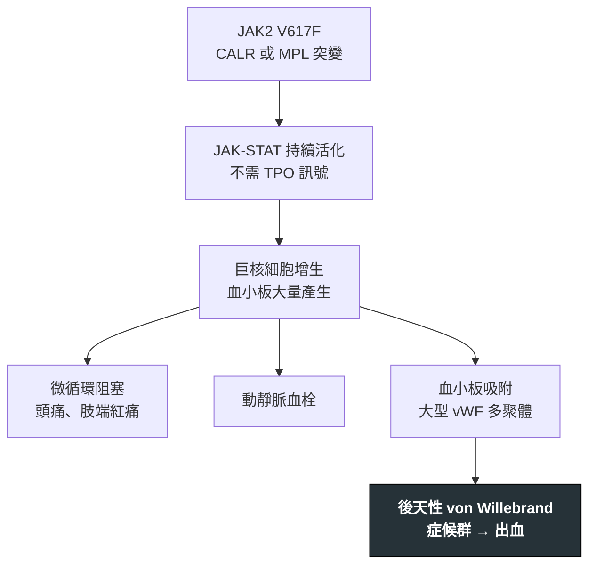

---
tags:
  - Med/Disease/Hema
  - MPN
  - 禁忌
aliases:
  - ET
  - 原發性血小板增多症
  - Essential Thrombocythemia
created: 2026-07-11
updated: 2026-07-26
status: 可用
source: 依 [[Hema Category]] 展開；WHO HAEM5（2022）
cssclass: clinical-note
presents_as:
  - "[[Thrombosis]]"
  - "[[Bleeding]]"
diagnosed_by:
  - "[[CBC with differential]]"
  - "[[Bone marrow biopsy]]"
treated_by:
  - "[[Aspirin]]"
  - "[[Hydroxyurea]]"
differential:
  - "[[PV]]"
  - "[[PMF]]"
  - "[[CML]]"
complication:
  - "[[Thrombosis]]"
  - "[[Hemorrhage]]"
  - "[[PMF]]"
---

# ET ｜ 原發性血小板增多症 · Essential Thrombocythemia

> [!abstract] 一句話總覽
> 經典 MPN 中「主升＝**血小板**」的一支，同樣由 **JAK2／CALR／MPL** 三重奏驅動。臨床在**血栓與出血之間擺盪**：中度升高偏血栓，極高時反而因**後天性 von Willebrand 症候群**出血。診斷前務必先排除反應性血小板增多。

> [!tip] 30 秒行動卡
> **診斷關鍵**：**持續性**血小板 ≥450×10⁹/L ＋ 骨髓**大型成熟多分葉巨核細胞**增多 ＋ JAK2／CALR／MPL 之一
> **治療骨架**：依血栓風險分層——低危觀察 ± [[Aspirin]]；高危 [[Hydroxyurea]] ＋ [[Aspirin]]
> **絕對不可**：血小板極高（如 >1000–1500×10⁹/L）又在出血時，貿然只給抗血小板而不驗 vWF

---

## 定義與定位

| 項目 | 重點 |
|---|---|
| 本質 | 克隆性 MPN，巨核細胞系增生 → **持續性血小板增多** |
| 好發族群 | 中老年為主；另有一個**年輕女性**的小高峰 |
| 分類位置 | 慢性 × 髓性 → MPN，**Ph 陰性**；見 [[Hema Category]] |
| 三兄弟定位 | [[PV]]＝紅血球｜**ET＝血小板**｜[[PMF]]＝纖維化，共用 **JAK2／CALR／MPL** 三重奏 |

## 病因與機制

> [!tip] 一條線推出全部處置
> 同一個「血小板太多」，中等量造成**血栓**、極高量把 vWF 吸走而造成**出血**。決策因此不是看數字給藥，而是先問「病人現在偏血栓端還是出血端」：偏血栓 → aspirin ± 降細胞；偏出血 → 先降細胞、停抗血小板。

![[assets/et-bone-marrow.jpg|600]]
*ET 骨髓：可見大型、成熟巨核細胞增加並鬆散成簇，核多分葉呈 staghorn 外觀；背景仍保留造血結構，沒有 overt PMF 那種緻密成簇、bulbous atypia 與明顯纖維化。Source: [Wikimedia Commons — Essential thrombocythemia (2)](https://commons.wikimedia.org/wiki/File:Essential_thrombocythemia_(2).jpg)（CC BY-SA／GFDL，詳見來源頁）。*

## 臨床表現

- **典型**：多為健檢意外發現血小板升高，無症狀
- **提示性**：微循環症狀——頭痛、視覺閃爍、**肢端紅痛（erythromelalgia，對 aspirin 反應好）**；輕度脾腫
- **少見但重要**：**極高血小板時的黏膜出血**（後天性 vWF 症候群）；動靜脈血栓含內臟靜脈；懷孕併發症

→ 相關主訴流程：[[Thrombosis]]、[[Bleeding]]

## 診斷

| 診斷條件 | 內容 |
|---|---|
| 主要條件 | ① **持續性血小板 ≥450×10⁹/L** ② 骨髓**大型成熟多分葉巨核細胞**增多、無顯著纖維化 ③ 不符合 [[PV]]／[[PMF]]／[[CML]]／[[MDS]] ④ 有 **JAK2／CALR／MPL** 突變 |
| 三重奏基因 | **JAK2 最常見；CALR 多見於 JAK2 陰性者；MPL 較少**。**三陰性**時需其他克隆性標記，或徹底排除反應性 |
| 必查 | **鐵蛋白、CRP／ESR**（找反應性）；**BCR::ABL1**（排除 CML） |

**要開的檢查**：[[CBC with differential]]、[[Peripheral blood smear]]、[[Bone marrow biopsy]]、[[Cytogenetics FISH]]

## 鑑別診斷

| 要排除的 | 支持它的線索 | 怎麼排除 |
|---|---|---|
| **反應性血小板增多**（最常見） | 缺鐵、感染／發炎、術後、脾切除、惡性腫瘤 | 鐵蛋白、CRP／ESR；矯正病因後血小板回落 |
| [[PV]] | Hb／Hct 也升高（**缺鐵時可被掩蓋**） | 血清 EPO、鐵狀態；補鐵後 Hb 竄升要重想 PV |
| 早期（prefibrotic）[[PMF]] | 巨核細胞**異型、緻密成簇**，網狀纖維已開始增加 | **骨髓切片形態**是唯一分辨方法 |
| [[CML]] | 可以血小板升高表現，WBC 常高、嗜鹼球↑ | **BCR::ABL1** |

## 治療

| 情境 | 處置 |
|---|---|
| 全部病人／低危 | 控制心血管危險因子；觀察 ± 低劑量 [[Aspirin]] |
| 高危（年長、曾有血栓） | **[[Hydroxyurea]]** ＋ 低劑量 [[Aspirin]] |
| 年輕／懷孕／不耐 hydroxyurea | **[[Interferon alfa]]**；anagrelide 為另一選項 |
| **極高血小板併出血** | **先降細胞、暫停抗血小板**，並驗 vWF 活性 |

## 併發症與預後

- **要盯的併發症**：[[Thrombosis]]（動、靜脈）、[[Hemorrhage]]（後天性 vWF 症候群）、後 ET 骨髓纖維化（見 [[PMF]]）、少數轉 [[AML]]
- **預後**：**MPN 三兄弟中最好**，多數接近常人壽命
- **預後因子**：年齡、既往血栓、白血球升高、驅動基因（**CALR 型血栓風險低於 JAK2**）

## 禁忌與陷阱

> [!danger] 絕對不可
> | 情境 | 絕對不可 | 為什麼 | 該做什麼 |
> |---|---|---|---|
> | 血小板極高（如 >1000–1500×10⁹/L）＋黏膜出血 | 貿然只加抗血小板或抗凝 | 此時多為**後天性 von Willebrand 症候群**，抗血小板會加重出血 | 驗 **vWF 活性**；以降細胞為主，暫停 aspirin |
> | 尚未排除反應性 | 直接當 ET 給細胞減少治療 | 缺鐵／發炎造成的血小板增多不該化療 | 先驗鐵蛋白、CRP 與 BCR::ABL1，找感染／腫瘤 |
> | 單次抽血偏高 | 立刻下 ET 診斷 | ET 要求**持續性**升高 | 間隔重驗確認 |

> [!warning] 常見錯誤
> - 把「血小板數字」當治療目標——ET 治療是為了**降低血栓事件**，不是把數字壓正常。
> - 忘了 ET 也會出血，看到出血就認定是別的病。
> - 缺鐵掩蓋了 Hb，把其實是 [[PV]] 的病人診斷成 ET。
> - 骨髓切片沒看纖維化分級，漏掉 prefibrotic [[PMF]]。

## 相關連結

- [[PV]] · [[PMF]] — MPN 三兄弟，共用 JAK2／CALR／MPL
- [[CML]] — Ph 陽性的對照，靠 BCR::ABL1 分開
- [[Hema Category|血液淋巴腫瘤分類 · Master Map]]
