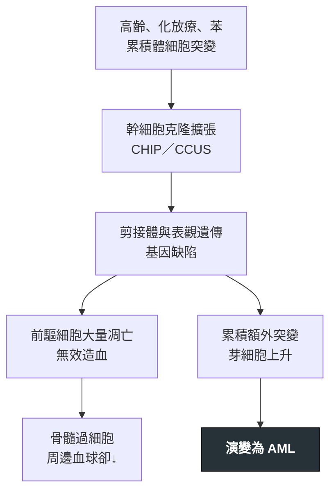

---
tags:
  - Med/Disease/Hema
  - myelodysplasia
  - cytopenia
aliases:
  - MDS
  - 骨髓化生不良
  - 骨髓增生異常
  - Myelodysplastic neoplasms
  - Myelodysplastic syndromes
created: 2026-07-11
updated: 2026-07-26
status: 可用
source: 依 [[Hema Category]] 展開；WHO HAEM5（2022）
cssclass: clinical-note
presents_as:
  - "[[Anemia]]"
  - "[[Pancytopenia]]"
diagnosed_by:
  - "[[Bone marrow biopsy]]"
  - "[[Peripheral blood smear]]"
  - "[[Cytogenetics FISH]]"
treated_by:
  - "[[Lenalidomide]]"
  - "[[Allogeneic HSCT]]"
differential:
  - "[[AML]]"
  - "[[Anemia]]"
  - "[[PMF]]"
complication:
  - "[[AML]]"
  - "[[Febrile neutropenia]]"
  - "[[Hemorrhage]]"
---

# MDS ｜ 骨髓化生不良腫瘤 · Myelodysplastic Neoplasms

> [!abstract] 一句話總覽
> 克隆性幹細胞病變造成**無效造血**：骨髓過細胞、周邊血卻**計數↓**，且各系有 **dysplasia**。芽細胞 **<20%**，但高風險者會轉 [[AML]]——整套決策都圍繞**風險分層**。

> [!tip] 30 秒行動卡
> **診斷關鍵**：**持續性 cytopenia ＋ dysplasia（≥10%）＋ blast <20%**，且已排除營養缺乏、藥物、病毒等可逆原因
> **治療骨架**：先算 **IPSS-R**——低危支持／ESA、**del(5q) 用 [[Lenalidomide]]**；高危去甲基化藥物＋評估 [[Allogeneic HSCT]]
> **絕對不可**：無；但別把它當單純營養性貧血補鐵了事

---

## 定義與定位

| 項目 | 重點 |
|---|---|
| 本質 | 克隆性髓系腫瘤：**無效造血** → 周邊計數↓，骨髓卻常過細胞且有 dysplasia |
| 好發族群 | 老年人；化放療後為**治療相關型（t-MDS）** |
| 分類位置 | 慢性 × 髓性，但屬**計數↓**組，與 MPN 分立；見 [[Hema Category]] |

> [!tip] MDS 與 MPN 的分水嶺
> **MDS＝計數↓**：無效造血，骨髓常過細胞＋dysplasia——「造壞又送不出去」。
> **MPN（[[CML]]／[[PV]]／[[ET]]／[[PMF]]）＝計數↑**：骨髓過細胞＋有效增殖——「造太多」。

> [!note] 🆕 WHO 2022 重點
> - 更名 **myelodysplastic neoplasms**（縮寫仍 MDS）：是**腫瘤**不是「症候群」。
> - 分 **defining genetic abnormalities**（del(5q)、*SF3B1*、*TP53* multi-hit）與**形態定義**兩類；前驅概念 **CHIP／CCUS**（有克隆但未達 MDS）。
> - 具 defining genetics 的 AML 多不需 20% blast；MDS↔AML 仍靠 blast 與整體判斷（WHO／ICC 略異）。

## 病因與機制

> [!tip] 一條線推出全部處置
> 「骨髓滿滿卻沒東西可用」＝**無效造血**。低危的問題是**血球不夠用** → 支持治療、ESA、del(5q) 給 lenalidomide；高危的問題是**快變成白血病** → 去甲基化藥物、能移植就移植。分層之所以是第一步，正因兩條路目標不同。

## 臨床表現

- **典型**：老年人**慢性、找不到原因的貧血**（最常見），疲倦、易喘
- **提示性**：MCV 常正常或偏大；抹片可見 **pseudo-Pelger-Huët 核**與低顆粒粒球；反覆感染、瘀斑；逐漸**輸血依賴**
- **少見但重要**：脾腫不明顯（與 MPN 相反）；可合併自體免疫現象（如 Sweet syndrome）；血球快速惡化或芽細胞竄升＝可能已轉 [[AML]]

→ 相關主訴流程：[[Anemia]]、[[Pancytopenia]]

## 診斷

| 診斷條件 | 內容 |
|---|---|
| 必要條件 | **持續性 cytopenia**（≥1 系）＋ **dysplasia**（≥1 系、通常該系 **≥10%** 細胞異常）＋ 已排除其他原因 |
| 芽細胞 | 骨髓 **<20%**（≥20% 或具 AML defining genetics → [[AML]]） |
| 分子／染色體 | 診斷、預後、治療三用：**del(5q)**（預後較佳）、***SF3B1***（環狀鐵芽細胞、較惰性）、*TP53* multi-hit（高危） |
| 必須排除 | **B12／葉酸／銅缺乏**、酒精、藥物、HIV／病毒、先天性、其他腫瘤 |

**要開的檢查**：[[CBC with differential]]、[[Peripheral blood smear]]、[[Bone marrow biopsy]]（含鐵染色）、[[Cytogenetics FISH]]

## 鑑別診斷

| 要排除的 | 支持它的線索 | 怎麼排除 |
|---|---|---|
| 營養性／藥物性（可逆） | B12／葉酸／銅缺乏、酒精、藥物；也會有 dysplasia 樣變化 | **補充或停藥後血球會回復**，MDS 不會 |
| 再生不良性貧血 | 骨髓**低細胞**、無明顯 dysplasia、無克隆性異常 | 骨髓切片細胞量＋染色體 |
| [[AML]] | 芽細胞 **≥20%** 或具 AML defining genetics | 骨髓芽細胞比例＋分子 |

## 治療

| 情境 | 處置 |
|---|---|
| 第一步 | 算 **IPSS-R／IPSS-M**（血球數、芽細胞、染色體）分兩條路 |
| 低危·貧血 | 輸血＋鐵螯合；EPO 不高者用 **ESA**；*SF3B1*／環狀鐵芽細胞型可用 luspatercept；**del(5q) 用 [[Lenalidomide]]** |
| 高危 | **去甲基化藥物（azacitidine、decitabine）** |
| 可移植者 | **[[Allogeneic HSCT]]——唯一可能治癒**，高危應及早評估 |
| 全程支持 | 發燒即當 [[Febrile neutropenia]] 處理；必要時輸血小板 |

## 併發症與預後

- **要盯的併發症**：[[Febrile neutropenia]]、[[Hemorrhage]]（血小板↓）、輸血相關鐵過載、演變為 [[AML]]
- **預後**：由 **IPSS-R** 決定，從穩定數年到近似 AML 都有；**t-MDS 與 *TP53* multi-hit 最差**

## 禁忌與陷阱

> [!danger] 絕對不可
> 本病無立即致死型絕對禁忌；風險來自**把它當單純營養性貧血而延誤診斷**，以及血球低下的感染與出血，見下方常見錯誤。

> [!warning] 常見錯誤
> - 用「再生不良」「老年性貧血」一筆帶過——MDS 是**克隆性腫瘤性疾病**，不是單純營養性貧血。
> - 沒排除 **B12／葉酸／銅缺乏與藥物**就下 MDS 診斷。
> - 只看貧血程度、不算 **IPSS-R**——高危拖到轉 [[AML]] 才想移植就太晚。

## 相關連結

- [[AML]] — 轉化去向與 blast 界線
- [[PMF]] · [[CML]] — MPN 對照：計數↑ vs MDS 計數↓
- [[Anemia]] — 貧血鑑別入口
- [[Hema Category|血液淋巴腫瘤分類 · Master Map]]
