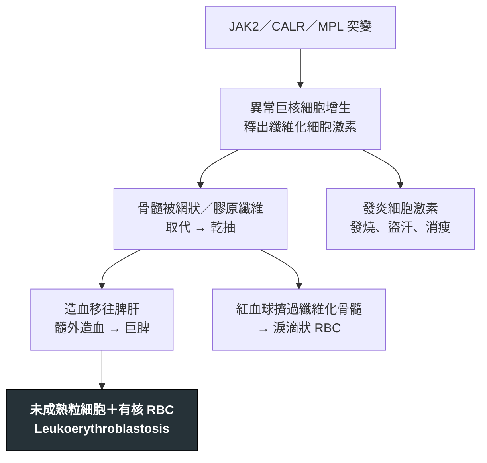

---
tags:
  - Med/Disease/Hema
  - MPN
  - 禁忌
aliases:
  - PMF
  - 原發性骨髓纖維化
  - 骨髓纖維化
  - Primary Myelofibrosis
created: 2026-07-11
updated: 2026-07-26
status: 可用
source: 依 [[Hema Category]] 展開；WHO HAEM5（2022）
cssclass: clinical-note
presents_as:
  - "[[Splenomegaly]]"
  - "[[Pancytopenia]]"
diagnosed_by:
  - "[[Peripheral blood smear]]"
  - "[[Bone marrow biopsy]]"
treated_by:
  - "[[Ruxolitinib]]"
  - "[[Allogeneic HSCT]]"
differential:
  - "[[CML]]"
  - "[[MDS]]"
  - "[[Hairy Cell Leukemia]]"
complication:
  - "[[AML]]"
  - "[[Thrombosis]]"
---

# PMF ｜ 原發性骨髓纖維化 · Primary Myelofibrosis

> [!abstract] 一句話總覽
> MPN 中以**纖維化與髓外造血**為主軸者：異常巨核細胞把骨髓變成纖維組織，造血只好逃到脾肝。基因同樣走 **JAK2／CALR／MPL**，招牌是**淚滴狀紅血球＋白紅血球母細胞反應＋骨髓乾抽**三件套。

> [!tip] 30 秒行動卡
> **診斷關鍵**：**巨脾 ＋ 淚滴狀 RBC（dacrocyte）＋ leukoerythroblastosis ＋ 骨髓乾抽（dry tap）** → 做**骨髓切片**看纖維化分級與巨核異型
> **治療骨架**：脾腫／體質症狀用 **[[Ruxolitinib]]**；貧血支持；**唯一可能治癒＝[[Allogeneic HSCT]]**
> **絕對不可**：骨髓乾抽抽不到就放棄，沒做骨髓切片

---

## 定義與定位

| 項目 | 重點 |
|---|---|
| 本質 | 克隆性 MPN：巨核細胞異常 → **進行性骨髓纖維化 ＋ 髓外造血** |
| 好發族群 | 中老年 |
| 分類位置 | 慢性 × 髓性 → MPN，**Ph 陰性**；見 [[Hema Category]] |
| 三兄弟定位 | [[PV]]＝紅血球｜[[ET]]＝血小板｜**PMF＝纖維化**，共用 **JAK2／CALR／MPL** |
| 續發型 | 可繼發於 [[PV]]／[[ET]]（後 PV／後 ET 骨髓纖維化），處理原則相同 |

## 病因與機制

> [!tip] 一條線推出全部處置
> 三件套全來自同一件事——**骨髓被纖維塞住**：抽不出來（乾抽）、紅血球擠變形（淚滴）、造血逃到脾肝（巨脾＋不成熟細胞進周邊血）。治療因此分兩路：**症狀與脾腫**用 JAK 抑制劑壓下去，**纖維化本身只有移植能重來一次**。

![[assets/pmf-smear.jpg|720]]
*PMF 周邊血低倍全景：可見大量大小形狀不一的紅血球，許多呈單端尖出的 teardrop／dacryocyte；同時混入有核紅血球與未成熟髓系細胞，構成 leukoerythroblastic picture。Source: [Wikimedia Commons — Primary Myelofibrosis blood stain](https://commons.wikimedia.org/wiki/File:Primary_Myelofibrosis_blood_stain.jpg), El*Falaf（CC BY-SA 4.0）。*

## 臨床表現

- **典型**：**巨脾**造成左上腹脹痛、早飽；貧血與疲倦
- **提示性**：體質症狀——發燒、盜汗、體重下降、搔癢、骨痛
- **少見但重要**：髓外造血腫塊（脊椎旁可致 [[Spinal cord compression]]、腹水／肋膜積液）、門脈高壓、脾梗塞

→ 相關主訴流程：[[Splenomegaly]]、[[Pancytopenia]]、[[Bone pain]]

## 診斷

| 診斷條件 | 內容 |
|---|---|
| 血片三件套 | ① **淚滴狀紅血球（dacrocyte）** ② **白紅血球母細胞反應（leukoerythroblastosis）** ③ 貧血＋異形血小板 |
| 骨髓 | 抽吸常**乾抽（dry tap）**；**必須做切片**——巨核異型成簇＋網狀／膠原纖維分級 |
| 基因 | **JAK2／CALR／MPL** 三選一；三陰性需其他克隆性標記 |
| 必要排除 | 不符合 [[PV]]／[[ET]]／[[CML]]／[[MDS]]；**BCR::ABL1 陰性** |

**要開的檢查**：[[Peripheral blood smear]]、[[Bone marrow biopsy]]、[[Cytogenetics FISH]]、[[CBC with differential]]

## 鑑別診斷

| 要排除的 | 支持它的線索 | 怎麼排除 |
|---|---|---|
| **續發性骨髓纖維化** | 轉移癌（乳癌、攝護腺癌）、結核、自體免疫、放射線 | 骨髓切片找癌細胞／肉芽腫 |
| [[CML]] | 也可有脾腫與纖維化 | **BCR::ABL1 陽性** |
| [[MDS]] 伴纖維化 | 明顯 dysplasia、計數↓ 為主 | 骨髓形態：無 MPN 樣巨核異型成簇 |
| [[Hairy Cell Leukemia]] | 同樣乾抽＋脾腫＋血球減少 | 免疫表型、BRAF V600E |

## 治療

| 情境 | 處置 |
|---|---|
| 無症狀低危 | 觀察追蹤即可 |
| 脾腫／體質症狀 | **[[Ruxolitinib]]** 等 JAK 抑制劑——縮脾、改善症狀，但**不逆轉纖維化** |
| 貧血 | 輸血支持；EPO 不高者可試 ESA；danazol；早期可用 [[Interferon alfa]] |
| 中高危且可移植 | **[[Allogeneic HSCT]]——唯一可能治癒**，應及早評估 |

## 併發症與預後

- **要盯的併發症**：進展為芽細胞期／[[AML]]（依 AML 方式治療並評估移植）、[[Thrombosis]]（含門脈系統）、門脈高壓與食道靜脈曲張、感染、脾梗塞
- **預後**：**MPN 三兄弟中最差**；以 DIPSS 等分層（年齡、Hb、WBC、周邊芽細胞、體質症狀、染色體與 *ASXL1* 等突變）
- **基因**：CALR 突變者相對較佳；三陰性與高風險突變較差

## 禁忌與陷阱

> [!danger] 絕對不可
> | 情境 | 絕對不可 | 為什麼 | 該做什麼 |
> |---|---|---|---|
> | 骨髓抽吸乾抽 | 報「檢體不足」就結案 | **乾抽本身就是纖維化的線索**，沒切片就無法診斷與分級 | 一定要做**骨髓切片**＋網狀纖維染色 |
> | 長期服用 [[Ruxolitinib]] | 突然停藥 | 可能出現細胞激素反彈（發燒、脾臟急速回脹、病情急轉直下） | **逐步減量**，必要時短期類固醇覆蓋 |
> | 巨脾病人 | 用力深觸診或接觸性運動 | 脾臟破裂或梗塞出血 | 輕觸診，避免腹部撞擊 |

> [!warning] 常見錯誤
> - 看到 leukoerythroblastosis 就直接想 PMF——**要先排除骨髓轉移癌與感染**。
> - 以為 [[Ruxolitinib]] 會逆轉纖維化或治癒——它處理的是脾腫與症狀。
> - 把 PMF 當 [[MDS]]：MDS 是**無效造血→計數↓**，PMF 主軸是**纖維化／髓外造血**。

## 相關連結

- [[PV]] · [[ET]] — MPN 三兄弟，也可續發成骨髓纖維化
- [[CML]] — Ph 陽性的對照
- [[MDS]] — 計數↓ 的對照
- [[Hema Category|血液淋巴腫瘤分類 · Master Map]]
