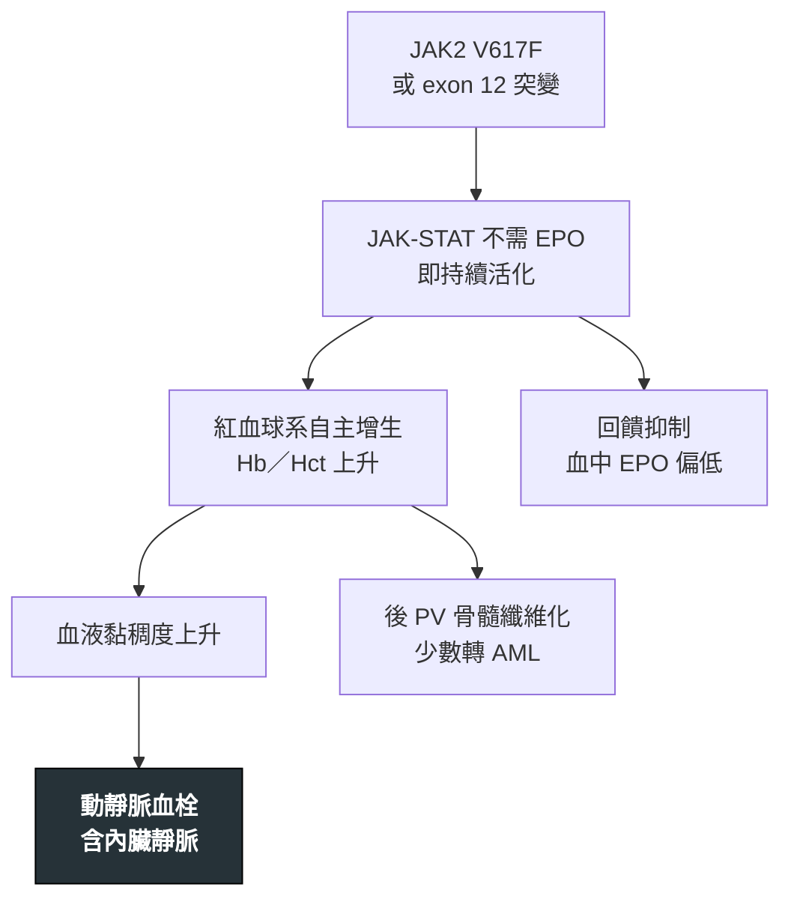

---
tags:
  - Med/Disease/Hema
  - MPN
  - 禁忌
aliases:
  - PV
  - 真性紅血球增多症
  - Polycythemia Vera
created: 2026-07-11
updated: 2026-07-26
status: 可用
source: 依 [[Hema Category]] 展開；WHO HAEM5（2022）
cssclass: clinical-note
presents_as:
  - "[[Splenomegaly]]"
diagnosed_by:
  - "[[CBC with differential]]"
  - "[[Bone marrow biopsy]]"
treated_by:
  - "[[Phlebotomy]]"
  - "[[Aspirin]]"
  - "[[Hydroxyurea]]"
differential:
  - "[[ET]]"
  - "[[PMF]]"
  - "[[CML]]"
complication:
  - "[[Thrombosis]]"
  - "[[PMF]]"
  - "[[AML]]"
---

# PV ｜ 真性紅血球增多症 · Polycythemia Vera

> [!abstract] 一句話總覽
> **JAK2** 驅動的經典 MPN，紅血球質量**真正增加**（不是血漿濃縮），常伴 WBC、PLT 輕度升高。傷害幾乎全來自「血太黏」造成的血栓，所以第一線處置不是化療，而是**把 Hct 壓到 <45%**。

> [!tip] 30 秒行動卡
> **診斷關鍵**：Hb／Hct 升高 ＋ **血清 EPO 偏低** ＋ **JAK2 V617F**（陰性再驗 exon 12）；熱水澡後搔癢＋脾腫是強烈提示
> **治療骨架**：**[[Phlebotomy]] 維持 Hct <45%** ＋ 低劑量 [[Aspirin]]；高危加 [[Hydroxyurea]] 或 [[Interferon alfa]]
> **絕對不可**：光觀察或只給抗凝，卻沒把 Hct 放血降到 <45%；漏掉低劑量 aspirin

---

## 定義與定位

| 項目 | 重點 |
|---|---|
| 本質 | JAK2 驅動的克隆性 MPN，主升＝**RBC／Hb／Hct**；三系皆可動 |
| 好發族群 | 中老年 |
| 分類位置 | 慢性 × 髓性 → MPN，**Ph 陰性**；見 [[Hema Category]] |
| 三兄弟定位 | **PV＝紅血球｜[[ET]]＝血小板｜[[PMF]]＝纖維化**，共用 **JAK2／CALR／MPL** 三重奏（PV 幾乎都是 JAK2） |

## 病因與機制

> [!tip] 一條線推出全部處置
> 病人不是缺氧才造血，是激酶自己開著——所以 **EPO 反而被壓低**（與續發性正好相反）。傷害來自「太黏」，處置順位就跟著出來：① 物理性把 Hct 降下來（放血）② 抗血小板 ③ 只有高危才需要細胞減少治療。

## 臨床表現

- **典型**：多血面容（臉紅、結膜充血）、頭痛頭暈、**脾腫**；常在健檢發現 Hb／Hct 高
- **提示性**：**熱水澡後搔癢（aquagenic pruritus）**、肢端紅痛（erythromelalgia）、痛風／高尿酸
- **少見但重要**：**不尋常部位血栓**（Budd–Chiari、門脈、腸繫膜靜脈）可為首發表現；血小板功能異常時反而出血

→ 相關主訴流程：[[Splenomegaly]]、[[Thrombosis]]

## 診斷

| 診斷條件 | 內容 |
|---|---|
| 主要條件 | ① Hb／Hct 升高（或紅血球質量增加）② 骨髓**三系增生**＋多形性成熟巨核細胞 ③ **JAK2 V617F 或 exon 12 突變** |
| 次要條件 | **血清 EPO 低於正常** |
| 基因 | **JAK2 V617F >95%**；陰性務必加驗 **exon 12** |
| 必須排除 | 續發性紅血球增多：抽菸、慢性肺病／睡眠呼吸中止、高海拔、EPO 分泌腫瘤、外源性睪固酮或 EPO |

**要開的檢查**：[[CBC with differential]]、[[Peripheral blood smear]]、[[Bone marrow biopsy]]（同時送 JAK2 突變、血清 EPO、鐵蛋白）

## 鑑別診斷

| 要排除的 | 支持它的線索 | 怎麼排除 |
|---|---|---|
| 續發性紅血球增多 | 缺氧、抽菸、EPO 瘤、用藥；無脾腫、無搔癢 | **EPO 正常或升高、JAK2 陰性** |
| 相對性（假性）紅血球增多 | 脫水、利尿劑；血漿容積↓而紅血球質量正常 | 補液後回正 |
| [[ET]] | 主升是血小板，Hb／Hct 正常 | 血象＋骨髓；同樣驗三重奏基因 |
| [[CML]] | WBC 為主、嗜鹼球↑ | **BCR::ABL1 陽性** |

## 治療

| 情境 | 處置 |
|---|---|
| 所有病人（骨幹） | **[[Phlebotomy]] 維持 Hct <45%** ＋ 無禁忌時**低劑量 [[Aspirin]]** |
| 同等重要 | 戒菸、控制血壓／血糖／血脂 |
| 高危（年長或曾有血栓） | 加細胞減少治療：**[[Hydroxyurea]]** 或 **[[Interferon alfa]]**（年輕、懷孕者優先） |
| Hydroxyurea 不耐／失敗 | **[[Ruxolitinib]]**，對頑固搔癢與脾腫特別有效 |
| 症狀處理 | 搔癢：抗組織胺、干擾素／ruxolitinib；高尿酸：降尿酸藥 |
| 進展 | 出現後 PV 骨髓纖維化或轉 [[AML]] → 重新分期並評估 [[Allogeneic HSCT]] |

## 併發症與預後

- **要盯的併發症**：[[Thrombosis]]（動、靜脈含內臟靜脈）、[[Hyperviscosity syndrome]]、[[Hemorrhage]]（極高血小板時的後天性 vWF 缺乏）、後 PV 骨髓纖維化（見 [[PMF]]）、少數轉 [[AML]]
- **預後**：控制良好者可存活十餘年以上；**主要死因是血栓事件**，其次為纖維化／白血病轉化
- **追蹤重點**：Hct、血栓事件、脾臟大小、抹片是否出現淚滴狀 RBC 或不成熟細胞

## 禁忌與陷阱

> [!danger] 絕對不可
> | 情境 | 絕對不可 | 為什麼 | 該做什麼 |
> |---|---|---|---|
> | 已診斷 PV | 只觀察或只給抗凝，**沒把 Hct 降到 <45%** | Hct <45% 相較放任在較高值可顯著降低血栓與心血管死亡 | 立即 [[Phlebotomy]]，並長期維持 <45% |
> | 無出血禁忌 | 不給低劑量 [[Aspirin]] | 抗血小板可降低血栓事件 | 常規低劑量 aspirin |
> | 放血後鐵蛋白低 | 為了「補鐵」給鐵劑 | 補鐵會讓紅血球再衝上來，抵消放血 | 放血造成的缺鐵是**治療目標的一部分**，不補鐵 |

> [!warning] 常見錯誤
> - 看到 Hb 高只想到脫水或抽菸，沒驗 **EPO 與 JAK2**。
> - **JAK2 V617F 陰性就排除 PV**——還有 exon 12。
> - 極高血小板時只加抗血小板，忽略後天性 von Willebrand 症候群的出血風險（同 [[ET]]）。
> - 把後 PV 骨髓纖維化當成「治療造成的貧血」處理。

## 相關連結

- [[ET]] · [[PMF]] — MPN 三兄弟，共用 JAK2／CALR／MPL；PV 也可續發成骨髓纖維化
- [[CML]] — Ph 陽性的對照，靠 BCR::ABL1 分開
- [[AML]] — 少數會轉化
- [[Hema Category|血液淋巴腫瘤分類 · Master Map]]
