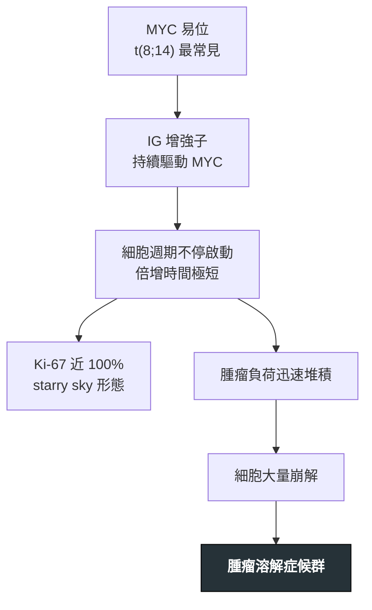

---
tags:
  - Med/Disease/Hema
  - lymphoma
  - aggressive-B
  - 禁忌
aliases:
  - Burkitt
  - 柏基特淋巴瘤
  - Burkitt Lymphoma
created: 2026-07-11
updated: 2026-07-26
status: 可用
source: 依 [[Hema Category]] 展開；WHO HAEM5（2022）
cssclass: clinical-note
presents_as:
  - "[[Lymphadenopathy]]"
  - "[[Fever]]"
diagnosed_by:
  - "[[Lymph node biopsy]]"
  - "[[Cytogenetics FISH]]"
  - "[[Flow cytometry]]"
treated_by:
  - "[[Rituximab]]"
differential:
  - "[[DLBCL]]"
  - "[[B-ALL]]"
complication:
  - "[[Tumor lysis syndrome]]"
---

# Burkitt ｜ 柏基特淋巴瘤 · Burkitt Lymphoma

> [!abstract] 一句話總覽
> 人體倍增最快的腫瘤之一：**MYC** 易位（經典 **t(8;14) IGH::MYC**）讓細胞不停進入細胞週期，**Ki-67 近 100%**、**BCL2 陰性**、形態呈 **starry-sky**。它高度可治癒，但**腫瘤溶解症候群**比腫瘤本身更快致命。

> [!tip] 30 秒行動卡
> **診斷關鍵**：中等大小單調 B 細胞 ＋ starry sky ＋ **CD10+ BCL6+ BCL2− Ki-67≈100%** → 驗 **MYC** 易位
> **治療骨架**：**短程高強度**多藥化療 ＋ [[Rituximab]] ＋ **中樞神經預防**（不是 R-CHOP）
> **絕對不可**：未水化、未降尿酸就給第一劑化療

---

## 定義與定位

| 項目 | 重點 |
|---|---|
| 本質 | 生發中心來源、**極度侵襲**的成熟 B 細胞淋巴瘤 |
| 好發族群 | 兒童與年輕成人為主；免疫缺陷者風險升高 |
| 分類位置 | 成熟 B · 高度侵襲；見 [[Hema Category]] |
| 三型情境 | **地方性**（非洲兒童、**顎骨**、高 EBV）· **散發性**（**迴盲部／腹部**腫塊）· **免疫缺陷相關**（HIV 等） |

🆕 WHO HAEM5 更強調 **EBV+ vs EBV−** 的生物學分組，而非只用舊的地理標籤。

## 病因與機制

> [!tip] 一條線推出全部處置
> 「快」推出全部：長得快 → 化療必須**短程高強度**；死得快 → **TLS 預防必須先於第一劑**；跑得快 → **中樞預防是常規**。

![[assets/burkitt-starry-sky.jpg|620]]
*單調、緊密排列的中等大小腫瘤細胞形成深色「夜空」；散在吞噬凋亡碎屑、胞質較淡的 tingible-body macrophage 形成「星星」。Source: [Wikimedia Commons — Burkitt's lymphoma Histopathology](https://commons.wikimedia.org/wiki/File:Burkitt%27s_lymphoma_Histopathology.jpg), National Cancer Institute（public domain）。*

## 臨床表現

- **典型**：數週內冒出的巨大腫塊——**顎骨／面骨**（地方性）或**迴盲部、腹腔、卵巢**（散發性）
- **提示性**：LDH 與尿酸顯著升高；B symptoms
- **少見但重要**：腦膜與中樞侵犯；骨髓大量侵犯時與 [[B-ALL]] 難分

→ 相關主訴流程：[[Lymphadenopathy]]、[[Fever]]

## 診斷

| 診斷條件 | 內容 |
|---|---|
| 形態 | 中等大小、單調 B 細胞；**starry-sky**（tingible-body macrophage） |
| 免疫表型 | **CD20+ CD10+ BCL6+**（生發中心表型）、**BCL2 陰性** |
| 增殖指數 | **Ki-67 ≈ 100%** |
| 分子 | **MYC** 易位：**t(8;14)** 最常見，亦可 t(2;8)、t(8;22) |
| 必查 | LDH、尿酸、鉀、磷、鈣、腎功能；分期 PET-CT ＋ **腦脊髓液細胞學** |

**要開的檢查**：[[Lymph node biopsy]]、[[Flow cytometry]]、[[Cytogenetics FISH]]、[[Bone marrow biopsy]]

## 鑑別診斷

| 要排除的 | 支持它的線索 | 怎麼排除 |
|---|---|---|
| [[DLBCL]]／**double-hit** | 「很像 Burkitt」但 **BCL2 陽性**或 Ki-67 未達滿 | MYC ＋ BCL2/BCL6 FISH → 歸 HGBCL，**不要硬套 Burkitt** |
| [[B-ALL]] | 以骨髓與周邊血為主、**TdT+**、不成熟表型 | 表面 Ig 與 TdT |
| [[Follicular Lymphoma]] | 同屬生發中心，但 **BCL2+**、Ki-67 低 | BCL2 與 Ki-67 |

## 治療

| 情境 | 處置 |
|---|---|
| 治療前（最優先） | **積極水化 ＋ 降尿酸**（rasburicase／allopurinol），密集追蹤電解質 |
| 第一線 | **短程、高強度多藥化療 ＋ [[Rituximab]]** |
| 中樞預防 | 常規鞘內化療 ± 可穿透中樞的藥物 |
| 難治／復發 | 預後差；考慮臨床試驗、細胞治療，適合者移植 |

## 併發症與預後

- **要盯的併發症**：[[Tumor lysis syndrome]]（**可在治療前自發發生**）、[[Febrile neutropenia]]、中樞神經侵犯
- **預後**：兒童與低期別成人**治癒率高**；取決於期別、中樞侵犯，以及能否安全撐過初期

## 禁忌與陷阱

> [!danger] 絕對不可
> | 情境 | 絕對不可 | 為什麼 | 該做什麼 |
> |---|---|---|---|
> | 巨大腫瘤負荷、LDH 高 | 未水化、未降尿酸就給第一劑 | 細胞同時崩解 → 高鉀、高磷、低鈣、急性腎衰、心律不整 | 先水化＋rasburicase，備透析 |
> | 已有腎損或高尿酸 | 只給 allopurinol 就開始 | allopurinol 不分解**既有**尿酸 | 改 rasburicase，代謝穩定再開始 |
> | 形態像 Burkitt 但 BCL2+ | 直接按 Burkitt 治 | 實為 HGBCL／double-hit，策略不同 | 補做 MYC/BCL2/BCL6 FISH |

> [!warning] 常見錯誤
> - 用 **R-CHOP** 治 Burkitt——強度不足且缺中樞預防。
> - 忘記腦脊髓液檢查與中樞預防。
> - 把 TLS 當「化療副作用」，而不是**治療前就該預防的急症**。

## 相關連結

- [[DLBCL]] — 高度侵襲 B 對照，double-hit 的歸屬
- [[Follicular Lymphoma]] — 同為生發中心來源，靠 BCL2／Ki-67 分開
- [[Tumor lysis syndrome]] — 本病最緊急的併發症
- [[Hema Category#🧬 關鍵基因速查表 Translocations|t(8;14) 基因表]]
- [[Hema Category|血液淋巴腫瘤分類 · Master Map]]
