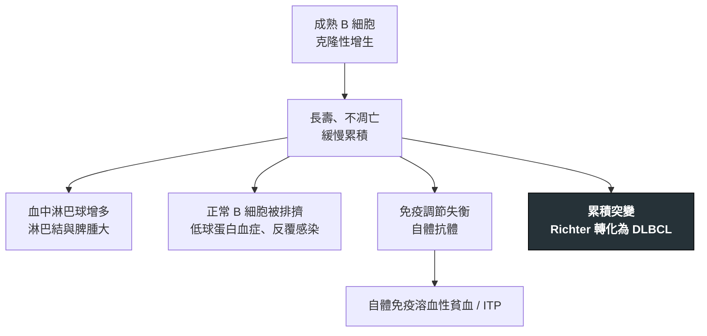

---
tags:
  - Med/Disease/Hema
  - leukemia
  - lymphoma
  - indolent-B
  - 禁忌
aliases:
  - CLL
  - SLL
  - CLL/SLL
  - 慢性淋巴性白血病
  - 小淋巴球淋巴瘤
  - Chronic Lymphocytic Leukemia
created: 2026-07-11
updated: 2026-07-26
status: 可用
source: 依 [[Hema Category]] 展開；WHO HAEM5（2022）
cssclass: clinical-note
presents_as:
  - "[[Lymphadenopathy]]"
  - "[[Splenomegaly]]"
diagnosed_by:
  - "[[Flow cytometry]]"
  - "[[Peripheral blood smear]]"
treated_by:
  - "[[Ibrutinib]]"
  - "[[Rituximab]]"
differential:
  - "[[Mantle Cell Lymphoma]]"
  - "[[Hairy Cell Leukemia]]"
  - "[[Follicular Lymphoma]]"
complication:
  - "[[DLBCL]]"
  - "[[Anemia]]"
---

# CLL-SLL ｜ 慢性淋巴性白血病／小淋巴球淋巴瘤 · Chronic Lymphocytic Leukemia / SLL

> [!abstract] 一句話總覽
> 同一疾病的兩種表現：**CLL** ＝血液／骨髓淋巴球增多為主，**SLL** ＝淋巴結為主、周邊負荷低。成熟 B 細胞、**CD5+ CD23+**，多數惰性到可以先不治，但要盯兩件事：**自體免疫血球破壞**與 **Richter 轉化**成 [[DLBCL]]。

> [!tip] 30 秒行動卡
> **診斷關鍵**：老人無症狀淋巴球增多 ＋ 抹片 **smudge cell** ＋ 流式 **CD5+ CD23+ CD20 dim**
> **治療骨架**：無症狀 → **觀察等待**；需治時用 **BTK 抑制劑**（[[Ibrutinib]]）或 venetoclax ± 抗 CD20
> **絕對不可**：只因為淋巴球數字高就開始治療

---

## 定義與定位

| 項目 | 重點 |
|---|---|
| 本質 | 成熟小 B 細胞的**惰性**克隆增生；CLL 與 SLL 為同一病的不同分布 |
| 好發族群 | 老年人；西方最常見成人白血病 |
| 分類位置 | 成熟 B · 惰性；見 [[Hema Category]] |
| 標記關鍵 | **CD5+、CD23+、CD20 dim**——與 [[Mantle Cell Lymphoma]]（CD5+ **CD23−** cyclin D1+）正面對打 |

## 病因與機制

> [!tip] 一條線推出全部處置
> 長得慢 → **治療不延長無症狀病人的存活**；真正會出事的是「被排擠」（感染、血球低下）與「轉化」。治療時機看的是**器官與血球被壓垮**，不是淋巴球數字。

## 臨床表現

- **典型**：老年人健檢發現**無症狀淋巴球增多**；無痛性淋巴結腫大、脾腫大
- **提示性**：反覆感染（低免疫球蛋白血症）；抹片 **smudge cells（塗抹細胞）**
- **少見但重要**：**自體免疫溶血性貧血／ITP** 可與疾病並存；單一淋巴結突然快速長大 ＋ LDH 急升 → **Richter 轉化**

→ 相關主訴流程：[[Lymphadenopathy]]、[[Splenomegaly]]

## 診斷

| 診斷條件 | 內容 |
|---|---|
| 確診 | 周邊血流式細胞術即可診斷 CLL；SLL 需 [[Lymph node biopsy]] |
| 免疫表型 | **CD5+ CD23+ CD20 dim**、輕鏈限制 |
| 預後分子 | ***IGHV* 突變狀態**、***TP53*／del(17p)**、del(11q) 等 |
| 分期 | **Rai**／**Binet**（依淋巴結區、脾肝腫大、貧血、血小板低下分層） |

**要開的檢查**：[[CBC with differential]]、[[Peripheral blood smear]]、[[Flow cytometry]]、[[Cytogenetics FISH]]

## 鑑別診斷

| 要排除的 | 支持它的線索 | 怎麼排除 |
|---|---|---|
| [[Mantle Cell Lymphoma]] | 也是 **CD5+**，但 **CD23−、cyclin D1+**、t(11;14)，行為偏侵襲 | cyclin D1 與 t(11;14) |
| [[Hairy Cell Leukemia]] | 巨脾、**全血球減少**、單核球缺乏、乾抽 | CD11c/CD25/CD103、BRAF V600E |
| [[Follicular Lymphoma]] | **CD10+ BCL2+ CD5−** | 免疫表型 |

## 治療

| 情境 | 處置 |
|---|---|
| 無症狀、早期 | **觀察等待**——提早治療不延長存活 |
| 需治時機 | 骨髓衰竭（貧血／血小板低下）、巨塊、B symptoms、難治的自免血球減少 |
| 第一線 | **BTK 抑制劑**（[[Ibrutinib]] 等）或 **BCL2 抑制劑**（venetoclax）± 抗 CD20（[[Rituximab]]／obinutuzumab） |
| 自體免疫溶血／ITP | 先以**類固醇**處理免疫問題，未必等同疾病進展 |
| **Richter 轉化** | 按侵襲性大 B 細胞淋巴瘤處理，**預後差** |

## 併發症與預後

- **要盯的併發症**：反覆感染、**自體免疫溶血性貧血／ITP**（見 [[Anemia]]）、**Richter 轉化為 [[DLBCL]]**
- **預後**：多數病程長達數年至十數年；**del(17p)／TP53 突變與未突變 IGHV** 為不良預後

## 禁忌與陷阱

> [!danger] 絕對不可
> | 情境 | 絕對不可 | 為什麼 | 該做什麼 |
> |---|---|---|---|
> | 無症狀早期、僅淋巴球高 | 貿然開始治療 | 不延長存活，只換來毒性與感染 | 定期追蹤血球與腫塊變化 |
> | 貧血合併網狀紅血球升高、Coombs 陽性 | 只當「疾病進展」直接上化療 | 實為**自體免疫溶血**，需免疫治療 | 先查 Coombs／LDH／haptoglobin，用類固醇 |
> | 單一腫塊快速長大、LDH 飆高 | 假設只是 CLL 惡化 | 可能已 **Richter 轉化** | 對長最快的病灶做切除生檢 |

> [!warning] 常見錯誤
> - **CD5+ 就當 mantle**——CLL 也是 CD5+，關鍵在 **CD23** 與 **cyclin D1**。
> - 把貧血一律歸給骨髓侵犯，漏掉溶血。

## 相關連結

- [[Mantle Cell Lymphoma]] — CD5 陽性的最重要鑑別
- [[DLBCL]] — Richter 轉化的去向
- [[Hairy Cell Leukemia]] — 另一慢性 B 白血病
- [[Hema Category|血液淋巴腫瘤分類 · Master Map]]
