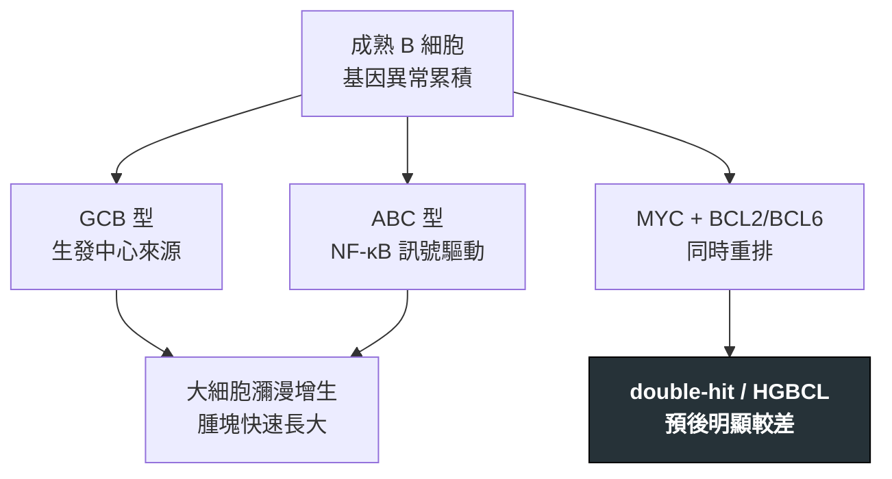

---
tags:
  - Med/Disease/Hema
  - lymphoma
  - aggressive-B
  - 禁忌
aliases:
  - DLBCL
  - 瀰漫性大B細胞淋巴瘤
  - Diffuse Large B-cell Lymphoma
created: 2026-07-11
updated: 2026-07-26
status: 可用
source: 依 [[Hema Category]] 展開；WHO HAEM5（2022）
cssclass: clinical-note
presents_as:
  - "[[Lymphadenopathy]]"
  - "[[Fever]]"
diagnosed_by:
  - "[[Lymph node biopsy]]"
  - "[[Flow cytometry]]"
  - "[[Cytogenetics FISH]]"
treated_by:
  - "[[Rituximab]]"
differential:
  - "[[Burkitt]]"
  - "[[Follicular Lymphoma]]"
complication:
  - "[[Tumor lysis syndrome]]"
  - "[[Febrile neutropenia]]"
---

# DLBCL ｜ 瀰漫性大 B 細胞淋巴瘤 · Diffuse Large B-cell Lymphoma

> [!abstract] 一句話總覽
> **最常見的非何杰金淋巴瘤（NHL）**：中到大型 B 細胞瀰漫生長、侵襲性強，但以 **R-CHOP** 為骨架的免疫化療**有治癒可能**。診斷時務必分出亞型（GCB vs ABC）並揪出 **double-hit**。

> [!tip] 30 秒行動卡
> **診斷關鍵**：快速長大的腫塊 → **切除式生檢**；**CD20+** 大細胞瀰漫浸潤 ＋ MYC/BCL2/BCL6 FISH
> **治療骨架**：**R-CHOP**（[[Rituximab]] + CHOP）；高危者加中樞預防
> **絕對不可**：未做 TLS 預防、未評估心臟 EF 就開始

---

## 定義與定位

| 項目 | 重點 |
|---|---|
| 本質 | 成熟 B 細胞來源、**侵襲性**大細胞淋巴瘤；**最常見的 NHL** |
| 好發族群 | 中老年為主 |
| 分類位置 | 成熟 B · **侵襲性**；見 [[Hema Category]] |
| 部位 | **nodal 或 extranodal 皆可**（胃、CNS、睪丸、骨）；🆕 WHO 對**免疫豁免部位**（CNS／玻璃體視網膜／睪丸）另有傘狀概念 |
| **可轉化而來** | **[[Follicular Lymphoma]]**、**[[CLL-SLL]]（Richter）** 等惰性淋巴瘤可轉成 DLBCL |

## 病因與機制

> [!tip] 一條線推出全部處置
> 長得快 → 對化療敏感，所以**可治癒**；但也代表**腫瘤溶解**與**壓迫症狀**早發。分型不改第一線骨架，改的是要不要加強、要不要中樞預防。

## 臨床表現

- **典型**：**快速腫大**的淋巴結或結外腫塊；**B symptoms**
- **提示性**：LDH 升高；依部位出現壓迫症狀（上腔靜脈、腸阻塞、脊髓壓迫）
- **少見但重要**：胃、CNS、睪丸等結外原發，**中樞復發風險高**

→ 相關主訴流程：[[Lymphadenopathy]]、[[Fever]]

## 診斷

| 診斷條件 | 內容 |
|---|---|
| 檢體 | **切除式／粗針生檢**（FNA 不足） |
| 基本 | 中大型細胞瀰漫浸潤、**CD20+** |
| **Hans 演算法** | **CD10 → BCL6 → MUM1** 分 **GCB vs non-GCB（ABC）**；**GCB**＝CD10+，或 CD10− BCL6+ MUM1−；**non-GCB**＝CD10− BCL6+ MUM1+，或 **CD10− BCL6−（不論 MUM1）** |
| 必做 FISH | **MYC、BCL2、BCL6**——用來抓 double-hit |
| 分期 | **PET-CT** ＋ 骨髓評估 ＋ **中樞風險評估** |

**要開的檢查**：[[Lymph node biopsy]]、[[Flow cytometry]]、[[Cytogenetics FISH]]、[[Bone marrow biopsy]]

> [!warning] Double-hit／高惡性度：比「普通 DLBCL」更兇
> - **MYC ＋ BCL2** 重排：WHO HAEM5 傾向視為較同質的高危實體（DLBCL/HGBCL with MYC & BCL2）。
> - 僅 **MYC ＋ BCL6** 生物學不同，依形態可歸 DLBCL, NOS 或 HGBCL, NOS。
> - 形態「像 Burkitt」但 **BCL2 陽性** → **不要**當典型 [[Burkitt]]。

## 鑑別診斷

| 要排除的 | 支持它的線索 | 怎麼排除 |
|---|---|---|
| [[Burkitt]] | 中等大小單調細胞、starry sky、**BCL2−、Ki-67≈100%** | Ki-67 與 MYC／BCL2 FISH |
| 由惰性淋巴瘤轉化 | 本來就有 [[Follicular Lymphoma]]／[[CLL-SLL]] 病史 | 重新做切除生檢比對 |

## 治療

| 情境 | 處置 |
|---|---|
| 治療前必做 | **TLS 預防**（水化＋降尿酸）、**心臟 EF 評估**、B 肝篩檢 |
| 第一線 | **R-CHOP**＝[[Rituximab]] ＋ CHOP（含 anthracycline） |
| 中樞高風險 | 加做**中樞預防**（睪丸、多處結外、CNS-IPI 高） |
| Double-hit | 較 R-CHOP 更強的方案，並強化中樞預防 |
| 復發／難治 | salvage ± [[Autologous HSCT]]；**CAR-T**、雙特異性抗體 |

## 併發症與預後

- **要盯的併發症**：[[Tumor lysis syndrome]]、[[Febrile neutropenia]]、anthracycline **心毒性**、中樞復發
- **預後**：整體**可治癒**；以 **IPI** 分層（年齡、LDH、體能、期別、結外數）
- **不良因子**：double-hit、ABC 型、轉化而來、中樞侵犯

## 禁忌與陷阱

> [!danger] 絕對不可
> | 情境 | 絕對不可 | 為什麼 | 該做什麼 |
> |---|---|---|---|
> | 高腫瘤負荷、LDH 高 | 未做 TLS 預防就給第一劑 | 細胞大量崩解 → 高鉀、高磷、急性腎衰、心律不整 | 先水化＋降尿酸，密集追蹤電解質 |
> | 心衰或 EF 偏低 | 未評估心臟就給 anthracycline | 累積性心毒性可致不可逆心衰 | 先做心臟超音波，必要時改無 anthracycline 方案 |

> [!warning] 常見錯誤
> - 只做 **FNA** 就下診斷——無法分型，也會漏掉 double-hit。
> - 不驗 **MYC/BCL2/BCL6 FISH**，把 double-hit 當普通 DLBCL 治。
> - 惰性淋巴瘤病人腫塊變大只當「原病進展」，漏掉轉化。

## 相關連結

- [[Burkitt]] — 高度侵襲 B 對照
- [[Follicular Lymphoma]] · [[CLL-SLL]] — 可轉化來源
- [[Hema Category#5.2 各論|Category §5.2]]
- [[Hema Category|血液淋巴腫瘤分類 · Master Map]]
