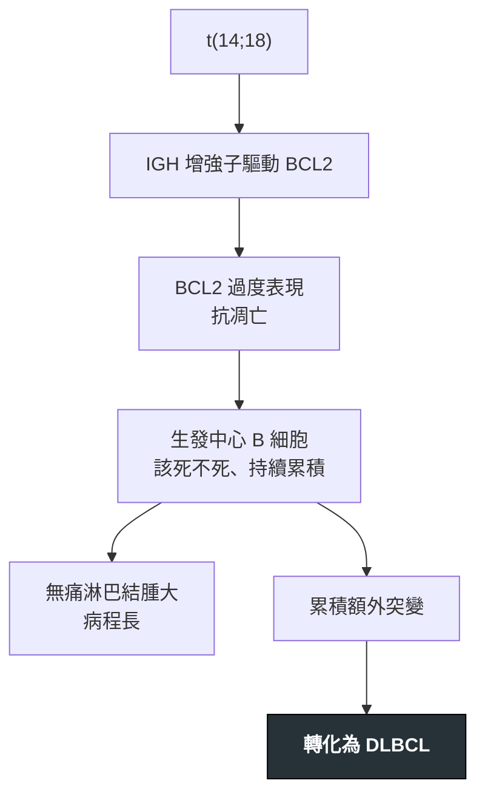

---
tags:
  - Med/Disease/Hema
  - lymphoma
  - indolent-B
aliases:
  - FL
  - 濾泡淋巴瘤
  - 濾泡性淋巴瘤
  - Follicular Lymphoma
created: 2026-07-11
updated: 2026-07-26
status: 可用
source: 依 [[Hema Category]] 展開；WHO HAEM5（2022）
cssclass: clinical-note
presents_as:
  - "[[Lymphadenopathy]]"
diagnosed_by:
  - "[[Lymph node biopsy]]"
  - "[[Flow cytometry]]"
treated_by:
  - "[[Rituximab]]"
  - "[[Radiotherapy]]"
differential:
  - "[[DLBCL]]"
  - "[[Mantle Cell Lymphoma]]"
  - "[[Burkitt]]"
complication:
  - "[[DLBCL]]"
---

# Follicular Lymphoma ｜ 濾泡淋巴瘤 · Follicular Lymphoma

> [!abstract] 一句話總覽
> 源自**生發中心 B 細胞**的常見惰性淋巴瘤，經典 **t(14;18) IGH::BCL2** 讓細胞不會凋亡。它長得慢、活得久、但**治不斷根**，且隨時可能轉化成 [[DLBCL]]——所以臨床決策的重點不是「殺光」，而是「何時才值得動手」。

> [!tip] 30 秒行動卡
> **診斷關鍵**：淋巴結保留濾泡結構 ＋ **CD10+ BCL6+ BCL2+**（反應性生發中心 BCL2 是**陰性**）
> **治療骨架**：侷限期 → 放療；進期無症狀 → **觀察等待**；有症狀／高負荷 → [[Rituximab]] ± 化療
> **絕對不可**：無

---

## 定義與定位

| 項目 | 重點 |
|---|---|
| 本質 | 生發中心 B 細胞來源的**惰性**成熟 B 細胞淋巴瘤 |
| 好發族群 | 中老年；西方最常見的惰性淋巴瘤 |
| 分類位置 | 成熟 B · 惰性（可轉侵襲）；見 [[Hema Category]] |
| 分級 | 傳統依 centroblast 密度分 1–3A（惰性）與 **3B**（**行為與治療比照 [[DLBCL]]**）；🆕 WHO HAEM5 已將 1–3A 併為 **classic FL 且不再強制分級**，**3B 獨立改名 follicular large B-cell lymphoma（FLBL）**——臨床結論不變 |

## 病因與機制

> [!warning] 良惡的開關：BCL2
> **反應性生發中心 BCL2 陰性；濾泡淋巴瘤 BCL2 陽性。**
> 生理上生發中心 B 細胞本來就該可以被淘汰（所以不表現 BCL2）；t(14;18) 把這個開關焊死。這一條同時解釋了病理判讀與病程。

## 臨床表現

- **典型**：中老年，**無痛性、多處淋巴結腫大**，可持續數年甚至自行消長
- **提示性**：骨髓侵犯常見（但白血病期少）；多數診斷時已是進期
- **少見但重要**：**單一腫塊突然快速長大 ＋ LDH 急升 ＋ B symptoms → 轉化**

→ 相關主訴流程：[[Lymphadenopathy]]

## 診斷

| 診斷條件 | 內容 |
|---|---|
| 檢體 | **切除式淋巴結生檢**（FNA 不足以分級） |
| 形態 | 保留濾泡結構，但濾泡大小一致、缺乏 mantle zone 與 tingible body macrophage |
| 免疫表型 | **CD20+ CD10+ BCL6+ BCL2+**、CD5− |
| 分子 | t(14;18) IGH::BCL2（約 85%） |
| 分期 | 全身 PET-CT ＋ 骨髓檢查 |

**要開的檢查**：[[Lymph node biopsy]]、[[Flow cytometry]]、[[Bone marrow biopsy]]

![[assets/fl-vs-reactive-bcl2.jpg|720]]
*上排 a＝reactive follicular hyperplasia：濾泡大小與形狀較不一，BCL2 只染深色 interfollicular／mantle 區，germinal center 保持陰性；下排 b＝follicular lymphoma：濾泡較單調、背對背排列，BCL2 在腫瘤濾泡內呈陽性。Source: [Gavrielides et al., *Sci Rep* 2020, Figure 1](https://pmc.ncbi.nlm.nih.gov/articles/PMC7195401/)（CC BY 4.0）。*

## 鑑別診斷

| 要排除的 | 支持它的線索 | 怎麼排除 |
|---|---|---|
| 反應性濾泡增生 | 濾泡大小不一、有 tingible body macrophage | **BCL2 陰性** |
| [[Mantle Cell Lymphoma]] | **CD5+、cyclin D1+**、t(11;14) | 免疫表型完全不同 |
| [[Burkitt]] | 同為生發中心來源，但 **BCL2−、Ki-67 近 100%**、starry sky | Ki-67 與 MYC |
| [[DLBCL]] | 瀰漫性大細胞、濾泡結構消失 | 形態；且需注意是**由 FL 轉化而來** |

## 治療

| 情境 | 處置 |
|---|---|
| 侷限期（I–II） | **[[Radiotherapy]]**，可長期控制甚至治癒 |
| 進期、無症狀、低負荷 | **觀察等待**——提早治療不延長存活 |
| 有症狀／高負荷 | [[Rituximab]] ± 化療（bendamustine 或 CHOP） |
| 復發 | 再誘導、標靶、放射免疫治療；適合者考慮移植 |
| 級別 3B | **比照 [[DLBCL]] 積極治療** |
| 疑似轉化 | 對**長最快的那顆**做切除生檢，確認後按 DLBCL 處理 |

## 併發症與預後

- **要盯的併發症**：轉化為 [[DLBCL]]（約每年 2–3%）
- **預後**：中位存活可達十餘年；預後指標用 **FLIPI**
- **警訊**：**POD24**（初次治療後 24 個月內惡化）是明確的不良預後族群

## 禁忌與陷阱

> [!danger] 絕對不可
> 本病無「立即致死」型絕對禁忌；風險來自**過度治療**與**漏掉轉化**，見下方常見錯誤。

> [!warning] 常見錯誤
> - 對無症狀低負荷病人立刻上化療——不延長存活，只增加毒性與續發腫瘤風險。
> - 懷疑轉化時只做 **FNA**——拿不到結構，無法分級，會漏掉 DLBCL。
> - 把級別 **3B** 當惰性處理——它該用侵襲性淋巴瘤的方式治。
> - 看到「濾泡結構保留」就判良性——關鍵是 **BCL2**，不是結構。

## 相關連結

- [[DLBCL]] — 轉化的去向
- [[Burkitt]] — 同為生發中心來源，靠 BCL2／Ki-67 分開
- [[Mantle Cell Lymphoma]] — CD5 陽性的對照
- [[Hema Category|血液淋巴腫瘤分類 · Master Map]]
