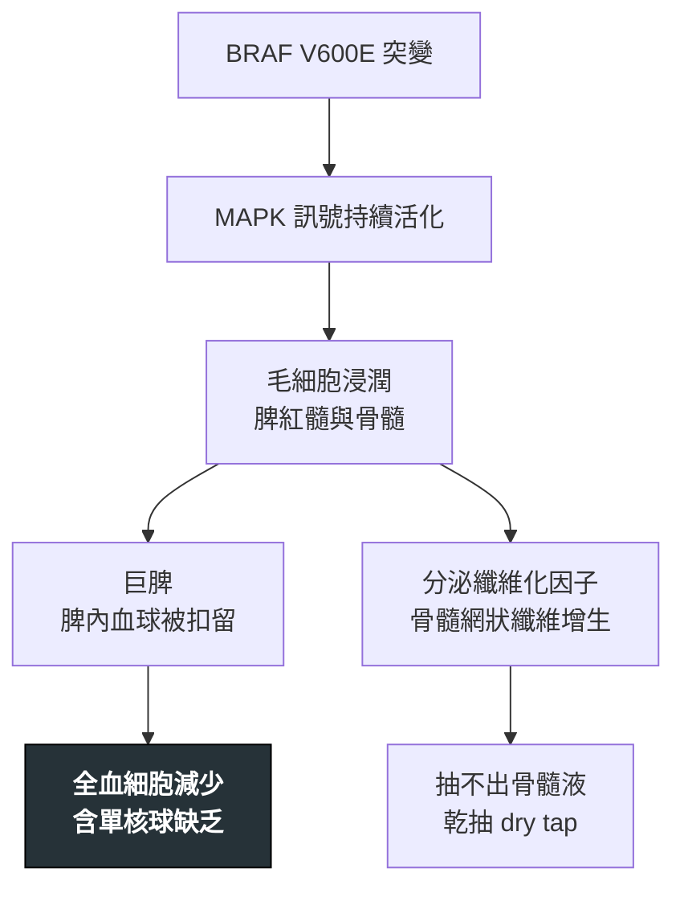

---
tags:
  - Med/Disease/Hema
  - leukemia
  - indolent-B
aliases:
  - HCL
  - 毛細胞白血病
  - Hairy Cell Leukemia
created: 2026-07-11
updated: 2026-07-26
status: 可用
source: 依 [[Hema Category]] 展開；WHO HAEM5（2022）
cssclass: clinical-note
presents_as:
  - "[[Splenomegaly]]"
  - "[[Pancytopenia]]"
diagnosed_by:
  - "[[Bone marrow biopsy]]"
  - "[[Flow cytometry]]"
treated_by:
  - "[[Cladribine]]"
  - "[[Rituximab]]"
differential:
  - "[[CLL-SLL]]"
  - "[[MDS]]"
complication:
  - "[[Febrile neutropenia]]"
---

# Hairy Cell Leukemia ｜ 毛細胞白血病 · Hairy Cell Leukemia

> [!abstract] 一句話總覽
> 少見但「考點很高產」的慢性 B 細胞白血病：細胞有**毛狀突起**，幾乎全部帶 **BRAF V600E**。臨床是**巨脾 ＋ 全血細胞減少 ＋ 骨髓乾抽**，淋巴結腫大反而不突出。對 **purine analog** 反應極佳，多數可長期緩解。

> [!tip] 30 秒行動卡
> **診斷關鍵**：巨脾 ＋ 全血球低下 ＋ **單核球缺乏** ＋ **骨髓乾抽** → 驗流式 **CD11c/CD25/CD103/CD123** 與 **BRAF V600E**
> **治療骨架**：有症狀才治；一線 **[[Cladribine]]**（或 pentostatin）± [[Rituximab]]
> **絕對不可**：無立即致死型禁忌（見下）

---

## 定義與定位

| 項目 | 重點 |
|---|---|
| 本質 | 成熟 B 細胞來源的**惰性**慢性白血病，主要占據**脾紅髓與骨髓** |
| 好發族群 | 中老年、**男性居多**；相對少見 |
| 分類位置 | 成熟 B · 惰性；見 [[Hema Category]] |
| 為何獨立成篇 | 主表未收，但「**脾腫大＋全血球低下**」的鑑別在考試與臨床極常用 |

## 病因與機制

> [!tip] 一條線推出全部處置
> 病灶集中在**脾與骨髓**、不在淋巴結 → 所以看到的是脾大與血球低下，而不是淋巴結腫大；纖維化 → 所以**乾抽**，診斷要靠**骨髓切片而非抽吸**；驅動點單一（BRAF）→ 所以標靶與 purine analog 都能打得很準。

![[assets/hairy-cell.jpg|620]]
*多顆異常 B cell 有圓形／腎形核、疏鬆染色質與較豐富淡藍胞質；胞質邊緣向四周伸出細長、不規則的毛狀突起，是 hairy cell 的辨識點。Source: [Wikimedia Commons — Hairy cell leukemia smear](https://commons.wikimedia.org/wiki/File:Hairy_cell_leukemia_smear_2009-08-20.JPG), Paulo Henrique Orlandi Mourao（CC BY-SA 3.0）。*

## 臨床表現

- **典型**：**巨脾**造成的腹脹或左上腹不適；疲倦、易感染、出血傾向
- **提示性**：**全血細胞減少**，且**單核球缺乏（monocytopenia）**是經典線索；**淋巴結腫大不突出**
- **少見但重要**：因單核球與嗜中性球雙低，可有非典型分枝桿菌等機會性感染

→ 相關主訴流程：[[Splenomegaly]]、[[Pancytopenia]]

## 診斷

| 診斷條件 | 內容 |
|---|---|
| 形態 | 圓核、豐富胞質、**hair-like projections** |
| 免疫表型 | **CD20 強陽性**，加上 **CD11c、CD25、CD103、CD123** |
| 基因 | ***BRAF V600E***（經典型幾乎皆有） |
| 組織化學 | **TRAP+**（傳統教學點） |
| 骨髓 | 常**乾抽**（網狀纖維增生）→ 必須做**切片**，不能只靠抽吸 |

**要開的檢查**：[[CBC with differential]]、[[Peripheral blood smear]]、[[Flow cytometry]]、[[Bone marrow biopsy]]

## 鑑別診斷

| 要排除的 | 支持它的線索 | 怎麼排除 |
|---|---|---|
| **HCL-variant**（🆕 HAEM5 已廢除此名，併入 **SBLPN**） | 白血球常升高、**CD25−**、**BRAF 陰性**，對 purine analog 反應差 | BRAF 與 CD25 |
| 脾邊緣帶淋巴瘤（SMZL） | 也有脾大，但無毛細胞表型、單核球不缺 | CD103/CD25、BRAF |
| [[CLL-SLL]] | **CD5+ CD23+**、淋巴球明顯增多、smudge cell | 流式表型 |
| [[MDS]] | 全血球低下但無巨脾；骨髓可抽出、有異常增生 | 骨髓切片與形態 |

## 治療

| 情境 | 處置 |
|---|---|
| 無症狀、血象尚可 | **觀察等待**——不需立即治療 |
| 治療時機 | 有症狀性脾腫大、明顯血球低下、反覆感染 |
| 第一線 | **purine analog**：[[Cladribine]] 或 pentostatin，± [[Rituximab]] |
| 復發／難治 | **BRAF 抑制劑**（vemurafenib 等）± 其他標靶 |
| 支持性 | 治療期間嚴防感染；深度骨髓抑制期需嚴密照護 |

## 併發症與預後

- **要盯的併發症**：[[Febrile neutropenia]]、機會性感染（purine analog 造成長期淋巴球低下）、脾腫大相關的血球扣留
- **預後**：一線治療反應率很高，多數可獲長期緩解；復發仍可再治療
- **追蹤重點**：血球回升情形與感染事件

## 禁忌與陷阱

> [!danger] 絕對不可
> 本病**無立即致死型絕對禁忌**。真正的風險有二：一是**治療期間的深度免疫抑制與感染**（purine analog 會讓 CD4 長期偏低），二是**診斷被誤判**而給了錯的一線藥。細節見下方常見錯誤。

> [!warning] 常見錯誤
> - 骨髓**乾抽**就當「抽失敗」重抽——乾抽本身就是線索，該做的是**切片**。
> - 看到全血球低下只想 [[MDS]] 或再生不良性貧血，**漏掉脾腫大這條線**。
> - 忽略**單核球缺乏**——這是少數幾個會特別提示 HCL 的血球異常。
> - 把 **HCL-variant**（HAEM5 新名 **SBLPN**）當經典型治療：它 BRAF 陰性、CD25 陰性，purine analog 效果差。

## 相關連結

- [[CLL-SLL]] — 另一種慢性 B 細胞白血病
- [[MDS]] — 全血球低下的重要鑑別
- [[LCH]] — 另一個 BRAF V600E 疾病（譜系完全不同）
- [[Hema Category|血液淋巴腫瘤分類 · Master Map]]
