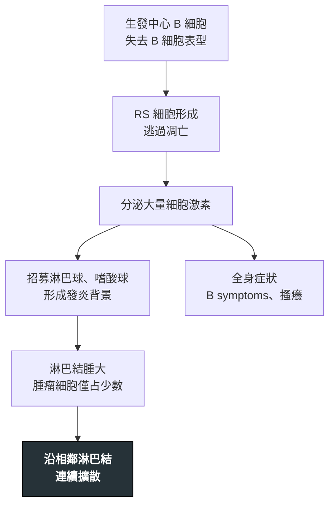

---
tags:
  - Med/Disease/Hema
  - lymphoma
  - Hodgkin
  - 禁忌
aliases:
  - HL
  - Hodgkin
  - 何杰金淋巴瘤
  - 霍奇金淋巴瘤
  - Reed-Sternberg
  - Hodgkin Lymphoma
created: 2026-07-11
updated: 2026-07-26
status: 可用
source: 依 [[Hema Category]] 展開；WHO HAEM5（2022）
cssclass: clinical-note
presents_as:
  - "[[Lymphadenopathy]]"
  - "[[Fever]]"
diagnosed_by:
  - "[[Lymph node biopsy]]"
treated_by:
  - "[[Brentuximab vedotin]]"
  - "[[Radiotherapy]]"
differential:
  - "[[DLBCL]]"
  - "[[ALCL]]"
complication:
  - "[[Febrile neutropenia]]"
---

# Hodgkin Lymphoma ｜ 何杰金淋巴瘤 · Hodgkin Lymphoma

> [!abstract] 一句話總覽
> 以**極少數腫瘤性 Reed-Sternberg（RS）細胞**活在大量發炎背景中為特徵。它沿**連續淋巴結**擴散、**結外少**（與多數 NHL 相反），好發**雙峰年齡**。治癒率高，所以現代難題不是能不能治好，而是**長期治療後遺症**。

> [!tip] 30 秒行動卡
> **診斷關鍵**：頸／縱膈無痛淋巴結 → **切除式生檢**；classic HL＝**CD15+ CD30+ CD20−/弱 CD45−**
> **治療骨架**：化療（ABVD 等骨架）± [[Radiotherapy]]，依分期與 **PET 反應**調整
> **絕對不可**：出現 bleomycin 相關肺症狀仍續用；治癒後失去長期追蹤

---

## 定義與定位

| 項目 | 重點 |
|---|---|
| 本質 | 腫瘤細胞（RS）只占少數，其餘為反應性發炎細胞 |
| 好發族群 | **雙峰**：年輕成人 ＋ 老年 |
| 分類位置 | 何杰金淋巴瘤；見 [[Hema Category]] |
| 擴散方式 | **連續性**淋巴結區擴散；結外相對少 |

### Classic HL（多數）

| 項目 | 重點 |
|---|---|
| 腫瘤細胞 | **RS cell**（owl-eye 核仁） |
| 免疫 | **CD15+、CD30+、CD20−/弱、CD45−**，PAX5 弱+ |
| EBV | 部分陽性（mixed cellularity 較高） |
| 亞型 | **結節硬化型 NS**（最常見，年輕女）· 混合細胞型 · 富淋巴球 · 淋巴球貧乏 |

### NLPHL（勿與 classic 混）

| 項目 | 重點 |
|---|---|
| 細胞 | LP／**popcorn cell** |
| 免疫 | **CD20+、CD45+、CD15−、CD30−**（與 classic **相反**） |
| 🆕 | ICC 等趨向強調其 B 細胞淋巴瘤本質；預後通常佳 |

## 病因與機制

> [!tip] 一條線推出全部處置
> 腫瘤細胞少、發炎多 → **切片要夠大**（FNA 只會抽到發炎細胞）；擴散是**連續**的 → **局部放療**有價值，分期特別重要；CD30 是 RS 招牌 → [[Brentuximab vedotin]] 打得中。

![[assets/reed-sternberg-cell.jpg|620]]
*中央 Reed–Sternberg cell 體積巨大，雙核近鏡像排列，每個核內都有醒目嗜酸性核仁，形成 owl-eye；背景則是大量小型反應性淋巴球與其他發炎細胞。Source: [Wikimedia Commons — Hodgkin Disease, Reed-Sternberg Cell](https://commons.wikimedia.org/wiki/File:Hodgkin_Disease,_Reed-Sternberg_Cell.jpg), Ed Uthman（CC BY-SA 2.0）。*

## 臨床表現

- **典型**：**無痛性淋巴結腫大**，好發**頸部與縱膈**
- **提示性**：**B symptoms**、全身搔癢
- **少見但重要**：飲酒後淋巴結疼痛；巨大縱膈腫塊可壓迫氣道

→ 相關主訴流程：[[Lymphadenopathy]]、[[Fever]]

## 診斷

| 診斷條件 | 內容 |
|---|---|
| 檢體 | **切除式淋巴結生檢**（FNA 不足以看到背景結構） |
| 確診 | 發炎背景中找到 **RS 細胞**＋符合的免疫表型 |
| 分期 | **PET-CT**；治療中以 **interim PET** 評估反應 |
| 治療前 | 肺功能（bleomycin）、心臟功能 |

**要開的檢查**：[[Lymph node biopsy]]、[[CBC with differential]]

## 鑑別診斷

| 要排除的 | 支持它的線索 | 怎麼排除 |
|---|---|---|
| [[DLBCL]] | 腫瘤細胞**是主體**、瀰漫成片、**CD20+ CD45+** | 免疫組織化學 |
| [[ALCL]] | 也 **CD30+**，但 T 細胞表型、可 ALK+ | T 細胞標記與 ALK |

## 治療

| 情境 | 處置 |
|---|---|
| 早期 | 短程化療 ± **[[Radiotherapy]]**，依 interim PET 減量 |
| 進期 | 完整療程化療（ABVD 等歷史骨架），當代依 PET 反應調整 |
| 復發／難治 | 救援化療 ± [[Autologous HSCT]]；**[[Brentuximab vedotin]]**（抗 CD30 ADC）、**PD-1 抑制劑** |
| NLPHL | 預後佳，較保守；CD20+ 可用 [[Rituximab]] |

## 併發症與預後

- **要盯的併發症**：[[Febrile neutropenia]]、**bleomycin 肺毒性**、anthracycline 心毒性
- **長期後遺症（治癒者的主要威脅）**：**放療後續發乳癌**（胸部照射的年輕女性）、續發白血病、**心血管疾病**
- **預後**：整體**治癒率高**；NLPHL 通常更佳

## 禁忌與陷阱

> [!danger] 絕對不可
> | 情境 | 絕對不可 | 為什麼 | 該做什麼 |
> |---|---|---|---|
> | 用 bleomycin 期間出現乾咳、喘、低血氧 | 當成感染繼續給下一劑 | **bleomycin 肺纖維化**可不可逆 | 立即停 bleomycin、評估肺功能與影像 |
> | 曾接受胸部放療的年輕女性 | 治癒後就結束追蹤 | **續發乳癌**與心血管疾病風險長期升高 | 依規範提早、長期做乳房與心血管監測 |

> [!warning] 常見錯誤
> - 用 **FNA** 診斷 HL——抽到的多半是發炎背景，找不到 RS 細胞。
> - 把 **NLPHL** 當 classic HL 治——兩者免疫表型**正好相反**，治療策略也不同。

## 相關連結

- [[DLBCL]] — 最常見 NHL 對照（腫瘤細胞是主體、結外多）
- [[ALCL]] — 另一個 CD30 陽性的淋巴瘤
- [[Hema Category#7. 何杰金淋巴瘤 Hodgkin Lymphoma|Category §7]]
- [[Hema Category|血液淋巴腫瘤分類 · Master Map]]
