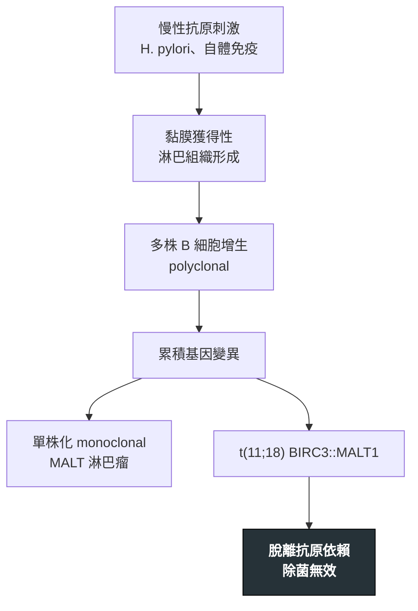

---
tags:
  - Med/Disease/Hema
  - lymphoma
  - indolent-B
  - 禁忌
aliases:
  - MALT
  - MZL
  - 邊緣帶淋巴瘤
  - MALT lymphoma
  - mucosa-associated lymphoid tissue
created: 2026-07-11
updated: 2026-07-26
status: 可用
source: 依 [[Hema Category]] 展開；WHO HAEM5（2022）
cssclass: clinical-note
presents_as:
  - "[[Lymphadenopathy]]"
diagnosed_by:
  - "[[Lymph node biopsy]]"
  - "[[Flow cytometry]]"
  - "[[Cytogenetics FISH]]"
treated_by:
  - "[[Rituximab]]"
  - "[[Radiotherapy]]"
differential:
  - "[[Follicular Lymphoma]]"
  - "[[CLL-SLL]]"
complication:
  - "[[DLBCL]]"
---

# MALT Lymphoma ｜ 邊緣帶／黏膜相關淋巴組織淋巴瘤 · Marginal Zone / MALT Lymphoma

> [!abstract] 一句話總覽
> 惰性成熟 B 細胞淋巴瘤，長在**慢性抗原刺激的發炎土壤**上（胃 **H. pylori**、自體免疫）。它示範了 **polyclonal → monoclonal** 的腫瘤演化：所以胃 MALT 的第一刀不是化療，而是**把抗原拿掉**——除菌。但 **t(11;18)** 陽性者除菌無效。

> [!tip] 30 秒行動卡
> **診斷關鍵**：胃鏡發現慢性胃炎樣病灶 → 生檢 **CD5− CD10−** 單株 B 細胞 ＋ 淋巴上皮病變；同時驗 **H. pylori** 與 **t(11;18)**
> **治療骨架**：胃 MALT ＋ H. pylori+ ＋ 無高危基因 → **先除菌**；否則 [[Radiotherapy]] 或 [[Rituximab]]
> **絕對不可**：**t(11;18) 陽性只做除菌就結案**

---

## 定義與定位

| 項目 | 重點 |
|---|---|
| 本質 | 邊緣帶來源的**惰性**成熟 B 細胞淋巴瘤 |
| 好發族群 | 中老年；常有慢性感染或自體免疫背景 |
| 分類位置 | 成熟 B · 惰性；見 [[Hema Category]] |
| 三大邊緣帶 | **結外 MALT**（本篇主角）· 結內 MZL · **脾 MZL** |

### 好發部位與相關疾病

| 部位 | 相關 |
|---|---|
| **胃** | ***H. pylori*** |
| 唾液腺 | **Sjögren 症候群** |
| 甲狀腺 | **橋本甲狀腺炎** |
| 眼附屬器、肺、皮膚 | 各有抗原／自免關聯 |

## 病因與機制

> [!tip] 一條線推出全部處置
> 腫瘤一開始**靠抗原養著** → 拿掉抗原（除菌）就可能整片退掉；一旦拿到 **t(11;18)** 這種自主性突變，就**不再需要抗原**，除菌自然無效——這一條同時解釋了治療選擇與追蹤策略。

## 臨床表現

- **典型**：胃 MALT 表現為**消化不良、上腹痛、慢性胃炎樣症狀**，常無腫塊感
- **提示性**：Sjögren 病人唾液腺持續腫大、橋本病人甲狀腺快速變大
- **少見但重要**：多數為侷限期，但可多部位受累；**轉化為大 B 細胞淋巴瘤**時腫塊快速長大

→ 相關主訴流程：[[Lymphadenopathy]]

## 診斷

| 診斷條件 | 內容 |
|---|---|
| 檢體 | 病灶部位生檢（胃 MALT 需**多點**胃鏡生檢） |
| 免疫表型 | **CD20+**，通常 **CD5−、CD10−**（對照 [[CLL-SLL]] 與 [[Follicular Lymphoma]]） |
| 形態 | 邊緣帶樣小 B 細胞浸潤；**淋巴上皮病變（lymphoepithelial lesion）** |
| 分子 | **t(11;18) BIRC3::MALT1**——胃 MALT 常見，**預示對單純除菌反應差** |
| 必查 | **H. pylori**（組織染色／呼氣試驗）、內視鏡超音波評估侵犯深度、分期影像 |

**要開的檢查**：[[Lymph node biopsy]]、[[Flow cytometry]]、[[Cytogenetics FISH]]

## 鑑別診斷

| 要排除的 | 支持它的線索 | 怎麼排除 |
|---|---|---|
| 反應性淋巴增生（慢性胃炎） | 無單株性、無淋巴上皮病變 | 輕鏈限制／免疫球蛋白基因重排 |
| [[Follicular Lymphoma]] | **CD10+ BCL6+ BCL2+**、t(14;18) | 免疫表型 |
| [[CLL-SLL]] | **CD5+ CD23+**、周邊淋巴球增多 | 流式表型 |

## 治療

| 情境 | 處置 |
|---|---|
| 胃 MALT、H. pylori+、**無 t(11;18)** | **先除菌**——部分可完全緩解；之後定期胃鏡追蹤 |
| 除菌失敗或 **t(11;18) 陽性** | **H. pylori 陽性仍應除菌**（治感染本身），但**不可只靠它**——同時安排 **[[Radiotherapy]]**（侷限期效果佳）或 [[Rituximab]] |
| 其他部位（眼、唾液腺、甲狀腺、肺） | 侷限期放療；必要時手術或全身治療 |
| 進期／多部位 | 全身治療（[[Rituximab]] ± 化療） |
| 已轉化 | 按 [[DLBCL]] 積極治療 |

## 併發症與預後

- **要盯的併發症**：**轉化為 [[DLBCL]]**、胃病灶出血或穿孔（少見）
- **預後**：**惰性、預後佳**，侷限期長期控制率高；除菌反應者可維持多年緩解
- **追蹤重點**：除菌後需**內視鏡連續追蹤**，退縮常需數月以上

## 禁忌與陷阱

> [!danger] 絕對不可
> | 情境 | 絕對不可 | 為什麼 | 該做什麼 |
> |---|---|---|---|
> | **t(11;18) 陽性**的胃 MALT | 只做除菌就當治療完成 | 腫瘤已脫離抗原依賴，除菌不會讓它退 | 除菌照做，但**同時**安排放療或抗 CD20 |
> | 除菌後病灶未退 | 一再重複除菌療程並持續觀望 | 拖延讓病灶進展甚至轉化 | 依時程重新生檢，改用局部或全身治療 |

> [!warning] 常見錯誤
> - **不驗 t(11;18)** 就把所有胃 MALT 都交給除菌。
> - 除菌後太早判定失敗——退縮本來就慢，需給足追蹤時間。
> - 只顧胃部，忘記 MALT 可長在**甲狀腺、唾液腺、眼附屬器、肺、皮膚**。

## 相關連結

- [[Follicular Lymphoma]] · [[CLL-SLL]] — 其他惰性成熟 B，靠 CD5／CD10 分開
- [[DLBCL]] — 轉化的去向
- [[Hema Category|血液淋巴腫瘤分類 · Master Map]]
