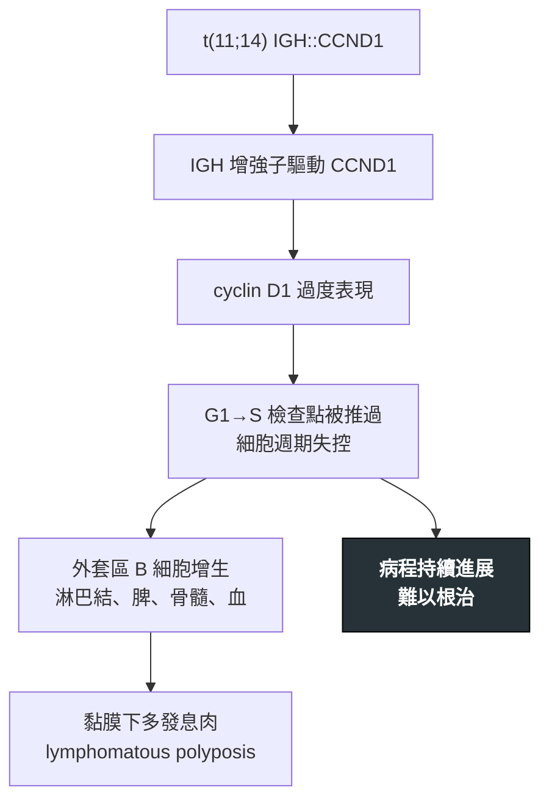

---
tags:
  - Med/Disease/Hema
  - lymphoma
  - aggressive-B
  - 禁忌
aliases:
  - MCL
  - 套細胞淋巴瘤
  - 外套細胞淋巴瘤
  - Mantle Cell Lymphoma
created: 2026-07-11
updated: 2026-07-26
status: 可用
source: 依 [[Hema Category]] 展開；WHO HAEM5（2022）
cssclass: clinical-note
presents_as:
  - "[[Lymphadenopathy]]"
  - "[[Splenomegaly]]"
diagnosed_by:
  - "[[Lymph node biopsy]]"
  - "[[Flow cytometry]]"
  - "[[Cytogenetics FISH]]"
treated_by:
  - "[[Ibrutinib]]"
  - "[[Autologous HSCT]]"
differential:
  - "[[CLL-SLL]]"
  - "[[Follicular Lymphoma]]"
complication:
  - "[[Tumor lysis syndrome]]"
---

# Mantle Cell Lymphoma ｜ 套細胞淋巴瘤 · Mantle Cell Lymphoma

> [!abstract] 一句話總覽
> 由 **t(11;14) IGH::CCND1** 驅動、**cyclin D1 陽性**的成熟 B 細胞淋巴瘤。表型 **CD5+ 但 CD23−**，正好是 [[CLL-SLL]] 的對照組。它由**小細胞**構成卻**行為偏侵襲**——「小細胞就是惰性」在這裡不成立。

> [!tip] 30 秒行動卡
> **診斷關鍵**：**CD5+ CD23− cyclin D1+**，FISH 驗 **t(11;14)**；cyclin D1 陰性的罕見型看 **SOX11**
> **治療骨架**：年輕適合移植者 → 強化免疫化療 ± [[Autologous HSCT]]；老年／不適 → **BTK 抑制劑**（[[Ibrutinib]]）
> **絕對不可**：看到「小細胞」就當惰性長期觀望

---

## 定義與定位

| 項目 | 重點 |
|---|---|
| 本質 | 來自濾泡外套區（mantle zone）的成熟 B 細胞淋巴瘤 |
| 好發族群 | **偏老年男性** |
| 分類位置 | 成熟 B · **偏侵襲**；見 [[Hema Category]] |
| 招牌 | **t(11;14) IGH::CCND1 → cyclin D1 過度表現** |

### 與 CLL/SLL 的正面對照

| | CLL/SLL | **Mantle** |
|---|---|---|
| CD5 | + | + |
| CD23 | **+** | **−** |
| Cyclin D1 | − | **+** |
| 易位 | — | **t(11;14)** |
| 行為 | 惰性 | **偏侵襲** |

另：**SOX11+** 支持 MCL（對某些 cyclin D1 陰性的罕見型特別有幫助）。

## 病因與機制

> [!tip] 一條線推出全部處置
> 問題出在**細胞週期油門被踩死**，不是抗凋亡 → 不像 FL 可以長期觀望，多數需要治療；但也不像 Burkitt 一擊就清，所以第一線要用足強度並考慮**移植鞏固**。

## 臨床表現

- **典型**：**廣泛期**才被發現——淋巴結、**脾腫大**、骨髓與周邊血皆可受累
- **提示性**：**腸道多發息肉樣侵犯（lymphomatous polyposis）**；可有**白血病期**（周邊血淋巴球增多）
- **少見但重要**：極少數表現為惰性，需專科判斷；**blastoid 型**則特別兇

→ 相關主訴流程：[[Lymphadenopathy]]、[[Splenomegaly]]

## 診斷

| 診斷條件 | 內容 |
|---|---|
| 檢體 | 淋巴結切除生檢；白血病期可用周邊血流式 |
| 免疫表型 | **CD20+ CD5+ CD23− cyclin D1+**、CD10− |
| 分子 | **t(11;14) IGH::CCND1**（FISH） |
| 輔助 | **SOX11**——cyclin D1 陰性型的關鍵 |
| 分期 | PET-CT ＋ 骨髓檢查；有腸胃症狀加內視鏡 |

**要開的檢查**：[[Lymph node biopsy]]、[[Flow cytometry]]、[[Cytogenetics FISH]]、[[Bone marrow biopsy]]

## 鑑別診斷

| 要排除的 | 支持它的線索 | 怎麼排除 |
|---|---|---|
| [[CLL-SLL]] | 同為 **CD5+**，但 **CD23+**、cyclin D1−、smudge cell、行為惰性 | **cyclin D1 與 t(11;14)** |
| [[Follicular Lymphoma]] | **CD10+ BCL2+ CD5−**、t(14;18) | 免疫表型 |

## 治療

| 情境 | 處置 |
|---|---|
| 年輕、適合移植 | 強化免疫化療（含 cytarabine 的方案）± **[[Autologous HSCT]]** 鞏固 |
| 老年／不適合強治 | 較溫和的免疫化療，或**標靶導向** |
| 復發／難治 | **BTK 抑制劑**（[[Ibrutinib]] 等）、BCL2 抑制劑；適合者考慮細胞治療 |
| 少數惰性表現亞群 | 可較保守觀察，但**需專科判斷**，不是預設選項 |

## 併發症與預後

- **要盯的併發症**：[[Tumor lysis syndrome]]（高負荷／blastoid 型）、[[Febrile neutropenia]]、腸道病灶出血或阻塞
- **預後**：多數會**反覆復發**，長期治癒困難；**MIPI** 為常用預後指標
- **不良因子**：**blastoid 型**、高 Ki-67、TP53 異常

## 禁忌與陷阱

> [!danger] 絕對不可
> | 情境 | 絕對不可 | 為什麼 | 該做什麼 |
> |---|---|---|---|
> | 病理報告寫「小 B 細胞淋巴瘤」 | 直接歸類惰性、長期只觀察 | 多數 MCL 行為偏侵襲，拖延會失去最佳治療時機 | 一定要驗 **cyclin D1／t(11;14)** 再決定 |
> | 使用 BTK 抑制劑期間 | 忽略出血與心房顫動風險、隨意併用抗凝血劑 | 該類藥物會增加出血與心律問題 | 用藥前後評估出血風險與心律，手術前依規範停藥 |

> [!warning] 常見錯誤
> - **CD5+ 就當 CLL**——關鍵在 **CD23** 與 **cyclin D1**。
> - 只做形態不做 cyclin D1／FISH，把 MCL 漏成其他小 B 細胞淋巴瘤。
> - 看到腸道多發息肉只想大腸癌或家族性息肉症，忘記 **lymphomatous polyposis**。

> [!tip] 口訣
> **Mantle ＝ CD5+ CD23− ＋ cyclin D1（t(11;14)）**。

## 相關連結

- [[CLL-SLL]] — 最重要鑑別，CD23 與 cyclin D1 是分水嶺
- [[Follicular Lymphoma]] — 另一種 CD5− 成熟 B 淋巴瘤
- [[Hema Category#🧬 關鍵基因速查表 Translocations|t(11;14)]]
- [[Hema Category|血液淋巴腫瘤分類 · Master Map]]
