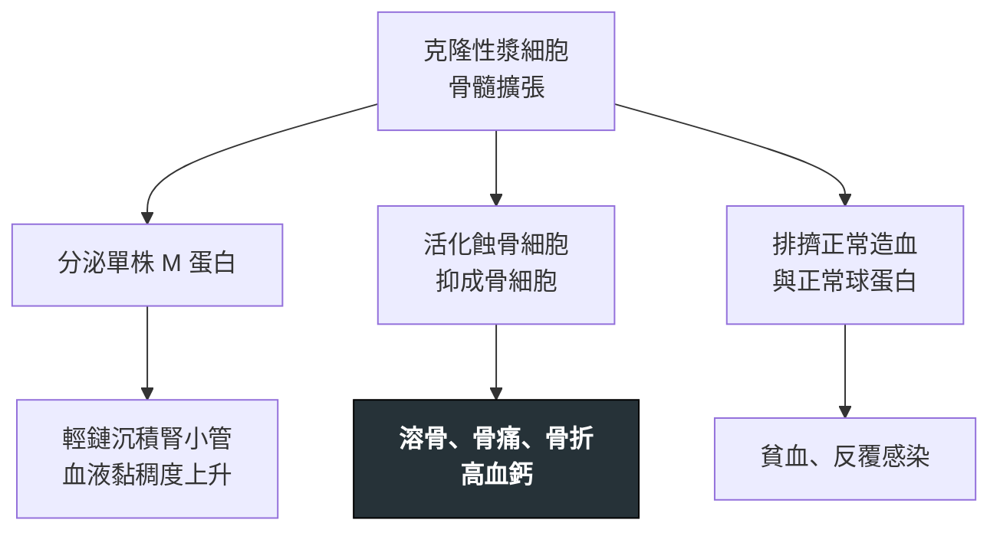

---
tags:
  - Med/Disease/Hema
  - plasma-cell
  - 禁忌
aliases:
  - MM
  - 多發性骨髓瘤
  - 骨髓瘤
  - Multiple Myeloma
created: 2026-07-11
updated: 2026-07-26
status: 可用
source: 依 [[Hema Category]] 展開；WHO HAEM5（2022）
cssclass: clinical-note
presents_as:
  - "[[Bone pain]]"
  - "[[Anemia]]"
diagnosed_by:
  - "[[Bone marrow biopsy]]"
  - "[[SPEP]]"
treated_by:
  - "[[Bortezomib]]"
  - "[[Lenalidomide]]"
  - "[[Autologous HSCT]]"
differential:
  - "[[Anemia]]"
complication:
  - "[[Hypercalcemia]]"
  - "[[Spinal cord compression]]"
  - "[[Hyperviscosity syndrome]]"
---

# Multiple Myeloma ｜ 多發性骨髓瘤 · Multiple Myeloma

> [!abstract] 一句話總覽
> 克隆性**漿細胞**腫瘤，分泌**單株免疫球蛋白（M 蛋白）**。它不是典型淋巴結病，而是**骨髓＋骨＋腎**的病：用 **CRAB** 與骨髓漿細胞負荷診斷，標記 **CD138+**，血片見 **Rouleaux**。

> [!tip] 30 秒行動卡
> **診斷關鍵**：老年人骨痛／貧血／腎損／高鈣 → **SPEP/UPEP ＋ 免疫固定 ＋ 游離輕鏈** ＋ 骨髓檢查
> **治療骨架**：誘導（PI ＋ IMiD ＋ 類固醇 ± anti-CD38）→ 適合者 **[[Autologous HSCT]]** → 維持
> **絕對不可**：高鈣危象或脊髓壓迫只排門診；腎損時給 NSAID 或顯影劑

---

## 定義與定位

| 項目 | 重點 |
|---|---|
| 本質 | 成熟 B 細胞末端分化（**漿細胞**）克隆性腫瘤 |
| 好發族群 | 老年為主 |
| 分類位置 | 漿細胞腫瘤；見 [[Hema Category]] |
| 疾病譜 | **MGUS → 冒煙型 smoldering → 症狀性 MM**；另有漿細胞瘤、AL 類澱粉沉積症 |

## 病因與機制

> [!tip] 一條線推出全部處置
> 一個源頭分出兩條線：**細胞塞骨髓** → 貧血、感染、溶骨；**蛋白到處跑** → 腎損、高黏稠、類澱粉。治療要兩手並進：殺漿細胞（誘導＋移植）＋ 護終端器官（護骨、護腎、防感染）。

## 臨床表現

- **典型**：**骨痛**（腰背最常見）、病理性骨折、疲倦、**貧血**
- **提示性**：不明原因腎損、高血鈣、反覆感染
- **少見但重要**：**脊髓壓迫**（背痛＋下肢無力）；IgA／IgG 極高時的**高黏稠症候群**

→ 相關主訴流程：[[Bone pain]]、[[Anemia]]

## 診斷

**IMWG**：**克隆性骨髓漿細胞 ≥10%**（或生檢證實之漿細胞瘤）**＋** 任一 myeloma-defining event。

### CRAB（終端器官損傷）

| 字母 | 意義 | 約略閾值概念 |
|---|---|---|
| **C** | Hyper**C**alcemia | Ca 明顯升高（如 >11 mg/dL 或高於 ULN 1 mg/dL） |
| **R** | **R**enal | CrCl <40 或 Cr >2 mg/dL |
| **A** | **A**nemia | Hb <10 g/dL 或低於正常下限 2 g/dL |
| **B** | **B**one | ≥1 處溶骨（影像） |

### 生物標記型 MDE（可在器官損傷前達診斷）

- 骨髓克隆漿細胞 **≥60%**
- 受累／非受累 **FLC 比 ≥100**（且**受累 FLC 本身 ≥100 mg/L**，否則比值無意義）
- MRI **>1** 處局灶病灶（即 **≥2 處**，每處 ≥5 mm）

### 實驗室與影像

| 項目 | 重點 |
|---|---|
| 標記 | **CD138+、CD38+**，常 **CD56+**（異常）、胞質 Ig、輕鏈限制 |
| 血／尿 | **SPEP/UPEP**、免疫固定、**血清游離輕鏈**；尿 **Bence-Jones** |
| 血片 | **Rouleaux（錢串狀）** |
| 影像 | 全身低劑量 CT／PET／MRI，**取代**單純骨骼 survey |

**要開的檢查**：[[SPEP]]、[[Bone marrow biopsy]]、[[Peripheral blood smear]]、[[Flow cytometry]]

## 鑑別診斷

| 要排除的 | 支持它的線索 | 怎麼排除 |
|---|---|---|
| MGUS／冒煙型骨髓瘤 | 有 M 蛋白但**無 CRAB、無生物標記型 MDE** | 依上述診斷條件 |
| 骨轉移癌 | 有原發癌；病灶可成骨或混合 | 影像型態、無 M 蛋白 |

## 治療

| 情境 | 處置 |
|---|---|
| 誘導 | **[[Bortezomib]]（PI）＋ [[Lenalidomide]]（IMiD）＋ 類固醇 ± anti-CD38** |
| 適合移植者 | **[[Autologous HSCT]]** 鞏固 |
| 維持 | [[Lenalidomide]] 等 |
| 支持性 | **雙磷酸鹽／denosumab** 護骨、感染預防、**血栓預防**（用免疫調節劑時） |

## 併發症與預後

- **要盯的併發症**：[[Hypercalcemia]]、**[[Spinal cord compression]]**、腎衰竭、[[Hyperviscosity syndrome]]、[[Thrombosis]]
- **預後**：仍屬**不可治癒但可長期控制**；以 **R-ISS** 與細胞遺傳學分層

## 禁忌與陷阱

> [!danger] 絕對不可
> | 情境 | 絕對不可 | 為什麼 | 該做什麼 |
> |---|---|---|---|
> | 血鈣升高＋意識改變、脫水 | 當慢性高鈣門診追蹤 | **高鈣危象**可致心律不整、昏迷 | 立即大量輸液，並給雙磷酸鹽／降鈣治療 |
> | 背痛 ＋ 下肢無力／感覺異常／括約肌障礙 | 只開止痛藥觀察 | **脊髓壓迫**數小時內即可造成不可逆癱瘓 | 緊急 MRI ＋ 類固醇，立即會診放療／神經外科 |
> | 已有腎功能惡化 | 給 **NSAID** 或做**顯影劑**檢查 | 疊加腎毒性，可能推入不可逆腎衰 | 改用非腎毒性止痛與非顯影影像 |

> [!warning] 常見錯誤
> - 只驗 SPEP 就排除 MM——**輕鏈型**電泳可能正常，必須加**游離輕鏈與 UPEP**。
> - 看到 M 蛋白就診斷 MM——多數其實是 **MGUS**。

## 相關連結

- [[Anemia]] — CRAB 的 A
- [[Hema Category#6. 漿細胞腫瘤 Plasma Cell Neoplasm（Multiple Myeloma）|Category §6]]
- [[Hema Category|血液淋巴腫瘤分類 · Master Map]]
