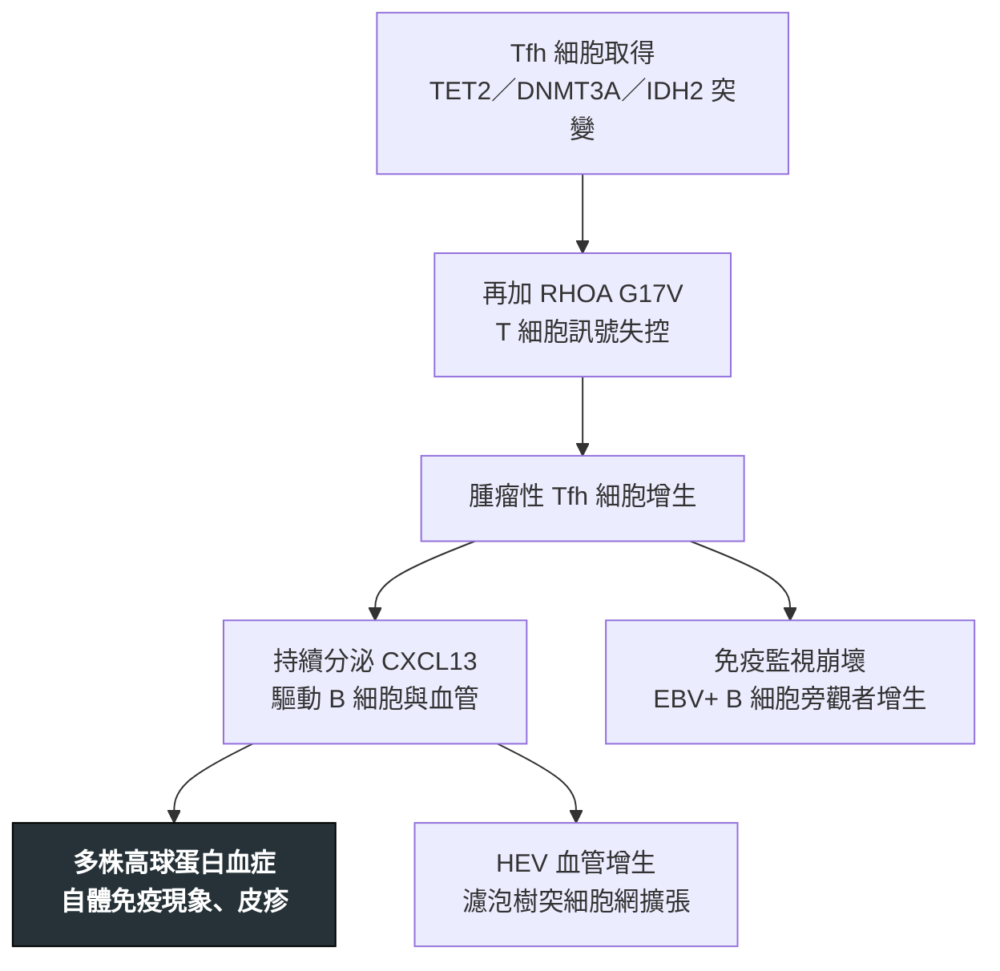

---
tags:
  - Med/Disease/Hema
  - lymphoma
  - mature-T
  - Tfh
aliases:
  - AITL
  - 血管免疫母細胞T細胞淋巴瘤
  - 結內Tfh細胞淋巴瘤
  - Angioimmunoblastic T-cell Lymphoma
  - Nodal Tfh cell lymphoma
created: 2026-07-11
updated: 2026-07-26
status: 可用
source: 依 [[Hema Category]] 展開；WHO HAEM5（2022）
cssclass: clinical-note
presents_as:
  - "[[Lymphadenopathy]]"
  - "[[Fever]]"
diagnosed_by:
  - "[[Lymph node biopsy]]"
  - "[[Flow cytometry]]"
treated_by:
  - "[[Autologous HSCT]]"
differential:
  - "[[PTCL]]"
  - "[[DLBCL]]"
complication:
  - "[[DLBCL]]"
  - "[[Anemia]]"
---

# AITL ｜ 結內 Tfh 細胞淋巴瘤，AITL 型 · Nodal Tfh Cell Lymphoma, Angioimmunoblastic Type

> [!abstract] 一句話總覽
> 源自**濾泡輔助 T 細胞（Tfh）**的結內侵襲性淋巴瘤。腫瘤細胞還持續**指揮 B 細胞與血管**，所以病人看起來像自體免疫病而不像淋巴瘤。🆕 WHO HAEM5（2022）已將它併入 **nodal Tfh cell lymphoma**，AITL 為其 **angioimmunoblastic 型**。

> [!tip] 30 秒行動卡
> **診斷關鍵**：全身淋巴結腫大＋發燒皮疹＋**多株高球蛋白血症** → 切除式生檢找 **Tfh 表型（CD4+ CD10+ PD-1+ CXCL13+ BCL6+）**
> **治療骨架**：CHOP 為基礎化療；緩解後適合者以 [[Autologous HSCT]] 鞏固
> **絕對不可**：無（但不可只當自體免疫病用類固醇壓著）

---

## 定義與定位

| 項目 | 重點 |
|---|---|
| 本質 | 來自 **Tfh 細胞**的成熟 T 細胞淋巴瘤，以結內病變為主 |
| 好發族群 | 中老年；最常見的 T 細胞淋巴瘤之一 |
| 分類位置 | 成熟 T／NK · 結內 Tfh 家族；見 [[Hema Category]] |
| 🆕 命名更新 | 舊稱 AITL；HAEM5 改列 **nodal Tfh cell lymphoma**，AITL 只是其中一型 |

## 病因與機制

> [!tip] 一條線推出全部處置
> 腫瘤是 **T 細胞**，但病人身上看得到的（高球蛋白、溶血、皮疹、EBV+ B 增生）幾乎都是**被它指揮出來的旁觀者現象**。所以治療對象永遠是 T 細胞——把 T 打下去，B 端表現會跟著退。

## 臨床表現

- **典型**：中老年，**全身性淋巴結腫大**、肝脾腫大、發燒與 B symptoms，進展快
- **提示性**：**整組像自體免疫病**——皮疹、關節痛、**多株高球蛋白血症**、**Coombs 陽性溶血性貧血**、自體抗體陽性
- **少見但重要**：胸腹水；背景 EBV+ B 細胞可增生成 EBV+ [[DLBCL]]

→ 相關主訴流程：[[Lymphadenopathy]]、[[Fever]]、[[Skin lesion]]

## 診斷

| 診斷條件 | 內容 |
|---|---|
| 檢體 | **切除式淋巴結生檢**（FNA 不足） |
| 形態 | **arborizing 高內皮小靜脈（HEV）增生**、**濾泡樹突細胞網擴張**、多形性發炎背景 |
| 免疫表型 | 腫瘤 T 細胞 **CD4+** 並帶 Tfh 標記：**CD10、PD-1、CXCL13、BCL6、ICOS** |
| 背景 B | 散在 **EBER+ B 母細胞**——旁觀者，不是診斷主角 |
| 克隆與分子 | **TCR 重排陽性**（腫瘤是 T）；常見 TET2、DNMT3A、IDH2、**RHOA G17V** |

**要開的檢查**：[[Lymph node biopsy]]、[[Flow cytometry]]、[[Bone marrow biopsy]]、[[SPEP]]

## 鑑別診斷

| 要排除的 | 支持它的線索 | 怎麼排除 |
|---|---|---|
| [[PTCL]] | 無 Tfh 標記、無 HEV／FDC 網增生 | 補做整組 Tfh 免疫染色 |
| 反應性淋巴結炎、藥物反應 | 結構保留、無 T 細胞克隆 | TCR 重排＋Tfh 表型 |
| [[DLBCL]] | 大 B 細胞成片分佈 | AITL 的 EBV+ B 僅散在；看 TCR 重排 |
| 自體免疫疾病（如 SLE） | 自體抗體具特異性、淋巴結不持續變大 | 淋巴結生檢 |

## 治療

| 情境 | 處置 |
|---|---|
| 第一線 | CHOP 為基礎多藥化療；CD30 陽性者可考慮含 [[Brentuximab vedotin]] 的方案 |
| 鞏固 | 首次緩解後，體能可承受者做 [[Autologous HSCT]] |
| 復發／難治 | HDAC 抑制劑、去甲基化藥物；年輕者評估 [[Allogeneic HSCT]] |
| 支持性 | 伺機性感染預防；溶血明顯時加類固醇 |

## 併發症與預後

- **要盯的併發症**：**自體免疫溶血性貧血**（見 [[Anemia]]）、伺機性感染、轉化為 EBV+ [[DLBCL]]
- **預後**：屬侵襲性淋巴瘤，整體預後保守；化療可緩解但**復發常見**，且無專屬靶點（對照 ALK+ [[ALCL]]）

## 禁忌與陷阱

> [!danger] 絕對不可
> 本病無立即致死型絕對禁忌；最大風險是**被當成自體免疫病或感染**而長期只給類固醇——症狀短暫改善，診斷卻一路延後，見下方常見錯誤。

> [!warning] 常見錯誤
> - **當成自體免疫病**：發燒、皮疹、高球蛋白、Coombs 陽性溶血很像 SLE 或藥物過敏——但淋巴結會持續變大，該做的是生檢。
> - 看到背景 **EBV+ B 細胞**就診斷 B 細胞淋巴瘤或傳染性單核球增多症——腫瘤是 T。
> - 只做 FNA——拿不到 HEV／FDC 網的結構訊息。
> - 沒驗整組 Tfh 標記就報 PTCL, NOS——AITL 是最常被漏掉的「有名字」實體。

## 相關連結

- [[PTCL]] — 排除 AITL 等特定實體之後，才叫 NOS
- [[DLBCL]] — 背景 EBV+ B 細胞的去向
- [[NK-T Lymphoma]] — 同樣與 EBV 相關，但譜系與部位完全不同
- [[Hema Category|血液淋巴腫瘤分類 · Master Map]]
