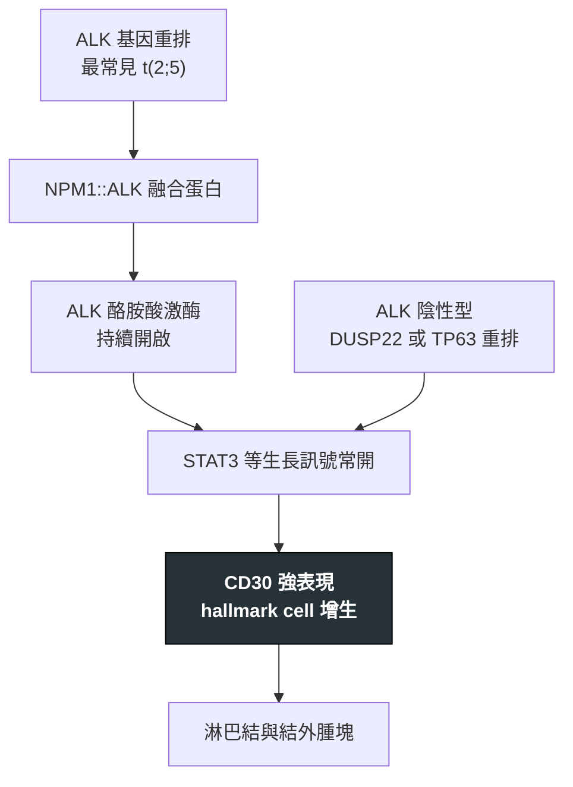

---
tags:
  - Med/Disease/Hema
  - lymphoma
  - mature-T
  - CD30
  - 禁忌
aliases:
  - ALCL
  - 間變性大細胞淋巴瘤
  - BIA-ALCL
  - Anaplastic Large Cell Lymphoma
created: 2026-07-11
updated: 2026-07-26
status: 可用
source: 依 [[Hema Category]] 展開；WHO HAEM5（2022）
cssclass: clinical-note
presents_as:
  - "[[Lymphadenopathy]]"
  - "[[Skin lesion]]"
diagnosed_by:
  - "[[Lymph node biopsy]]"
  - "[[Cytogenetics FISH]]"
treated_by:
  - "[[Brentuximab vedotin]]"
  - "[[Radiotherapy]]"
differential:
  - "[[Hodgkin Lymphoma]]"
  - "[[PTCL]]"
  - "[[DLBCL]]"
complication:
  - "[[Tumor lysis syndrome]]"
  - "[[Febrile neutropenia]]"
---

# ALCL ｜ 間變性大細胞淋巴瘤 · Anaplastic Large Cell Lymphoma

> [!abstract] 一句話總覽
> **CD30 強陽性**的成熟 T 細胞淋巴瘤，形態招牌是 **hallmark cell**。它其實是**四種行為完全不同的病共用一個名字**——ALK+、ALK−、原發皮膚型、BIA-ALCL——所以看到 ALCL 的第一件事是**先分型**。

> [!tip] 30 秒行動卡
> **診斷關鍵**：大細胞淋巴瘤 ＋ **CD30 強陽性** ＋ hallmark cell → 一定要加做 **ALK 免疫染色**
> **治療骨架**：全身型以 **[[Brentuximab vedotin]] ＋ CHP 為第一線**（ECHELON-2）；皮膚型局部處理；BIA-ALCL 完整包膜切除＋移除植入物
> **絕對不可**：把乳房植入物周圍的**晚發性積液**只當一般積液抽掉了事

---

## 定義與定位

| 項目 | 重點 |
|---|---|
| 本質 | **CD30 強陽性**的成熟 T 細胞淋巴瘤，常丟失 pan-T 抗原 |
| 好發族群 | ALK+ 偏兒童與年輕成人；ALK− 偏年長 |
| 分類位置 | 成熟 T／NK · CD30+ 大細胞群；見 [[Hema Category]] |
| 關鍵分型 | **ALK+ 全身型**（預後佳）／**ALK− 全身型**（預後差）／**原發皮膚型**（惰性）／**BIA-ALCL** |

## 病因與機制

> [!tip] 一條線推出全部處置
> 四型的共同點只有 **CD30**——所以 CD30 既是診斷憑證，也是治療靶（[[Brentuximab vedotin]]）。差別在**驅動力**：ALK+ 有明確可抑制的激酶，預後好、復發還有藥可用；ALK− 沒有；皮膚型與 BIA-ALCL 則因**病灶被侷限住**，局部處理就夠。

## 臨床表現

- **典型**：淋巴結腫大＋B symptoms；全身型常見**結外侵犯**（皮膚、骨、軟組織、肺）
- **提示性**：**兒童或年輕人**的侵襲性大細胞淋巴瘤先想 ALK+；**原發皮膚型**為紅紫色結節，可自行消退再復發
- **少見但重要**：**BIA-ALCL**——乳房植入物術後**數年**才出現的周圍積液或腫塊，患側乳房突然腫大

→ 相關主訴流程：[[Lymphadenopathy]]、[[Skin lesion]]

## 診斷

| 診斷條件 | 內容 |
|---|---|
| 形態 | **Hallmark cell**：偏心的馬蹄形／腎形核 |
| 免疫表型 | **CD30 強且均一陽性**；EMA 常＋；**pan-T 抗原常丟失**（CD3 可陰性） |
| ALK／分子 | ALK+ 以 **t(2;5) NPM1::ALK** 最常見，染色呈**核＋質**；ALK− 可見 **DUSP22** 或 **TP63** 重排 |
| BIA-ALCL | 積液送**細胞學＋CD30**，並取**包膜**做病理 |

**要開的檢查**：[[Lymph node biopsy]]、[[Flow cytometry]]、[[Cytogenetics FISH]]

## 鑑別診斷

| 要排除的 | 支持它的線索 | 怎麼排除 |
|---|---|---|
| [[Hodgkin Lymphoma]] | 同為 CD30+，但 **CD15+**、PAX5 弱＋、發炎背景豐富 | CD15／PAX5／ALK |
| [[PTCL]] | CD30 僅部分或弱陽性、無 hallmark cell | CD30 強度與形態 |
| 皮膚 CD30+ 淋巴增生（LyP） | 病灶小、反覆自行消退 | 臨床病程＋分期排除全身侵犯 |

## 治療

| 情境 | 處置 |
|---|---|
| ALK+ 全身型 | **BV＋CHP** 為第一線；年輕病人**預後佳**，多數可治癒 |
| ALK− 全身型 | **BV＋CHP** 為第一線但**預後較差**；緩解後考慮 [[Autologous HSCT]] 鞏固 |
| 原發皮膚型 | **惰性**——手術切除或 [[Radiotherapy]]；不需全身化療 |
| BIA-ALCL | **完整包膜切除＋移除植入物**；侷限者多可治癒，播散才需全身治療 |
| 復發／難治 | ALK+ 用 ALK 抑制劑；[[Brentuximab vedotin]]；評估 [[Allogeneic HSCT]] |

## 併發症與預後

- **要盯的併發症**：腫瘤崩解快時的 [[Tumor lysis syndrome]]、[[Febrile neutropenia]]
- **預後**：**ALK+ 全身型最好**，**ALK− 較差**；原發皮膚型與侷限性 BIA-ALCL 預後佳

## 禁忌與陷阱

> [!danger] 絕對不可
> | 情境 | 絕對不可 | 為什麼 | 該做什麼 |
> |---|---|---|---|
> | 乳房植入物術後晚發性積液 | 只當血清腫抽掉、不送檢 | 這是 BIA-ALCL 最典型也最早的表現 | 積液送**細胞學＋CD30**，影像評估包膜與腫塊 |
> | 全身型 ALCL | 比照皮膚型只做局部處理 | 會快速播散 | 完整分期後給全身治療（BV＋CHP） |

> [!warning] 常見錯誤
> - 看到 **CD30+ 大細胞**就報 Hodgkin——ALCL 的 CD30 強而均一，且 CD15 陰性。
> - 把主融合記成「NPM-TMP3」——正確是 **NPM1::ALK**，TPM3::ALK 只是少見變異。
> - **CD3 陰性就否定 T 細胞來源**——ALCL 常丟失 pan-T 抗原，要靠 TCR 重排佐證。

## 相關連結

- [[Hodgkin Lymphoma]] — 同為 CD30+，靠 CD15／PAX5 分開
- [[PTCL]] — 排除 ALCL 之後才叫 NOS
- [[Brentuximab vedotin]] — CD30 抗體藥物複合體
- [[Hema Category|血液淋巴腫瘤分類 · Master Map]]
