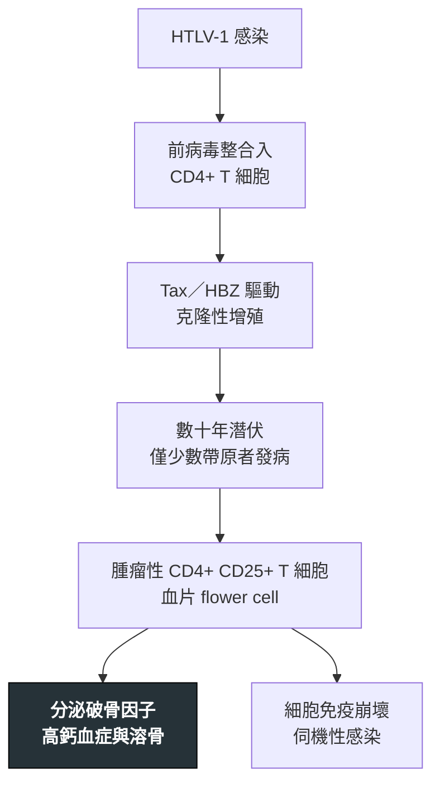

---
tags:
  - Med/Disease/Hema
  - lymphoma
  - mature-T
  - HTLV-1
  - 禁忌
aliases:
  - ATLL
  - 成人T細胞白血病／淋巴瘤
  - Adult T-cell Leukemia/Lymphoma
created: 2026-07-11
updated: 2026-07-26
status: 可用
source: 依 [[Hema Category]] 展開；WHO HAEM5（2022）
cssclass: clinical-note
presents_as:
  - "[[Lymphadenopathy]]"
  - "[[Skin lesion]]"
diagnosed_by:
  - "[[Peripheral blood smear]]"
  - "[[Flow cytometry]]"
treated_by:
  - "[[Interferon alfa]]"
  - "[[Allogeneic HSCT]]"
differential:
  - "[[Mycosis Fungoides]]"
  - "[[PTCL]]"
  - "[[Multiple Myeloma]]"
complication:
  - "[[Hypercalcemia]]"
  - "[[Tumor lysis syndrome]]"
---

# ATLL ｜ 成人 T 細胞白血病／淋巴瘤 · Adult T-cell Leukemia/Lymphoma

> [!abstract] 一句話總覽
> 由 **HTLV-1** 直接造成的成熟 CD4+ T 細胞腫瘤，流行於**日本西南部與加勒比海**。血片可見 **flower cell**，招牌是**高鈣血症**與**嚴重細胞免疫低下**——所以每個病人都要同時處理腫瘤、鈣與**類圓線蟲**。

> [!tip] 30 秒行動卡
> **診斷關鍵**：流行區成人＋皮膚病灶＋**高血鈣**＋血片 **flower cell** → 驗 **HTLV-1 抗體／PCR**
> **治療骨架**：先分四型；急性／淋巴瘤型化療或 AZT＋[[Interferon alfa]]，適合者 [[Allogeneic HSCT]]；慢性／燜燒型可觀察
> **絕對不可**：免疫抑制治療前不篩 **Strongyloides**；高鈣危象只給口服水分觀察

---

## 定義與定位

| 項目 | 重點 |
|---|---|
| 本質 | **HTLV-1** 感染 CD4+ T 細胞後長期演變而成的成熟 T 細胞腫瘤 |
| 好發族群 | 流行區成人：**日本西南部、加勒比海**、中南美；帶原者僅少數終身發病 |
| 傳播 | **母乳**、性行為、輸血 |
| 分類位置 | 成熟 T／NK · 病毒相關；見 [[Hema Category]] |
| 關鍵分型 | **急性型／淋巴瘤型／慢性型／燜燒型**——依血中腫瘤細胞、鈣、LDH 與器官侵犯區分，決定治不治 |

## 病因與機制

> [!tip] 一條線推出全部處置
> 腫瘤細胞帶**調節性 T 細胞**表型（CD4+ **CD25+**），一邊煽動蝕骨細胞、一邊癱瘓細胞免疫。所以死因往往不是腫瘤負荷，而是**高鈣**與**感染**——這兩件事要跟抗腫瘤治療同時做。

## 臨床表現

- **典型**：全身淋巴結腫大、肝脾腫大、**皮膚病灶**（丘疹、結節、紅斑）
- **提示性**：**高血鈣**（意識改變、多尿、便秘）＋**溶骨病灶**＋LDH 升高
- **少見但重要**：**類圓線蟲過度感染症候群**；慢性／燜燒型可只有皮膚病灶或輕度淋巴球增多

→ 相關主訴流程：[[Lymphadenopathy]]、[[Skin lesion]]

## 診斷

| 診斷條件 | 內容 |
|---|---|
| 病毒 | **HTLV-1 抗體／PCR 陽性**——沒有 HTLV-1 就不是 ATLL |
| 形態 | 血片 **flower cell／clover-leaf cell**（多分葉核） |
| 免疫表型 | **CD4+ CD25+**，常丟失 **CD7** |
| 代謝 | **高血鈣**、溶骨病灶、LDH 升高 |

**要開的檢查**：[[Peripheral blood smear]]、[[Flow cytometry]]、[[Lymph node biopsy]]、**Strongyloides** 糞便與血清篩檢

## 鑑別診斷

| 要排除的 | 支持它的線索 | 怎麼排除 |
|---|---|---|
| [[Mycosis Fungoides]]／Sézary | 同為侵犯皮膚的 CD4+ 腫瘤 | **HTLV-1 陰性**、無高鈣 |
| [[Multiple Myeloma]] | 同樣高鈣＋溶骨 | 有 M protein、無 flower cell；見 [[SPEP]] |

## 治療

| 情境 | 處置 |
|---|---|
| 分型優先 | **慢性／燜燒型**可觀察等待或皮膚導向治療 |
| 急性／淋巴瘤型 | 多藥化療；白血病相病人可用 AZT ＋ [[Interferon alfa]] |
| 鞏固 | 適合者評估 **[[Allogeneic HSCT]]**——唯一具治癒潛力的手段 |
| 支持性 | **Strongyloides 驅蟲**、伺機性感染預防、高鈣處理 |

## 併發症與預後

- **要盯的併發症**：[[Hypercalcemia]]（可成高鈣危象）、[[Tumor lysis syndrome]]、**類圓線蟲過度感染**
- **預後**：**急性型與淋巴瘤型侵襲性高、預後差**；慢性／燜燒型較惰性但可轉急性型

## 禁忌與陷阱

> [!danger] 絕對不可
> | 情境 | 絕對不可 | 為什麼 | 該做什麼 |
> |---|---|---|---|
> | 準備化療或類固醇等免疫抑制 | 未先篩檢並治療 **Strongyloides** | 會誘發**過度感染症候群**與續發革蘭氏陰性菌敗血症 | 先驗糞便寄生蟲與血清學，陽性者先驅蟲 |
> | 高血鈣合併意識改變、脫水 | 只補口服水分觀察 | 高鈣危象會迅速惡化成腎衰竭與心律不整 | 積極靜脈輸液水化、加降鈣藥物，同步開始抗腫瘤治療 |
> | HTLV-1 陽性者 | 捐血、以母乳哺育嬰兒 | 病毒經血品與母乳傳播 | 血品篩檢；改以配方奶餵養 |

> [!warning] 常見錯誤
> - 看到高鈣＋溶骨只想到 [[Multiple Myeloma]]——流行區病人、血片有 flower cell 時要驗 HTLV-1。
> - 把皮膚病灶當濕疹或 [[Mycosis Fungoides]]——分野在 HTLV-1 與高鈣。
> - 燜燒／慢性型立刻上強力化療——過度治療只增加感染風險。

## 相關連結

- [[Mycosis Fungoides]] — 另一個侵犯皮膚的 CD4+ T 細胞腫瘤
- [[Multiple Myeloma]] — 高鈣＋溶骨的另一大原因
- [[PTCL]] — 排除 ATLL 後才叫 NOS
- [[Hema Category|血液淋巴腫瘤分類 · Master Map]]
