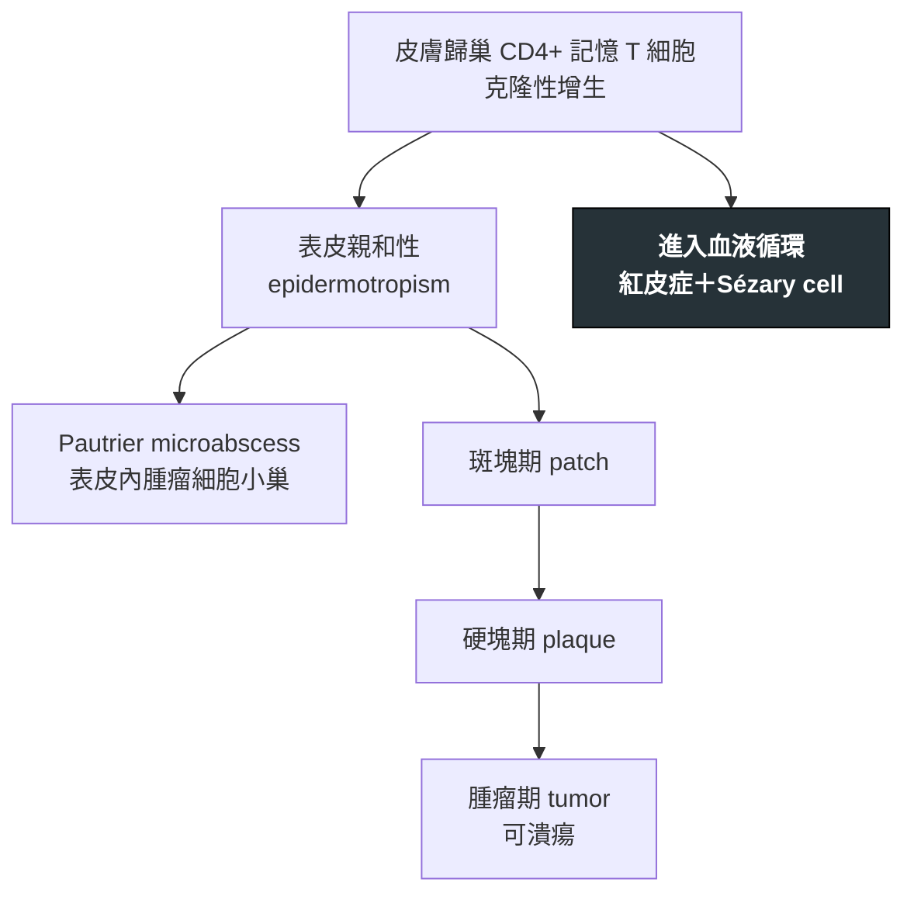

---
tags:
  - Med/Disease/Hema
  - lymphoma
  - mature-T
  - CTCL
aliases:
  - MF
  - 蕈樣肉芽腫
  - Sézary syndrome
  - Mycosis Fungoides
created: 2026-07-11
updated: 2026-07-26
status: 可用
source: 依 [[Hema Category]] 展開；WHO HAEM5（2022）
cssclass: clinical-note
presents_as:
  - "[[Skin lesion]]"
diagnosed_by:
  - "[[Skin biopsy]]"
  - "[[Flow cytometry]]"
treated_by:
  - "[[Radiotherapy]]"
  - "[[Interferon alfa]]"
differential:
  - "[[ATLL]]"
  - "[[PTCL]]"
complication:
  - "[[Sepsis]]"
---

# Mycosis Fungoides ｜ 蕈樣肉芽腫／Sézary 症候群 · Mycosis Fungoides / Sézary Syndrome

> [!abstract] 一句話總覽
> 最常見的**皮膚 T 細胞淋巴瘤（CTCL）**。腫瘤是一群**賴在表皮不走**的 CD4+ 記憶 T 細胞，病程以皮膚為舞台：**斑塊 patch → 硬塊 plaque → 腫瘤 tumor**。當它進入血液造成**紅皮症＋血中 Sézary cell**，即為 **Sézary syndrome**。

> [!tip] 30 秒行動卡
> **診斷關鍵**：多年治不好的「濕疹」，好發於**不曬到太陽的部位** → [[Skin biopsy]] 找 **epidermotropism** 與 **Pautrier microabscess**
> **治療骨架**：早期以**皮膚導向療法**為主（外用類固醇、PUVA／NB-UVB、局部放療）；進期才加系統性治療
> **絕對不可**：無（但早期不該直接上全身化療）

---

## 定義與定位

| 項目 | 重點 |
|---|---|
| 本質 | 皮膚歸巢 **CD4+ 記憶 T 細胞**的克隆性增生，惰性起頭 |
| 好發族群 | 中老年，男性略多；病程可橫跨數十年 |
| 分類位置 | 成熟 T／NK · 原發皮膚型；見 [[Hema Category]] |
| 兩個名字 | **MF**＝皮膚為主；**Sézary syndrome**＝紅皮症＋血液侵犯 |

## 病因與機制

> [!tip] 一條線推出全部處置
> 腫瘤細胞**待在表皮裡**，所以早期只要把藥或光線送到表皮就夠——這解釋了外用類固醇、光療、局部放療為何有效，也解釋了全身化療在早期**沒有好處只有毒性**。等細胞離開皮膚進入血液（Sézary），才需要全身策略。

## 臨床表現

- **典型**：慢性、搔癢、界線清楚的紅色**斑塊**，好發於**臀部、大腿內側等遮蔽部位**；可長年時好時壞
- **提示性**：外用類固醇有反應但**停藥就復發**、抗黴菌與抗濕疹治療都無效；出現浸潤變厚的硬塊
- **少見但重要**：**Sézary syndrome**——**紅皮症**、劇癢、掌蹠角化、淋巴結腫大、血中 **Sézary cell**（腦回狀核）

→ 相關主訴流程：[[Skin lesion]]

## 診斷

| 診斷條件 | 內容 |
|---|---|
| 檢體 | **皮膚切片**；常需**多部位、多次**切，且切片前應停用外用類固醇 |
| 形態 | **Epidermotropism**（腫瘤 T 細胞親表皮）、**Pautrier microabscess**、腦回狀核 |
| 免疫表型 | **CD3+ CD4+**，常見 **CD7 丟失**（也可丟 CD2／CD5） |
| 克隆性 | 皮膚 **TCR 基因重排**——單獨陽性不等於診斷 |
| Sézary | 紅皮症＋血液流式見 **CD4/CD8 比上升**與異常表型 |

**要開的檢查**：[[Skin biopsy]]、[[Flow cytometry]]、[[Peripheral blood smear]]

## 鑑別診斷

| 要排除的 | 支持它的線索 | 怎麼排除 |
|---|---|---|
| 濕疹／異位性皮膚炎 | 治療有效、分佈符合、無克隆 | 切片＋TCR 重排 |
| 乾癬 | 銀白厚鱗屑、伸側分佈 | 切片：無 epidermotropism |
| [[ATLL]] | 也侵犯皮膚的 CD4+ 腫瘤，但常有高鈣 | **HTLV-1 血清學** |

## 治療

| 情境 | 處置 |
|---|---|
| 早期（斑塊／硬塊期） | **皮膚導向**：外用類固醇、外用化療或類視色素、**PUVA／NB-UVB 光療** |
| 局部腫瘤 | 病灶 [[Radiotherapy]]；範圍廣者可用全皮膚電子束治療 |
| 進期／難治 | 類視色素、[[Interferon alfa]]、HDAC 抑制劑；CD30+ 用 [[Brentuximab vedotin]] |
| Sézary syndrome | 體外光化學療法（ECP）、抗體治療；年輕者評估 [[Allogeneic HSCT]] |
| 支持性 | 保濕止癢；紅皮症者注意**體溫、體液流失與感染** |

## 併發症與預後

- **要盯的併發症**：**皮膚屏障破壞→金黃色葡萄球菌感染與敗血症**（[[Sepsis]]）；晚期可**大細胞轉化**（常 CD30+）
- **預後**：由**分期**主導——侷限斑塊期接近常人壽命；腫瘤期、紅皮症與血液侵犯者明顯較差

## 禁忌與陷阱

> [!danger] 絕對不可
> 本病無立即致死型絕對禁忌。風險來自兩端：早期的**過度治療**（全身化療不延長存活、只增毒性），以及紅皮症期被低估的**皮膚感染與敗血症**。

> [!warning] 常見錯誤
> - **長期被當濕疹或乾癬治療數年**——反覆、不典型、治不好的皮疹要切片，而且往往要切好幾次。
> - 切片前沒停外用類固醇——病理特徵被壓掉，切了也是白切。
> - 一次切片陰性就排除診斷——早期 MF 的病理常不具診斷性，需追蹤重切。
> - 只憑 **TCR 克隆陽性**下診斷——良性皮膚病也可能出現克隆。
> - 早期就上全身化療；或忽略紅皮症病人的體液流失與感染風險。

## 相關連結

- [[ATLL]] — 另一個侵犯皮膚的 CD4+ T 細胞腫瘤，靠 HTLV-1 分開
- [[PTCL]] — 排除 MF 等特定實體後才叫 NOS
- [[Hema Category|血液淋巴腫瘤分類 · Master Map]]
